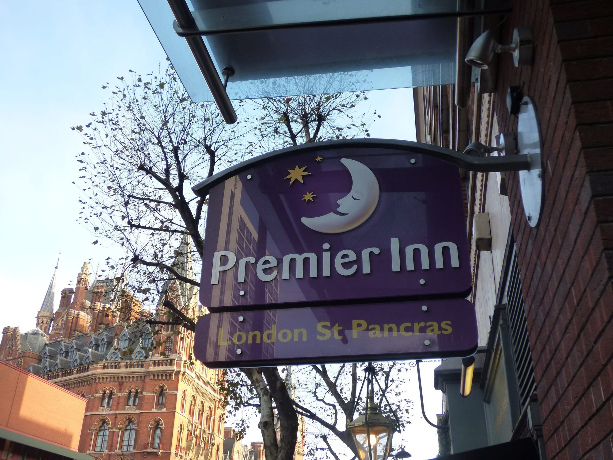
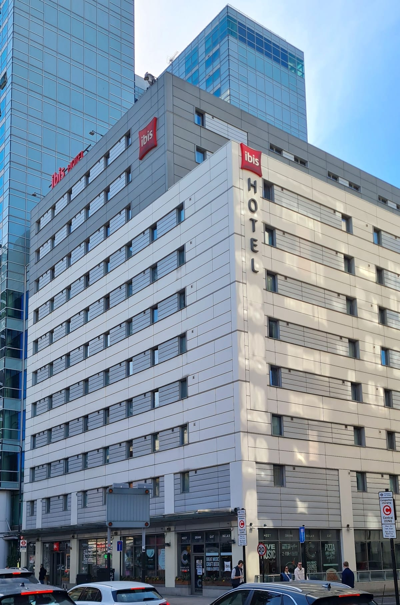
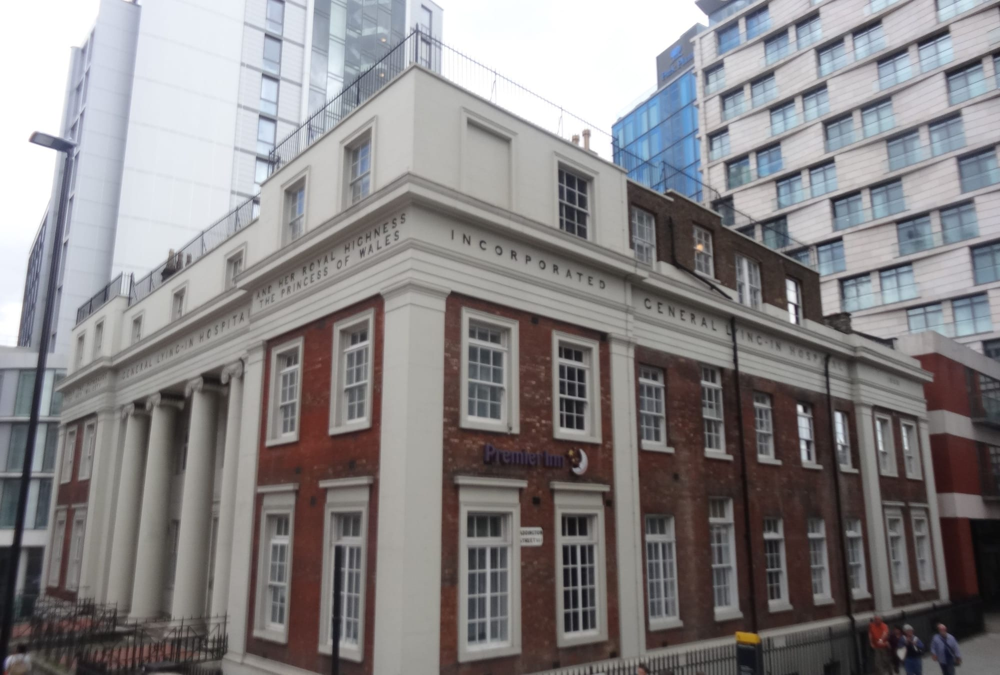
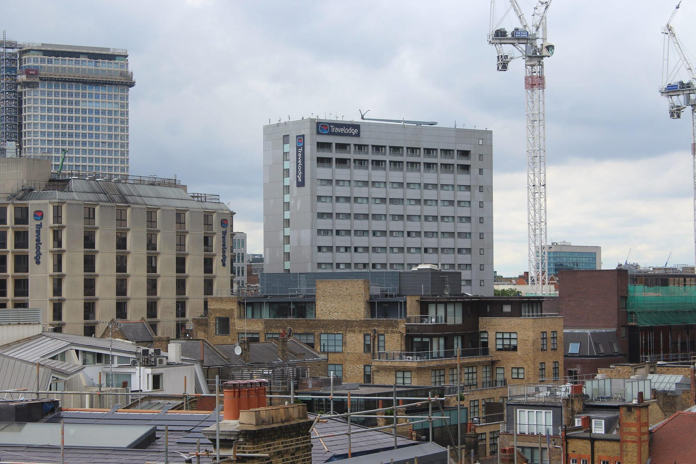
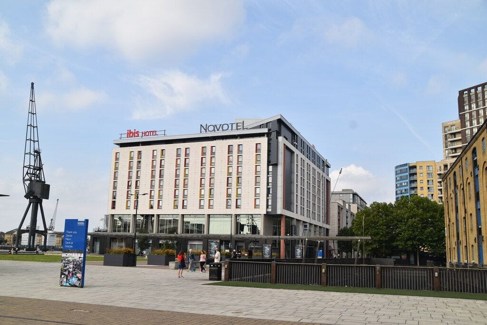

London's budget chains are closer in price than their reputations suggest, so the choice usually comes down to the rules: what breakfast costs, who can cancel, whether the room has a window, and whether the dog can come.

> 💡 **The Short Version:** **Premier Inn** for the room and for children: a king-size bed in most rooms, free Wi-Fi, a refund if you sleep badly, and up to two children per adult eat breakfast free. **hub by Premier Inn** for the cheapest Premier Inn in Zone 1, in an 11 square metre room for two at most. **Travelodge** for the lowest prices we found and the only chain of the three that takes pets in every room, though its Wi-Fi is free for only 30 minutes a day. **ibis** where the location suits: rooms of 12 to 17 square metres, and at **ibis Styles London Southwark** the breakfast is in the price. All three check in at 3pm and out at noon. **Book a Sunday night if you can**: it was the cheapest of our five sample nights at 14 of the 16 chain hotels we priced.
>
> **Three picks:** [Premier Inn London County Hall](hotel:premier-inn-county-hall) (beside the London Eye) · [Travelodge London Central Waterloo](hotelscom:124223136) (SuperRooms, five minutes from Waterloo) · [ibis Styles London Southwark](hotelscom:220240) (breakfast included, near Borough Market).

*Prices and policies as of 19 November 2026.*

## The three chains at a glance

| | Premier Inn | hub by Premier Inn | Travelodge | ibis, ibis Styles, ibis budget |
|---|---|---|---|---|
| **Double bed** | King-size in most rooms | Double; king-size in Bigger rooms | King-size in every double | Double or queen |
| **Room size** | Not published | 11 m², or 14 m² Bigger | Not published | 12 m² to 17 m² at the London branches below |
| **Breakfast** | From £10.99, £8.99 continental | Deli or Lounge, varies by hotel | Unlimited buffet, price varies by hotel | Extra at ibis and ibis budget; included at ibis Styles Southwark |
| **Children** | Two per adult stay and eat breakfast free | Two guests a room at most, no cots | Two per adult eat breakfast for £1 | Under-12s stay free; breakfast free under 3, half price to 11 |
| **Dogs** | Assistance dogs only | Assistance dogs only | Every room, fee per pet | Hotel by hotel |
| **Wi-Fi** | Free | Free | 30 minutes free a day | Set by each hotel |
| **Free cancellation** | Flex rate, until 1pm on arrival day | hub Flex, until 1pm on arrival day | Flexible Rate, until midday on arrival day | Set by each hotel's rate |

## What a night costs

We priced the same branches on the same five nights for our [budget hotels guide](/articles/best-budget-hotels-london/): Sunday 11 October and Saturday 17 October 2026, Saturday 12 December 2026, Wednesday 17 February and Saturday 17 April 2027. Each price is the cheapest double or twin for two adults, taxes included, from premierinn.com, travelodge.co.uk or Hotels.com, captured on 14 and 15 September 2026. The typical night is the middle of the five.

| Area | Premier Inn or hub | Travelodge | ibis |
|---|---|---|---|
| **Earl's Court** | Premier Inn Kensington (Earl's Court): **£147**, £85 to £221 | | ibis London Earls Court: **£154**, £84 to £200 |
| **Shoreditch and Whitechapel** | hub Shoreditch: **£131**, £63 to £179 | | ibis budget Whitechapel: **£125.50**, £84 to £168 on four nights |
| **Docklands** | | Docklands Central, East India: **£81.99**, £34.99 to £111.99 | ibis ExCeL Docklands: **£101**, £76 to £185 |
| **Bankside and Borough** | Premier Inn Southwark (Bankside): **£161**, £102 to £243 | | ibis Styles Southwark: **£223**, £139 to £257, breakfast included |
| **King's Cross** | Premier Inn: **£179**, £127 to £283. hub: **£137**, £92 to £196 | | |

Three things stand out. **The night of the week matters more than the chain**: hub by Premier Inn London West Brompton was £59 on the October Sunday and £176 on the December Saturday. **hub costs less than a central Premier Inn**: the three hubs' typical nights, £131 to £141, were all below the £161 to £179 of Premier Inn's King's Cross, Southwark and County Hall hotels, and at King's Cross the hub was £42 cheaper than the Premier Inn a few streets away. And **the Travelodge was the cheapest hotel we priced in any of the three chains**: Docklands Central's typical night, £81.99, was £19 below the ibis by ExCeL and £32 below Premier Inn's cheapest, at Hanger Lane.

On 19 November, travelodge.co.uk's from-prices for the coming Sunday, 22 November, ran from £49.99 at London Central City Road and London Central Tower Bridge to £80.99 at London Central Euston.

**Is ibis budget cheaper than Premier Inn?** Not reliably. ibis budget Whitechapel's typical night was £5.50 below hub Shoreditch's, and each was the cheaper on two of the four nights both had rooms: hub on the October Sunday (£63 against £84) and, by £1, the October Saturday; the ibis on the December Saturday (£144 against £179) and the April Saturday (£107 against £131).

Which? members rank the chains the other way round. In its survey published in November 2025, Premier Inn scored 73%, hub 70%, ibis Styles 64%, ibis 61%, Travelodge 59% and ibis budget 57%; the [full table is in our budget guide](/articles/best-budget-hotels-london/#the-budget-chains-compared).

## Rates and cancellation

Premier Inn prices every room by demand and says its lowest prices go to those who book well ahead; the cheaper the rate, the less you can change.

**[Premier Inn](https://www.premierinn.com/gb/en/why/rates.html)** has five rates, all per room, VAT included, meals extra:

| Rate | Pay | Cancel for a refund | Change the date |
|---|---|---|---|
| **Flex** | Now or on arrival | Until 1pm on arrival day | Until 1pm on arrival day |
| **Semi-Flex** | Now | Until three full days before | Until 1pm on arrival day |
| **Advance** | Now | Until 28 full days before | Until 1pm on arrival day |
| **Standard** | Now | Never | Until 1pm on arrival day |
| **Non-Flex** | Now | Never | Never |

hub sells a **hub Flex** rate with pay on arrival and free cancellation until 1pm on the day; hub takes no cash for rooms.

**[Travelodge](https://www.travelodge.co.uk/about/frequently-asked-questions/)** has three. The **Lowest Rate** is paid in advance with no changes and no refunds. **Semi-Flex** is non-refundable, but you can move the date, or change the room type, for £12.50 before noon on arrival day; you can't move it to another hotel. The **Flexible Rate** can be changed or cancelled for a full refund until midday on arrival day.

**ibis** rates are set hotel by hotel, as a flexible rate or a cheaper prepaid one, with the cancellation deadline shown before you pay. Free [ALL Accor membership](https://all.accor.com/a/en/offers/ena/members-rate.html) unlocks a Members' Rate of up to 10% off at participating hotels. The paid [ALL Accor+ ibis](https://ibis.accor.com/en/all-plus-ibis.html) card, €99 a year on Accor's site, takes 15% off the best public rate at ibis, ibis Styles and ibis budget for up to two rooms, and guarantees a room if you book at least two days ahead.

**The [Good Night Guarantee](https://www.premierinn.com/gb/en/sleep/good-night-guarantee.html)** is Premier Inn's alone: if you don't sleep well, you can claim a refund for that night. Tell reception during the stay, give them the chance to fix it, then claim within seven days of checking out. It does not apply at hub.

## The rooms

*The sign outside Premier Inn London St Pancras on Euston Road. Photo: [ell brown](https://commons.wikimedia.org/wiki/File:Premier_Inn_London_St_Pancras,_Euston_Road,_London_-_30955148550.jpg), [CC BY-SA 2.0](https://creativecommons.org/licenses/by-sa/2.0/).*

### Premier Inn

A double or king-size bed with a choice of firm or soft pillows, blackout curtains, a desk, tea and coffee, a hairdryer, Freeview TV and a power shower, with **a bath in most rooms**. Irons and travel cots are free on request. Air conditioning depends on the hotel: County Hall, Waterloo and St Pancras, below, have it in every room. **Premier Plus** rooms add a coffee machine, a mini-fridge, an iron and the faster Ultimate Wi-Fi, which otherwise costs £6 for 24 hours.

### hub by Premier Inn

A Standard room is 11 square metres with a double bed, storage underneath it, a slide-out desk and a touchscreen in the headboard for the lights and air conditioning; a Bigger room is 14 square metres with a king-size bed. There's a power shower but **no bath and no kettle**: tea and coffee are free downstairs all day. Rooms underground or on the lower ground floor have no window, only a lightbox or light well, and the windows elsewhere are sealed. Our [windowless hotel rooms guide](/articles/windowless-hotel-rooms-london/) has which hubs sell them as a separate grade.

> ⚠️ **hub sleeps two.** Every room takes two people at most, the lead guest must be 18 or over, and there are no cots. A family needs a Premier Inn, a Travelodge or an ibis.

### Travelodge

Every double has a king-size Travelodge Dreamer bed with four pillows, plus tea and coffee, a desk and bedside USB points. **Standard rooms have no hairdryer or iron**; ask at reception. In summer the bed is made with a top sheet and the duvet left in the room. **Wi-Fi is free for 30 minutes a day**, then £3.50 for 24 hours or £15 a week.

**[SuperRooms](https://www.travelodge.co.uk/about/super-rooms/)** sit on their own floor and add a Lavazza coffee machine, a Hansgrohe rain shower, a choice of hypoallergenic pillows, an armchair, a hairdryer, an iron and the premium Wi-Fi; the newest also have a fridge with still and sparkling water. Covent Garden, Waterloo and Euston have them.

### ibis, ibis Styles and ibis budget

ibis sells three levels under one name. At the London branches below, an **ibis** double is 16 square metres, an **ibis Styles** room 16 to 17 square metres, with breakfast in the price at Southwark, and an **ibis budget** room 12 square metres, with a bunk or pull-down bed in the triples. ibis London Blackfriars and ibis Styles London Southwark are cashless: card only.

*ibis London City Shoreditch on Commercial Street. Photo: [Derbrauni](https://commons.wikimedia.org/wiki/File:Ibis_London_City_-_Shoreditch.jpg), [CC BY 4.0](https://creativecommons.org/licenses/by/4.0/).*

## Breakfast

**[Premier Inn](https://www.premierinn.com/gb/en/faq/premier-inn-breakfast.html)** charges from £10.99 for the full buffet and £8.99 for continental, and £11.99 or £13.99 at some restaurants. Up to two under-16s eat free for each adult who orders the full breakfast. hub has no restaurant: the Covent Garden, Brick Lane and Tower Bridge hubs have a Proven Dough deli selling a bacon sandwich, toastie or porridge with a hot drink, and the two Westminster hubs, Goodge Street and King's Cross a Lounge with pastries, toast, fruit and unlimited coffee. Both open at 6.30am on weekdays and 7am at weekends.

**[Travelodge](https://www.travelodge.co.uk/about/our-restaurants/breakfast/)** serves an unlimited breakfast at its Bar Café hotels, with bacon, Cumberland sausages, free-range scrambled eggs, hash browns and as much Lavazza coffee as you want. The price varies by hotel and shows when you add it to a booking. Up to two children per full-paying adult eat for £1 each. A Breakfast to Go bag of cereal, a pain au chocolat, a flapjack and an iced coffee costs £6.95. At Travelodge London Central Covent Garden breakfast runs 6am to 10am every day.

**ibis** charges per hotel. ibis Styles London Southwark's rate includes an unlimited continental buffet; ibis budget London Whitechapel sells a continental breakfast, which you can take away. Under Accor's family policy, children under 3 eat free and 3 to 11-year-olds pay half the adult price when they eat with their family.

## Families

**Premier Inn** family rooms sleep two adults and two children under 16, usually on a king-size bed with a sofa bed and a pull-out bed. Up to two children stay free with a paying adult, travel cots are free (bring your own bedding), and some hotels have interconnecting rooms if you call ahead.

**Travelodge** family rooms have a king-size bed and one or two pull-out beds, for two adults and two under-16s, or three adults and a child. It has **no interconnecting rooms**, and cots are available at some hotels only: ring the hotel.

**ibis** family rooms in London mostly sleep three: ibis London Blackfriars' is 20 square metres with a double and a sofa bed, and ibis budget Whitechapel's triples add a single bunk or pull-down bed. ibis Styles London Southwark's 28 square metre suite, The Works, sleeps four. Children under 12 stay free in their parents' room, and Accor's [family offer](https://all.accor.com/a/en/experiences/ena-all-for-family.html) takes 50% off a second room when two adults book with at least one child up to 15.

Our [family hotels guide](/articles/best-family-hotels-london/) has the London hotels with the most room for a family, budget and otherwise.

## Dogs

**Premier Inn and hub take [assistance dogs only](https://www.premierinn.com/gb/en/faq/smoking-and-pets.html).** No pet dogs, at any of them.

**[Travelodge](https://www.travelodge.co.uk/about/pet-friendly-hotels/) takes pets in every room at every hotel**, up to two per room, any domesticated animal. Add the pet as an extra when you book; the cleaning fee is per pet, per stay, not per night, and Travelodge told the [Mirror](https://www.mirror.co.uk/travel/travelodge-updates-pet-policy-brits-36982571) in April 2026 that it had gone up to £25 at most of its hotels. Pets can't be left alone in the room, must be on a lead in public areas and aren't allowed in the Bar Café. Assistance dogs pay nothing. Emotional support animals pay the pet fee.

**ibis** decides hotel by hotel. ibis London Blackfriars, ibis Styles London Southwark and ibis budget London Whitechapel all list pets as welcome on Accor's site, with no fee published; ring the hotel before you book.

Our [dog-friendly hotels guide](/articles/dog-friendly-hotels-london/) has the fees, weight limits and nearest parks at the London hotels that take dogs, from Travelodge to Rosewood.

## Check-in and check-out

All three check in at **3pm** and out at **12 noon**, at every branch below. Premier Inn and Travelodge receptions are open 24 hours. Premier Inn sells early check-in from 11am, and Travelodge from 12 noon plus late check-out until 2pm, both for a fee and at some hotels only. Most Premier Inns store luggage; at Travelodge, the larger hotels do, and Covent Garden's luggage room is open 9am to 5pm. If there's a gap between check-out and your train, a [day room](/articles/day-rooms-london/) is the other option.

## Which to book

- **Two adults, a short city break, Zone 1:** hub by Premier Inn. Every hub we priced had a lower typical night than every central Premier Inn, for a room about half the size.
- **A family with two children:** Premier Inn. The family room sleeps four and both children eat breakfast free; Travelodge sleeps four too but charges £1 a child and has no interconnecting rooms; most ibis family rooms sleep three.
- **The dog is coming:** Travelodge, the one chain of the three that takes pets at every hotel.
- **The lowest price:** Travelodge, then compare with the nearest hub. Book a Sunday, and on the Lowest Rate only if your dates are fixed.
- **Plans might change:** Premier Inn's Flex rate or Travelodge's Flexible Rate, both cancellable until the day you arrive. ibis rates differ by hotel, so read them before you pay.
- **You want breakfast included:** ibis Styles, which prices it into the room.
- **You work, or need to stream:** Premier Inn or hub, where the Wi-Fi is free, or a Travelodge SuperRoom, which includes premium Wi-Fi.
- **You collect hotel points:** ibis, which earns ALL Accor points across Novotel, Mercure and Accor's other brands.

## Well-placed branches

### Premier Inn and hub

#### Premier Inn London County Hall

*Belvedere Road, SE1 7PB · Westminster or Waterloo · [Booking.com](hotel:premier-inn-county-hall)*

Inside County Hall, the listed former headquarters of London's government, beside the London Eye at the Westminster Bridge end of the South Bank, with air conditioning in every room and Premier Plus rooms with a coffee machine and fridge. The typical night we priced was £177, and the December Saturday £295; book early, because the price climbs fast. Our [South Bank stay guide](/articles/where-to-stay-south-bank/) compares it with its neighbours.

#### Premier Inn London Waterloo (Westminster Bridge)

*85 York Road, SE1 7NJ · Waterloo · [premierinn.com](https://www.premierinn.com/gb/en/hotels/england/greater-london/london/london-waterloo-westminster-bridge.html)*

*The former General Lying-In Hospital on York Road, now part of Premier Inn London Waterloo (Westminster Bridge). Photo: [Jordiferrer](https://commons.wikimedia.org/wiki/File:Premier_Inn_London_Waterloo_-_General_Lying-In_Hospital.jpg), [CC BY-SA 4.0](https://creativecommons.org/licenses/by-sa/4.0/).*

On the site of the General Lying-In maternity hospital, whose old building on the corner of Addington Street carries the Premier Inn sign, with rooms up to the 14th floor of the block behind. Air conditioning in every room. The London Eye and Westminster Bridge are a short walk away, Waterloo station closer still.

#### Premier Inn London St Pancras

*88 Euston Road, NW1 2RA · King's Cross St Pancras · [premierinn.com](https://www.premierinn.com/gb/en/hotels/england/greater-london/london/london-st-pancras.html)*

On Euston Road across from St Pancras International, between Euston and King's Cross stations and beside the British Library: the one for a Eurostar or an early train north. Air conditioning in every room.

#### Premier Inn London Kensington (Earl's Court)

*11 Knaresborough Place, SW5 0TJ · Earl's Court · [premierinn.com](https://www.premierinn.com/gb/en/hotels/england/greater-london/london/london-kensington-earls-court.html)*

Beside Earl's Court station and two stops from the South Kensington museums, with family rooms and a restaurant. It priced at a typical £147, and £85 on the October Sunday. Our [budget hotels guide](/articles/best-budget-hotels-london/#premier-inn-london-kensington-earls-court) covers why families choose it.

#### hub by Premier Inn London Covent Garden

*110 St Martin's Lane, WC2N 4BA · Charing Cross or Leicester Square · [Booking.com](hotel:hub-covent-garden)*

A hub on St Martin's Lane, among the West End theatres and a short walk from Trafalgar Square, with a Proven Dough deli for breakfast. Rooms are 11 square metres, for two at most, and may have a lightbox or light well in place of a window. Our [Covent Garden stay guide](/articles/where-to-stay-covent-garden/) sets it against the area's other hotels.

### Travelodge

*Travelodge London Central Covent Garden, the beige block on the left, on Drury Lane. Photo: [M J Roscoe](https://commons.wikimedia.org/wiki/File:Travelodge_Covent_Garden_-_geograph.org.uk_-_5445269.jpg), [CC BY-SA 2.0](https://creativecommons.org/licenses/by-sa/2.0/).*

#### Travelodge London Central Covent Garden

*10 Drury Lane, WC2B 5RE · Holborn, 5 minutes · [Hotels.com](hotelscom:1748448)*

On the corner of Drury Lane and Shorts Gardens, at the Seven Dials end of Covent Garden. Air-conditioned, with SuperRooms, family rooms and a Bar Café serving breakfast from 6am to 10am. Pets are welcome, as at every Travelodge, though not in the Bar Café.

#### Travelodge London Central Waterloo

*195–203 Waterloo Road, SE1 8UX · Waterloo, 5 minutes · [Hotels.com](hotelscom:124223136)*

On Waterloo Road south of the station, within walking distance of the Old Vic and the South Bank. Air-conditioned, with SuperRooms and a Bar Café.

#### Travelodge London Central Euston

*1–11 Grafton Place, NW1 1DJ · Euston, under a minute · [travelodge.co.uk](https://www.travelodge.co.uk/hotels/344/London-Central-Euston-hotel)*

Off Eversholt Street right beside Euston station, with King's Cross and St Pancras a short walk east. Air-conditioned, with SuperRooms and a Bar Café. Don't drive: Euston station's car park has closed for the HS2 works.

### ibis

*ibis London ExCeL Docklands, which shares its building with the Novotel, at Royal Victoria Dock. Photo: [N Chadwick](https://commons.wikimedia.org/wiki/File:Ibis_Hotel,_Victoria_Dock_-_geograph.org.uk_-_7645145.jpg), [CC BY-SA 2.0](https://creativecommons.org/licenses/by-sa/2.0/).*

#### ibis London Blackfriars

*49 Blackfriars Road, SE1 8NZ · Southwark, 2 minutes · [Hotels.com](hotel:ibis-london-blackfriars)*

A 297-room ibis on Blackfriars Road, ten minutes' walk from Waterloo and twelve from Shakespeare's Globe, with 16 square metre doubles, 20 square metre family rooms for three, air conditioning and a bar, Charlie's Corner. Card only. Pets are welcome; ask about the fee.

#### ibis Styles London Southwark

*43–47 Southwark Bridge Road, SE1 9HH · London Bridge, under 5 minutes · [Hotels.com](hotelscom:220240)*

A 154-room ibis Styles a few streets from Borough Market and the river, with an unlimited continental breakfast in the rate and check-out at noon. Rooms are 16 square metres with a queen bed or two singles, and The Works suite sleeps four. Card only. Its typical night, £223, was the highest of any branch we priced; the breakfast is part of the reason.

#### ibis budget London Whitechapel

*100 Whitechapel Road, E1 1JG · Whitechapel or Aldgate East · [all.accor.com](https://all.accor.com/hotel/8033/index.en.shtml)*

Rooms of 12 square metres a short walk from Brick Lane and Spitalfields, with a continental breakfast you can take away. Triples sleep three on a double and a bunk or pull-down bed, which is as big as a room here gets. Whitechapel station, six minutes' walk, is on the Elizabeth line, three minutes from Liverpool Street.

#### ibis London ExCeL Docklands

*9 Western Gateway, E16 1AB · Custom House, 6 minutes · [Hotels.com](hotelscom:215235)*

At Royal Victoria Dock beside ExCeL London, for a show or a conference there. It priced at a typical £101, and £76 on the October Sunday. Our [ExCeL stay guide](/articles/where-to-stay-near-excel/) has the other hotels within walking distance.

## Also consider: Z Hotels

Z Hotels runs small rooms at Zone 1 addresses, including Covent Garden, Soho, Strand, Trafalgar, Victoria and Shoreditch, and every London branch sells a cheaper windowless grade. Its free membership takes 10% off booking direct. In our pricing only [The Z Hotel Shoreditch](hotel:z-hotel-shoreditch) came in at £150 a night or less; [The Z Hotel Covent Garden](hotel:z-hotel-covent-garden)'s typical night was £211. If a bed is all you need, a [capsule hotel](/articles/pod-hotels-london/) costs less again, and our [London on a budget guide](/articles/london-on-a-budget/) covers the rest of the trip.
