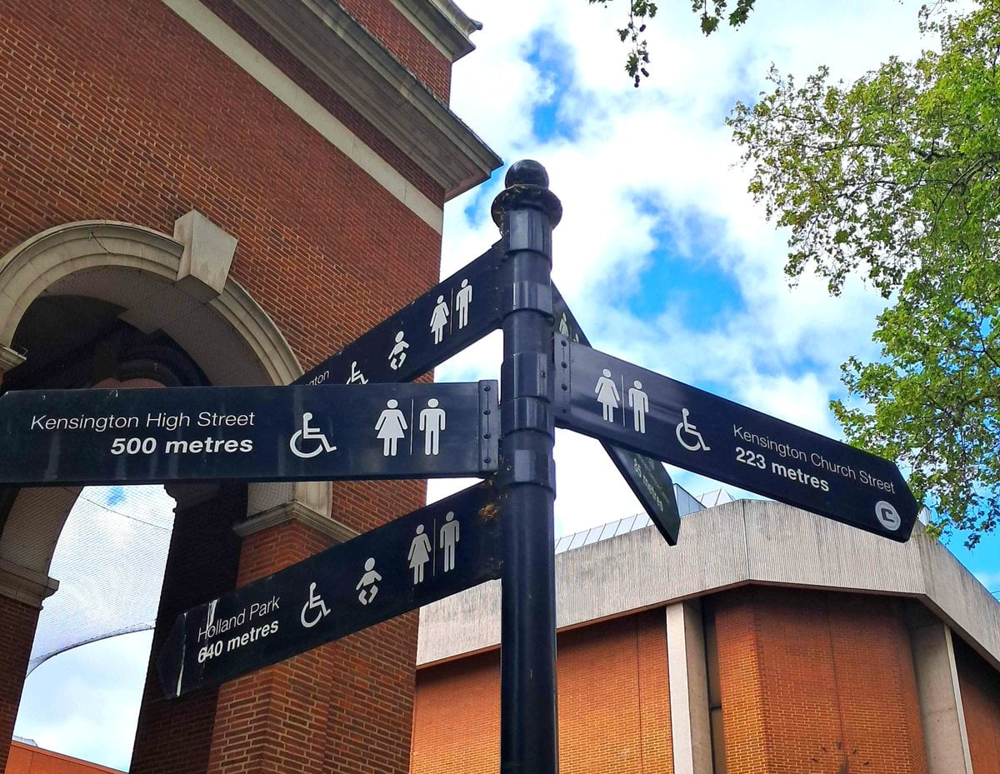

This guide uses the Great British Public Toilet Map's database, the crowdsourced, council-fed dataset most toilet-finder apps run on, plus the official pages of the parks, boroughs and venues that operate toilets.

> 💡 **The Short Version:** About **85% of London's logged public toilets are free**. The main things that charge are the **Royal Parks (a flat 20p, card only)**, **Trafalgar Square (20p)** and the **Camden markets (up to £1)**. Mainline station toilets and TfL's own Tube station toilets are free. **Community Toilet Scheme** pubs, cafes and libraries let anyone in without buying anything, and every major free museum has toilets open to all visitors.

---

## Where you'll actually pay, and how much

| Where | Charge | Notes |
| --- | --- | --- |
| **All 8 Royal Parks** (Hyde Park, Regent's Park, St James's Park, Green Park, Kensington Gardens, Richmond Park, Greenwich Park, Bushy Park) | **20p** | Contactless card or phone only; cash is no longer accepted |
| **Camden Market, Stables Market &amp; Hawley Wharf** | **Up to £1** | Hawley Wharf has a Changing Places toilet |
| **Camden Lock Market** | 40p | Standalone, accessible |
| **Victoria Embankment Gardens** (Villiers Street) | £1 | Daily 7am–8.30pm; accessible toilet on a RADAR key |
| **Piccadilly Circus (inside the Tube station)** | £1 | 7am–11pm Monday to Saturday, 10am–8pm Sunday |
| **Cutty Sark Gardens, Greenwich** | 50p | **Free for RADAR key holders** |
| **Greenwich Park, Lower Avenue** | 20p | Seasonal hours |
| **Kensington Gardens, Flower Walk** | 20p | Contactless tap only |
| **Trafalgar Square public toilets** (west side, at the foot of the central staircase) | 20p | Daily 10am–8pm; contactless accepted; accessible toilet and baby change |
| **The Jubiloo, Jubilee Gardens** | £1 | North-west corner of the gardens by the London Eye; open from 10am daily |
| **Parliament Street, Westminster** (exit 6 of Westminster station) | £1 | Daily 7.30am–8.30pm; baby change and ambulant cubicles |

**Station toilets are free.** Network Rail no longer charges at the 20 stations it runs, which include King's Cross, Euston, Paddington, Victoria, Liverpool Street, Waterloo, London Bridge and Charing Cross, and St Pancras International's toilets are free as well. [TfL](https://tfl.gov.uk/help-and-contact/public-toilets-in-london) says its own Tube station toilets are free too. Some are inside the ticket gates, so you tap in and out, and ones TfL doesn't run, such as Piccadilly Circus, can charge.

---

Powered by <a target="_blank" rel="sponsored" href="https://www.getyourguide.com/london-l57/">GetYourGuide</a>

## Free, by area

**Trafalgar Square &amp; the West End**
- **National Gallery** and **National Portrait Gallery** — free to enter
- **Jubilee Hall, Covent Garden** — daily 8am–7.30pm. Westminster's Covent Garden and Leicester Square toilets are closed
- **Charing Cross Library** — ground floor only

**South Bank &amp; Waterloo**
- **Waterloo Station, Main Concourse** — opposite platform 18
- **Royal Festival Hall** — on all four floors
- **Imperial War Museum** — free entry, free toilets, closed only 24–26 December
- **Borough Market** — in Three Crown Square, Borough Market Kitchen and the Market Hall, open during trading hours; the accessible toilets need no RADAR key

**Camden**
- **Camden Town Hall** (Judd Street entrance) — includes a Changing Places toilet
- **Camden Town public toilets** — the men's under the traffic island where Camden High Street meets Parkway, the women's on Parkway; 9am–7.45pm June to October, 9am–5.45pm November to May

**King's Cross**
- **King's Cross Station** — Upper Mezzanine, and a second one between Platform 9 and the Harry Potter Shop
- **St Pancras International** — ground floor by Boots, 24 hours (expect a queue for the Ladies)
- **British Library**
- **Coal Drops Yard**, lower level — fully accessible
- **Granary Square** — a standalone block

**Greenwich**
- **National Maritime Museum**

**Shoreditch, Hackney &amp; Tower Hamlets**
- **Old Spitalfields Market** — opposite the Flying Tiger shop
- **Broadgate Shopping Centre** — includes a Changing Places toilet
- **Barbican Centre** — on most levels, including accessible and gender-neutral toilets

**Notting Hill, Kensington &amp; Bayswater**
- **Holland Park** — baby change both sides
- **Paddington Station, Platform 12** — free (the showers next door are £5)
- **Kensington Town Hall** — via the Hornton Street car-park exit

**Canary Wharf**
- **Cabot Square** — street level, open 10am–6pm
- **Market Halls Cargo food court**
- **Canary Wharf Jubilee line station** — accessible-only, RADAR key required

**Richmond &amp; Kew**
- **Marble Hill Park**
- **Kew Gardens** — two of the three nearest toilets are free-standing and free; the third is inside the gate

**Islington &amp; Angel**
- **Chapel Market** — 8am–6pm daily

---

## The Community Toilet Scheme: free at pubs, cafes and libraries

Camden pays participating businesses **up to £750 a year** to let the public use their toilet without buying anything. The City of London runs an identically named scheme with its own interactive map, and Southwark runs the same idea under a different name. Westminster points people to the Great British Public Toilet Map instead, and Islington to the same map and the Toilets4London app.

There is no sticker or window decal marking a participating premises, so if you are not sure, just ask.

Participants include:
- **The Shakespeare** and **The Old Red Cow**, two pubs on the City of London's scheme
- **JD Wetherspoon, Ledger Building** and **The Alchemist**, both in Canary Wharf
- **The Angel and Crown**, a pub on Richmond's scheme
- **Whitechapel Gallery** and the **Vagina Museum**, both on Tower Hamlets' scheme
- **Mudchute Park &amp; Farm** and **The Rotunda**, also Tower Hamlets
- **Belsize Community Library** and **Pedro's Café**, on Camden's scheme

---

## Museums, department stores and shopping centres

Every major free-entry museum in London has toilets open to any visitor inside the building; you don't need a ticket for a paid exhibition:

**[British Museum](/articles/british-museum-guide/)**, **Tate Modern**, **Tate Britain**, **National Gallery**, **V&amp;A**, **Natural History Museum** and **Science Museum** are all free to enter. Tate Modern and Tate Britain both have a **Changing Places** toilet; the V&amp;A's nearest one is next door at the Science Museum, which has its own.

**Battersea Power Station** has public toilets throughout, including accessible and family-friendly ones.

**Westfield London** and **Westfield Stratford City** both list accessible toilets (RADAR key, from Guest Services) and a baby-change lounge.

**Department stores publish where their toilets are, not who may use them.** Selfridges and John Lewis Oxford Street list their toilets floor by floor; neither states a policy for non-customers.

---

## The RADAR key, and where it gets you in free

Locked accessible toilets across the UK often use the National Key Scheme lock, opened with a **RADAR key**. It costs **£5**, or £6 if you pay VAT, plus **£1.75 postage** from Disability Rights UK, which sells it to people who need it because of a disability or health condition. It works nationwide.

A RADAR key gets you into the accessible-only toilet at **Canary Wharf's Jubilee line station**, and waives the 50p charge at **Cutty Sark Gardens** in Greenwich.

**Changing Places toilets** are larger rooms with an adult changing bench and a hoist. Several of the central ones are behind a key you ask staff for, not a RADAR key you carry. Our [step-free London guide](/articles/step-free-london/) lists where they are, from Tate Modern and the National Gallery to five main-line stations.

---

## Old toilets that became something else

Fitzrovia's **Attendant** coffee shop trades from a Victorian gentleman's convenience, where the original urinals now provide seating with small tables. The ornate cast-iron railings over the stairwell down from street level are the originals.

---

## Apps and tools for finding one anywhere

- **The Great British Public Toilet Map** (toiletmap.org.uk) — the database this article uses. Crowdsourced and fed by council open data.
- **Flush** — a toilet-finder app that stores its database on your phone, so it works without signal.
- **Toilets4London** — the app Islington and the City of London councils point to for council-run and Community Toilet Scheme toilets.

*A fingerpost in Kensington giving the distance to the nearest public toilets.*

---

Powered by <a target="_blank" rel="sponsored" href="https://www.getyourguide.com/london-l57/">GetYourGuide</a>

## What to know before you go

* **Royal Parks toilets are card and contactless only.** Cash is no longer accepted.
* **Some toilets are seasonal.** Camden's High Street blocks and Greenwich Park's Lower Avenue toilet both run shorter hours in winter.
* **A Community Toilet Scheme venue welcomes non-customers**; a department store or independent café has not published a policy either way.
* **Accessible toilets often need a RADAR key**; carry one if you will need it more than once.

---

## Continue planning your London trip

- 💷 **[London on a Budget](/articles/london-on-a-budget/)**
- 💰 **[Money in London](/articles/money-in-london/)** — cash, cards and cash machines across the city
- 🕵️ **[Hidden London](/articles/hidden-london-secret-places/)**
- 🌳 **[Best Parks and Gardens in London](/articles/best-parks-gardens-london/)**
- 🛶 **[Best Canal Walks in London](/articles/best-canal-walks-london/)**
- 🚇 **[Getting Around London: Transport Guide](/articles/getting-around-london-transport-guide/)**
- ♿ **[Step-Free London](/articles/step-free-london/)** — accessible stations, Changing Places toilets and attraction access
- 🎪 **[Free Things to Do in London](/free/)**
- 🏥 **[Healthcare in London for Visitors](/articles/healthcare-for-visitors-london/)** — NHS, A&E and pharmacies, for visitors

---

*Charges and opening hours change; the Great British Public Toilet Map shows the current status of any single toilet.*