Fixed-price lunch and early-evening menus serve the same kitchen's food for less than the same dishes cost at dinner. Where a price is a saving, the table says what dinner costs instead.

> 💡 **The Short Version:** **Chez Bruce** is the biggest saving here: £40.50 against £98.50 at dinner. **Franco Manca** at £12.50, **Hera** in Stratford at £13.90, **Dishoom** at £16 and **Brasserie Zédel** at £16.95 are the cheapest. **Hawksmoor** does a main and a side for £21. **Bocca di Lupo** at £18 works for lunch and pre-theatre alike. And most of these run **Monday to Friday only**.

> ⚠️ **Prices change and menus rotate.** Confirm on the restaurant's own site before you travel.

> 🧭 **This is one of several ways to pay less to eat out in London, and it needs no membership, app or code.** If it does not fit, the others might: [discount cards](/articles/restaurant-discount-cards-london/) if you eat out monthly, [off-peak apps](/articles/off-peak-restaurant-apps-london/) if you will eat at five, [bottomless brunch](/articles/bottomless-brunch-london/) if the drinks are the point, [food deals](/articles/food-deals-london/) for 2-for-1, student and Blue Light offers, [happy hour](/articles/happy-hour-london/) if you are drinking, [kids eat free](/articles/kids-eat-free-london/) if you are feeding children, [food delivery apps](/articles/food-delivery-apps-london/) if you are eating in, or [cheap eats](/articles/cheap-eats-london/) if you would rather just spend less.

---

## How these menus work

**Weekdays, and often not Friday.** The great majority run Monday to Friday. Several stop at Thursday, and Chez Bruce runs Tuesday to Friday only.

**A limited choice.** Typically two or three options per course, not the full carte.

**Time windows are tight.** Most run from midday to somewhere between 2.15pm and 6pm. Restaurant Gordon Ramsay's is 12:00–13:30.

**Sometimes the whole table has to take it.** Hoppers and Som Saa both require it, and several cap the table size — Quo Vadis at four, Hawksmoor at seven.

---

## The biggest savings: fine dining at lunch

Fine dining at set-lunch prices; ★ marks Michelin stars.

| Restaurant | Set lunch | Dinner instead | When |
| --- | --- | --- | --- |
| **Chez Bruce**, Wandsworth | **£40.50 / 2 courses, £48.50 / 3** | £98.50 for three | Tue–Fri lunch |
| **Galvin La Chapelle**, Spitalfields ★ | £49 / 2, £55 / 3 | £32–£50 per main à la carte | Lunch, not Sunday |
| **Kitchen W8**, Kensington ★ | £49.50 / 3 courses | — | Lunch Mon–Sat, and 6–6.15pm sitting |
| **Trinity**, Clapham ★ | £105 / 4 courses | £155 for the same four courses | Daily 12.15–2pm |
| **Restaurant Gordon Ramsay**, Chelsea ★★★ | £125 / 3 courses | £225 Menu Prestige | Tue–Sat 12–1.30pm |

**Chez Bruce is the biggest saving.** The "Brucie Bonus" is £40.50 for two courses when the same kitchen charges £98.50 for three in the evening, under half price.

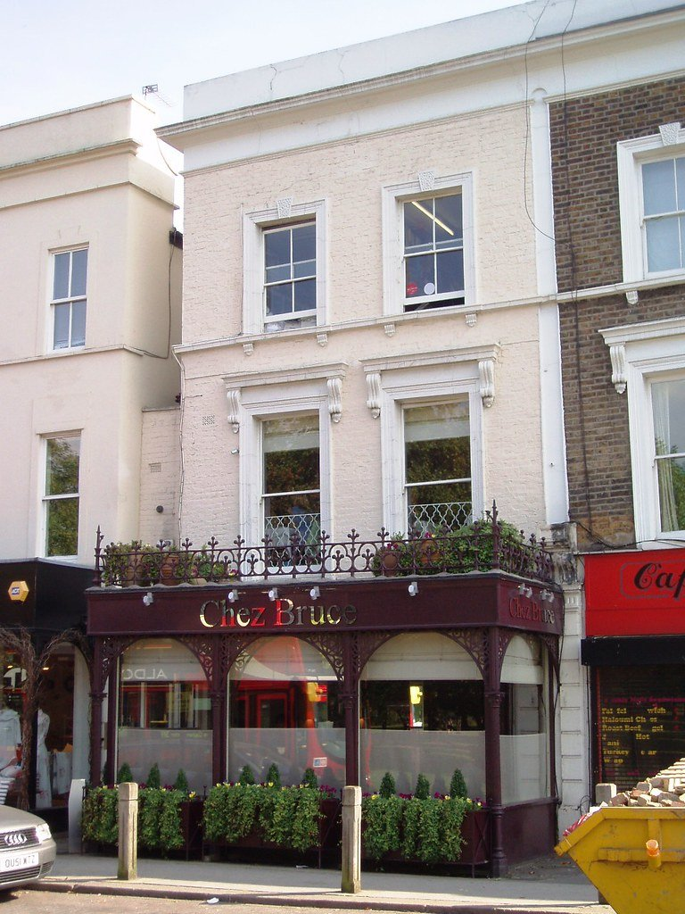
*Chez Bruce, Wandsworth. Photo: [Ewan-M](https://www.flickr.com/photos/55935853@N00/2879798210), [CC BY-SA 2.0](https://creativecommons.org/licenses/by-sa/2.0/).*

**Trinity is about a third off** the same four courses at dinner, and Gordon Ramsay's £125 lunch compares with £225 for the Prestige menu.

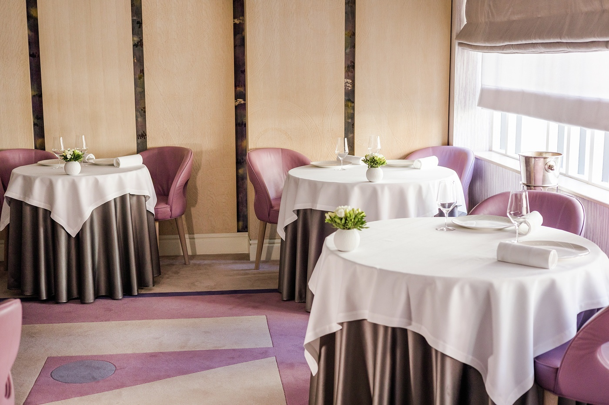
*The dining room at Restaurant Gordon Ramsay, Chelsea.*

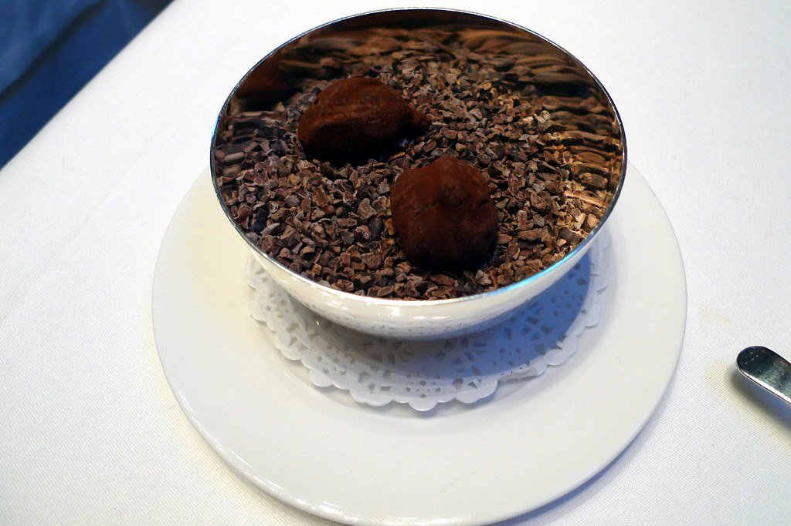
*Galvin La Chapelle, Spitalfields. Photo: [Ewan-M](https://www.flickr.com/photos/55935853@N00/4286655868), [CC BY-SA 2.0](https://creativecommons.org/licenses/by-sa/2.0/).*

---

Powered by <a target="_blank" rel="sponsored" href="https://www.getyourguide.com/london-l57/">GetYourGuide</a>

## Reliable mid-range set lunches

| Restaurant | Deal | When |
| --- | --- | --- |
| **Hera**, Stratford | £13.90 Office Lunch, two courses | Mon–Fri 11am–3.30pm |
| **Brasserie Zédel**, Piccadilly | £16.95 / 2, £19.95 / 3 | Lunch **and** dinner |
| **Bocca di Lupo**, Soho | £18 starter + main, £26 with dessert | Mon–Fri 12–6.30pm |
| **Suzi Tros**, Notting Hill | £20 / 2, £29 / 3 | Mon–Fri lunch |
| **Boulevard Brasserie**, Covent Garden | £22.95 starter + main, £27.90 with dessert | Daily 12–6.30pm |
| **The Delaunay**, Aldwych | £23.50 / 2, £27.50 / 3 | Daily from 11.30am |
| **Balthazar**, Covent Garden | £25.50 / 2, £28.50 / 3 | Mon–Thu all day, Fri 12–6pm, Sun from 5pm. Max six |
| **Sarastro**, Covent Garden | £27.50 / 2, £6 for dessert | Daily until 6pm |
| **The Palomar**, Soho | £28 / 3 courses | Weekdays: lunch 12–2.30pm, pre-theatre 5–6pm |
| **The Ivy West Street**, Covent Garden | £28.95 / 2, £34.95 / 3 | Mon–Fri 11.30am–6pm |
| **Boisdale**, Belgravia | £29.50 / 2, £34.50 / 3 | Lunch |
| **Mucci's**, Chelsea | £10 starters, £20 pastas and mains | Kitchen menu |
| **Colbert**, Sloane Square | £30 / 2, £35.75 / 3 | Daily from noon |
| **Bingham Riverhouse**, Richmond | £30 / 2, £40 / 3 with a carafe of Vinho Verde between two | Mon–Fri 12–6.30pm |
| **Quo Vadis**, Soho | £30 / 2, £35 / 3 | Mon–Sat lunch, 5–6.15pm and 9–10pm. Max four |
| **Som Saa**, Spitalfields | £35pp, £30 vegan — whole table | Mon–Sat 12–2.30pm |
| **Chutney Mary**, St James's | £39 / 2, £45 / 3 | Mon–Fri 12–2.15pm |
| **[The Gore](https://collezione.starhotels.com/en/our-hotels/the-gore-london/dining/sunday-lunch.html)**, South Kensington | £45 / 2, £50 / 3 Sunday lunch; the menu changes weekly | Sundays 12.30–3pm |
| **NOPI**, Soho | £45pp / 3 courses | Mon–Fri |

**Brasserie Zédel** charges £16.95 for two courses in an Art Deco basement off Piccadilly Circus. It runs at dinner too, so it is a fixed price, not a lunchtime saving.

**Hera in Stratford** is the cheapest sit-down lunch on this page after Franco Manca: £13.90 for two courses with sides, in a Greek restaurant by Stratford station.

**Bingham Riverhouse** in Richmond includes the wine: three courses at £40 come with a carafe of organic Vinho Verde to share between two, in a dining room over the Thames.

**Mucci's on the King's Road is not a time-limited offer.** Starters are £10 and pastas and mains £20 on the kitchen menu, with no lunch window; the 400g steak is £40.

**Bocca di Lupo on Archer Street** serves a starter and a main from its regional Italian menu for £18, until 6.30pm, so it works as lunch or pre-theatre, two minutes from Piccadilly Circus. The dishes change monthly.

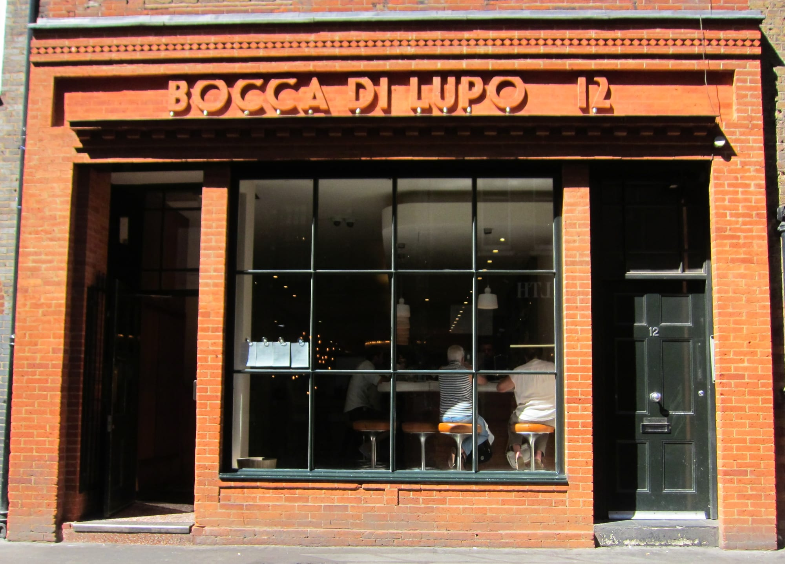
*Bocca di Lupo on Archer Street.*

**Trishna in Marylebone** is tiered: one course £25 and two £35 **at weekday lunches only**, while three at £45 and four at £50 are also available in the early evening, 5–6.15pm.

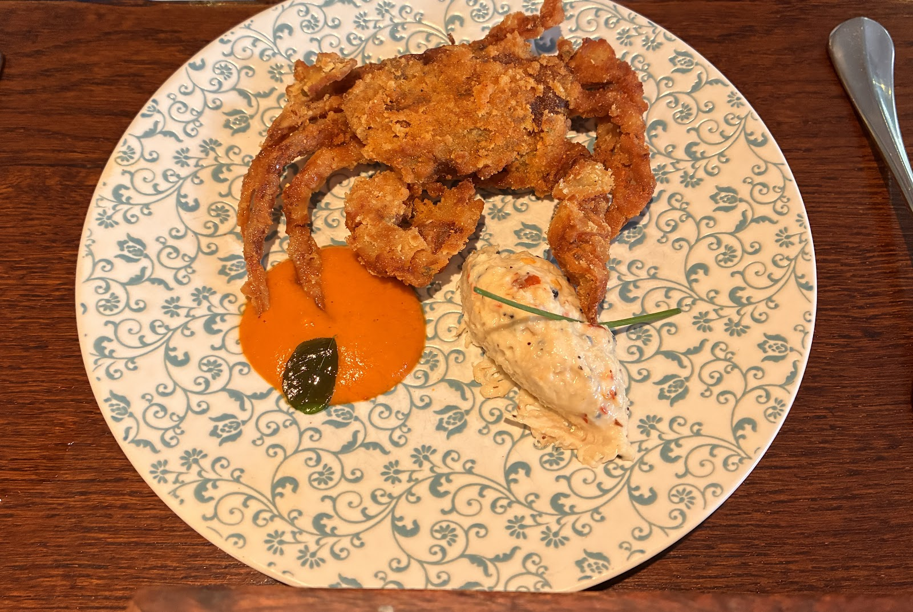
*Soft-shell crab at Trishna.*

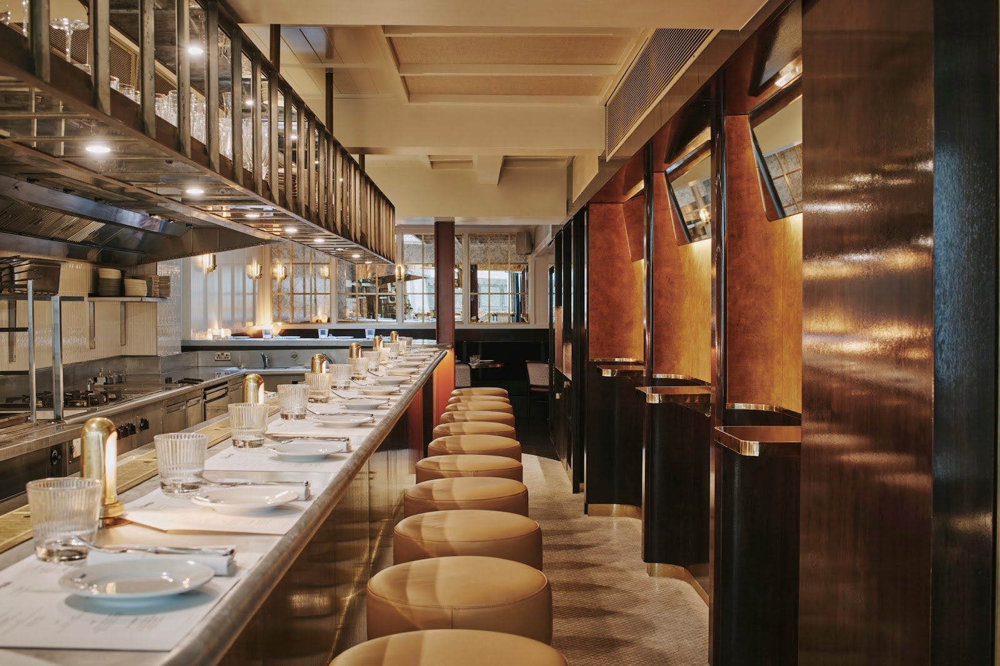
*The counter at The Palomar in Soho.*

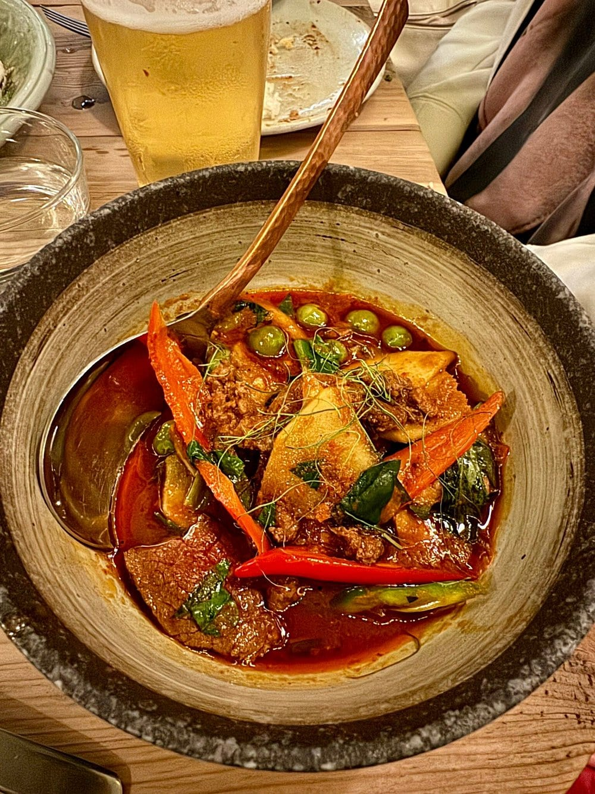
*A red curry at Som Saa.*

---

## Chain and mini-chain set menus

| Chain | Deal | When |
| --- | --- | --- |
| **Franco Manca** | £12.50 one course — pizza plus a soft drink. £15 two courses | Mon–Fri 12–4pm |
| **Dishoom** | £16pp "Swift Vitality", £20pp "Prompt Replenishment", to share between two | Mon–Fri 12–5pm |
| **Hawksmoor** | £21 / 1, £26 / 2, £30 / 3 courses. Max seven | Lunch Mon–Sat 12–3pm. Early evening: 2 courses £26, 3 courses £30 |
| **Côte Brasserie** | £22.50–£23.50 / 2, £26.50–£27.50 / 3 — varies by branch | Mon–Fri from 11.30am |
| **Hoppers** | £22pp "Lunch Plate", whole table | Mon–Fri 12–3pm |

**Hawksmoor's** £21 buys a main and a side, and the lunch menu runs on Saturdays as well. The early-evening menu runs Monday to Thursday 4:45pm to 5:45pm, Friday 4:30pm to 5pm and Saturday 3:15pm to 5pm.

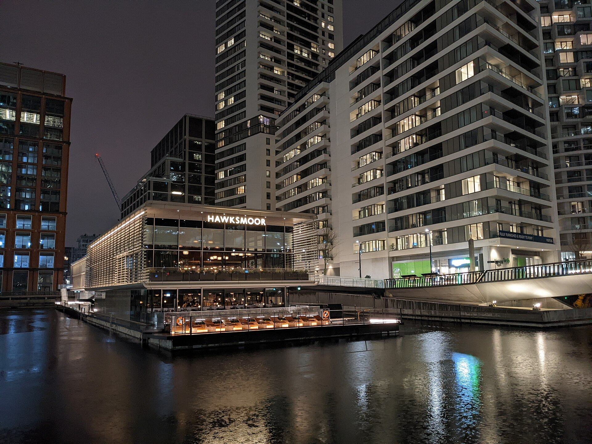
*Hawksmoor, Wood Wharf. Photo: [The wub](https://commons.wikimedia.org/wiki/File:Hawksmoor,_Wood_Wharf_-_2022-02-09.jpg), [CC BY-SA 4.0](https://creativecommons.org/licenses/by-sa/4.0/).*

**Franco Manca's £12.50** includes a soft drink and is the cheapest price on this page.

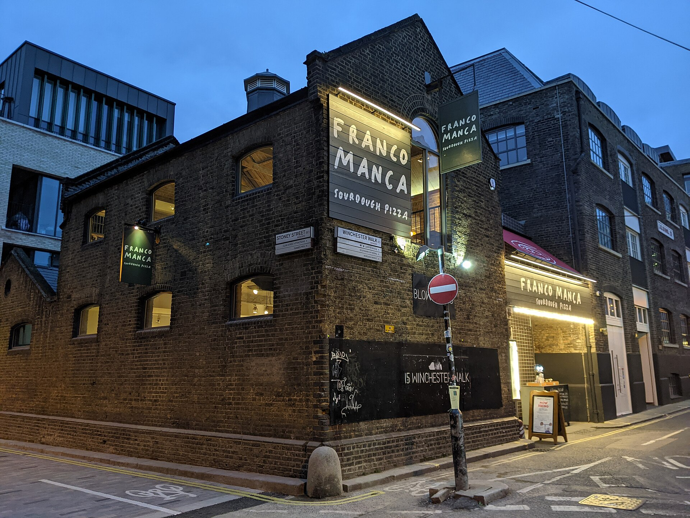
*Franco Manca, Winchester Walk, Southwark. Photo: [Daniel from Glasgow](https://commons.wikimedia.org/wiki/File:Franco_Manca,_15_Winchester_Walk,_Blows_Yard,_Southwark,_November_2021.jpg), [CC BY 2.0](https://creativecommons.org/licenses/by/2.0/).*

The [chain restaurants guide](/articles/best-chain-restaurants-london/) covers these chains' menus and booking rules in full.

**Côte's price varies by branch**, so check the one you are going to.

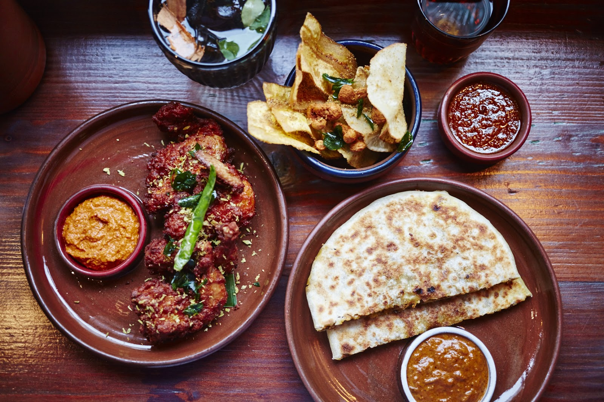
*Dishes at Hoppers.*

---

## Pre-theatre and early evening

Pre-theatre menus run in the early evening, usually finishing by about 6.30pm.

| Restaurant | Deal | When |
| --- | --- | --- |
| **Bocca di Lupo**, Soho | £18 starter + main, £26 with dessert | Mon–Fri until 6.30pm |
| **The Palomar**, Soho | £28 / 3 courses | Weekdays 5–6pm |
| **The Delaunay**, Aldwych | "Full Haus" — 3 courses and a drink, £29.50 | Mon–Fri 4.30–6.30pm, and from 9pm |
| **Sarastro**, Covent Garden | £27.50 / 2, £6 for dessert | Daily until 6pm |
| **Boulevard Brasserie**, Covent Garden | £22.95 starter + main | Daily until 6.30pm |
| **Trishna**, Marylebone | £45 / 3, £50 / 4 | 5–6.15pm |
| **Kitchen W8**, Kensington ★ | £49.50 / 3 courses | 6–6.15pm sitting |
| **NOPI**, Soho | £45pp / 3 courses | Mon–Fri 5–6.30pm |
| **[Kolamba](https://www.kolamba.co.uk/pre-theatre-dining)**, Soho | £30pp, Sri Lankan dishes to share | Mon–Fri 4–6pm |
| **[Opium](https://www.opiumchinatown.com/pre-theatre-dining-and-menu)**, Chinatown | £25pp: two dim sum baskets and a signature cocktail each | Daily 5–6.30pm |
| **[Fatt Pundit](https://www.fattpundit.co.uk/soho/)**, Soho | £33.50 / 2, £37 / 3, Indo-Chinese, with a vegetarian version | — |
| **[Haxells at the Strand Palace](https://www.strandpalacehotel.co.uk/restaurants-bars/pre-theatre.html)**, Strand | £32 / 2, £37 / 3 | Mon–Fri 12–6.30pm, Sat–Sun 4–6.30pm |
| **[The Cavalry Bar at The Rubens](https://rubenshotel.com/experiences/london-theatre)**, Victoria | £35 / 2, £45 / 3 | 4–6.45pm |
| **[The English Grill at The Rubens](https://rubenshotel.com/experiences/london-theatre)**, Victoria | £49 / 2, £55 / 3 | Daily 5.30–7pm |
| **[The Montague on the Gardens](https://montaguehotel.com/dining-and-drinks/whats-on/avenue-q-musical)**, Bloomsbury | £39 / 2, £49 / 3 with an Avenue Q cocktail | Until 2 January 2027 |

**Opium's** price needs a booking for one of its four bars (Apothecary, Peony, Attic or Academy). **The Rubens** takes 15% off pre-theatre dining at any of its bars and restaurants for ticket holders for Six, Wicked and Hamilton, and charges full price if you cannot show a same-day ticket. **The Montague's** Avenue Q menu is £94 / £104 with a ticket to the show at the Shaftesbury Theatre, which needs 48 hours' notice. **[Ayllu](https://www.ayllu.co.uk/news-offers/christmas)** in Paddington Central has a five-course evening set menu for £29pp from 26 to 30 December 2026, with sushi, ceviche and pollo al carbón among the courses.

**Bocca di Lupo** is two minutes from Shaftesbury Avenue and its window runs to 6.30pm, late enough for a 7.30pm curtain.

**The Delaunay's Full Haus runs again from 9pm**, so it works after a show too.

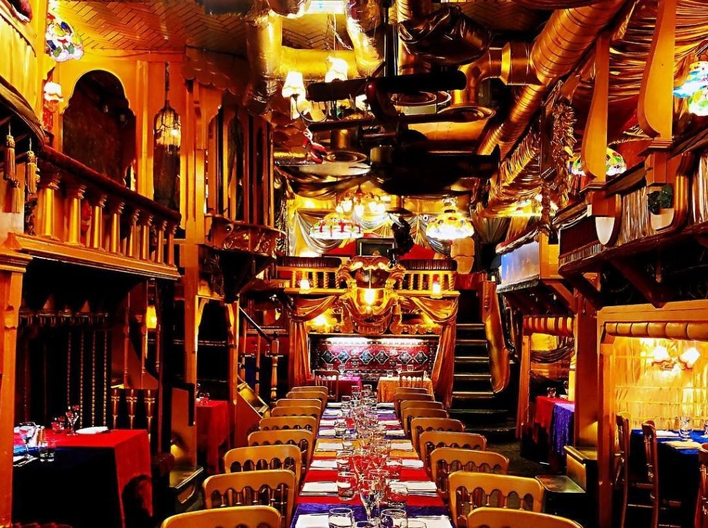
*Sarastro on Drury Lane.*

For a 7.30pm curtain, book at 5.30pm. See our [London theatre guide](/articles/london-theatre-guide/) for how curtain times and running times actually work.

---

## What is not actually a deal

- **The Wolseley** serves lunch 11.30am–3pm but has no set-price lunch menu at all
- **Barrafina** does not run one; the tapas are à la carte only
- **Alain Ducasse at The Dorchester** charges the same at lunch as at dinner
- **Brasserie Zédel** charges the same at dinner — good value, just not a lunchtime saving

**Also gone:** Le Gavroche closed in January 2024 and Marcus Wareing at The Berkeley in December 2023.

---

Powered by <a target="_blank" rel="sponsored" href="https://www.getyourguide.com/london-l57/">GetYourGuide</a>

## Continue planning your London trip

**Paying less to eat out in London.** A few different strategies, and they rarely combine — pick the one that fits how you eat:

- 💳 **[Restaurant Discount Cards](/articles/restaurant-discount-cards-london/)** — Tastecard and the rest, and why one costs £29.99 and its twin £79.99
- 🏷️ **[London Food Deals](/articles/food-deals-london/)** — 2-for-1, student and Blue Light discounts, offers by day, BYO and app rewards
- 🍹 **[Happy Hour in London](/articles/happy-hour-london/)**
- 📱 **[Off-Peak Restaurant Apps](/articles/off-peak-restaurant-apps-london/)** — First Table and EatClub — cheaper if you will eat early or walk in
- 🥂 **[Bottomless Brunch](/articles/bottomless-brunch-london/)** — packages compared on price per minute, and what “bottomless” covers
- 👨‍👩‍👧 **[Kids Eat Free](/articles/kids-eat-free-london/)** — every free and £1 children's offer with a London branch
- 💷 **[Cheap Eats in London](/articles/cheap-eats-london/)** — good food under £15 with no offer, code or membership at all
- 🍽️ **[Where to Eat in London](/articles/eat-in-london-guide/)**
- 🍝 **[The Best Italian Restaurants in London](/articles/best-italian-restaurants-london/)**
- 🥩 **[The Best Steak Restaurants in London](/articles/best-steak-restaurants-london/)**
- 🎭 **[London Theatre: Choosing a Show and Paying Less](/articles/london-theatre-guide/)**
