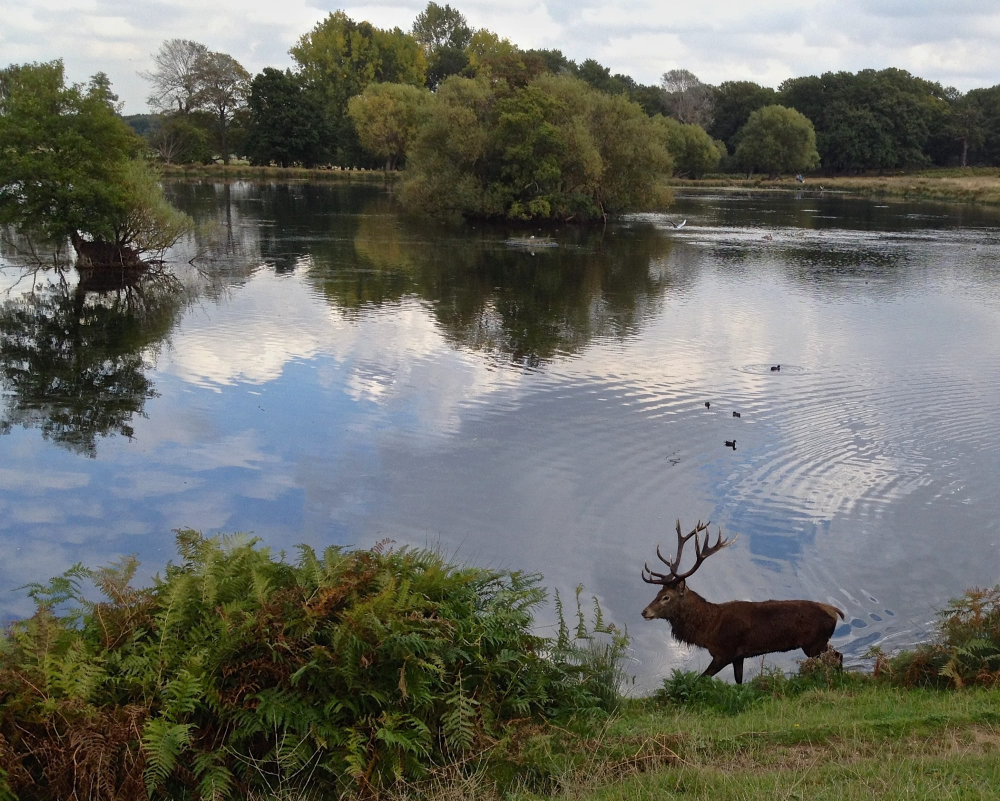
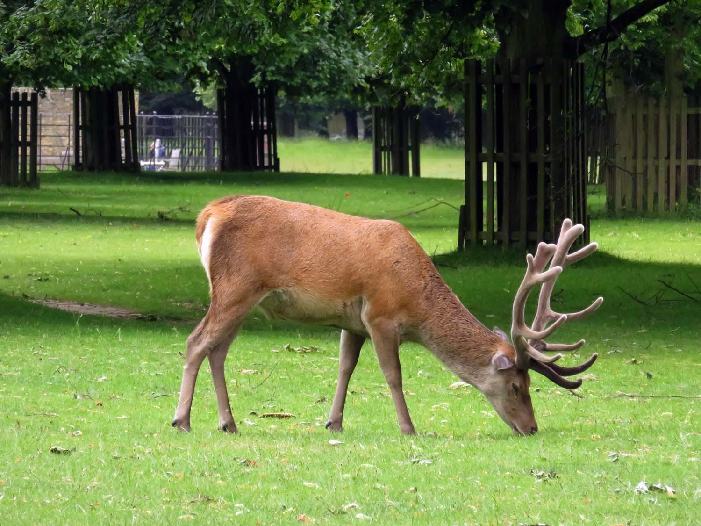
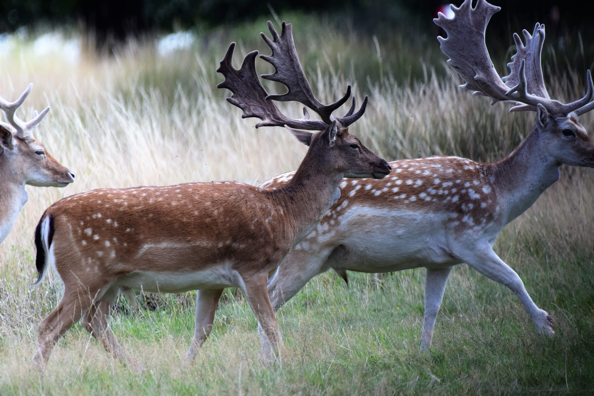

> 💡 **The Short Version:** Richmond Park has about 630 red and fallow deer, Bushy Park about 320, and both are free to walk through any day of the year. **The best weeks are the autumn rut**, from the end of September to early November, when the stags roar at dawn and dusk. **Keep 50 metres away at all times**; the Royal Parks asks for 100 metres from an active stag if you have a dog. **Dogs must be on a lead in both parks from 1 May to 31 July**, the birthing season. **Culls start on 1 November and 1 February**, and for up to six weeks the pedestrian gates shut at 8pm in Richmond Park. The easiest way in is by train to Richmond or Teddington, then a walk to the gate.

*Gate times and cull dates are the Royal Parks' own 2026 timetables, as at 19 November 2026. The 2027 timetables follow when it publishes them; the pattern below holds from year to year.*

## Richmond Park or Bushy Park

| | Richmond Park | Bushy Park |
| --- | --- | --- |
| **Deer** | About 630, red and fallow, since 1637 | About 320, red and fallow |
| **Size** | 2,500 acres, the largest Royal Park | About 1,100 acres |
| **Nearest stations** | Richmond, North Sheen, Norbiton (15 to 25 minutes' walk) | Hampton Wick, Teddington (about 5 minutes) |
| **Car parking** | Free, in seven car parks | Free, in four main car parks |
| **Best for** | Long walks, rutting stags in the bracken, Pen Ponds | A short walk from the station, deer beside Chestnut Avenue and near Hampton Court |

Richmond Park is the one to choose for the rut and for the sense of space. Bushy Park is the easier half day, and it pairs with [Hampton Court Palace](/articles/hampton-court-palace-guide/), which the park adjoins.

## The safety rules

> ⚠️ **Keep at least 50 metres from every deer, all year.**
> A stag weighs around 25 stone before the rut, and the Royal Parks gives its top speed as 30mph. Do not feed deer (illegal in both parks), do not picnic close to them, and if one approaches, cover your food, leave it and back away slowly. If a deer advances on you, put a tree or a vehicle between you and it; if you have a dog, let it off the lead so it can get away.

Two more rules matter:

- **Dogs.** From 1 May to 31 July dogs must be on a lead in every part of both parks, and the Royal Parks advises dog walkers to keep to the perimeter then. Outside those dates dogs can be off the lead at a safe distance from deer, but must be on one near deer and around ponds. A dog chasing deer is an offence and the owner can be prosecuted.
- **Photographers.** Stay 50 metres away and use a long lens. The Royal Parks has seen dozens of photographers surround one stag in the rut, and says that is dangerous and stressful for the animal. The British Deer Society's [code of conduct](https://bds.org.uk/photography/photographing-deer/code-of-conduct/) sets out how to photograph deer safely. The Royal Parks' full [deer safety advice](https://www.royalparks.org.uk/deer-safety-advice) covers both parks.

## When to see them

**Autumn rut, end of September to early November.** Stags thicken their necks, roar to deter rivals, then walk parallel to an equal rival and, if neither backs down, lock antlers. The biggest red stags hold up to 40 hinds in the middle of the rut. Fallow bucks do it differently: they gather in a lek, a group of males displaying, and it is common to see four or five big bucks with a group of 40 does. The Royal Parks' [12 things about the rut](https://www.royalparks.org.uk/read-watch-listen/12-things-you-should-know-about-deer-rutting-season) explains what you are watching. Go at dawn or the last hour of daylight, when the deer are moving and the park is quiet.

*A stag at the edge of Pen Ponds, Richmond Park. Photo: [Paul Coueslant](https://commons.wikimedia.org/wiki/File:Stag_cooling_off_in_Pen_Ponds,_Richmond_Park_-_geograph.org.uk_-_5492170.jpg), [CC BY-SA 2.0](https://creativecommons.org/licenses/by-sa/2.0/).*

**Birthing season, May to July.** Around 300 deer are born across the two parks, usually in May and June, and over 200 of them in Richmond Park in most years. Mothers hide fawns in long grass and bracken and return to suckle them, so a lone fawn is not abandoned. You are unlikely to see one, and you should not look; what you will see is hinds that are wary and quick to charge a dog. This is the season for the lead rule.

**Summer.** Red stags carry antlers in velvet, a soft skin that protects the growing bone, which grows up to 2.5cm a day. They rub it off in time for the rut in September.

*A red stag in velvet in Bushy Park. Photo: [Steve Daniels](https://commons.wikimedia.org/wiki/File:Red_deer_stag_in_Bushy_Park_-_geograph.org.uk_-_5422460.jpg), [CC BY-SA 2.0](https://creativecommons.org/licenses/by-sa/2.0/).*

**Winter.** Culls aside (below), the deer are quieter and rest in the open, and the park is emptier on a cold morning.

## Where to look in Richmond Park

The herds roam the whole park, so there is no fixed spot, but three places come up again and again with the photographers who go out during the rut.

- **Pen Ponds and its car park**, in the middle of the park, where deer come to drink and with a kiosk. The Royal Parks calls Pen Ponds the best known of the park's ponds, for terns, gulls and herons, so it is worth the walk whether or not a stag turns up.
- **Isabella Plantation and its car parks.** The plantation is fenced against deer, but deer rest in the meadow beside its car park in winter, and photographers have caught roaring stags nearby in the rut.
- **Roehampton Gate.** The car park here has a café and toilets, and photographers who go early on a busy weekend say a short walk from it takes you away from the crowds.

The park has seven main car parks, all free: Pembroke Lodge, Kingston Gate, Broomfield Hill, Robin Hood Gate, Roehampton Gate, Sheen Gate and Pen Ponds. Kingston Gate car park does not open until 9am on weekdays. Red deer are the largest land mammal native to Britain; fallow deer are smaller, usually spotted in summer, with palm-shaped antlers.

*Fallow bucks in Richmond Park, their antlers flat and palm-shaped, unlike the branching antlers of a red stag. Photo: [Heather Smithers](https://commons.wikimedia.org/wiki/File:Fallow_deer_Richmond_Park_(36239474022).jpg), [CC BY-SA 2.0](https://creativecommons.org/licenses/by-sa/2.0/).*

## Where to look in Bushy Park

The deer are spread across the whole park rather than in one spot. Two fixed points help you plan: the **Diana Fountain** and its car park on Chestnut Avenue, the long avenue through the middle of the park, and the **Pheasantry Café**, the park's one main café. The free main car parks are at Coleshill Road Gate, the Pheasantry Café and the Diana Fountain, with more at weekends through Clapperstile Gate. You can no longer drive straight through the park between Teddington Gate and Hampton Court Gate; both gates lead only to the car parks.

## Getting there

**Richmond Park by train.** Richmond (South Western Railway and the District line) and North Sheen are north of the park; Norbiton is south. The Royal Parks puts the walk to the nearest gate at 15 to 25 minutes from each. Richmond Gate is the nearest way in from the town, and Pembroke Lodge and its tea room are just inside. Our [Richmond guide](/articles/richmond-area-guide/) covers the town, the Thames and the walk up the hill.

**By bus.** The Royal Parks' minibus timetable names the connecting stops: the 85 and K3 on Kingston Hill for Ladderstile Gate, and the 65 at Ham Gate Avenue and Ham Common. The free **RP1 minibus** runs inside the park from mid-March to mid-November and stops at Roehampton Gate, Robin Hood Gate, Pen Ponds car park, Isabella Plantation, Pembroke Lodge and Richmond Gate. The 2026 season ran to 13 November; the service page carries the next season's [timetable](https://www.royalparks.org.uk/visit/parks/richmond-park/free-minibus-service-richmond-park).

**By car.** Parking is free, with no overnight parking, and cars left after closing time can be fined. You can drive between Richmond Gate and Kingston Gate at all times, and between Richmond Gate and Roehampton Gate on weekdays only; every other park road leads to a car park.

**Bushy Park.** Hampton Wick and Teddington stations, both on South Western Railway, are about five minutes' walk from the nearest gate. There is no Tube station near.

**By bike.** Cycling is allowed only on the larger roads and the Tamsin Trail, the 7-mile route round the edge of Richmond Park. Parkcycle hires bikes at Roehampton Gate car park.

## Opening hours and the culls

> ⚠️ **Culls start on 1 November and 1 February and run for up to six weeks.**
> The park is still open in the day, but Richmond Park's pedestrian gates shut from 8pm to 7.30am during a cull, except on Friday and Saturday nights. If you are leaving after an evening of stag-watching in early November, leave before 8pm.

**Richmond Park, 2026.** The pedestrian gates are open 24 hours a day outside the culls. The vehicle gates, which also open and shut the car parks, open at 7am in British Summer Time and 7.30am the rest of the year, and close at a time that follows the light. In 2026 that was 7pm in mid-September, 6pm in the last week of October, 4.30pm from 26 October to 8 November and 4pm from 16 November. Kingston Gate car park opens at 9am on weekdays.

**Bushy Park, 2026.** The pedestrian gates are open 24 hours a day, except in the culls, which take place every September and November. During a cull the pedestrian gates are locked at 10.30pm from Sunday to Thursday, and on Monday to Friday the pedestrian and vehicle gates open at 8am; weekends are normal. In 2026 the vehicle gates opened at 8am from 31 August to 11 October and from 2 November to 13 December, at 6.30am for most of the rest of the year, and closed at 7pm from late August to the end of the year. The timetable also lists an extra cull in January and February 2026.

Both parks publish the next year's timetable on their pages: [Richmond Park opening times](https://www.royalparks.org.uk/sites/default/files/2026-02/Opening%20Times%202026_Richmond_A4_Feb%202026.pdf) and [Bushy Park opening times](https://www.royalparks.org.uk/sites/default/files/2026-01/Opening%20Times%202026_Bushy_A4_Jan%202026.pdf).

## Make a day of it

- **Richmond Park:** [Pembroke Lodge](/articles/richmond-area-guide/) for tea and the sightline to St Paul's from King Henry's Mound, then the Isabella Plantation, in flower in late April and May. Autumn colour is covered in our [guide to autumn leaves in London](/articles/best-places-autumn-leaves-london/).
- **Bushy Park:** walk to [Hampton Court Palace](/articles/hampton-court-palace-guide/), the Tudor home of Henry VIII, who hunted the deer in the park next door.
- **Kew:** [Kew Gardens](/articles/kew-gardens-guide/) is the next District line stop from Richmond.
- **Other parks:** the [best parks and gardens in London](/articles/best-parks-gardens-london/) puts both against the rest.
