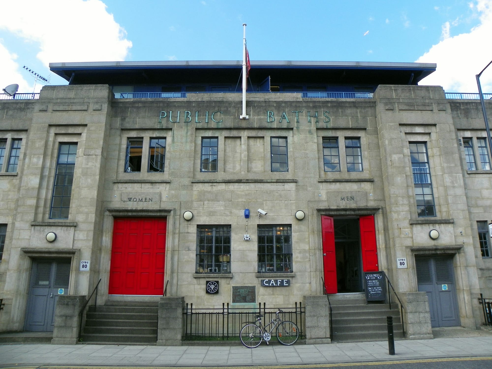
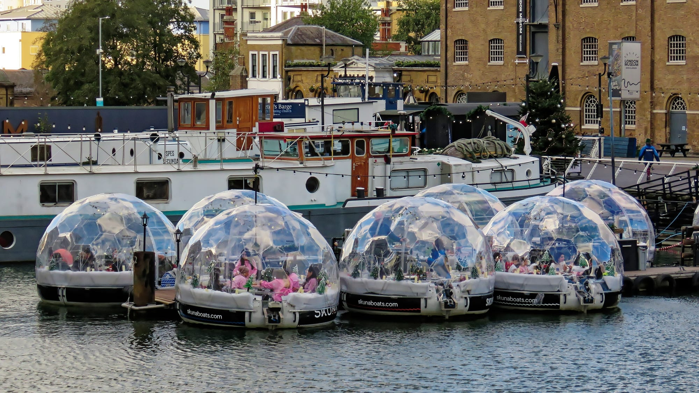
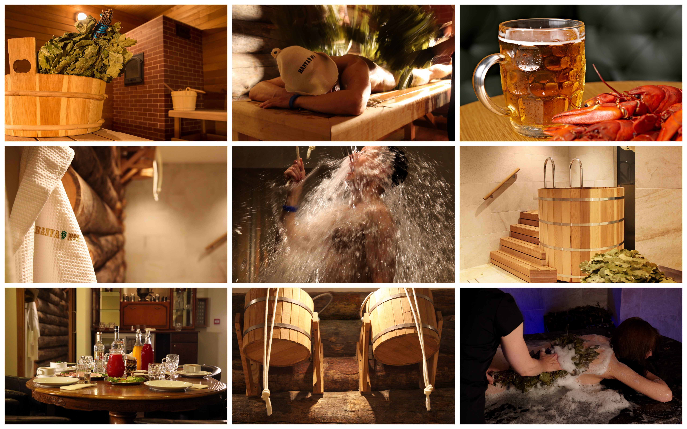
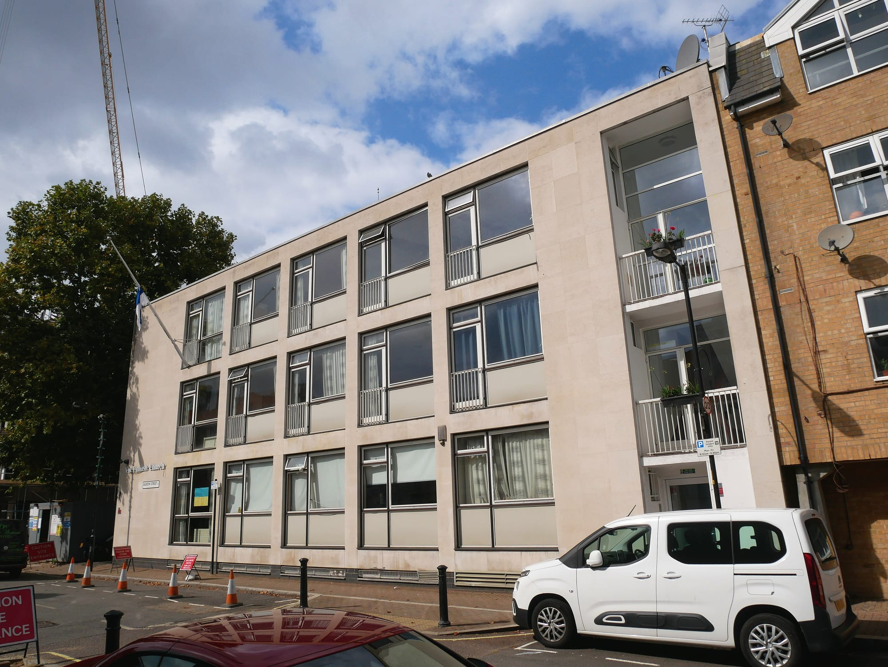
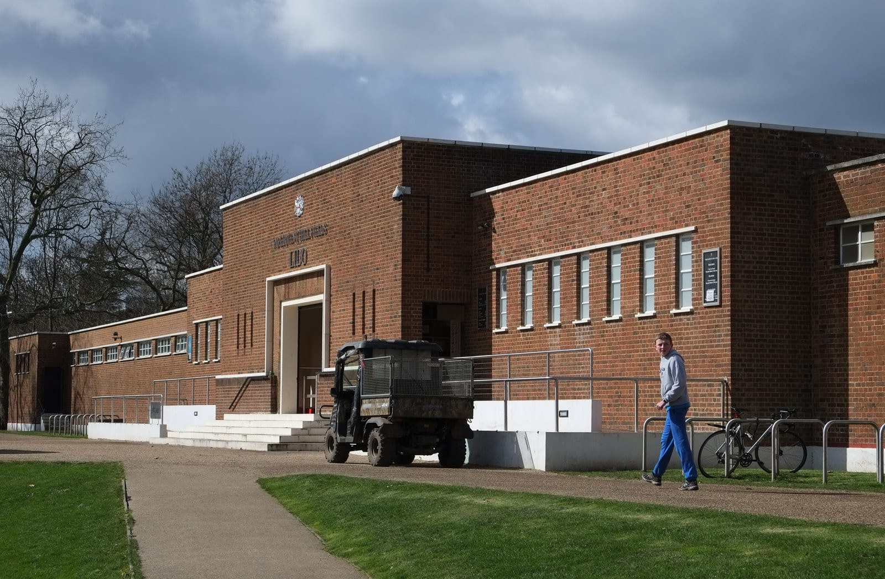

> 💡 **The Short Version:** London has communal saunas with cold plunges in most of its inner boroughs. **For the cheapest session**, [Community Sauna Baths](#community-sauna-baths) has five sites, from £11 an hour at Hackney Wick, and the [Finnish Church](#the-finnish-church-rotherhithe) in Rotherhithe charges £12. **On the water**, [TEMZ](#temz-teddington-and-hampton-court) sits on the Thames at Teddington and [Skuna](#skuna-canary-wharf) in the docks at Canary Wharf. **For a Russian steam bath with a birch-twig treatment**, book [Banya No.1](#banya-no1-hoxton). **For a one-off in the open air**, [Parliament Hill Lido](#parliament-hill-lido) has a winter sauna for £7 on top of the swim. Almost everywhere asks for swimwear and books by the session, so reserve a slot.

*Prices, hours and rules are each operator's own, as at 19 November 2026.*

## At a glance

| Venue | Area | Session | Price from | Format |
| --- | --- | --- | --- | --- |
| **[Community Sauna Baths](#community-sauna-baths)** | Hackney Wick and four more | 1 to 2 hours | £11 (£5 concessions) | Shared, with women-only and trans sessions |
| **[Pulse Club](#pulse-club-fulham-and-putney)** | Fulham, Putney | 75 minutes | £17 | Mixed, with women-only sessions |
| **[Sauna Social Club](#sauna-social-club-peckham)** | Peckham | 50 minutes to 2 hours | £14.99 | Shared, with DJ nights |
| **[Arc](#arc-canary-wharf)** | Canary Wharf | Classes | £49 for three | Guided classes |
| **[Rooftop Saunas](#rooftop-saunas-hackney-and-brixton)** | Hackney, Brixton | 30, 60 or 90 minutes | £11 each for four | Private cabin |
| **[TEMZ](#temz-teddington-and-hampton-court)** | Teddington, East Molesey | 50 minutes | £20 | Open sessions |
| **[Skuna](#skuna-canary-wharf)** | Canary Wharf | 60 minutes | £15 | Shared or private |
| **[Banya No.1](#banya-no1-hoxton)** | Hoxton | 90 minutes | £40 | Mixed, plus single-sex hours |
| **[The Finnish Church](#the-finnish-church-rotherhithe)** | Rotherhithe | 1 hour | £12 | Public or private |
| **[Porchester Spa](#porchester-spa-bayswater)** | Bayswater | Day entry | £31.95 | Single-sex six days, mixed Sundays |
| **[Parliament Hill Lido](#parliament-hill-lido)** | Hampstead Heath | 1 hour | £7 plus £5 swim | Shared, adults only |

> ⚠️ **Book before you go.** Community Sauna Baths, Pulse Club, TEMZ, Banya No.1, Rooftop Saunas and Skuna all sell sessions in fixed slots, and refunds need notice: 24 hours at TEMZ, Rooftop Saunas and the Finnish Church, and 72 hours at Banya No.1.

## Communal saunas

### Community Sauna Baths

*Hackney Wick (Eastway Baths, 80 Eastway, E9 5JH), Camberwell, Peckham, Stratford and Walthamstow*

**A not-for-profit with wood-fired and electric saunas and cold plunges at every site except Peckham, started in the car park of Eastway Baths in 2021.** Hackney Wick, the flagship, has six wood-fired saunas and one electric, with plunges from 3°C to 15°C in whisky barrels and tubs. You move between heat and cold as often as you like, and most people do two or three rounds. It is a sober, phone-free space.

**Prices at Hackney Wick, weekdays:** £11 for an hour at peak, £17.40 for 90 minutes at peak and £13.30 for two hours off-peak; weekends are £13.50 for an hour and £22 for two. Concessions start at £5 for people on low incomes, students and NHS workers. Bring swimwear and two towels, one to sit on; a small towel rents for £2. Toplessness is optional for everyone at Hackney Wick, with the waist down covered. Women-only sessions run before some slots, and Hackney Wick runs a trans sauna on Mondays every other month. [Book at community-sauna.co.uk](https://www.community-sauna.co.uk/book).

*The old public baths at 80 Eastway, Hackney Wick. Community Sauna Baths' flagship sits in the car park behind. Photo: [Peter O'Connor](https://commons.wikimedia.org/wiki/File:GOC_Walthamstow_to_Stratford_146_Old_Baths,_Hackney_Wick_(24918588934).jpg), [CC BY-SA 2.0](https://creativecommons.org/licenses/by-sa/2.0/).*

For where to eat afterwards, see our [Hackney guide](/articles/hackney-area-guide/), [Stratford guide](/articles/stratford-area-guide/) and [Peckham guide](/articles/peckham-area-guide/).

### Pulse Club, Fulham and Putney

*340 North End Road, SW6 1NB · 228 Upper Richmond Road, SW15 6TG*

**One big sauna at 85 to 90°C and four cold plunges from 3 to 10°C, in 75-minute sessions with a capped headcount.** Most sessions are free-roam: you move between the heat and the cold at your own pace, enough for three or four rounds. There is no dress code beyond swimwear, which is worn at all times, and the club supplies towels. The minimum age is 16. Sessions are mixed unless the timetable says otherwise, and women-only and silent sessions are on it.

**£17 off-peak (before 5pm on weekdays) and £22 at peak.** A three-session intro pack is £39. Both clubs open 7am to 9pm daily, with a later 11:30am start on Wednesdays at Fulham and Tuesdays at Putney. Putney is two minutes from Putney station and Fulham a short walk from Fulham Broadway. [Book at pulseclubsauna.com](https://www.pulseclubsauna.com/book).

### Sauna Social Club, Peckham

*Railway arch, Brayards Road, Peckham*

**Two Finnish-style saunas, very hot with water buckets, and four ice baths at different temperatures, then a "listening lounge" with tea and a snack.** On Friday and Saturday nights and every other Sunday, DJs and live musicians play in the lounge and the sound is streamed into the downstairs sauna. Thursday evenings are Aufguss, a German ritual where an in-house Sauna Master pours ice mixed with essential oils over the hot stones to make a burst of steam.

**£14.99 for the 50-minute Essential session, £24.99 for the 1 hour 40 minute Social session** and for Ambient (70 minutes) and Aufguss, and £34.99 for the two-hour Creative Wellbeing session with breathwork or sound healing. One of the two saunas is for chatting and the other is silent. [Book at saunasocialclub.co.uk](https://www.saunasocialclub.co.uk/book); the [Peckham guide](/articles/peckham-area-guide/) has the rest of the street.

### Arc, Canary Wharf

*Minus Level 2, 1 Crossrail Place, E14 5AR*

**A sauna that holds 60 people, rows of ice baths and a lounge, run as guided classes, free-flow sessions and evening socials.** The classes, such as Morning Warrior or Sleep Reset, combine breathwork and sound with the heat and cold. Evening "Arc After Dark" is a sauna party with a DJ. Bring your own swimwear; Arc provides two towels, one for the sauna and one for the shower.

**A three-class intro pack costs £49.** Book classes and free-flow sessions at [arc-community.com](https://www.arc-community.com/book-now). Our [Canary Wharf guide](/articles/canary-wharf-area-guide/) covers the estate.

### Rooftop Saunas, Hackney and Brixton

*Netil Corner, London Fields, E8 · International House, Brixton*

**Private aspen cabins, each with its own shower, plus a private cool-down room on the 60- and 90-minute slots, and shared outdoor cold plunges and waterfall buckets on the roof.** The Hackney roof looks over the city between Broadway Market and Victoria Park. You book a cabin for up to four, so you only share the plunges. The site is strictly for over-18s.

**From £11 a head for 30 minutes**, based on four people on a weekday before 4pm; a solo 30-minute slot is £20, and 60 and 90 minutes cost from £16.50 and £22 a head. Evenings and weekends cost half as much again. Bring two towels. You can reschedule or cancel up to 24 hours before. [Hackney bookings](https://rooftopsaunas.com/locations/hackney/) · [Brixton bookings](https://rooftopsaunas.com/locations/brixton/).

## On the water

*Skuna's igloo boats in the North Dock at West India Quay, where its sauna boats are also moored. Photo: [Acabashi](https://commons.wikimedia.org/wiki/File:Skuna_Igloo_Boats_West_India_Quay_Promenade_North_Dock_Canary_Wharf_London_England_04.jpg), [CC BY-SA 4.0](https://creativecommons.org/licenses/by-sa/4.0/).*

### TEMZ, Teddington and Hampton Court

*The Lensbury, Broom Road, Teddington, TW11 9NU · The Mitre Hotel, Hampton Court Road, East Molesey, KT8 9BN*

**A sauna and an ice bath fixed to a pontoon on the non-tidal Thames, with panoramic river views and the boat rocking gently under you.** The ice bath is kept at 8°C, and most people spend two to three minutes in it before going back to the heat. Changing rooms and showers are on site. Take swimwear, a towel and water, and in winter plenty of layers for afterwards.

**£20 for a 50-minute open session at Teddington**, which you can book as a non-member of The Lensbury; at Hampton Court it is £20 off-peak and £25 at peak. Open sessions take up to eight people. Private hire is £120 for up to eight at Teddington. A full refund needs 24 hours' notice. [Book at temzfloatingsaunas.com](https://www.temzfloatingsaunas.com/book-now-/). Combine it with [Hampton Court Palace](/articles/hampton-court-palace-guide/) or [Richmond](/articles/richmond-area-guide/).

### Skuna, Canary Wharf

*West India Quay, North Dock*

**Wood-fired sauna boats docked at West India Quay at 70 to 90°C, with 3 to 6°C cold plunges on a rooftop and a cold bucket shower.** The larger boat seats 14 and the smaller seven; sessions are 60 minutes, shared or private, with DJ-curated music. Heated changing rooms and lockers are on site, and robes, towels and sauna hats are sold there. Teenagers of 16 and over are welcome with an adult.

**A shared drop-in session is from £15 a head**, and a monthly membership with unlimited shared sessions is £49. Hire the larger sauna privately for £195 on a weekday or £225 at the weekend. [Book at skunaboats.com](https://bookings.skunaboats.com/). Nearby: the [Canary Wharf guide](/articles/canary-wharf-area-guide/).

## Banyas and bathhouses

### Banya No.1, Hoxton

*17 Micawber Street, N1 7TB*

**A Russian banya: a light steam room, highly humid but with fine, light steam rather than heavy droplets, then a cedar plunge pool or bucket showers, then a table with tea and Eastern European food.** Banya No.1 has been in Hoxton since 2012. The signature is parenie, where a steam master (banshchik in Russian) works the steam over you with bundles of leafy twigs, called veniks, followed by the plunge. Order it as an add-on. A felt hat, to borrow or buy there, protects your head from the heat.

*Banya No.1 on Micawber Street, Hoxton. Photo: Banya No.1.*

**In December:** Wednesday Club on 2 December runs from 19:00 to 22:00, from £65, with an aroma steam ritual, breathwork, drumming and a sound bath led by banya master Agate Silova. Private Banya Taiga, for groups of up to 10, runs evening ritual sessions through December from £99 a person. From 19 December to 1 January, peak prices apply to every public session.

**£40 off-peak or £50 at peak for the 90-minute Sauna & Plunge session.** Swimwear is essential in mixed sessions, and you can buy it at reception (£14 shorts, £18 bikini). Nudity is allowed in single-sex sessions, in the wet zone only: women-only on Monday from 9:30 to 12:30, men-only on Tuesday from 19:00 and Friday from 15:30. Children from 8 are admitted. Open 9:30 to 22:30 daily. Cancel up to 72 hours before for a full refund. [Book at gobanya.co.uk](https://gobanya.co.uk/banya-sessions/).

### The Finnish Church, Rotherhithe

*33 Albion Street, SE16 7HZ*

**A traditional Finnish sauna in the church that serves London's Finns, open Wednesday to Sunday.** You throw water on the hot stones for the löyly, the burst of steam, and sit on a small towel. Soap and perfumes are not allowed inside, and glass bottles are banned. The sauna closes for a few weeks a year for events and maintenance.

**Public sessions are £12 a head for an hour**, and a private sauna is from £25 for two people in the week and £28 at the weekend, plus £10 for each extra person. Cancel at least 24 hours ahead. [Book through the church](https://FinnishChurchSauna.as.me/). The [Bermondsey guide](/articles/bermondsey-area-guide/) covers the neighbourhood.

*The Finnish Church on Albion Street, Rotherhithe. Photo: [Doyle of London](https://commons.wikimedia.org/wiki/File:Southern_Face_of_the_Finnish_Church,_Rotherhithe_(01).jpg), [CC BY-SA 4.0](https://creativecommons.org/licenses/by-sa/4.0/).*

### Porchester Spa, Bayswater

*The Porchester Centre, Queensway, W2 5HS*

**London's oldest spa, in a 1920s building, with two steam rooms, a Turkish bath of three rooms of rising heat, a sauna up to 92°C and a plunge pool.** Everyone Active runs it with Westminster City Council. The facilities are for over-18s, and you bring your own clean towel. The cafe takes card only.

**£31.95 for an adult entry**, £17.60 for seniors and concessions. The decider is the day: men on Monday, Wednesday and Saturday, women on Tuesday, Thursday and Friday, and mixed only on Sunday. Open 10am to 9:30pm on weekdays and to 8pm at weekends, and the last entry is two hours before closing. Book on the Everyone Active app or website; casual bookings open five days ahead. The [Paddington guide](/articles/paddington-area-guide/) covers Bayswater.

## At a lido

### Parliament Hill Lido

*Gordon House Road, Hampstead Heath · Gospel Oak station is a 3-minute walk*

**A 60-metre unheated outdoor pool, open all year, with a sauna beside it in the winter season.** The sauna reopened on Saturday 17 October 2026 and runs until May, in one-hour sessions. It runs at 7am, 8am, 9am, 10am, 11am and 12pm from autumn to early spring, with evening sessions at 6pm and 7pm on Mondays, Wednesdays, Thursdays and Fridays in the later weeks. You wear swimwear and sit on a towel; wetsuits are not allowed.

**£7 for the sauna on top of a swim ticket, which is £5 for an adult in winter.** The sauna ticket cannot be bought without a swim ticket. Sauna tickets are sold in person only, by the user, in the 15 minutes before each session, and only 30 are sold. You must be 18 or over. The lido's [page on the City of London site](https://www.cityoflondon.gov.uk/things-to-do/green-spaces/hampstead-heath/where-to-go-at-hampstead-heath/parliament-hill-lido) has the current times. For the ponds and the rest of the heath, see our [Hampstead guide](/articles/hampstead-area-guide/) and the [best parks and gardens in London](/articles/best-parks-gardens-london/).

*The entrance to Parliament Hill Lido. Photo: [Martin Addison](https://commons.wikimedia.org/wiki/File:Parliament_Hill_Fields_Lido_-_geograph.org.uk_-_3899644.jpg), [CC BY-SA 2.0](https://creativecommons.org/licenses/by-sa/2.0/).*

## Your first session

- **Round one is 8 to 10 minutes in the heat.** Step out when you want, and cool down before going back; most people do two or three rounds.
- **Eat lightly and drink water first, and skip alcohol.** Wear a sauna hat to prevent dizziness, and take your glasses and contact lenses out.
- **Shower before you plunge.** Sit on a towel in the sauna, and add one ladle of water at a time after asking the others.
- **Check with a GP first** if you are pregnant or have a heart condition.

## Hotel spas

If you want a pool and a day in a robe, rather than a sauna by the hour, our guide to [hotel spa and pool day passes in London](/articles/hotel-spa-pool-day-passes-london/) lists the passes, from £80, that include a sauna and a steam room.
