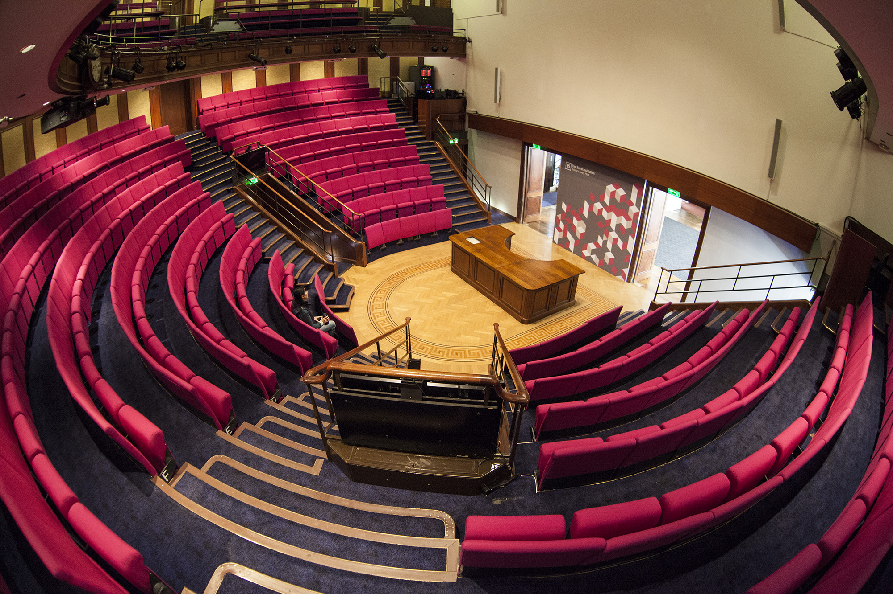
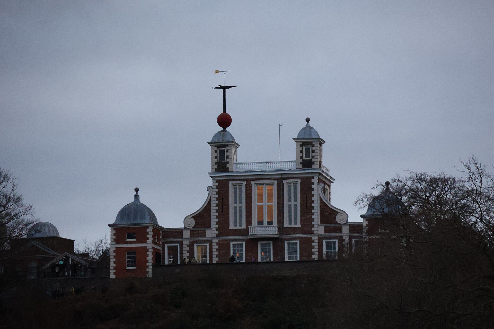
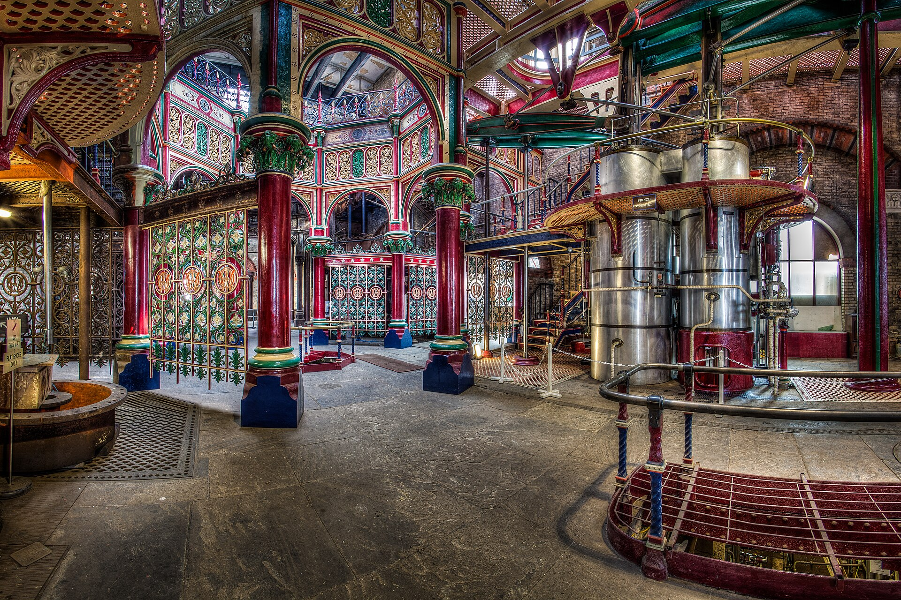
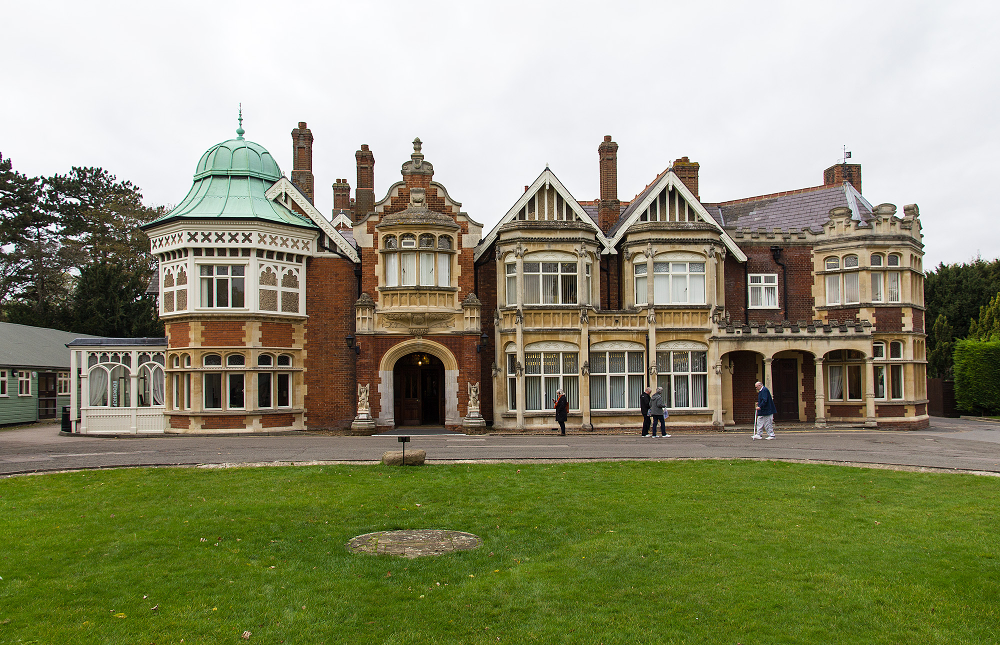

A Discourse at the Royal Institution begins at **7.30pm sharp with no introduction**, and the speaker is locked into a room ten minutes beforehand. The series has run since 1825.

Everything below is science in London that happens **on a date, with a way to book**: lectures, museum lates, planetarium shows, observatory nights, the October expo at ExCeL, and the Victorian pumping engines that only turn over on published dates. For the permanent collections — the Science Museum, the Natural History Museum, the Grant Museum, Wellcome — our [best museums in London guide](/articles/best-museums-london/) is the one you want.

> 💡 **The Short Version:** **[Gresham College](https://www.gresham.ac.uk/whats-on) has been free since 1597** and still is, in Holborn and online — but it oversells every lecture, so arrive 30 minutes early. **[Royal Institution](https://www.rigb.org/whats-on) Discourses are £20 or £15**, free to Ri Members, on selected Fridays; ordinary evening talks are £16 or £10. The **[Royal Society](https://royalsociety.org/science-events-and-lectures/public/) prize lectures are free**, and the YouTube stream needs no booking at all. **[New Scientist Live](https://live.newscientist.com/)** runs each October at ExCeL. The **[Peter Harrison Planetarium is closed](https://www.rmg.co.uk/whats-on/national-maritime-museum/astronomers-take-over)** — the replacement show is at the National Maritime Museum, £18 adult. **[Hampstead Observatory](https://www.hampsteadscience.ac.uk/observatory.html) is free** but runs evening sessions from **October to April only**, clear-sky only, with tickets live at 10am on the day. And four Victorian pumping stations still run their engines under steam on specific dates — **[Crossness](https://crossness.org.uk/visit/) on 6 December**, **[Kempton](https://kemptonsteam.org/whats-on/steaming-weekends/) on 29–31 December**, **[Kew Bridge](https://waterandsteam.org.uk/whats-on-new) on the last weekend of most months**, and **[Markfield](https://www.mbeam.org/visit) on 12 December**.

---

> 🧭 **Plan the rest of it:** [Best museums](/articles/best-museums-london/) · [Greenwich](/articles/greenwich-area-guide/) · [South Kensington](/articles/south-kensington-area-guide/) · [Hidden London](/articles/hidden-london-secret-places/) · [Things to do in October](/articles/things-to-do-in-london-in-october/)

## In the diary

Every date and price below is the organiser's own.

| Date | Price | What is on |
| --- | --- | --- |
| **Mon 26 Oct** | £16/£10 | Ri: Global fusion developments, the race for power, 7pm. The Ri's six-part particle physics short course with Harry Cliff runs 26 Oct to 30 Nov |
| **Wed 28 Oct** | Free | See Buildings Differently, a materials-science panel chaired by Mark Miodownik, the Royal Society |
| **Fri 30 Oct** | £20/£15 | Ri Discourse: Dame Ijeoma Uchegbu on drug delivery, 7.30pm |
| **Mon 2 Nov** | Members + one guest | RGS Monday Night Lecture: Lucy Hawkes on tracking wild animals, Kensington Gore, 6.30pm |
| **Tue 3 Nov** | Free | Croonian Prize Lecture: David Baker on computational protein design, the Royal Society, 6.30pm |
| **Tue 3 Nov** | £25, £15 members | NHM Dig Deeper: the team behind the *Wild London* documentary, Flett Theatre, 6.30pm |
| **Tue 10 Nov** | Free | Michael Faraday Prize Lecture: Anjali Goswami on evolution under pressure, the Royal Society, 6.30pm |
| **Tue 10 Nov** | Free | Gresham College: Alain Goriely on the end of mathematics and the AI crisis, Barnard's Inn Hall, 6pm |
| **Thu 12 Nov** | Free | Milner Prize Lecture: Johan Håstad on complexity theory, the Royal Society, 6.30pm |
| **Thu 19 Nov** | Free | Helen Czerski on the nitrogen cycle, Gresham College at Barnard's Inn Hall, 6pm |
| **Thu 19 Nov** | Free | Hampstead Scientific Society: George Allison on bone strength in children, 8pm |
| **Sat 28–Sun 29 Nov** | £15 adult, £5 child | November Steam Up, London Museum of Water & Steam, Brentford |
| **Sun 6 Dec** | £20.37 | Crossness Christmas Steaming Day, Thamesmead |
| **Sat 12 Dec** | Free | Markfield's last steaming day of 2026, engine running 12.30 and 2.30 |
| **Tue 29–Thu 31 Dec** | £12 and £15 | New Year's steaming at Kempton and the London Museum of Water & Steam |

---

## The lecture theatres

*Photo: [AnaConvTrans](https://commons.wikimedia.org/wiki/File:Royal_Institution_Lecture_Theatre.jpg), [CC BY-SA 4.0](https://creativecommons.org/licenses/by-sa/4.0/).*

### The Royal Institution, Albemarle Street

Two price bands. A **[Discourse](https://www.rigb.org/whats-on/discourse-how-get-molecule-obey-you) is £20 or £15 in the theatre and free to Ri Members and Patrons**, with a pay-what-you-can livestream from £5. Doors open about 6.50pm, you must be seated by 7.20pm, and there is a pay bar from 6pm. **Ordinary evening talks are £16 or £10, and £7 for Members**, usually 7pm to 8.30pm. Eventbrite's booking fee is on top of both.

The next Discourse is **Dame Ijeoma Uchegbu on 30 October**, on drug delivery. Ordinary talks run several nights a week, among them Alan Costley on fusion power on 26 October, and Harry Cliff teaches a six-part particle physics short course from 26 October to 30 November.

The **[Faraday Museum](https://www.rigb.org/visit/faraday-museum) downstairs is free** and holds Faraday's magnetic laboratory laid out as it was in the 1850s, opposite a working nanotechnology lab. The Ri is **[open Monday to Friday 9am to 5pm](https://www.rigb.org/visit)** and closed on bank holidays, and a 45-minute welcome tour is £10, or free to Members and refunded if you join on the day. Green Park is five minutes away and step-free.

### The Christmas Lectures are members-only

The **2026 [Christmas Lectures](https://www.rigb.org/christmas-lectures) are given by Jim Al-Khalili on the science of time**, filmed in the Ri theatre in mid-December and broadcast on BBC and iPlayer in late December. The audience is **young people aged 11 to 17**, and [tickets to the filming](https://www.rigb.org/christmas-lectures/join-us-christmas-lectures-live-filming) go exclusively to Ri Young Members, Members and Patrons. Membership starts at **£35 a year**, with 20% off the first year by Direct Debit, and family membership improves the odds of a ticket.

### Gresham College — free since 1597

**Every [Gresham lecture](https://www.gresham.ac.uk/whats-on) is free**, delivered by one of its professors, and streamed live as well as recorded. Most are at **Barnard's Inn Hall, Holborn EC1N 2HH**, two minutes from Chancery Lane; some are at Conway Hall, the Guildhall or LSO St Luke's, so check each one. Its archive of more than 3,500 past lectures is free to watch.

Two rules decide whether you get in. **In-person tickets are only released one month before the lecture**, through Eventbrite. And Gresham [deliberately oversells](https://www.gresham.ac.uk/faqs) every public lecture, so a ticket is not a seat — the college asks you to arrive **at least 30 minutes early**, and it no longer opens the overflow room downstairs. Children under 12 should be with an adult; there is no other age limit.

Coming up at Barnard's Inn Hall: Alain Goriely on **the end of mathematics and the AI crisis, Tuesday 10 November at 6pm**, and Helen Czerski on **the nitrogen cycle, Thursday 19 November at 6pm**.

### The Royal Society, Carlton House Terrace

**Free, and open to anyone.** The [public programme](https://royalsociety.org/science-events-and-lectures/public/) at 6–9 Carlton House Terrace SW1Y 5AG runs prize lectures and panels at 6.30pm, doors 6pm, with live subtitles. Coming up: **See Buildings Differently on 28 October**, the **Croonian Prize Lecture on 3 November** (David Baker on computational protein design), the **[Michael Faraday Prize Lecture on 10 November](https://royalsociety.org/science-events-and-lectures/2026/11/faraday-prize-lecture/)** (Anjali Goswami) and the **Milner Prize Lecture on 12 November** (Johan Håstad on complexity theory).

In-person seats are free but booked through Eventbrite, and the Society warns it issues more than it has seats, so entry is first-come. It also releases them in waves: for the Faraday lecture, **last-chance tickets go on sale on 27 October**. **Watching online needs no booking at all** — it goes out on the Society's YouTube channel with a live Q&A through Slido, and the recording stays up.

The free **[Summer Science Exhibition](https://royalsociety.org/science-events-and-lectures/summer-science-exhibition/)** fills the building for a week each summer; in 2026 it ran 30 June to 5 July with 13 flagship exhibits and was suitable for all ages.

### The Royal Geographical Society — members and one guest

The **[Monday Night Lectures](https://www.rgs.org/events/upcoming-events)** at 1 Kensington Gore SW7 2AR are the Society's flagship talks, and they are not open to the public: **Fellows and Members plus one guest**, included in membership, with a free ticket booked in advance. Doors 5.30pm at the Exhibition Road entrance, lecture 6.30pm in the Ondaatje Theatre, bar in the Map Room, card payments only. Every one is livestreamed, and members watching at home do not have to pre-book at all.

The autumn run is weekly: **Lucy Hawkes on tracking wild animals on 2 November** and polar expeditions on 9 November.

Membership is **£185 a year**, Fellowship from £144 — but **[Student Membership is free](https://www.rgs.org/join-us/student-membership)** for anyone studying GCSE, A Level or an undergraduate degree, which is the cheap way into the whole series. Separately, the Society hires the Ondaatje Theatre to outside promoters, and those nights are open to anyone at commercial prices.

### The Linnean Society, Burlington House

At Burlington House on Piccadilly. Its [events programme](https://www.linnean.org/meetings-and-events/events) runs lectures, workshops and its annual joint lecture with the British Ornithologists' Club, most of them also streamed.

The one to book is the **[Treasures Tour](https://www.linnean.org/research-collections/access/linnean-society-tours-1)**, which runs in the first week of each month and goes down into the bombproof collections store beneath the Piccadilly pavement, where Linnaeus's own specimens, books and archive are kept in controlled conditions. **90 minutes, £15 a head, £12 for members and £13 concession**, rising to £16.50, £13 and £15 for tours from 1 January 2027. **Age 16 and over only.** Private tours need a minimum of six people; individuals join the public tour.

### Imperial College, South Kensington

**Imperial Inaugurals** are term-time lectures marking a new professorship, **free, open to all, registration in advance, and livestreamed**. They run 5.30pm to 6.30pm on a Wednesday, usually in the City and Guilds Building. Imperial's [full listings](https://www.imperial.ac.uk/whats-on/) have the dates, and also carry named annual lectures and one-off events.

It is worth pairing with the museums two hundred metres away, which the [South Kensington area guide](/articles/south-kensington-area-guide/) covers.

### Hampstead Scientific Society

Founded 1899 and run entirely by volunteers. **[Talks](https://www.hampsteadscience.ac.uk/talks.html) are on the third Thursday of the month from September to May at 8pm**, at Hampstead Community Centre, 78 Hampstead High Street NW3 1RE. **Free, members and non-members both welcome**, tea and biscuits afterwards with the speaker. **George Allison of Sheffield on 19 November** on computational modelling of bone strength in children.

---

## Museums after dark

The collections are in the [museums guide](/articles/best-museums-london/). These are the things with a start time.

**[Wellcome Collection Lates](https://wellcomecollection.org/events)** take over the whole building on a Thursday evening, **7pm to 10pm, free but ticketed**, with one ticket covering the night and everything inside it on a first-come basis. Each Late has music in the atrium, short talks and gallery tours; dates are on the events page. Exhibitions, bar, café and shop stay open, and there is a low-lit quiet space.

**[NHM Dig Deeper](https://www.nhm.ac.uk/events/dig-deeper-talks.html)** is the Natural History Museum's evening panel series in the Flett Theatre by the East Entrance — **£25, or £15 for Members, doors 6.30pm, a drink included, recommended 12+**. On **Tuesday 3 November**, 6.30pm to 8.30pm, the filmmakers behind *Wild London* discuss shooting urban wildlife with a Museum scientist. Members book through a separate link, and Members who cannot attend watch free online; everyone else can buy a livestream ticket instead.

Two daytime NHM tours belong here too because they go where the public does not. The **[Spirit Collection tour](https://www.nhm.ac.uk/events/behind-the-scenes-tour-the-spirit-collection.html)** is **£35, or £28 for Members**, 45 minutes, ages 10+, meeting at the coral bay in Hintze Hall. Bags are not allowed and the cloakroom is included; there are chemical smells in the tank room, and the Museum says the tour is not suitable for pregnant visitors. The **[Science of the Natural History Museum tour](https://www.nhm.ac.uk/events/science-of-the-natural-history-museum.html)** is **£20, or £16 for Members**, an hour, from the Human Evolution Gallery, and now takes in the Fixing Our Broken Planet gallery.

For the full night, **[Dino Snores for Grown Ups](https://www.nhm.ac.uk/events/dino-snores-for-grown-ups.html)** is a sleepover under the galleries, **18.30 to 10.00, from £235, or £211.50 for Members**, with a three-course dinner, bars until 00:45 and a cooked breakfast; ages 18+ only. The VIP version at **£295** puts a camp bed on the upper balconies of Hintze Hall. Bring your own sleeping bag either way.

---

## Looking up

*Flamsteed House, Greenwich. Photo: [DiscoA340](https://commons.wikimedia.org/wiki/File:Royal_Observatory_Greenwich_(January_2024)_01.jpg), [CC BY-SA 4.0](https://creativecommons.org/licenses/by-sa/4.0/).*

### Royal Observatory Greenwich

**Closed from 2 November 2026** for the First Light refurbishment, due to finish by spring 2028; the Meridian Courtyard reopens in summer 2027, with tickets on sale in January ([project page](https://www.rmg.co.uk/royal-observatory/transformation)). Until 2 November it is **open daily, £24 adult, £18 student, £12 child, under-4s and Members free** — the [prices](https://www.rmg.co.uk/plan-your-visit/tickets-prices) — and **£3 for visitors on Universal Credit and several other benefits**. Standard hours are 10am to 5pm with last entry at 4pm. Two short guided add-ons run on top of entry at **£5 adult, £3.50 student and £2.50 child**: the **[Treasures Tour](https://www.rmg.co.uk/royal-observatory) daily at 11am and 3pm**, and the Lunar Tours daily at 1.30pm. Observatory Unlocked, where the Explainers take questions in the galleries, is on Saturdays and Sundays and costs nothing extra.

> ⚠️ **The Peter Harrison Planetarium is closed for renovation.** The replacement show is downstairs at the National Maritime Museum.

**[Astronomers Take Over](https://www.rmg.co.uk/whats-on/national-maritime-museum/astronomers-take-over)** is that replacement, and the booking page states that **no adults without children will be admitted**, so it is not an option for adults on their own. It is a **30-minute planetarium show presented live by the Observatory's own astronomers**, plus seven interactive zones — a Mars lander you aim at a crater, a spectroscope you split starlight with, a Moon room, a walk-through galaxy box. **£18 adult and £16 child with the planetarium, £8 for the zones alone, 25% off for Members**, 10am to 5pm with dates and times varying. It is inside the National Maritime Museum, which is free to enter.

The [Greenwich area guide](/articles/greenwich-area-guide/) has the rest of the hill, including the free view and how not to end up at North Greenwich by mistake.

### Hampstead Observatory

A **six-inch Cooke refractor from the late 19th century under a rotating dome**, on top of a Victorian covered reservoir just off Lower Terrace near Whitestone Pond, with a modern 16-inch Dobsonian beside it for fainter objects. Run by the Hampstead Scientific Society's volunteers.

**Evening sessions run October to April, usually Friday and Saturday from 8pm to 10pm, and only when the sky is clear.** In summer the dome closes for maintenance apart from occasional Sunday-morning solar viewings. Entry is **free but ticketed**, and the [booking rule](https://www.hampsteadscience.ac.uk/observatory.html) works like this: because the weather decides, **tickets only go live on Eventbrite at 10am on the day itself** for an evening session, and at 5pm the previous evening for a solar one. The Society posts on Facebook a few days ahead when a clear night looks likely.

Make an afternoon of it with the [Hampstead area guide](/articles/hampstead-area-guide/) and walk up over the Heath.

---

## The engines that only run on certain days

*The Beam Engine House, Crossness. Photo: [Nathusius2](https://commons.wikimedia.org/wiki/File:Crossness_Prince_Consort_Beam_Engine_IMG5999-03.jpg), [CC BY-SA 4.0](https://creativecommons.org/licenses/by-sa/4.0/).*

Four Victorian pumping stations around London still put steam into their original engines, and all four are volunteer-run and open on published dates, not daily. On a non-steaming day the engines stand still, so check which sort of day you are booking.

| Site | Price | Nearest station | What runs, and when |
| --- | --- | --- | --- |
| **[Crossness](https://crossness.org.uk/visit/)**, Thamesmead SE2 9AQ | £20.37 adult, £7.19 child 5–17 | Abbey Wood, Elizabeth line | The beam engine **Prince Consort** in the cast-iron Octagon, on Steaming Days only. **6 Dec** is the festive Steaming Day, 10am–3pm. Guided tours run on other dates but the engine does not turn |
| **[Kempton](https://kemptonsteam.org/whats-on/steaming-weekends/)**, Hanworth TW13 6XH | £12 adult, under-18s free | Kempton Park, 15 min | The **Sir William Prescott** triple-expansion engine, which the museum calls the largest working one in the world. Next steaming days **29–31 Dec**, 10.30am–4pm; the November weekend is cancelled. Static Sundays, March to October, are £7 |
| **[London Museum of Water & Steam](https://waterandsteam.org.uk/whats-on-new)**, Brentford TW8 0EN | £15 adult, £5 child on Steam Ups; £12/£4 otherwise | Kew Bridge | Steam Ups on the last weekend of most months: **28–29 Nov**, **29–31 Dec**. The Waddon, the Triple, Dancer's End and the Easton and Amos run every half hour from about 11.30 |
| **[Markfield](https://www.mbeam.org/visit)**, Tottenham N15 4RB | Free | Tottenham Hale or South Tottenham, 10 min | An 1886 engine built to lift Tottenham's sewage, in a riverside park. Open the second and fourth Sunday of most months, 10am–3.30pm. **Sat 12 Dec is the last steaming day of 2026**, engine running 12.30 and 2.30 |

**Crossness.** The Beam Engine House is Grade I listed, with painted and gilded cast iron around an octagonal well. Carers go free, Museums Association members go free and National Art Pass holders get 50% off. A **free vintage bus runs from Abbey Wood station on Steaming Days and special events**, but not for guided tours. Group and private tours are from £22.50 a head and photography visits from £36.

**Kempton** splits the day in two. Self-guided access to engine number 7 runs **10.30am to 1pm with last entry at 12.30pm**, then **guided tours every 20 minutes from 1.10pm to 3.10pm**, booked at reception when you arrive, six people at a time. Both involve steep stairs and carry a **minimum height of 1.4m** because of the historic railings. The [museum is closed from 20 October to 23 November 2026](https://kemptonsteam.org/visit-us/prices-opening-times/). Every public transport route ends in a walk of about 15 minutes: South Western Railway to Kempton Park, or bus 290 from Twickenham or Staines and the H25 from Feltham. Driving is simpler — the site is inside Greater London but outside both the Congestion Charge and the ULEZ.

**Kew Bridge.** The [museum](https://waterandsteam.org.uk/plan-your-visit) says it holds the world's largest collection of stationary steam engines, in the buildings of the old Kew Bridge Waterworks. On a Steam Up, two Cornish engines still standing in their original positions run to a timetable: the **Boulton & Watt from 12.15 to 12.45 and again 3.15 to 3.45**, the **Bull engine from 2.00 to 2.30**. Outside event days it opens **Thursday to Sunday, 10am to 4pm** and the engines are still. The **New Year's Steam Up on 29–31 December** adds a Routemaster shuttle to Kempton, 30 minutes each way, with both sites in steam; the bus is a heritage vehicle with no step-free access. It stands beside Kew Bridge station, 800 metres from the Elizabeth Gate of [Kew Gardens](/articles/kew-gardens-guide/) on the other side of the river.

**Markfield** costs nothing and sits in a park on the site of a Victorian sewage treatment works; volunteers run tours of the remains on most open days, booked at the museum door. There is a café and a playground, and level access to the engine hall.

Two more run below ground. **[Mail Rail](https://www.postalmuseum.org/visit-us/what-to-expect/mail-rail/)** at the Postal Museum runs a 15-minute ride through the Post Office's own tunnels, Tuesday to Sunday on a timed ticket included with museum entry — the [museums guide](/articles/best-museums-london/) has the price and the buggy rules. And the London Transport Museum's **[Hidden London](https://www.ltmuseum.co.uk/hidden-london)** tours open disused stations and wartime shelters to anyone aged 10 and over, with dates on sale to March 2027; the [hidden London guide](/articles/hidden-london-secret-places/) covers which ones are worth the money.

---

## The annual fixtures

| Event | Dates | Price | Where, and what you get |
| --- | --- | --- | --- |
| **[New Scientist Live](https://live.newscientist.com/)** | Each October | Ticketed | ExCeL London, Custom House on the DLR and Elizabeth line. Four stages over two public days, plus a show floor; the Monday is a Schools' Day |
| **[Great Exhibition Road Festival](https://www.greatexhibitionroadfestival.co.uk/)** | **19–20 Jun 2027** | Free | South Kensington's museums, Imperial and the Royal Albert Hall open the street between them for a weekend of science and arts |
| **[London Tech Week](https://londontechweek.com/)** | **7–11 Jun 2027** | Ticketed | Expo and content stages at Olympia 7–9 June; a fringe programme runs across London to the 11th |
| **[British Science Week](https://www.britishscienceweek.org/)** | **5–14 Mar 2027** | Mostly free | A ten-day national programme run by the British Science Association; the 2027 theme is Creativity |
| **[Royal Society Summer Science](https://royalsociety.org/science-events-and-lectures/summer-science-exhibition/)** | Early summer | Free | A week of research exhibits, talks and hands-on activities at Carlton House Terrace, all ages |
| **[Open House Festival](https://open-city.org.uk/open-house-festival)** | Nine days in Sep | Free | Buildings across all 33 boroughs, including engineering and infrastructure sites shut the rest of the year |

**New Scientist Live**'s two public days run **10am to 5pm** and the Schools' Day **9.30am to 3pm**; the four stages — Family, Future, Mind & Body, Universe — run in parallel from 10.30am. **Child tickets cover ages 6 to 17, under-5s go free, and under-14s must be accompanied.** Every talk is livestreamed and stays on demand for 12 months; if you are going in person you can add that for **£10**.

**Open House** is the way into buildings nobody sells tickets to the rest of the year, engineering sites included. The 2026 festival ran **12 to 20 September**. Plan around the timetable: the programme is published in early summer and booking for ticketed sites opens in mid August, with a free account needed first. Sites that ballot or book out do so in the first hours. [London on a budget](/articles/london-on-a-budget/) puts it in context with the rest of the free calendar.

---

## Bletchley Park: the day trip

*The Mansion, Bletchley Park. Photo: [David P Howard](https://commons.wikimedia.org/wiki/File:The_Mansion_at_Bletchley_Park_-_geograph.org.uk_-_4216465.jpg), [CC BY-SA 2.0](https://creativecommons.org/licenses/by-sa/2.0/).*

**Bletchley Park is in Milton Keynes, not London**, and it is a full day out, not an afternoon's detour — the Trust asks you to allow at least four hours and says a whole day is easy. Treat it like [Oxford](/articles/oxford-day-trip/) or [Cambridge](/articles/cambridge-day-trip/): one destination, a train each way.

**Getting there.** London Northwestern Railway runs **direct from Euston to Bletchley, typically about 50 minutes, 34 minutes on the fastest service**, with up to four trains an hour and 79 a day. The [operator's own fares](https://www.londonnorthwesternrailway.co.uk/train-times/london-euston-to-bletchley) are **Advance singles from £6.80**, an **Off-Peak Day Single at £11.60**, an **Off-Peak Day Return at £23.20** and an **Anytime Day Single at £25.50**. The first train out of Euston is 05:35 and the last is 01:39. **[Bletchley station is a five-minute walk](https://www.londonnorthwesternrailway.co.uk/attractions/trains-to-bletchley-park)**: turn right along Sherwood Drive, then left after 100 to 200 metres. Groups of three to nine get a third off off-peak fares with GroupSave.

**What it costs.** [Admission](https://www.bletchleypark.org.uk/plan-a-visit/) booked online before the day is **£25.87 adult, £23.62 senior or student, £13.50 for 12- to 17-year-olds, £6.75 for 8- to 11-year-olds and free under 8** — a 10% saving on the gate prices of £28.75, £26.25, £15.00 and £7.50. **Every ticket is an annual pass**, so it covers return visits free for twelve months, events included. Open daily 9.30am to 5pm to 31 October 2026 with last admission at 3pm, then 9.30am to 4pm from 1 November with last admission at 2pm, closed 24 to 26 December.

> 💷 **Your train ticket is worth two entries.** Bletchley Park is on the National Rail **2FOR1** list, so a rail ticket to Bletchley can get two people in for the price of one. Our [2FOR1 guide](/articles/national-rail-2for1-london-attractions/) explains why Oyster and contactless do not qualify and what you have to print.

**Do not miss the second museum.** [The National Museum of Computing](https://www.tnmoc.org/plan-your-visit) is in **Block H on the same estate**, and it is a separate charity with a separate ticket that a lot of visitors walk past. It holds the **[rebuilt Colossus](https://www.tnmoc.org/colossus)** — the world's first electronic computer, built to find the wheel settings of the Lorenz cipher the German high command used, and designed by Tommy Flowers at the Post Office Research Station in **Dollis Hill, north-west London**. The IEEE designated Colossus an **IEEE Milestone in 2026**. Day tickets are **£20 adult, £15 concession, £12.50 child aged 5–15 and £55 family**; annual tickets are £30, £25, £20 and £70. It opens **Tuesday, Thursday, Saturday and Sunday, 10.30am to 4.30pm in autumn and winter**, last admission an hour before closing, and it is 400 metres from Bletchley station. Two museums in one day is tight but doable on an early train.

[Day trips from London](/articles/day-trips-from-london/) compares the rest of what is reachable and back in a day.

---

## Five booking rules that catch people out

1. **A free ticket is not a seat.** Gresham College and the Royal Society both issue more tickets than they have chairs, on purpose. Gresham asks for 30 minutes; the Royal Society opens its doors at 6pm for a 6.30pm start.
2. **The on-sale date counts for more than the date of the talk.** Gresham releases in-person tickets exactly a month out. The NHM sells to Members two weeks before anyone else. The Royal Society drips prize-lecture tickets in three batches.
3. **Weather decides the observatory, so the ticket appears on the morning.** Hampstead's evening sessions go live at 10am on the day. There is no advance list.
4. **Steaming day or open day is not the same visit.** At Crossness the engine only runs on a Steaming Day; at Markfield most Sundays are open days with the engine still. Check which you are booking.
5. **The livestream is often the cheaper half of the same event.** An Ri Discourse is £20 in the room and pay-what-you-can from £5 online. Every Royal Society lecture goes out free on YouTube with no booking, while the seat in the room has to be reserved in a batch. NHM Members watch Dig Deeper online for nothing; everyone else pays £25 in the theatre or buys a livestream ticket.

If you are building a whole trip around this, [things to do in London in October](/articles/things-to-do-in-london-in-october/) has the month New Scientist Live lands in, [best time to visit London](/articles/best-time-to-visit-london/) sets the seasons against each other, and [getting around London](/articles/getting-around-london-transport-guide/) explains the fares out to Thamesmead, Brentford and Greenwich. For the consumer shows and fairs that aren't science but share New Scientist Live's calendar and venue, see our [exhibitions and conventions guide](/articles/exhibitions-conventions-london/).

---

