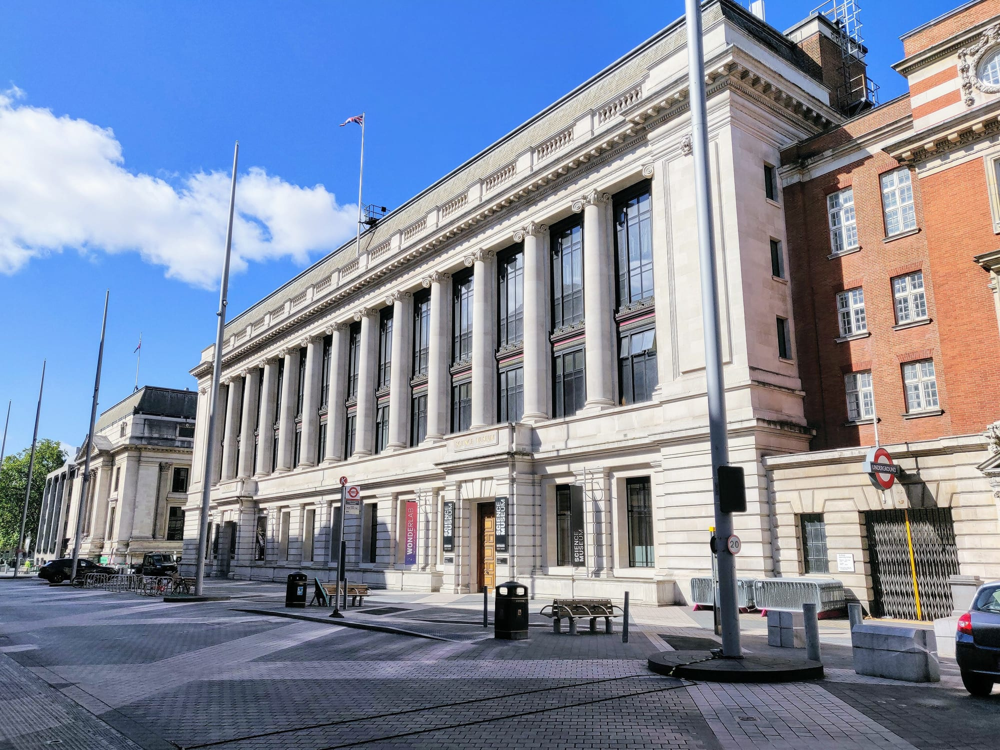
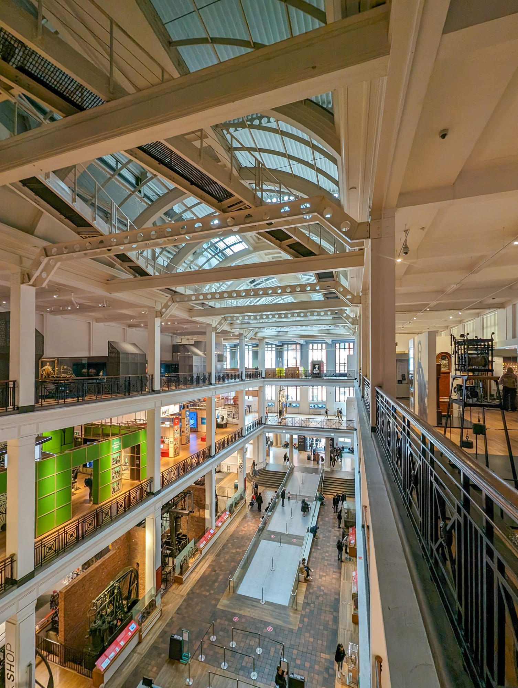
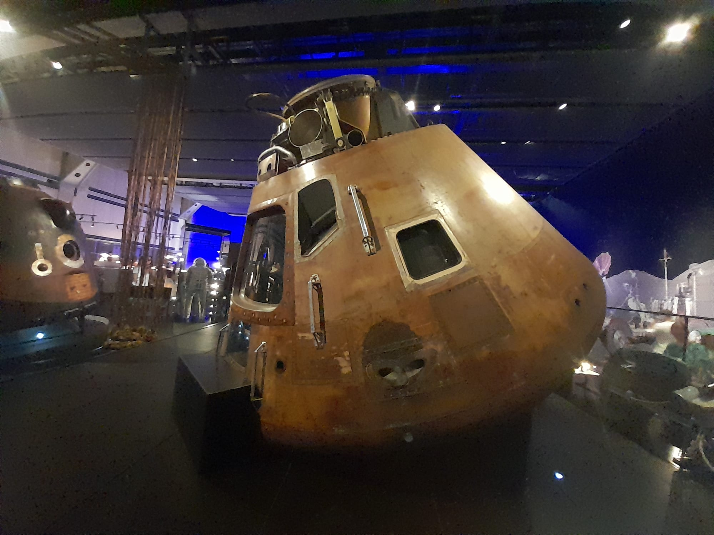
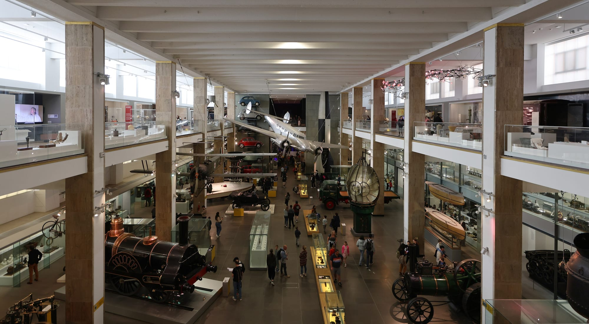
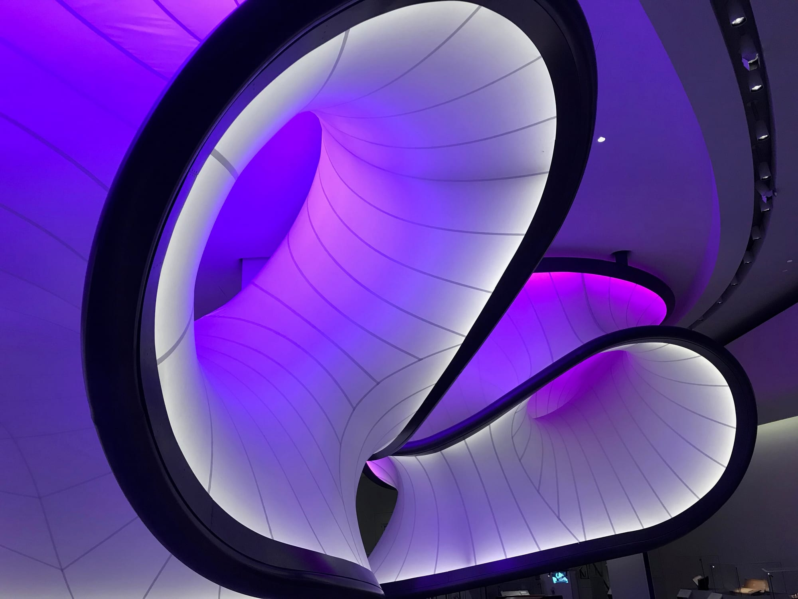
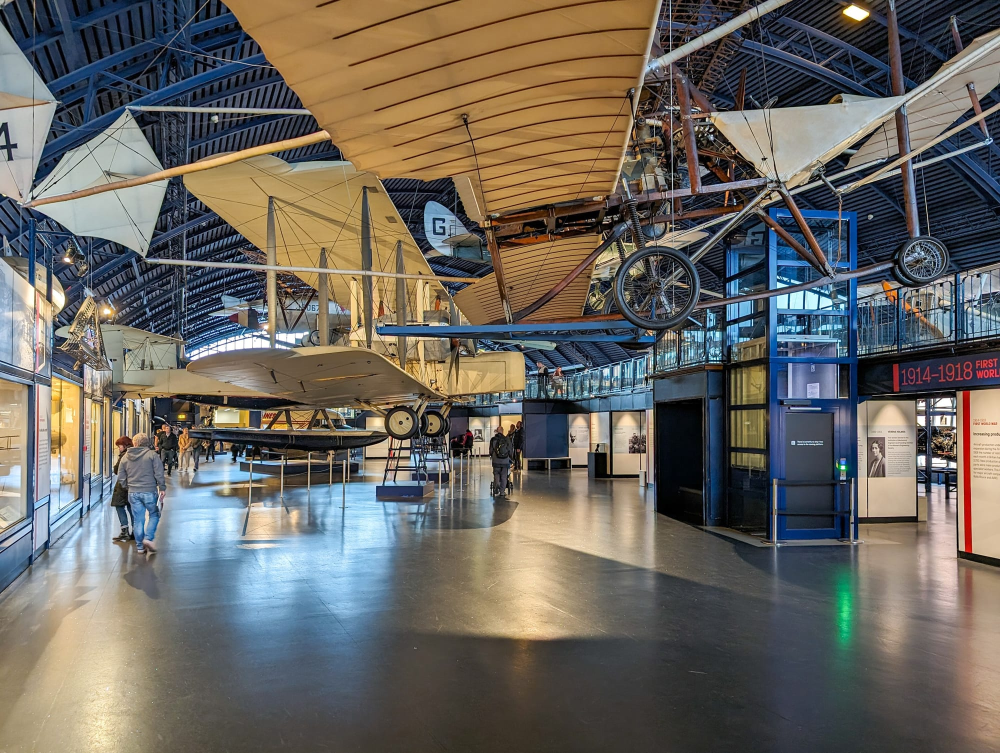

> 💡 **The Short Version:**
> - **Entry is free, daily 10:00 to 18:00** (last entry 17:15; closed 24–26 December). [Book a free timed ticket](https://tickets.sciencemuseum.org.uk/) first. An average visit is about two hours.
> - **Three paid attractions.** Wonderlab from £13.50 (ages 7–14), Power Up from £10 (ages 5 and over) and the IMAX cinema from £11. Booking ahead is cheaper than buying on the day.
> - **Free but ticketed:** *Becoming America: How Science Shaped a Nation* runs to 25 April 2027 and includes a rare 1776 print of the Declaration of Independence.
> - **Start on level 0:** the Energy Hall, Making the Modern World and the new Space gallery, where Apollo 10 sits beside a Soyuz capsule. Then go up for Medicine, Information Age and Flight.
> - **Adults only:** Pokémon x ESA Lates is on Thursday 26 November 2026, free and ticketed. Children aged 7 to 11 can sleep over at Astronights from £82.
> - **From South Kensington station it is a five-minute walk.** If you would rather have a guided audio route, <a href="https://www.getyourguide.com/activity/-t1535577?partner_id=WWP7I0R&amp;cmp=science-museum-guide" target="_blank" rel="sponsored nofollow noopener" data-affiliate="gyg">GetYourGuide sells a timed-entry audio tour</a>.

> ⚠️ **Book the free ticket, then book Wonderlab separately.** Wonderlab, Power Up and IMAX are not included in free admission, and the museum says they often sell out in school holidays. Wonderlab needs its own timed slot, so a general ticket alone will not get you in.

*Prices, opening times and event dates as of 15 November 2026.*

---

## Tickets, prices and opening hours

*The Exhibition Road front. Photo: [Shadowssettle](https://commons.wikimedia.org/wiki/File:Science_Museum,_Exhibition_Road.jpg), [CC BY-SA 4.0](https://creativecommons.org/licenses/by-sa/4.0/).*

Enter by the Main Entrance on Exhibition Road. Your arrival slot is printed on your ticket, so try to arrive within it. Children under 12 must be with an adult aged 18 or over.

| Attraction | Where | From | Notes |
| --- | --- | ---: | --- |
| **General admission** | Whole museum | Free | Free ticket booked online, with an arrival slot. |
| **[Wonderlab](https://www.sciencemuseum.org.uk/see-and-do/wonderlab)** | Level 3 | £13.50 | Ages 7–14. Free for ages 3 and under. Annual pass £29. Family groups of 3–5 with up to two adults get £3 off each pass. |
| **[Power Up](https://www.sciencemuseum.org.uk/see-and-do/power)** | Level -1 | £10 | Ages 5 and over; under-16s need an adult. Annual pass £26. |
| **[IMAX: The Ronson Theatre](https://www.sciencemuseum.org.uk/imax-cinema)** | West Hall, level 0 | £11 | Documentaries and some blockbusters. |
| **[Becoming America](https://www.sciencemuseum.org.uk/see-and-do/becoming-america)** | Special Exhibition Gallery 2, level 2 | Free | Ticketed, to 25 April 2027. Recommended for ages 11 and over. |

Day-pass prices fall if you book at least a day ahead, and the earliest and latest slots of the day are cheapest. Wonderlab also has a limited number of £5 adult tickets for people receiving Universal Credit or certain other benefits, bookable at least a day before and for up to five people per household.

**Opening hours:** daily 10:00 to 18:00, last entry 17:15. Galleries begin closing 30 minutes before the museum does, so a 16:00 arrival gives you about an hour. The museum is closed on 24, 25 and 26 December and keeps the same hours in school holidays. On Thursday 26 November 2026 it closes at 17:00.

**Short closures to know about:** Wonderlab closes at 16:00 on Tuesday 8 December 2026 and is shut from Monday 11 to Friday 15 January 2027. Flight is closed all day on Thursday 19 November 2026. Information Age opens at 11:00 on Sunday 13 December 2026 and Saturday 27 February 2027. The museum is building new galleries, so expect some noise and a few diverted routes.

For a guided audio route with timed entry, <a href="https://www.getyourguide.com/activity/-t1535577?partner_id=WWP7I0R&amp;cmp=science-museum-guide" target="_blank" rel="sponsored nofollow noopener" data-affiliate="gyg">GetYourGuide sells one</a>. Check live availability below:

Powered by <a target="_blank" rel="sponsored" href="https://www.getyourguide.com/london-l57/">GetYourGuide</a>

The museum's own Interactive Guide is a handheld device with a family tour and an adult tour. It costs £5 and is collected from the Energy Hall ticket desk, in English only.

---

## The galleries worth the walk

The museum is spread over levels -1 to 3, and the galleries are free unless marked. This order starts at the entrance and climbs.

### Level 0: the Energy Hall, Making the Modern World and Space

*Looking down into the Energy Hall. Photo: [The wub](https://commons.wikimedia.org/wiki/File:Energy_Hall,_Science_Museum,_London_(1).jpg), [CC BY-SA 4.0](https://creativecommons.org/licenses/by-sa/4.0/).*

- **Energy Hall:** full-size steam engines straight inside the entrance, including the oldest surviving unaltered atmospheric engine, rotative engines built by James Watt and a steam turbine designed and built by Charles Parsons.
- **Making the Modern World:** Babbage's Difference Engine No. 1, Crick and Watson's DNA model, the first Apple computer, penicillin from Fleming's laboratory and a clock built to run for 10,000 years. Some sections have been closed since 30 June 2026 while objects are moved for a new gallery, but most of it is open.
- **Space:** the museum's new free gallery, open in the West Hall beside the IMAX. Apollo 10, which orbited the Moon in 1969, stands next to a Soyuz capsule that went to the International Space Station in 2015, a pairing the museum calls a world first. It also holds the Sokol spacesuit worn by Helen Sharman, the first Briton in space, the radio headset Neil Armstrong used to speak to Mission Control, a three-billion-year-old Moon rock from Apollo 15 and a grain-sized sample of the asteroid Ryugu. The route there is along the level 0 corridor near Lifts and Stairs C, following signs towards the back of the museum.

*The Apollo 10 command module. Photo: [jeremySO](https://commons.wikimedia.org/wiki/File:2026-08-04_-_Science_Museum_-_10.jpg), [CC BY 4.0](https://creativecommons.org/licenses/by/4.0/).*

*Making the Modern World. Photo: [Geni](https://commons.wikimedia.org/wiki/File:Making_the_Modern_World_gallery_london_science_museum_2025.JPG), [CC BY-SA 4.0](https://creativecommons.org/licenses/by-sa/4.0/).*

### Level 1: Medicine and Technicians

- **Medicine: The Wellcome Galleries:** three thousand objects over 500 years of history, including the world's first MRI scanner, Fleming's penicillin mould, a professional pianist's prosthetic arm and robotic surgery equipment.
- **Technicians: The David Sainsbury Gallery:** a new free, hands-on gallery that puts you in workplaces from a film set to a pharmaceutical lab.

### Level 2: Information Age, Mathematics and Science City

- **Information Age:** six zones (Cable, Broadcast, Exchange, Constellation, Web and Cell) from the first BBC radio broadcast in 1922 to digital TV, with the wireless story of the Titanic and the Enfield Telephone Exchange, the last manual telephone switchboard.
- **Mathematics: The Winton Gallery:** designed by Zaha Hadid Architects, its curved white forms are a sculpture in themselves.
- **Science City 1550–1800: The Linbury Gallery:** how science shaped London between 1550 and 1800, with material from the Royal Society and the King George III collection.

*The Mathematics gallery. Photo: [Matt Brown](https://commons.wikimedia.org/wiki/File:Mathematics_gallery.jpg), [CC BY 2.0](https://creativecommons.org/licenses/by/2.0/).*

### Level 3: Flight and Wonderlab

- **Flight:** overhead walkways put you level with the aircraft, among them the 1909 Antoinette monoplane, Amy Johnson's Gipsy Moth, the Vickers Vimy that first crossed the Atlantic in 1919, a Hawker P1127 that led to the Harrier and a full slice of a Boeing 747.
- **Wonderlab:** 50 exhibits in seven zones (Maths, Electricity, Forces, Space, Light, Matter and Sound), with a giant Tesla coil, friction slides and a chemistry bar. Explainers run live shows in the Showspace all day, included in the ticket. Most visitors spend one to two hours.

*The Flight gallery. Photo: [The wub](https://commons.wikimedia.org/wiki/File:Flight_gallery,_Science_Museum,_London.jpg), [CC BY-SA 4.0](https://creativecommons.org/licenses/by-sa/4.0/).*

---

## Becoming America and the IMAX

**[Becoming America: How Science Shaped a Nation](https://www.sciencemuseum.org.uk/see-and-do/becoming-america)** runs to 25 April 2027. It is free but ticketed, and covers the 1760s to the 1790s through maps, paintings and instruments. Objects include a rare surviving 1776 print of the Declaration of Independence, an ornate microscope made for King George III, a dugout canoe built for the show and Benjamin Franklin's chart of the Gulf Stream. Free curator tours run on the second Wednesday of each month at 15:15, booked by phone on 033 0058 0058.

**The IMAX** is one of two cinemas in Europe that can show both digital and 70mm IMAX film. *Dune: Part Three* is listed in 70mm IMAX until 3 February 2027, and the IMAX also shows science documentaries on subjects such as Antarctica, T. rex and the International Space Station. Documentary tickets start from £11, and family groups of 3 to 5 get a discount.

---

## Lates, Astronights and the Space Show

- **Lates:** adults-only evenings, 18:30 to 22:00, with free general tickets and £12 VIP tickets. **Pokémon x ESA Lates** is on Thursday 26 November 2026, with free ticketed entry from 18:30 and last entry at 21:15. It has a Pokémon Space Trail, talks in the Mathematics and Space galleries and a board game café. Free entry to the Pokémon x ESA Shop at the event has sold out. Leave bags at home, because luggage and large items are not allowed and bag-carriers can be delayed at the door. [Lates dates](https://www.sciencemuseum.org.uk/see-and-do/lates) are announced on the museum's site.
- **Astronights:** sleepovers for children aged 7 to 11 and their adults, with a ratio of one adult to six children. Standard tickets start at £82 and VIP at £125. Doors open at 18:45, and tickets go off sale three days before each night. Dates: Saturday 5 December 2026, Friday 15 January, Friday 5 March and Friday 12 March 2027. A quieter SENsory Astronights runs on Saturday 20 February 2027 at £42.50 per camper. [Details and booking](https://www.sciencemuseum.org.uk/see-and-do/astronights).
- **The Space Show:** a free 20-minute live show at 11:30, 13:30 and 15:30 on Saturdays and Sundays until 25 March 2027, plus selected weekdays in school holidays. Book online to guarantee seats. [Show page](https://www.sciencemuseum.org.uk/see-and-do/space-show).

---

## With children

- **Under 7:** Wonderlab is recommended for ages 7 to 14. The Garden on level -1 and Pattern Pod on level 0 both have buggy parking for the length of your visit.
- **From 5:** Power Up is a hands-on games gallery with 160 consoles over 50 years, from Pong to Minecraft. It is also on level -1 and is not included in free admission.
- **Pushchairs:** buggies are welcome through most of the museum but not into some galleries, where you are asked to leave them in a designated area. Wonderlab lets you park inside it.
- **Family room:** on level -1, with baby changing across the museum and a breastfeeding space.
- **Trails:** free self-guided family trails are on the [Science Museum blog](https://blog.sciencemuseum.org.uk/), and Flight has a Lucky Jim trail.

If you are planning a day in South Kensington with children, our [London with Children guide](/articles/london-with-children/) pairs the museums with parks and hands-on galleries by age.

---

## Food, lockers and cloakroom

The cafés are run by Benugo, and the museum's [food and drink page](https://www.sciencemuseum.org.uk/visit/food-and-drink) has the menus.

- **Energy Café** (level 0, next to the Energy Hall, 10:00 to 17:30): hot meals, salads and lunchboxes. A kids' box is £6.80.
- **Space Café** (level 0, beside the Space gallery): pizzas and burgers. Weekdays 11:00 to 15:30, weekends 11:00 to 16:00 and 11:00 to 17:00 in school holidays.
- **Gallery Café** (level 2): cakes, coffee and sandwiches, closed Monday to Wednesday outside school holidays. Pre-booked afternoon tea is also served here.
- **Shake Bar** (level 3, opposite Wonderlab, 11:00 to 16:00): milkshakes and made-to-order ice cream tubs.
- **Picnics:** bring your own to the terrace on level -1 opposite The Garden, or the seating on levels 2 and 3. Picnic areas are shared with school groups.

**Lockers** are on level -1, card payment only: £3 for a coat or small bag, £5 for a rucksack and £7 for a carry-on-sized bag. The museum advises leaving suitcases at home. If you are on your way to or from the airport, see our [London luggage storage guide](/articles/luggage-storage-london/).

---

## Accessibility and quieter visits

- **Step-free access:** most of the museum, but there is no step-free access to the mezzanine in Making the Modern World or Flight.
- **Changing Places:** on level 0 next to the Hans Rausing Lecture Theatre, opened with a RADAR key or by asking staff.
- **Wheelchairs and stools:** a limited number are available. You can book a manual wheelchair in advance on 033 0058 0058 or borrow one at the Information Desk on the day.
- **Quieter times:** weekday afternoons in term time are the least busy. Ear defenders are free at the Information and Tickets desk, the IMAX box office and the Wonderlab desk, and the museum publishes a sensory map and a visual story. If the entrance queue is a barrier, ask staff for priority entry.
- **Assistance dogs** are welcome; other pets are not admitted.
- **Nearest step-free Tube:** Knightsbridge, a 15 to 20 minute walk, or take the C1, 14 or 74 bus to South Kensington station.

Our [step-free London guide](/articles/step-free-london/) covers the station and the rest of the area.

---

## Getting there

- **South Kensington station** (Circle, District and Piccadilly lines) is a five-minute walk. Gloucester Road is 15 minutes. The pedestrian subway from the station is covered in our [South Kensington guide](/articles/south-kensington-area-guide/).
- **Buses:** routes 14, 49, 70, 74, 345, 360, 414, 430 and C1 stop outside South Kensington station.
- **Cycling:** docking stations are outside the V&A and Natural History Museum on Exhibition Road, and on Thurloe Place.
- **Driving:** the museum has no car park and there is no visitor parking on Exhibition Road. The nearest pay-and-display is in Prince Consort Road and Queen's Gate. The museum is inside the ULEZ.
- **Next door:** the [Natural History Museum](/articles/natural-history-museum-guide/) is beside it on Exhibition Road and the [V&A](/articles/v-and-a-guide/) is across the road. Pick one for the morning and one for the afternoon.

---

## Common mistakes

1. **Assuming Wonderlab is included.** It needs its own ticket and timed slot.
2. **Arriving at 16:00 on a whim.** Last entry is 17:15, and galleries begin closing 30 minutes before the museum does.
3. **Taking young children to Wonderlab.** It is designed for 7 to 14. Power Up takes 5 and over.
4. **Looking for the old Exploring Space gallery.** It has closed. The new Space gallery is on level 0, in the West Hall.
5. **Bringing a bag to Lates.** Large items are not allowed, and bag-carriers can be delayed at the door.

---

## Continue planning your London trip

- 🖼️ **[London Exhibitions 2027](/articles/london-exhibitions-2027/)**: the year's big museum and gallery shows month by month, with prices and how each one books.
- 🏛️ **[South Kensington Area Guide](/articles/south-kensington-area-guide/)**: the station subway, the three museums and where to eat.
- 🦕 **[Natural History Museum Guide](/articles/natural-history-museum-guide/)**: the three entrances, Hope the blue whale and paid exhibitions.
- 🎨 **[V&A Guide](/articles/v-and-a-guide/)**: Friday late opening, the Cast Courts and the Raphael Cartoons.
- 🛏️ **[Where to Stay in South Kensington](/articles/where-to-stay-south-kensington/)**: hotels within walking distance of the museum quarter.
- 🖼️ **[The Best Museums in London](/articles/best-museums-london/)**: how the Science Museum compares with the others.
- 👨‍👩‍👧 **[London with Children](/articles/london-with-children/)**: pairing the Science Museum with parks, boat rides and hands-on galleries by age group.
- 🔬 **[Science in London](/articles/science-events-london/)**: lectures, museum Lates and the days the engines run.
- ♿ **[Step-Free London](/articles/step-free-london/)**: accessible Tube stations, bus ramps and Changing Places toilets.
- 🌧️ **[London in the Rain](/articles/london-in-the-rain/)**: indoor days across the city.
