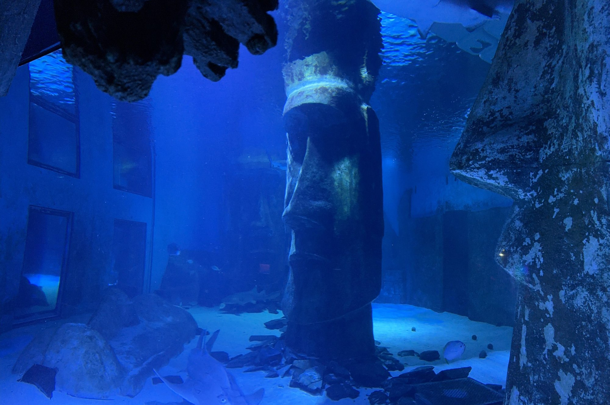
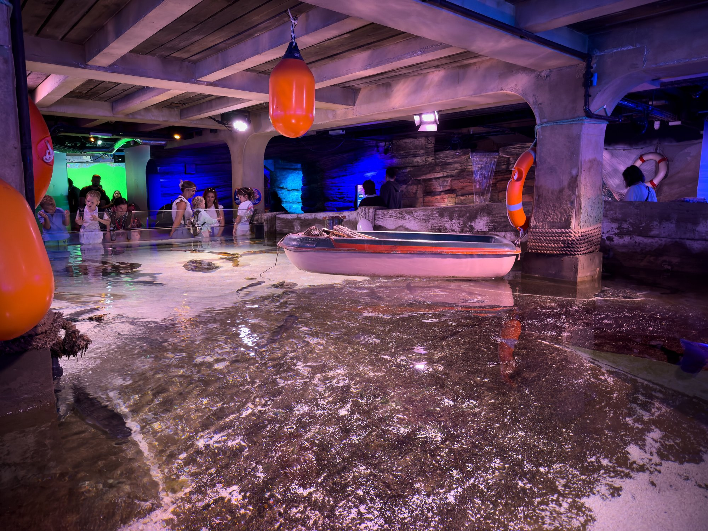
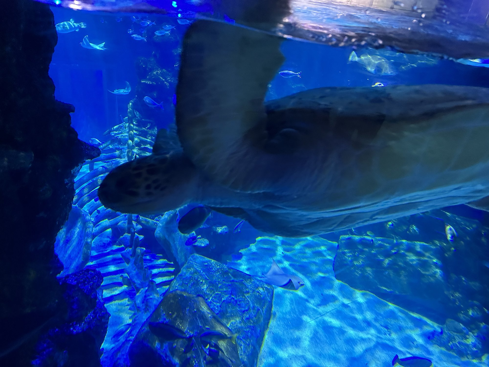
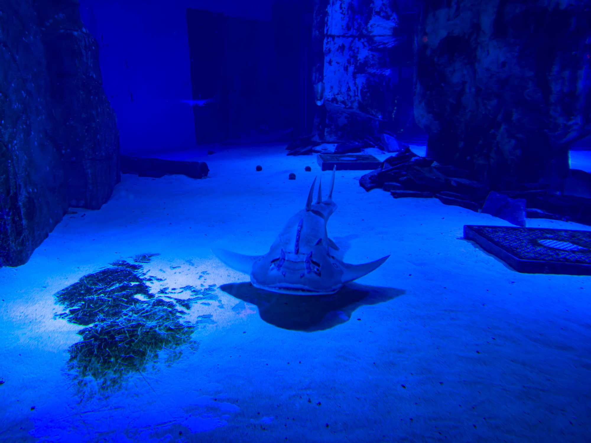
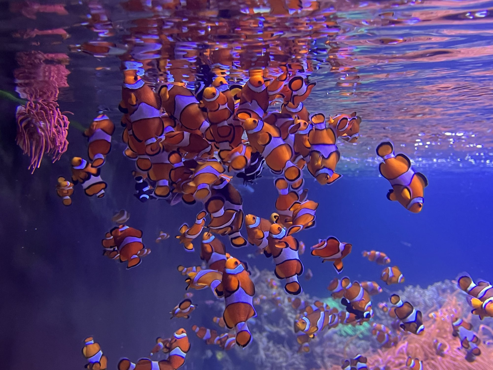
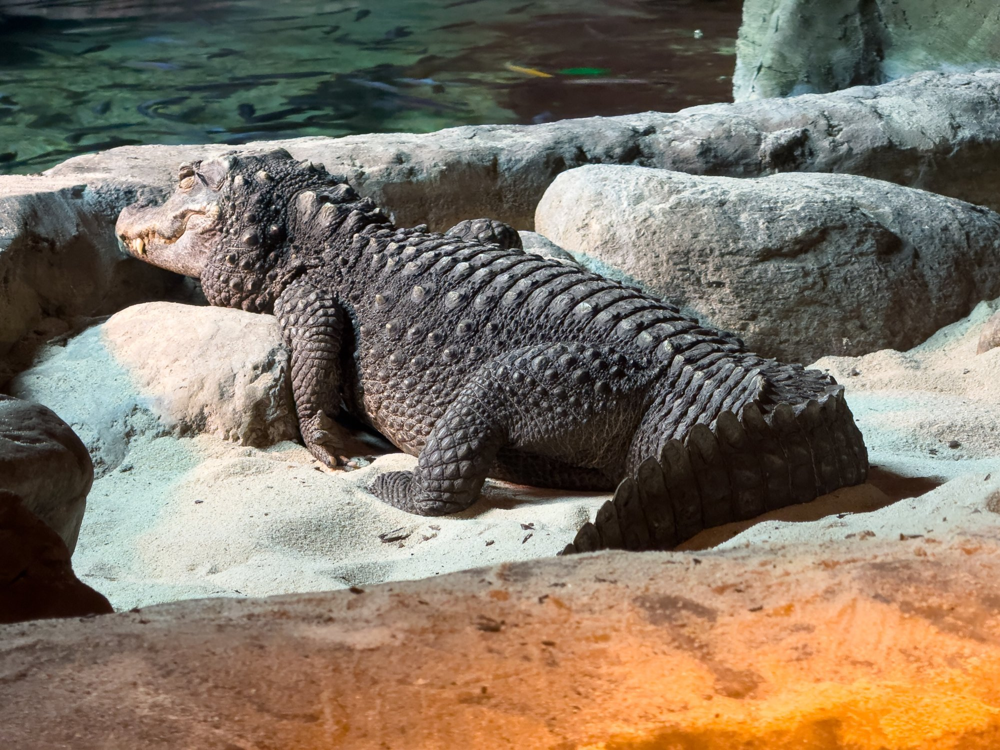
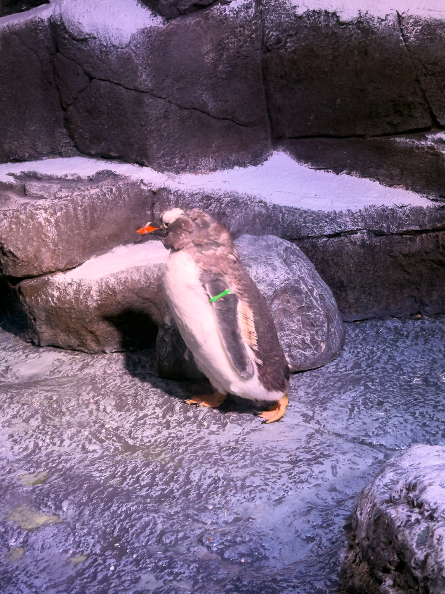
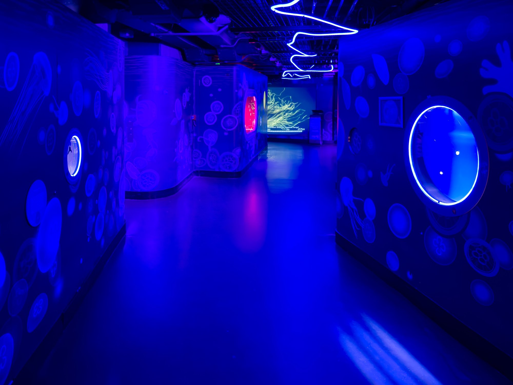

> 💡 **The Short Version:**
> - **The price:** An adult ticket is **from £28 online** and **£39 at the door**; a child aged 2 to 15 is **from £25 online** and **£35 at the door**; under-2s go free (November 2026). Online prices rise with demand.
> - **Combos:** SEA LIFE plus the London Eye is **from £49**; all five Merlin London attractions (SEA LIFE, the Eye, Madame Tussauds, the London Dungeon and Shrek's Adventure) are **from £59**. You get seven days to use the rest.
> - **Allow one to two hours.** Last entry is an hour before closing: 16:00 on weekdays until 18 December 2026.
> - **Penguins in winter:** their lights follow the southern-hemisphere day, so they go to sleep early. Book a morning slot if you want to see them awake.
> - **Quietest:** weekdays in term time, especially afternoons. Weekends and school holidays are busiest.
> - **Leave the suitcase at the hotel.** Suitcases and backpacks over 30 litres are refused, and there is no cloakroom. Pushchairs can go all the way round.

---

SEA LIFE London Aquarium fills the basement of County Hall, the former seat of London's government beside the London Eye. Its 14 zones run over three floors below ground, from a glass floor above the shark tank to a walk-through tunnel under 750,000 litres of tropical seawater, a gentoo penguin colony and a rainforest with piranhas and a dwarf crocodile.

---

## Tickets and prices

SEA LIFE is run by **Merlin Entertainments**, which also runs the London Eye, the London Dungeon and Shrek's Adventure in the same building, and Madame Tussauds in Marylebone. Prices are dynamic: the "from" figure is the cheapest online date, and SEA LIFE says booking ahead saves up to 28% on the door price.

| Ticket | Online | On the day | Details |
| :--- | :--- | :--- | :--- |
| **Standard, adult (16+)** | From £28 | £39 | A timed entry slot. |
| **Standard, child (2–15)** | From £25 | £35 | Under-2s free. |
| **Anytime Entry, adult** | From £33 | £44 | Arrive at any time on your chosen day. |
| **Standard + VR** | From £32 | £43 | Adds the virtual reality pods after the rainforest. |
| **Deluxe Package** | From £38 | £49 | Anytime entry, the VR and a mission pack or guidebook. |
| **Student** | From £16 | — | Online, for students registered with Student Beans. |
| **Carer** | Free | — | Booked with at least one full-price ticket; bring proof of eligibility. |

*Prices from [SEA LIFE London's tickets page](https://www.visitsealife.com/london/tickets-prices/), November 2026.*

[Book a standard ticket](https://ticketing.visitsealife.com/en/london/tickets/standard-sea-life-aquarium-tickets) on SEA LIFE's own booking page. There is no booking fee, and you show the QR code on your phone at the door.

SEA LIFE is **cashless**: pay by card or phone at the door, the café and the shop. Tickets are non-refundable, but you can move your date and time up to three times through the [manage your booking page](https://www.visitsealife.com/london/plan-your-visit/before-you-visit/manage-your-booking/), subject to availability. Walk-up entry is not guaranteed on busy days.

Dates, slots and prices through GetYourGuide:

Powered by <a target="_blank" rel="sponsored" href="https://www.getyourguide.com/london-l57/">GetYourGuide</a>

> ⚠️ **No suitcases, and no cloakroom.** Security refuses suitcases and any backpack over 30 litres, and SEA LIFE has nowhere to store them. The nearest left luggage is at the London Eye ticket office next door or at Waterloo station. Day bags and shopping are fine.

---

## Combination tickets and discounts

### Merlin's combination tickets

Bought on [SEA LIFE's multi-attraction page](https://www.visitsealife.com/london/tickets-prices/ways-to-visit/multi-attraction-tickets/), the slot you choose is for SEA LIFE. You then have **seven days** to visit the others, booking a free timed slot for each through Merlin's booking portal.

| Combination (adult) | Online from | Merlin's "bought separately" figure |
| :--- | :--- | :--- |
| SEA LIFE + London Eye | £49 | £78 |
| SEA LIFE + Madame Tussauds | £49 | £78 |
| SEA LIFE + Shrek's Adventure | £49 | £71 |
| SEA LIFE + London Eye + Shrek's Adventure | £54 | £110 |
| SEA LIFE + London Eye + Madame Tussauds | £54 | £117 |
| All five: SEA LIFE, the Eye, Tussauds, the London Dungeon, Shrek's Adventure | £59 | £184 |

*Prices from SEA LIFE London's multi-attraction page, November 2026.*

Merlin's "separately" column uses door prices. Against the cheapest advance prices, SEA LIFE and the Eye come to £57, so even the two-attraction combo saves £8. The **London Dungeon** is not suitable for under-5s and recommends 12 and over, so check it fits your family before counting it.

Three of the four are in County Hall: the London Eye's ticket hall, the Dungeon and Shrek's Adventure are all a few minutes' walk along the riverside. Madame Tussauds is on Marylebone Road; see our [Madame Tussauds guide](/articles/madame-tussauds-london-guide/) and our [London Eye guide](/articles/london-eye-guide/).

The five-attraction pass on GetYourGuide:

Powered by <a target="_blank" rel="sponsored" href="https://www.getyourguide.com/london-l57/">GetYourGuide</a>

### The Merlin Annual Pass

The pass covers SEA LIFE, the London Eye, Madame Tussauds, the London Dungeon and Shrek's Adventure, plus Merlin's theme parks. Passholders must still book a timeslot or they will not be let in. Our [Madame Tussauds guide](/articles/madame-tussauds-london-guide/) sets out the three tiers and their exclusion dates.

### One third off by train

Travel to London on a National Rail ticket and SEA LIFE is **one third off** through the [Days Out Guide](https://www.daysoutguide.co.uk/sea-life-london-aquarium). It is not 2FOR1. Our [National Rail 2FOR1 guide](/articles/national-rail-2for1-london-attractions/) explains the train ticket rules.

---

## Opening hours and the best time to go

| Dates (2026) | Open | Last entry |
| :--- | :--- | :--- |
| Mondays to Fridays, to 18 December | 10:00–17:00 | 16:00 |
| Saturdays, to 12 December | 10:00–19:00 | 18:00 |
| Sundays, to 13 December | 10:00–18:00 | 17:00 |
| 19 to 23 December | 10:00–19:00 | 18:00 |
| 24 December | 10:00–16:00 | 15:00 |
| 25 December | Closed | — |
| 26 December | 11:00–18:00 | 17:00 |
| 27 to 30 December | 10:00–19:00 | 18:00 |
| 31 December | 10:00–16:00 | 15:00 |

*Hours from [SEA LIFE London's opening hours page](https://www.visitsealife.com/london/plan-your-visit/before-you-visit/opening-hours/), November 2026. It has your date.*

SEA LIFE's own advice on crowds:

- **Busiest:** weekends and school holidays. Those dates are also the dearest online.
- **Quietest:** weekdays in term time, especially in the afternoon.
- **The tunnel** can have a short wait at peak times.

The afternoon advice has one catch in winter. The penguin enclosure follows the southern-hemisphere day to keep the gentoos' moulting and breeding on schedule, so from late autumn the lights go down early and the birds go to sleep. SEA LIFE warns they may not be visible in late-afternoon sessions. If the penguins are the reason for the visit, book the morning.

---

## What's inside

The route is one-way, over three floors below ground, with a lift and stairs at each change of level. SEA LIFE counts more than 500 sea creatures.

### The zones, in walking order

**Shark Walk.** The visit starts on a glass floor over the Pacific shark tank, with the sharks swimming beneath your feet. Staff can route you round it if a see-through floor is too much.

*The Easter Island heads in the shark tank. Photo: [Matt Brown](https://commons.wikimedia.org/wiki/File:Main_tank_of_London_Aquarium.jpg), [CC BY 2.0](https://creativecommons.org/licenses/by/2.0/).*

**The Atlantic coast and Ray Lagoon.** A shoal of sand eels and an Atlantic wolffish, then a shallow lagoon under a mock pier where rays glide below the surface. A window lower down shows their mouths and gills from beneath. The Ray Ranger talks here.

*Ray Lagoon, under the mock pier. Photo: [Mike Peel](https://commons.wikimedia.org/wiki/File:At_London_2025_643.jpg), [CC BY-SA 4.0](https://creativecommons.org/licenses/by-sa/4.0/).*

**Open Oceans and the tunnel.** The biggest tank, built round the replica ribcage of a grey whale, with zebra sharks, cownose and eagle rays, southern stingrays and tropical fish. The glass tunnel runs through it 5 metres below the surface, and the two green sea turtles, Boris and Dougie, swim overhead. Boris weighs about 135kg. The tunnel takes one to three minutes to walk; staff can take you round it instead.

*A green sea turtle in Open Oceans. Photo: [Matt Brown](https://commons.wikimedia.org/wiki/File:Turtle_at_London_Aquarium.jpg), [CC BY 2.0](https://creativecommons.org/licenses/by/2.0/).*

**The Shipwreck.** The shark tank seen from the side, set as a wreck among giant Easter Island heads. It holds five shark species: sand tiger sharks (Bungle and Zippy), four nurse sharks and blacktip reef sharks among them. Look on the sand for Betty, the bowmouth guitarfish, which the aquarium describes as half shark, half ray. The Shark Ranger talk is here.

*A bowmouth guitarfish on the floor of the shark tank. Photo: [Mike Peel](https://commons.wikimedia.org/wiki/File:At_London_2025_653.jpg), [CC BY-SA 4.0](https://creativecommons.org/licenses/by-sa/4.0/).*

**Coral Kingdom.** A 40-foot tank of living coral, which SEA LIFE bills as the UK's largest, with hundreds of clownfish, regal tangs and cardinalfish; the lighting moves from day to night. The aquarium is UK Border Force's partner at Heathrow for coral seized without the right paperwork, and gives it a home.

*Clownfish at feeding time. Photo: [Morhua](https://commons.wikimedia.org/wiki/File:Clownfish_feeding.jpg), [CC0 1.0](https://creativecommons.org/publicdomain/zero/1.0/).*

**Seahorses and seadragons.** Seahorses gripping seagrass with their tails, and seadragons trailing leaf-like fronds.

**Rainforest Adventure.** An Amazon set with a river of piranhas (SEA LIFE says it is the UK's biggest collection), pacu, terrapins, a leafcutter ant colony, a Chilean rose tarantula and Forrest, a dwarf crocodile, the smallest crocodile species. Bowser the snapping turtle was found at the bottom of a pond in Richmond Park in 2015. The virtual reality pods are just after this zone.

*The dwarf crocodile in Rainforest Adventure. Photo: [Mike Peel](https://commons.wikimedia.org/wiki/File:At_London_2025_656.jpg), [CC BY-SA 4.0](https://creativecommons.org/licenses/by-sa/4.0/).*

**Rockpool Explorer.** A hands-on pool where staff let you feel a skate egg and a shark egg.

**Polar Adventure.** The gentoo penguin colony on a mock Antarctic shore, with polar bears and an orca from the Arctic shown in augmented reality. Gentoos are the third-largest penguin and the fastest swimmer, at up to 22mph.

*A gentoo penguin in Polar Adventure. Photo: [Mike Peel](https://commons.wikimedia.org/wiki/File:At_London_2025_663.jpg), [CC BY-SA 4.0](https://creativecommons.org/licenses/by-sa/4.0/).*

**Ocean Invaders.** The jellyfish zone, which SEA LIFE calls the UK's largest jellyfish experience: moon jellyfish, upside-down jellyfish and Japanese sea nettles all year, the jellyfish life cycle in five stages, and a screen where you design your own.

*The Ocean Invaders jellyfish zone. Photo: [Mike Peel](https://commons.wikimedia.org/wiki/File:At_London_2025_669.jpg), [CC BY-SA 4.0](https://creativecommons.org/licenses/by-sa/4.0/).*

### Talks and feeds

Rangers give short talks at Ray Lagoon, the shark tank, Rainforest Adventure and the penguins, with public feeds and diver displays during the day. The [talks and feeding times page](https://www.visitsealife.com/london/plan-your-visit/information/talks-and-feeding-times/) lists them; check the times on the boards as you go in.

### Paid extras

| Experience | Price | What you get |
| :--- | :--- | :--- |
| **Behind the Scenes tour** | From £39.50 with entry | 30 minutes in the working areas: the life support systems and the food prep. Weekends and school holidays only. |
| **VIP Turtle Experience** | £200 for two | 30 minutes behind the scenes with Boris and Dougie at 14:30 on selected days. Ages 10 and over. |
| **Snorkel with Sharks** | £170 a person | 60 minutes, including 15 in a clear cage in the shark tank. Everyone must be at least 1.3m tall; under-18s snorkel with a parent. |
| **SEA LIFE Lates** | From £29 | Monthly after-hours evenings for over-18s, with a drink on arrival. |

*Prices from [SEA LIFE London's experiences page](https://www.visitsealife.com/london/tickets-prices/ways-to-visit/vip-experiences/) and the [Lates page](https://www.visitsealife.com/london/explore/events/sea-life-lates-event/), November 2026.*

**Christmas:** from 1 to 24 December 2026 the Elf on the Shelf trail is included with entry: children pick up an activity sheet at the start and solve challenges round the aquarium, earning a piece of the star for the undersea Christmas tree at each one.

---

## With children

- **Under-2s are free**, and child prices run to 15. SEA LIFE recommends the aquarium for ages 6 and over, but says it suits all ages.
- **Anyone under 16 must be with someone over 18.**
- **Pushchairs go all the way round**, with lifts beside every staircase, and a free buggy bay opens at weekends and on peak dates such as 16 to 31 December.
- **Every toilet block has baby changing** except the men's toilets at the end of Rainforest Adventure.
- **Things that scare some children:** the spiders, snakes and sharks, the glass Shark Walk, the tunnel and the costumed characters who roam some zones. Staff can route you round the first two and help you out at any point.

Our [London with children guide](/articles/london-with-children/) covers what else in London pays for itself with a family.

---

## Accessibility

- **Step-free throughout.** The aquarium is on three floors with a lift beside every staircase and a ramp at the exit. For safety, no more than ten wheelchairs can be inside at once, which matters for groups.
- **Three accessible toilets:** after the Shark Walk at ground level, after the rainforest on level −2 and before Ocean Invaders on level −1.
- **Free carer ticket** with any full-price ticket, booked at the same time. Bring proof such as a Blue Badge, a DLA or PIP award letter, a BD8 or CVI for visual impairment, or an Access Card with the carer symbol. It covers every attraction on a combination ticket, but not the paid experiences.
- **Low light and uneven floors** in places, and only a few seats along the route; staff will find you the nearest.
- **Flashing light:** there is no strobe, but the souvenir photo point after the Atlantic corridor uses flash.
- **Rockpool Explorer** is wheelchair accessible; the VR pods are not fully, though staff can bring a headset to your wheelchair.
- **Assistance dogs** are welcome.
- **BSL:** QR codes round the aquarium link to British Sign Language videos about the animals.
- **Quiet at the Aquarium** sessions run monthly for visitors with autism and other sensory needs. Details are on the [accessibility page](https://www.visitsealife.com/london/plan-your-visit/information/accessibility-guide/), with a downloadable sensory story.

Our [step-free London guide](/articles/step-free-london/) has the stations with lifts.

---

## Getting there

**Address:** Riverside Building, County Hall, Westminster Bridge Road, London SE1 7PB, next to the London Eye.

- **Westminster** (Circle, District and Jubilee lines): take Exit 1 and cross Westminster Bridge. The aquarium is visible from the bridge, five to seven minutes' walk.
- **Waterloo** (Bakerloo, Jubilee, Northern and Waterloo & City lines, and South Western Railway): follow signs for the South Bank (Exit 6) and walk towards the London Eye, six to nine minutes. Exits 2 and 3 are step-free.
- **Charing Cross** and **Embankment**: cross the Golden Jubilee footbridge and walk past the Eye along the river, 10 to 15 minutes.
- **Buses:** 12, 53, 59, 76, 148, 159, 211 and 341 stop on Westminster Bridge Road.
- **No parking on site.** The aquarium is inside the Congestion Charge zone.

---

## Nearby

The aquarium is the start of the South Bank. The [London Eye](/articles/london-eye-guide/) boards on the riverside outside, and the London Dungeon and Shrek's Adventure are in the same building. Across Westminster Bridge are Parliament and Big Ben; our [Westminster area guide](/articles/westminster-area-guide/) covers that side.

Our [South Bank walk](/articles/south-bank-walk/) starts at Westminster Bridge and follows the river past the Southbank Centre and Tate Modern to Tower Bridge. The [South Bank area guide](/articles/south-bank-area-guide/) has the food, theatres and streets behind the river, and [where to stay on the South Bank](/articles/where-to-stay-south-bank/) the hotels.

*Prices and opening times as listed by SEA LIFE London Aquarium, November 2026.*

---

Powered by <a target="_blank" rel="sponsored" href="https://www.getyourguide.com/london-l57/">GetYourGuide</a>

## Continue planning your London trip

- 🎡 **[London Eye guide](/articles/london-eye-guide/)** — prices, Fast Track and the sunset slot, for the other half of the most popular combo.
- 🕴️ **[Madame Tussauds London guide](/articles/madame-tussauds-london-guide/)** — prices, Fast Track and the zones inside.
- 🏛️ **[South Bank area guide](/articles/south-bank-area-guide/)** — the riverside, the Southbank Centre and where to eat.
- 🚶 **[South Bank walk](/articles/south-bank-walk/)** — Westminster Bridge to Tower Bridge along the river.
- 👨‍👩‍👧 **[London with children](/articles/london-with-children/)** — what is worth the money with a family.
- ☔ **[London in the rain](/articles/london-in-the-rain/)** — more indoor days out.
- 🚆 **[National Rail 2FOR1](/articles/national-rail-2for1-london-attractions/)** — what a train ticket gets you at London attractions.
- ♿ **[Step-free London](/articles/step-free-london/)** — accessible stations and attractions.
- 🏨 **[Where to stay on the South Bank](/articles/where-to-stay-south-bank/)** — hotels a walk from County Hall.
