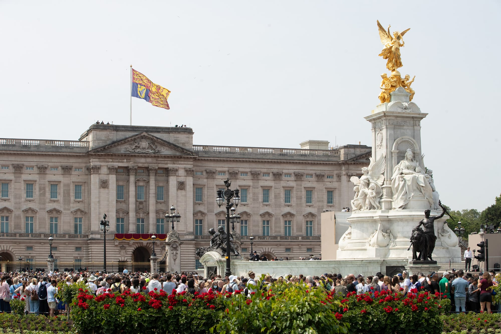
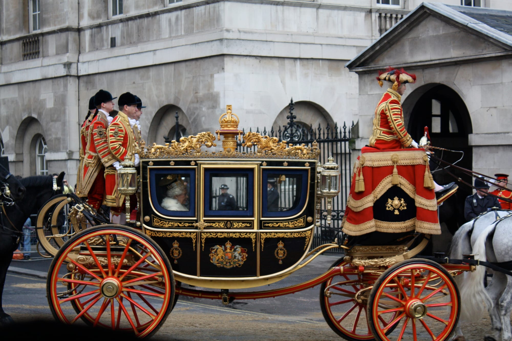
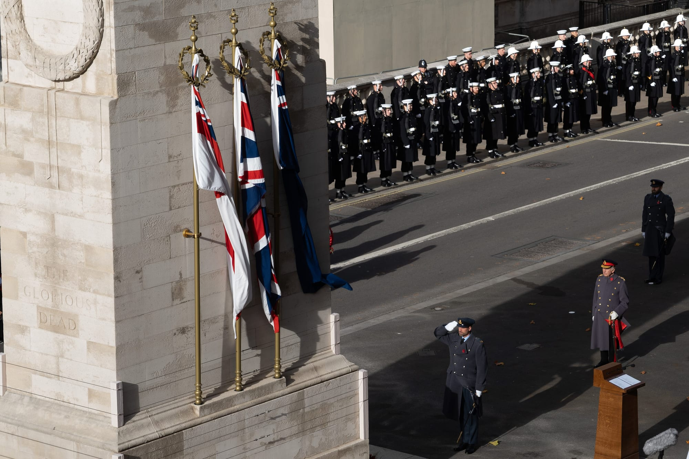
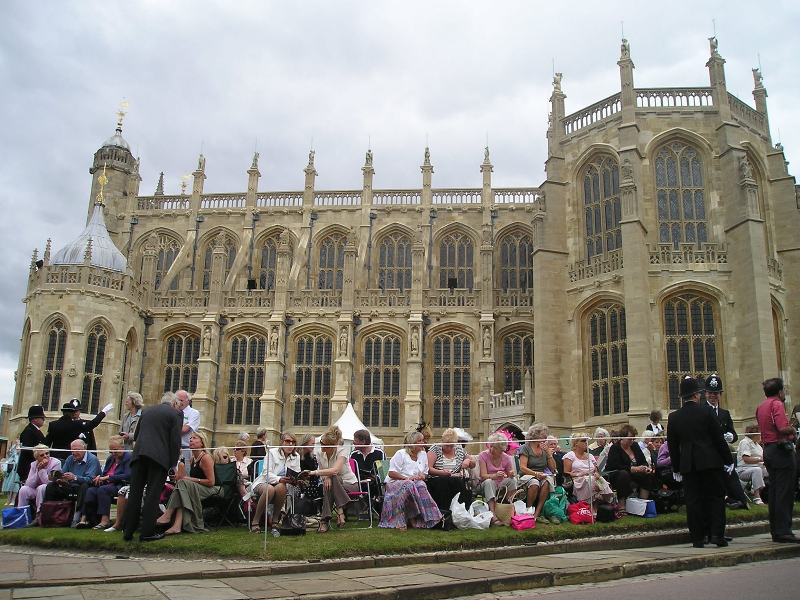

> 💡 **The Short Version:** The royal family is easiest to see in London on **Trooping the Colour**, a Saturday in June, when the King and the family appear on the Buckingham Palace balcony for the RAF fly-past at about 1pm. Stand on The Mall or the edge of St James's Park from 9am, or enter the ballot for a grandstand seat. **The State Opening of Parliament** (no fixed date) and **Remembrance Sunday** (the Sunday nearest 11 November) are free from the pavement on Whitehall. **Garter Day at Windsor** and **garden parties** need an application or a nomination. Outside those days the royals are not on display, and **Changing of the Guard** shows the soldiers, not the family.

*Dates are 2026's, from the Household Division, GOV.UK and the Royal Household. The 2027 dates for most events have not been published yet, so each section gives the usual pattern.*

## The events at a glance

| Event | When | Where | Free to watch? |
| --- | --- | --- | --- |
| **[Trooping the Colour](#trooping-the-colour)** | A Saturday in June (13 June in 2026) | The Mall, Horse Guards Parade, Buckingham Palace | Yes from the street; grandstand seats by ballot |
| **[State Opening of Parliament](#state-opening-of-parliament)** | Start of a new session; 13 May in 2026 | Buckingham Palace to Westminster, along The Mall and Whitehall | Yes |
| **[Remembrance Sunday](#remembrance-sunday)** | The Sunday nearest 11 November (14 November in 2027) | The Cenotaph, Whitehall | Yes |
| **[Garter Day](#garter-day-at-windsor)** | A Monday in June (15 June in 2026) | Windsor Castle | By ticket application |
| **[Royal garden parties](#royal-garden-parties)** | Summer | Buckingham Palace and the Palace of Holyroodhouse | Invitation only |
| **[Changing of the Guard](#changing-of-the-guard-and-the-palace-in-summer)** | Several days a week | Buckingham Palace, Horse Guards | Yes (no royals) |

## Trooping the Colour

**The King's official birthday is marked each June by a parade of 1,400 officers and soldiers and 200 horses on Horse Guards Parade**, and it is the one day each year when the family is on show together. The route runs from Buckingham Palace along The Mall to Horse Guards Parade and back. The ceremony opens with a Royal Salute and a 41-gun salute fired from The Green Park. The King inspects his troops, a regimental Colour is carried through the ranks of Foot Guards, and the King rides back to the Palace at the head of his Guards. **Then he joins other members of the royal family on the Buckingham Palace balcony to watch an RAF fly-past, at about 1pm.**

**Where to stand.** The Household Division advises standing on The Mall or at the edge of St James's Park overlooking Horse Guards Parade from 9am. The view from the park may be partly blocked by troops. For the balcony itself, the crowd gathers in front of the Palace around the Queen Victoria Memorial. The parade starts at about 10.20am. Nobody can park or be dropped off in Whitehall or round Horse Guards, so travel by Tube to St James's Park, Green Park or Charing Cross and walk.

**Seats.** Grandstand seats round Horse Guards Parade for the King's Birthday Parade are allocated by ballot, with a maximum of four tickets per application and a price of £30 each in 2026. The full parade is also run on the two Saturdays before, as the Colonel's Review and the Major General's Review, and tickets for those were on sale directly at £15 and £10 in 2026. The ballot and the sales run through [kbp.army.mod.uk](https://kbp.army.mod.uk). Ticket holders must follow a dress code: morning dress or a lounge suit, and no denim, shorts or sandals. Umbrellas and parasols are not allowed in the stands.

**Dates.** It is held on a Saturday in June, and the date for 2027 follows once the Household Division publishes it. The [Household Division's Trooping the Colour page](https://www.householddivision.org.uk/trooping-the-colour) carries the date and the map of vantage points.

*The crowd in front of Buckingham Palace before the balcony appearance. Photo: [Katie Chan](https://commons.wikimedia.org/wiki/File:Trooping_the_Colour_2023_(17).jpg), [CC BY-SA 4.0](https://creativecommons.org/licenses/by-sa/4.0/).*

## State Opening of Parliament

**The King travels from Buckingham Palace to the Palace of Westminster in a State coach, escorted by the Household Cavalry, to open each new session of Parliament.** The Imperial State Crown and the regalia travel ahead in a separate carriage. Spectators can watch the procession from The Mall and Whitehall; no ticket is needed, and crowds are large. The ceremony itself, with the King's Speech in the House of Lords, is not open to the public and is broadcast live.

The date is not fixed: it falls on the first day of a new parliamentary session or shortly after a general election. The 2026 State Opening was on Wednesday 13 May. Read the date in the news the week it is announced, and plan to be on the route early, as for any big London crowd. The Household Division's [State Opening page](https://www.householddivision.org.uk/state-opening-of-parliament) and the Royal Household's [account of the ceremony](https://www.royal.uk/state-opening-parliament) explain what each part is.

*The State Opening procession returning along Whitehall, 2008. Photo: [robertsharp](https://commons.wikimedia.org/wiki/File:State_Opening_of_Parliament_2008_I_(3082920424).jpg), [CC BY 2.0](https://creativecommons.org/licenses/by/2.0/).*

## Remembrance Sunday

**At the Cenotaph on Whitehall, the King and other members of the royal family lay wreaths at the National Service of Remembrance**, with senior politicians and Commonwealth and faith representatives, after the two-minute silence. It is held on the Sunday nearest 11 November, which makes it 14 November in 2027.

**No tickets or passes are needed.** The public watch from the pavements along Whitehall and Parliament Street. In 2026, per GOV.UK's plan for the day:

- **8am:** Whitehall opens to the public. Space is limited, and you go through police security checks.
- **From 10.30am:** detachments form up at the Cenotaph.
- **11am:** the guns of the King's Troop on Horse Guards Parade mark the two-minute silence and the service begins.
- **11.25am:** the service ends and the Royal British Legion detachments march past the Cenotaph.

Entry may be limited once the area is full. There are video screens north of the Cenotaph, outside Dover House, and on the corner of King Charles Street, south of it, and an enclosure for wheelchair users and others who find it hard to see, on the west side of Parliament Street, first come, first served. Don't bring large bags, and don't take photographs during the silence. Drones are banned. The details are in GOV.UK's [2026 guidance](https://www.gov.uk/guidance/national-service-of-remembrance-sunday-8-november-2026); the page for 2027 is published a month or so before the day.

*Remembrance Sunday at the Cenotaph, 9 November 2025. Photo: Department for Culture, Media & Sport, [CC0](https://creativecommons.org/publicdomain/zero/1.0/).*

## Garter Day at Windsor

**Every June the Knights of the Order of the Garter process on foot, in ceremonial dress with a band, from Windsor Castle to a service at St George's Chapel.** The Sovereign invests any new Companions in the Throne Room, hosts a lunch, and the party returns to the Upper Ward by carriage and car after the service. Garter Day was Monday 15 June in 2026.

**The public can watch only with a ticket.** A limited number of tickets let you see the procession to the chapel from inside the castle precincts. Applications go by email to GarterDay@royal.uk between 1 January and 1 March, with each person's full name and postal address, for up to four tickets. Ticket holders must be six or over, and you should say if anyone in the party uses a wheelchair. The Royal Household's [Order of the Garter page](https://www.royal.uk/the-order-of-the-garter) and [Windsor's page on Garter Day](https://www.windsor.gov.uk/ideas-and-inspiration/blog-latest-news/read/2026/01/experience-the-pomp-and-pageanty-of-garter-day-in-windsor-b112) give the current process. Our [Windsor day trip](/articles/windsor-day-trip/) covers the town and how to get there.

*Members of the public waiting outside St George's Chapel for the Garter Day procession. Photo: [Philip Allfrey](https://commons.wikimedia.org/wiki/File:St_George%27s_Chapel_Garter_Day.jpg), [CC BY-SA 2.5](https://creativecommons.org/licenses/by-sa/2.5/).*

## Royal garden parties

**Garden parties are by invitation only, and you cannot apply for one to the Palace.** Each year the Sovereign traditionally hosts four in summer: three at Buckingham Palace and one at the Palace of Holyroodhouse in Edinburgh, with over 30,000 guests across the season. Men wear morning dress or lounge suits, women day dress, usually with a hat or fascinator.

**How to get an invitation: be nominated.** The sponsors that nominate guests include the Lord-Lieutenants, societies and associations, government departments, local government, the services and the church. If you live in Greater London, the [Greater London Lieutenancy](https://greaterlondonlieutenancy.com/helping-you/hmqs-garden-parties/) takes nominations by email, with the nominee's contact details and a short citation. The deadline is the end of October for the following summer. The nominee must not know, and nominations from immediate family are discouraged. Nominees must live in the UK, can bring one guest over 18, and can attend only once in a lifetime. A letter comes from the Lieutenancy in January or February, and the official invitation follows from the Lord Chamberlain's Office about six weeks before the party. Outside London, nominate through your own county's Lieutenancy.

## Changing of the Guard and the palace in summer

**This is where to see the soldiers rather than the family.** The Changing of the Guard at Buckingham Palace runs on Monday, Wednesday and Friday, with the formal handover at 11am, and the mounted King's Life Guard changes at Horse Guards at 11am. Our [Changing of the Guard guide](/articles/buckingham-palace-changing-of-the-guard-guide/) has the times, the best places to stand and what the other days look like.

**Inside the palace.** The State Rooms open to ticket holders in summer, when the court is away; in 2027 the season is 8 July to 26 September, at £35 for an adult booked in advance. The King's Gallery and the Royal Mews stay open for much of the rest of the year. The same guide has the tickets, seasons and prices. If the Royal Standard is flying from the palace roof, the King is in residence; the Union Flag means he is away.

## Christmas at Sandringham

This one is outside London. The royal family usually goes to the Christmas morning service at St Mary Magdalene church on the Sandringham estate in Norfolk, and the public can watch from outside.

## Make a day of it

- **Westminster:** the State Opening route and the Cenotaph are minutes from [Westminster Abbey](/articles/westminster-abbey-guide/); see our [Westminster guide](/articles/westminster-area-guide/) and the [Westminster walk](/articles/westminster-walk/).
- **Kensington Palace:** the royal home you can walk round, covered in our [Kensington Palace guide](/articles/kensington-palace-guide/).
- **Hampton Court Palace:** Henry VIII's palace, in our [Hampton Court guide](/articles/hampton-court-palace-guide/).
