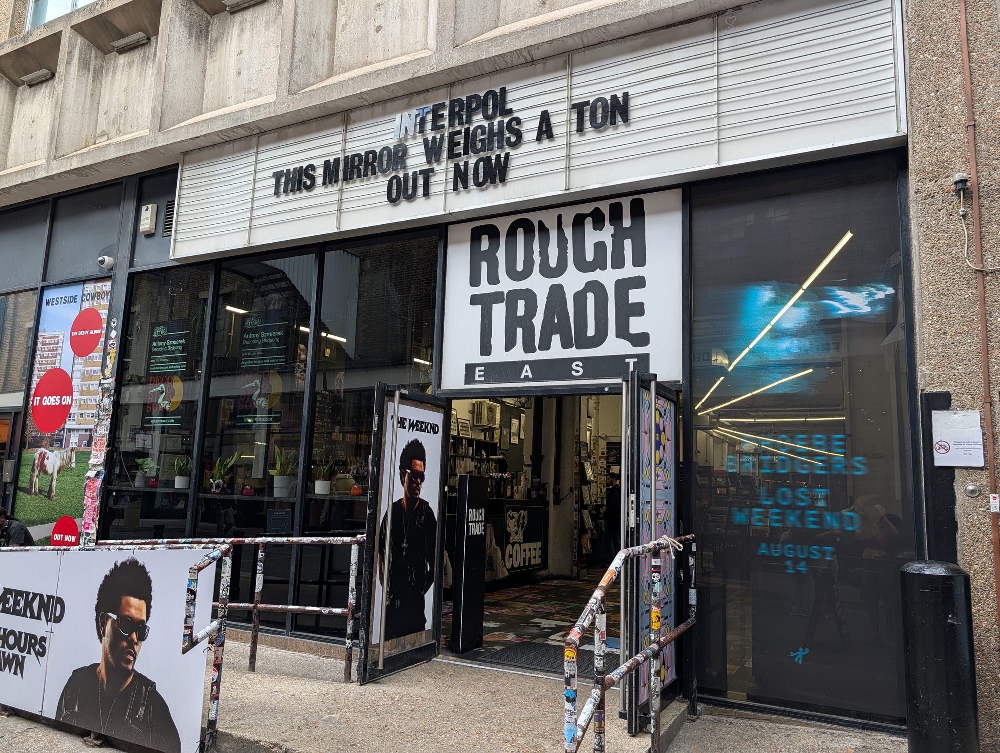
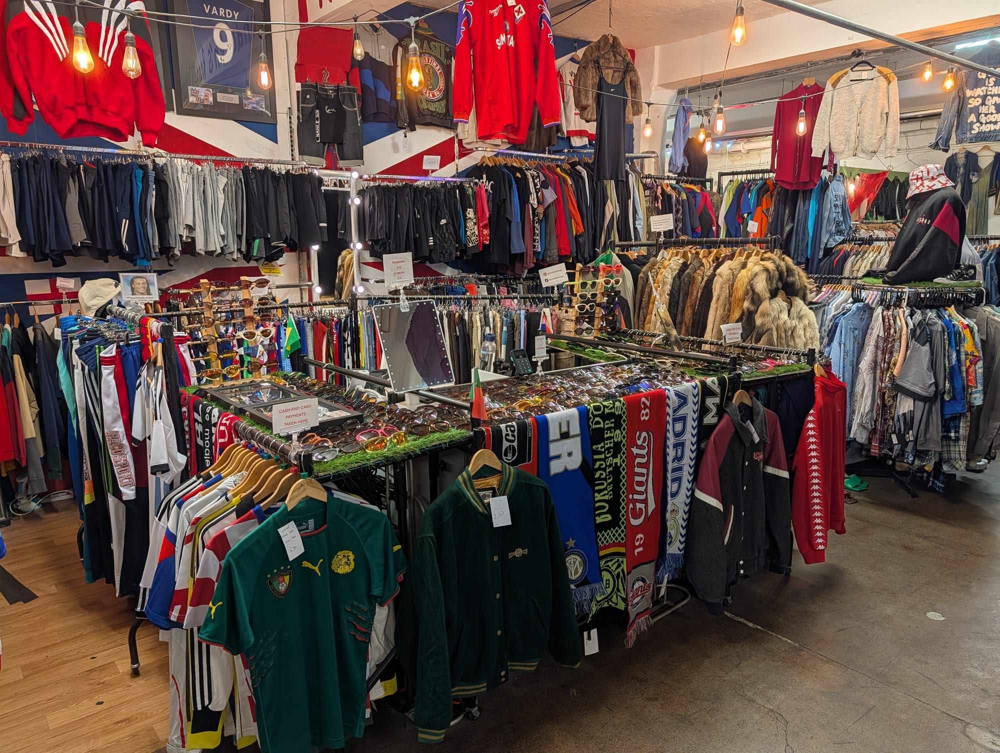
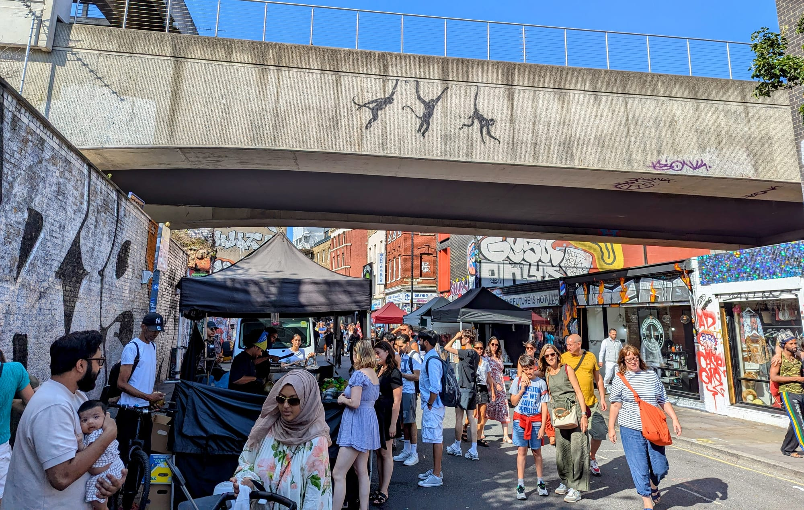
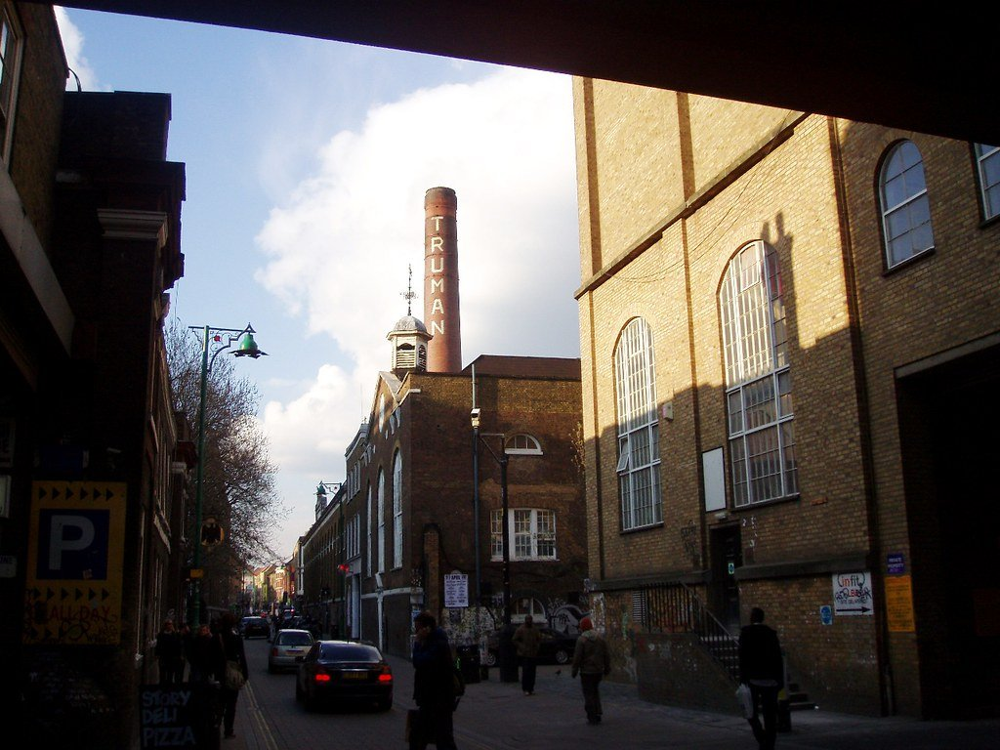
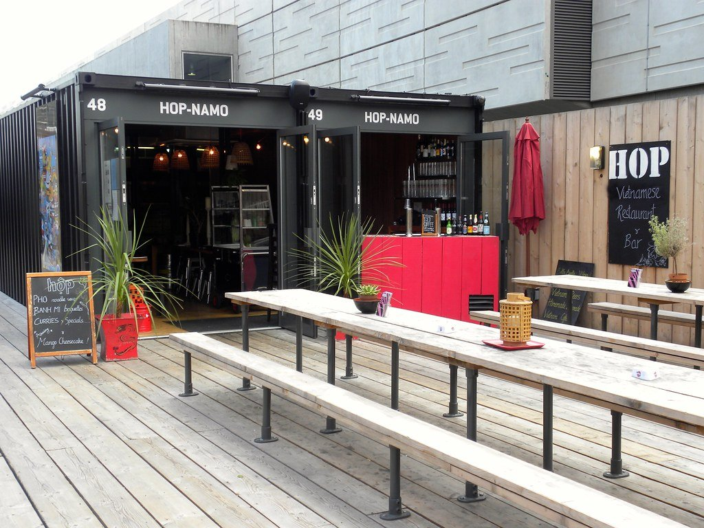

Shoreditch sits immediately north of the City: glass towers on one side, Victorian warehouses and painted walls on the other. Plan around the markets, which mostly run at the weekend, and the street art, which changes constantly.

**This guide covers Shoreditch, Spitalfields, Brick Lane and Hoxton together.** Old Spitalfields Market to the Truman Brewery is eight minutes, and Hoxton Square is ten minutes the other way.

Shoreditch has its own share of the commemorative plaques marking where notable people lived or worked - see them on our [interactive map](/plaques/?area=shoreditch).

## Why visit — and who should skip it

**Come here if** you like markets, vintage, street food or street art. On a Sunday there are four separate markets within twenty minutes' walk of each other, plus the flower market north-east.

**Skip it if** you come midweek expecting the weekend version. Monday to Thursday most of the markets are shut. Also skip it if you want traditional sights, as there are none.

## Top sights and activities

1. **The street art** — Hanbury Street, Chance Street, Redchurch Street, Grimsby Street and the Truman Brewery walls. It is repainted constantly, so treat it as a walk, not a checklist.
2. **Old Spitalfields Market** — A covered Victorian market hall trading daily, with different themes by day: antiques on Thursday (the hall opens early, at 08:00), records on the **first and third Friday of the month**, makers on Wednesday, and general and vintage at the weekend.
3. **Brick Lane** — Bangladeshi restaurants at the south end, vintage and street food around the Truman Brewery, and two rival bagel bakeries at the north, one of which never closes.
4. **Columbia Road Flower Market** — Sundays only, 08:00 to 15:00, fifteen minutes north-east.
5. **The Truman Brewery** — A former brewery complex holding separate markets, food halls, studios and event space either side of Brick Lane. Not all of them run on the same days.
6. **The Brick Lane Vintage Market** — Which the operator calls the largest vintage market in the UK, in a 13,000 sq ft basement under the Truman Brewery, with over a hundred shops. **Open seven days a week.**
7. **Dennis Severs' House** — A candlelit Georgian house on Folgate Street presented as if the family has just left the room: fires lit, food on the table, no labels and no talking. Booked in advance.
8. **Boxpark Shoreditch** — Shipping containers stacked into a food and retail court by Shoreditch High Street station.

*Shoreditch street art.*

## Key streets and micro-districts

### Brick Lane and the Truman Brewery

The spine of the area. **Bangladeshi restaurants at the south end** around the mosque, where the touts work the pavement. **The Truman Brewery in the middle**, which is where most of what people come for actually is. **The bagel bakeries at the north end**, where **Beigel Bake at 159 is open 24 hours a day, seven days a week** by its own account — and where the **Beigel Shop at 155**, the yellow-fronted one, is a completely separate business four doors down. [Which to pick is its own question](/articles/best-sandwiches-london/).

The buildings of the **Truman Brewery** on both sides of Brick Lane hold **separate markets**, plus studios, galleries and event space. They do not all run on the same days.

**Rough Trade East** is on Dray Walk inside the complex — a record shop with a stage at the back, and in-store gigs that are free with an album purchase.

*Rough Trade East, Dray Walk.*

### The Brick Lane Vintage Market

**The operator calls it the largest vintage market in the UK**, and it is the one thing in this area open seven days a week.

It is **underground**, in F Block at 85 Brick Lane, down a neon-lit staircase off the street: more than 13,000 square feet of basement holding **over a hundred shops**, each its own boutique.

Stock runs from the **1920s to the 1990s** — flapper dresses at one end and shell suits at the other — plus **fur and feather capes, vintage bridal wear, men's tailoring, hats, sunglasses, bags and jewellery**, and racks of **vinyl**.

**Open every day: Monday to Friday 11am–6.30pm, Saturday 11am–6pm, Sunday 10am–6pm.** Go on a weekday for room to browse the rails; Sunday is crowded. Prices are per item and vary by stall.

*The Brick Lane Vintage Market.*

*Brick Lane, under the railway bridge.*

**Next door, the Backyard Market** is the other half of the same trip: independent designer-makers inside a repurposed warehouse set back from Brick Lane, with street food stalls out front on the street. **Saturday 11am–6pm and Sunday 10am–6pm only** — so on a weekday, the vintage market is the one that is open.

### Spitalfields

Around the covered market hall. **Fournier Street and Princelet Street** are terraces of Georgian houses built for **Huguenot silk weavers** who arrived as refugees from France in the late 1600s; the wide upper windows are weavers' lofts. Many are still lived in, and **Dennis Severs' House** on Folgate Street is the one you can go inside. Book ahead.

**Old Spitalfields Market** trades daily under a Victorian roof, with a different theme by day — **antiques on Thursday**, when the hall opens early at 08:00; **records on the first and third Friday of the month**; makers on Wednesday; general and vintage at the weekend. The daily market runs 10:00–18:00 Monday to Saturday (Thursday from 08:00) and 10:00–17:00 on Sunday. The Kitchens, a dozen food counters around shared tables, opens 11:00–18:00 Monday to Saturday and 11:00–17:00 on Sunday.

*The Kitchens, Old Spitalfields.*

### Redchurch Street and Chance Street

**Redchurch Street** is a short run of independent fashion, skincare and homeware shops with coffee between them. **Chance Street and the alleys off it are walled with murals**, and they change constantly.

It is a ten-minute walk end to end, between the markets.

### Old Street

North-west, around the roundabout once called Silicon Roundabout. After dark it is bars, clubs and late licences; by day it is mostly tech offices and building sites. **Come here for a night out, not an afternoon**, and know that the good bars are on the streets leading off the roundabout, not on the junction.

### Hoxton
North of Old Street and calmer. **Hoxton Square** is a garden square with bars around it, and the **Museum of the Home** — a row of eighteenth-century almshouses laid out as domestic rooms from 1600 to now, free to enter, **10:00–17:00 Tuesday to Sunday and bank holiday Mondays, so shut on an ordinary Monday** — is a five-minute walk further north.

The bars around the square and along **Hoxton Street** are pubs and neighbourhood places rather than the queue-and-bouncer operations by Old Street roundabout. **Hoxton Street Market**, established in 1687, is a local street market running **Saturdays only, 09:00 to 16:00**, and closed on bank holidays apart from Good Friday. It is ten minutes' walk from Shoreditch High Street.

### Columbia Road

North-east, a residential street for six days of the week and, on **Sunday from 8am to around 3pm**, a flower market.

**Go at 8am** and you can move, talk to the growers and photograph the street. **Go in the last hour** and the traders cut prices to avoid carting stock home. The middle of the day is shoulder to shoulder.

The **shops along the street are open on Sunday too**: independent ceramics, prints, vintage and bakeries. It is fifteen minutes' walk north-east of Brick Lane.

*The Truman Brewery. Photo: [Ewan-M](https://www.flickr.com/photos/55935853@N00/2403737549), [CC BY-SA 2.0](https://creativecommons.org/licenses/by-sa/2.0/).*

Powered by <a target="_blank" rel="sponsored" href="https://www.getyourguide.com/london-l57/">GetYourGuide</a>

## Where to eat and drink

| Spot | Style | Price | Why go |
| --- | --- | --- | --- |
| **Beigel Bake** | Salt beef bagels | £ | Brick Lane, open 24 hours |
| **Dishoom Shoreditch** | Bombay-inspired Indian | ££ | The verandah room; expect to queue without a booking |
| **Old Spitalfields Market** | Food stalls | £ | Covered, daily, and the safe bet in bad weather |
| **Smoking Goat** | Thai barbecue | ££ | Shoreditch High Street; walk-in only downstairs |
| **The Ten Bells** | Historic pub | ££ | Beside Spitalfields, with its Victorian tiling intact |
| **Brick Lane Sunday food halls** | Street food | £ | Truman Brewery; dozens of traders under cover |
| **Upmarket, Brick Lane** | Street food | £ | Truman Brewery food hall, Mon–Sat 11am–6pm and Sun 10am–6pm |

**Smokestak** is named by nine of the fifteen sources behind our [barbecue guide](/articles/best-barbecue-london/), more than any other venue, and has a Michelin Bib Gourmand. The brisket goes over English oak for twelve to fourteen hours overnight.

*Boxpark Shoreditch. Photo: [JasonParis](https://www.flickr.com/photos/94064020@N00/8063833095), [CC BY 2.0](https://creativecommons.org/licenses/by/2.0/).*

For a night of singing, the Cocktail Club on Sclater Street and the Blues Kitchen on Curtain Road both have private karaoke rooms, and The Star of Bethnal Green has five themed rooms from £4 a head an hour. Our [karaoke guide](/articles/best-karaoke-london/) compares them.

Osteria Angelina, a short walk from Liverpool Street in Spitalfields, makes Japanese-Italian pasta in a glass-walled pasta lab. It is in our [fusion restaurants guide](/articles/best-fusion-restaurants-london/).

Four of the bars in our speakeasy guide are within a walk of here: Nightjar behind an unmarked door on City Road, Discount Suit Company in a former tailor's store room on Wentworth Street, The Mayor of Scaredy Cat Town through a fridge in The Breakfast Club on Artillery Lane, and The Natural Philosopher through a repair shop on Hackney Road. [The Best Speakeasy Bars in London](/articles/best-speakeasy-bars-london/) has the doors, prices and booking rules.

## Getting there

**By Overground.** **Shoreditch High Street** puts you at Boxpark and two minutes from Brick Lane.

**By Tube and Elizabeth line.** **Liverpool Street** is a ten-minute walk south, on the Elizabeth line, Central, Circle, Metropolitan and Hammersmith & City. **Old Street** (Northern) serves the north-west.

**Best exit.** From Liverpool Street, use the **Bishopsgate** exit and walk north — it takes you past Spitalfields on the way.

**On foot.** Fifteen minutes to the Tower, fifteen to St Paul's. The Elizabeth line reaches Canary Wharf from Liverpool Street in six minutes.

## How long to spend, and when to go

| If you have | Do this |
| --- | --- |
| **Two hours** | Spitalfields, Brick Lane and the Hanbury Street murals |
| **Half a day** | Add the Truman Brewery markets and Redchurch Street |
| **A full Sunday** | Start at Columbia Road at 08:00, then work south through everything |

**Best time:** Sunday. Every market runs, and the day rolls naturally into the evening bars.

**Avoid:** Monday to Wednesday if markets are your reason for coming — most are closed and the area is quiet.

Comparing neighbourhoods? [Best areas to visit in London](/articles/best-areas-to-visit-london/) sets them side by side by what each is best for, how long it takes and the best day to go.

## Walking routes

**[A Walk Through Shoreditch and Spitalfields: Columbia Road to Petticoat Lane →](/articles/shoreditch-spitalfields-walk/)**

Our full route for this area: **eleven numbered stops** over 2.6km, with a map, a Google Maps walking link and a day-by-day table of which market runs when. It takes in **Arnold Circus**, the **basement vintage market** that is the only thing here open seven days, and **Christ Church Spitalfields**, whose doors are open to visitors for three hours a week.

### The short version, if you only have a morning

1. **Start:** **Columbia Road Flower Market** at 08:30, before the crush.
2. **South to Brick Lane:** Through Hackney Road to the **Truman Brewery** food halls.
3. **Street art:** West along **Hanbury Street** and **Chance Street**.
4. **Redchurch Street:** The independent shops and more murals.
5. **Spitalfields:** South to **Old Spitalfields Market** and the Georgian streets around Fournier Street.
6. **Finish:** A salt beef bagel at **Beigel Bake**, or a drink at The Ten Bells.

Powered by <a target="_blank" rel="sponsored" href="https://www.getyourguide.com/london-l57/">GetYourGuide</a>

## Common mistakes to avoid

1. **Coming on a Monday or Tuesday expecting the full picture.** Most of the markets do not run. **Old Spitalfields trades daily**, and so does the **Brick Lane Vintage Market**.
2. **Missing Columbia Road.** Sunday morning only, fifteen minutes away.
3. **Following an old street art map.** Pieces are painted over within months. Walk the streets; do not hunt specific murals.
4. **Being pulled into a Brick Lane restaurant by a tout.** Keep walking.
5. **Arriving at Columbia Road at midday.** By then it is shoulder to shoulder. Go at 08:30 or in the final hour for discounts.
6. **Assuming Shoreditch High Street is on the Tube.** It is Overground only. Liverpool Street is the Tube option.

## Where to stay

Lively, well connected and good value against Zone 1 proper — but loud at weekends.

- **Shoreditch and Old Street** — Design-led hotels in converted warehouses. Book away from the street.
- **Liverpool Street and Aldgate** — Ten minutes south, quieter at night, excellent transport including the Elizabeth line.
- **Whitechapel** — East and cheaper, on the Elizabeth line and District line.

For the hotels compared, which streets are loud at 2am, and the areas within fifteen minutes where the same night costs half as much, see [where to stay in Shoreditch](/articles/where-to-stay-shoreditch/).
