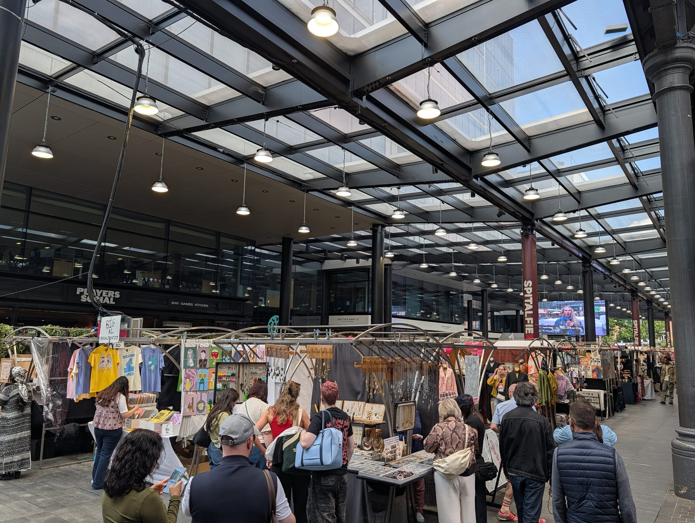

In this part of London the question is not where to go but **which day**.

Columbia Road exists on a Sunday and not on a Tuesday. The Brick Lane street market is a Sunday. Four of the Old Truman Brewery's eight markets are weekends only. Christ Church Spitalfields opens to visitors for two hours a week. Petticoat Lane is two different markets on two different streets depending on whether it is a weekday or a Sunday.

**This route runs north to south**, from Columbia Road Flower Market through the Boundary Estate and the length of Brick Lane, and finishes at Petticoat Lane. Eleven numbered stops, **2.6km and about 35 minutes of walking**, a half day once the markets get involved. It is free apart from what you buy.

For the bars, Hoxton and where to stay, see the [Shoreditch area guide](/articles/shoreditch-area-guide/).

> 💡 **The Short Version:** Go on a **Sunday** and start at **Columbia Road at 8am**, because it shuts at about 3pm and does not run any other day. Walk **south** the whole way. The stop people miss is the **Brick Lane Vintage Market**, a basement under the Truman Brewery that is open **seven days a week**. **Christ Church** lets visitors in on **Sunday afternoons only**. There are **two bagel shops**, not one. Finish at **Petticoat Lane**, then Liverpool Street.

## The route

  

    Map of the walk, numbered in walking order
  

  

    
Loading the map…

  

  

    <i class="route-map-marker" aria-hidden="true">1</i> On the route, in walking order
    <i class="route-map-marker route-map-marker--alt" aria-hidden="true">+</i> Optional detour
  

  <noscript>
    
The map needs JavaScript. Every stop below is numbered in walking order with its nearest station.

  </noscript>

**[Open the whole route in Google Maps →](https://www.google.com/maps/dir/?api=1&origin=51.529218,-0.06962&destination=51.516593,-0.074856&waypoints=51.526042,-0.074906%7C51.524449,-0.074633%7C51.524512,-0.071753%7C51.521267,-0.071908%7C51.520478,-0.072303%7C51.520287,-0.070903%7C51.519441,-0.072051%7C51.519122,-0.07375%7C51.519594,-0.075373&travelmode=walking)** — all eleven stops in walking order, set to walking directions, which is the version to put on your phone.

| # | Stop | Cost | Open |
| --- | --- | --- | --- |
| **1** | Columbia Road Flower Market | Free to walk | **Sunday only**, 8am–3pm |
| **2** | Arnold Circus & the Boundary Estate | Free | Always |
| **3** | Redchurch Street | Free to walk | Shop hours; street always |
| **4** | The two bagel shops | Free to walk | Beigel Bake **24 hours, 7 days** |
| **5** | The Old Truman Brewery | Free | **Eight markets, different days** |
| **6** | Brick Lane Vintage Market | Free to enter | **Seven days** |
| **7** | Hanbury Street & the street art | Free | Always |
| **8** | Brick Lane's south end & the Jamme Masjid | Free to walk | Street market **Sunday only** |
| **9** | Fournier Street & Christ Church | Free | Church **Sunday 1–4pm only** |
| **10** | Old Spitalfields Market | Free | Seven days, themed by day |
| **11** | Petticoat Lane | Free | **Sunday and weekdays, two sites** |
| **+** | Dennis Severs' House | **£16 + fee** | **Friday to Sunday only** |

---

## 1. Columbia Road Flower Market

**Sunday, 8am until about 3pm.** The market's own site says "8am 'til 3'ish"; Tower Hamlets, which licenses it, has the traders down until 2pm. Treat the last hour as the wind-down.

There is no midweek version. Six days a week Columbia Road is a quiet Victorian terrace in Bethnal Green; on Sunday it is a wall of cut flowers and potted plants with growers shouting over the top of them.

**Go at 8am or after 2pm.** Early gets you room to move and the pick of the stock. The last hour is when traders cut prices rather than cart stock home. Between about ten and one you are wedged in a crowd, unable to carry a plant.

**The shops open too.** The street has more than 60 independent shops, cafés and galleries, which open on Sunday because the market does. Some also trade during the week, which helps if you want the street without the crush.

> ⚠️ **If you are not walking on a Sunday, start at stop 2 instead.** Midweek Columbia Road is a residential street. Arnold Circus is six minutes' walk south.

## 2. Arnold Circus and the Boundary Estate

Six minutes south. **Seven streets converge on a raised circular garden with a bandstand on top.** This is the centre of the **Boundary Estate**, which Historic England lists: the gardens as a Grade II registered park and garden, the bandstand separately.

In 1890 the London County Council used the new Housing Act to clear the **Old Nichol**, a slum on this site, under what became the Boundary Street Improvement Scheme. It covered six hectares and **displaced 5,719 people**; **4,600** were rehoused in the blocks around you. The scheme was finished by the end of 1900. Historic England calls it the first major initiative the LCC undertook in improving its housing stock.

The mound is **earth from the foundations of the new blocks**, heaped at the centre of the radial plan. **The bandstand went up in 1899.** Four sets of steps at the compass points take you up two tiers of terracing to it.

## 3. Redchurch Street

Two minutes further. **Redchurch Street is the design end of Shoreditch**: a short run of independent fashion, skincare, homeware and coffee, ten minutes end to end.

It is on the route for what runs off it. **Chance Street and the alleys around it are walled with murals**, repainted constantly. This is where the street art tours end up.

**Do not come with a list.** Pieces here last months, not years, so the mural you saw online may already be gone.

## 4. The north end of Brick Lane and the two bagel shops

You join Brick Lane at the railway bridge.

**There are two bagel shops here, a few doors apart.** Both have queues, both sell salt beef beigels, and they are separate businesses:

- **Beigel Bake, 159 Brick Lane**: **open 24 hours, seven days a week**.
- **The Beigel Shop, 155 Brick Lane**: the yellow-fronted one, four doors down.

So "look for the yellow sign" sends you to the other shop. **[Our sandwich guide has the full story →](/articles/best-sandwiches-london/)**: which family runs which, what each is better at, and what a salt beef beigel costs.

**On a Sunday the street around them is a market.** Tower Hamlets licenses the Brick Lane street market for **Sundays, 10am to 3pm**, running here since 1888: flea-market stalls, household goods, retro fashion and food, filling the road under and around the bridge. On every other day this stretch is a road with two bagel shops on it.

*Brick Lane market, under the railway bridge.*

Powered by <a target="_blank" rel="sponsored" href="https://www.getyourguide.com/london-l57/">GetYourGuide</a>

## 5. The Old Truman Brewery

Brewing stopped here in 1989. The site now holds **eight separate markets** across the buildings on both sides of Brick Lane, and **they do not run on the same days**:

| Market | Where | Days |
| --- | --- | --- |
| **Brick Lane Vintage Market** | F Block, 85 Brick Lane | **Seven days** |
| **Upmarket** | 83 Brick Lane | **Seven days** |
| **Ely's Yard food trucks** | Ely's Yard | **Seven days** |
| **Artisan** | Above the vintage market, 85 + 83 | **Thursday to Monday** |
| **Backyard Market** | 146 Brick Lane | **Saturday & Sunday** |
| **The Tea Rooms** | Next to 146 Brick Lane | **Saturday & Sunday** |
| **Rinse Showrooms** | U Block, by 146 Brick Lane | **Saturday & Sunday** |
| **Provisions** | G1 Ely's Yard | **Saturday & Sunday** |

Weekend hours are broadly **Saturday 11am–6pm and Sunday 10am–6pm**; the seven-day ones open **11am–6pm Monday to Saturday**, 10am on Sunday. **Artisan** is a curated floor of makers above the vintage market, open Thursday to Monday, so it catches out a Tuesday or Wednesday visit.

**Upmarket, at 83 Brick Lane, is the food answer.** Its operator puts it at **over forty street food traders** (Ethiopian, Korean, arepas, Japanese shaved ice), open every day, with a retail section at weekends. Ely's Yard behind it is outdoor food trucks, also seven days.

*Rough Trade East, Dray Walk.*

**Rough Trade East is on Dray Walk**, inside the complex, open daily and free to walk into. In-store gigs run on the stage at the back.

> ⚠️ **The Boiler House is not one of these.** The Boiler House food hall on Brick Lane is no longer one of the Truman Brewery's markets. Do not plan a lunch around it.

## 6. The Brick Lane Vintage Market

**The one place on this walk that is never shut.**

You go down a neon-lit staircase off Brick Lane into the basement of **F Block at 85 Brick Lane**. The operator calls it "the largest vintage market in the UK", with **over 100 shops**. Traders come from across the UK and Europe, so each unit is its own boutique.

The listing runs from **the 1920s through to Y2K**: capes, vintage bridal wear, men's suits, hats, sunglasses, bags and jewellery, with **racks of vinyl** to flick through between the clothes.

**Open every day: Monday to Friday 11am–6.30pm, Saturday 11am–6pm, Sunday 10am–6pm.**

> 💡 **Come on a weekday if you want to buy something.** The Sunday crowd makes it hard to work a rail, and the traders have time for you when it is quiet.

*The Brick Lane Vintage Market.*

## 7. Hanbury Street and the street art

Hanbury Street crosses Brick Lane at the vintage market, and the walls both sides of the junction are the second street art cluster on this route.

It is a two-minute detour: walk east off Brick Lane, then back and west, and look above shopfront height, at gable ends and the sides of yards. Pieces get painted over within months, so treat it as a walk, not a checklist.

*Street art near Hanbury Street.*

## 8. Brick Lane's south end and the Jamme Masjid

South of Hanbury Street is the **Bangladeshi restaurant end** of the lane.

**The caution:** the restaurants vary enormously and some employ touts to work the pavement. A tout is a reason to keep walking. Look for somewhere busy with people who are not visibly on a walking tour.

**The history is at 59 Brick Lane**, on the corner of Fournier Street. **It has been a house of worship since 1743** and has housed three faiths:

- **1743**: La Neuve Église, a chapel for Huguenot Protestants who had fled France.
- **1809**: a Wesleyan Methodist chapel.
- **1898**: the Machzikei Hadath Synagogue, serving the Jewish community of Spitalfields and Whitechapel.
- **1976**: the **Brick Lane Jamme Masjid**, which holds around 3,000 for Friday prayers.

It is Grade II\* listed, and the minaret-like structure alongside it went up in 2009. **Find the sundial** in the pediment of the Fournier Street elevation: it carries the date **1743** and the motto **UMBRA SUMUS**, "we are but shadow".

It is a working mosque, not a visitor attraction (visits are arranged for schools, colleges and community groups), so you look at it from the pavement.

## 9. Fournier Street and Christ Church Spitalfields

Turn right into **Fournier Street**. **These are the Huguenot silk weavers' houses**, listed by Historic England as a group: Grade II, mostly early eighteenth century, red and yellow brick, three storeys and an attic. The wide upper windows are **weavers' lofts**, put there to get light onto the looms. Many are still lived in. It is 200 metres and the quietest stretch of the route.

At the west end is **Christ Church Spitalfields**, and this is the day-of-the-week trap of the walk.

> ⚠️ **The church opens to visitors on Sundays, 1pm to 3pm, and no other day.** Group tours of up to twelve are **£60** and need booking at least two weeks ahead. On a Monday to Saturday you are looking at the outside.

The outside is **Nicholas Hawksmoor's**, built **1723–29** and opened on 5 July 1729 under the Fifty New Churches Act; **Grade I listed** since 1950. Historic England says its "white ashlar tower and spire dominate the Spitalfields area", and the western portico of four giant Tuscan columns is where to stand.

**The Ten Bells is on the corner** at 84 Commercial Street: Grade II listed, **founded in 1666 with the present building mid-nineteenth century**. The listing singles out the **coloured Victorian tiled plaque of a street scene** inside the Commercial Street entrance. Its hours are under Where to eat.

Powered by <a target="_blank" rel="sponsored" href="https://www.getyourguide.com/london-l57/">GetYourGuide</a>

## 10. Old Spitalfields Market

Two minutes west, under a Victorian roof. It opens **seven days a week and is a different market every day**.

| Day | What is on |
| --- | --- |
| **Monday** | Daily market, 10am–6pm |
| **Tuesday** | Daily market, 10am–6pm |
| **Wednesday** | Daily market plus **Urban Makers Wednesdays**, 10am–5pm |
| **Thursday** | **Antiques Market**, and the hall opens early at **8am** |
| **Friday** | Daily market, plus the **Vinyl Market on the 1st and 3rd Friday** only, 10am–5pm |
| **Saturday** | Daily market plus **Urban Makers**, 10am–6pm |
| **Sunday** | Daily market, closing at **5pm** |

**The Thursday antiques market is the one to plan for if you are not here on a Sunday.** Dealers bring stock from around the country and Europe: ceramics, furniture, ephemera, cameras, militaria, costume jewellery. The hall opens at 8am for it, the only early start of the week.

**The Vinyl Market is the trap.** It is often written up as "records on Fridays", but the market's listing is the **first and third Friday of each month**, 10am to 5pm. Two Fridays in four you get the ordinary daily market.

**The Kitchens**, around a dozen food counters around shared tables, run **11am to 6pm Monday to Saturday and 11am to 5pm on Sunday**: the reliable lunch on any day.

*Old Spitalfields Market.*

## 11. Petticoat Lane

Five minutes south. **Petticoat Lane is two different markets on two different streets, depending on the day.** There is no street called Petticoat Lane: the Victorians thought the reference to underwear too racy and renamed it **Middlesex Street**, where the Sunday market runs.

- **Sunday, 9am to 3pm**: the big one, on **Middlesex Street** and spilling into Cobb, Leyden, New Goulston, Old Castle, Strype, Toynbee, Goulston and Wentworth Streets. Fashion, textiles and leather goods, with Asian and African fabric shops behind the stalls.
- **Monday to Friday, 8am to 4pm**: a **street food market on Wentworth Street**, around the Goulston Street and Bell Lane junctions, with clothing stalls along Wentworth Street through the week.

The weekday version is a lunch market and the Sunday version a clothing market. **Liverpool Street is five minutes north** and Aldgate East five minutes east.

---

## The detour: Dennis Severs' House

It only runs three days a week. **18 Folgate Street**, two minutes off the route between stops 9 and 10, is a Georgian house arranged as though the eighteenth-century family living in it has just walked out: fires lit, food on the table, the sound of the street outside. There is nothing to read and nothing roped off.

**Day visits run Friday, Saturday and Sunday**, in timed slots between **12pm and 3.15pm**, and last about 45 minutes. **£16 plus a £1.50 booking fee.** Friday and Saturday are the Relaxed Day Visit, where talking is allowed; Sunday is the Silent Day Visit. A Silent Night Visit at £25 and the Dennis Severs' Tour at £75 (no more than seven people) appear on the same booking calendar.

**Book online.** Walk-ups depend on availability and latecomers are not admitted.

> ⚠️ **Read the practicalities before you book.** There are **no toilets** and **no wheelchair access**: uneven floors, steep stairs, and visitors must be able to leave the building unaided. No photography. Only handbags and small backpacks, carried in your hand. Open fires mean smoke levels can be high, and nuts are used and displayed throughout the house. Under-16s need one adult each.

## Where to eat

The day decides between three options.

**Upmarket, 83 Brick Lane (£), at stop five**: over forty street food traders, **open every day**, 11am to 6pm Monday to Saturday and 10am to 6pm Sunday. Ely's Yard behind it is outdoor food trucks, also seven days. The answer at the halfway point and on a Monday.

**The Kitchens at Old Spitalfields (£), at stop ten**: around a dozen counters around long shared tables, **11am–6pm Monday to Saturday and 11am–5pm Sunday**, entirely covered. The wet-weather answer, and it lands at the end of the walk.

*The Kitchens, Old Spitalfields Market.*

**A salt beef beigel at 159 Brick Lane (£), at stop four**: open whatever time you get there.

**For a pint, the Ten Bells** at stop nine is open seven days: noon to midnight Monday to Wednesday, 11am to 1am Thursday to Saturday, 11am to midnight on Sunday. **The kitchen is closed on Mondays** and runs noon to 9pm the rest of the week.

**Brick Lane's curry houses** are at stop eight. Be selective, ignore the touts, and see the [area guide](/articles/shoreditch-area-guide/#where-to-eat-and-drink).

## The best day to go

**Sunday.** One day gets you everything; the other six get you a fraction.

| Day | What you get |
| --- | --- |
| **Sunday** | **Everything.** Columbia Road, the Brick Lane street market, Petticoat Lane, all eight Truman markets, and Christ Church open 1–3pm |
| **Saturday** | Every Truman market runs, Old Spitalfields is busy, Dennis Severs' is open. **No Columbia Road, no Christ Church** |
| **Thursday** | The best weekday. **Antiques at Old Spitalfields from 8am**, Artisan opens, and the vintage market is browsable |
| **Friday** | Vintage market, Upmarket, Artisan, Dennis Severs'. **Vinyl Market only on the 1st and 3rd Friday** |
| **Monday** | Quiet. Vintage market, Upmarket, Artisan and Old Spitalfields open. Ten Bells kitchen shut |
| **Tuesday–Wednesday** | Quietest. Vintage market and Upmarket open; **Artisan closed**. Wednesday adds Urban Makers at Spitalfields |

**What closes if you do not come on a Sunday:** Columbia Road, the Brick Lane street market, Petticoat Lane's Middlesex Street footprint, Christ Church's interior, and (Saturday aside) the Backyard Market, the Tea Rooms, Rinse Showrooms and Provisions.

**What does not care what day it is:** Arnold Circus, Redchurch Street, the street art, the Jamme Masjid from the pavement, Fournier Street, Beigel Bake, the Brick Lane Vintage Market, Upmarket, Ely's Yard, Old Spitalfields and Rough Trade East.

**If you came to shop rather than to look, a Tuesday or a Thursday beats a Sunday.** The vintage market holds over a hundred traders; on a Sunday you cannot work a rail, and on a Tuesday you can go through it and talk to the person selling. Thursday adds the antiques market from 8am and a floor of makers upstairs at Artisan.

**Time of day:** on a Sunday, be at Columbia Road for 8am. You reach Brick Lane by ten as the street market opens, Old Spitalfields by early afternoon, and Petticoat Lane before it packs up at three.

Powered by <a target="_blank" rel="sponsored" href="https://www.getyourguide.com/london-l57/">GetYourGuide</a>

## Getting there and back

**Start:** Hoxton (London Overground) is the closest station to Columbia Road, about five minutes; Bethnal Green (Central) and Old Street (Northern) are around fifteen. **Finish:** Liverpool Street (Elizabeth line, Central, Circle, Metropolitan, Hammersmith & City and rail) five minutes from Petticoat Lane, or Aldgate East (District, Hammersmith & City).

**Shoreditch High Street (Overground)** is beside stop 3 and the way to join halfway if you skip Columbia Road.

The walk is **flat and paved throughout** and never more than about five minutes from a station. The one climb is the four steps up to the bandstand at Arnold Circus.

**Walked south to north** it finishes at Columbia Road, but only on a Sunday and only if you arrive before three.

## Carry on walking

- **[City of London: Bank to Tower Bridge](/articles/city-of-london-walk/)** — starts at Bank, a short walk south of Spitalfields.
- **[The Banksy route](/articles/banksy-walk-london/)** — its stop 7, the Pink Car in Ely's Yard, is beside stop 5 here and the ninth original Banksy on the way from Waterloo Place.

## What to do with the rest of the day

- **[The Shoreditch area guide](/articles/shoreditch-area-guide/)** — Hoxton, the bars, Boxpark, the Museum of the Home, and where to stay.
- **[London's best markets](/articles/best-london-markets/)** — where Columbia Road, Spitalfields and Brick Lane sit among the rest, and which days the others run.
- **[London street art and Banksy](/articles/london-street-art/)** — the Rivington Street cluster north of here, and eight more areas.
- **[The City of London walk](/articles/city-of-london-walk/)** — starts at Bank, ten minutes south-west of where this one finishes.
- **[Where to stay in Shoreditch](/articles/where-to-stay-shoreditch/)** — the hotels compared, and which streets are loud at 2am.
- **[The best areas to visit in London](/articles/best-areas-to-visit-london/)** — the neighbourhoods compared by what each is best for, how long it takes and the best day to go.
