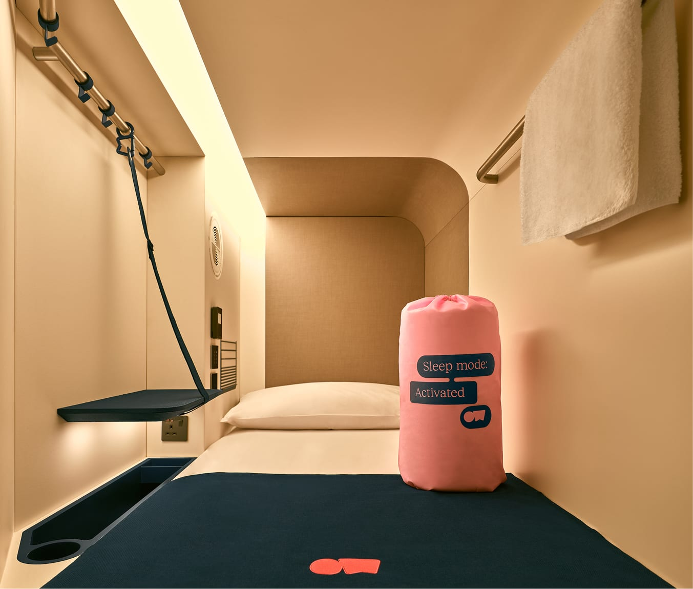
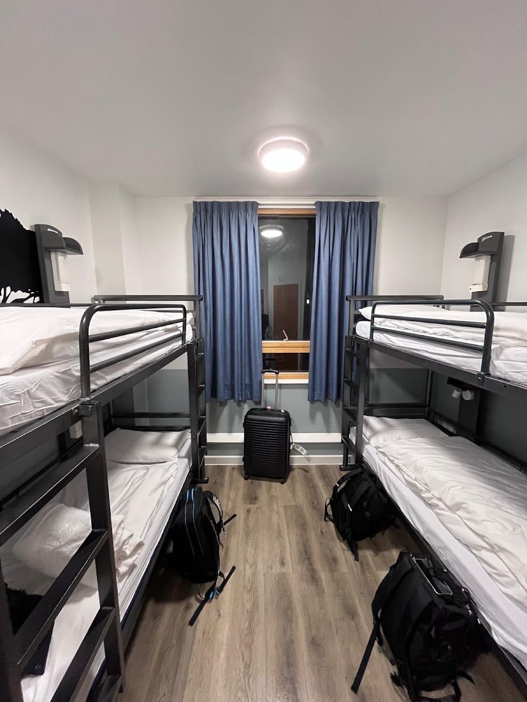
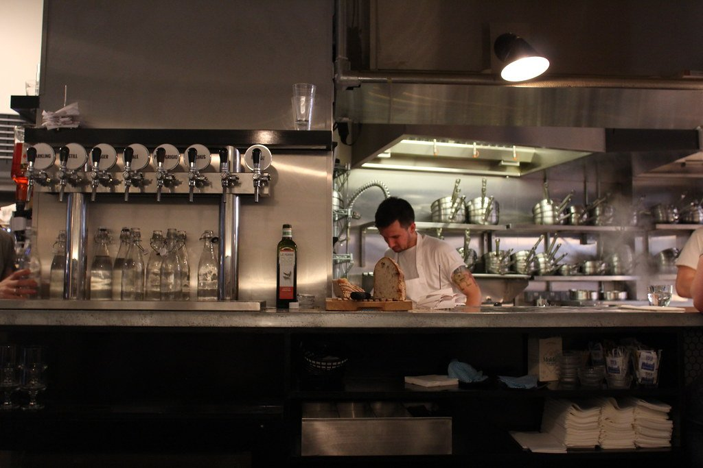
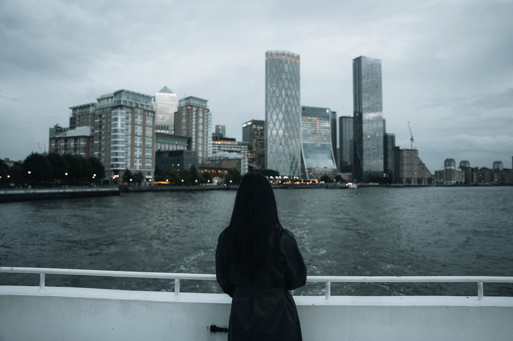

> 💡 **The Short Version:** **Stay** in a hostel with a bar for company, or a [capsule hotel](/articles/pod-hotels-london/) for privacy at a hostel price; women can book [female-only floors and dorms](/articles/best-hostels-london/) at 13 hostels. **Getting home at night**, hail a black cab or book a minicab by app; an unbooked minicab is illegal. **Text 61016** reaches British Transport Police on trains and at stations. **Eat** at a counter, where nobody notices a table for one: [Barrafina, Kiln and Padella](/articles/eating-alone-london/) all have one. **Meet people** on a [walking tour that stops in pubs](/articles/solo-traveller-tours-london/) or in a hostel bar. Tours and day trips are **priced per person**, so there is no single supplement.

*Prices, services and rules are each operator's own, checked on 19 November 2026; hotel prices are from the dates sampled in each linked guide.*

## Where to stay on your own

| Type | What you get alone | From | Our guide |
| --- | --- | --- | --- |
| **Hostel dorm** | A bed, a locker and a bar or kitchen full of other travellers | About £11 near King's Cross | [Best hostels](/articles/best-hostels-london/) |
| **Female-only dorm or floor** | The same, with women only; some have their own bathrooms | About £20–£22 | [Best hostels](/articles/best-hostels-london/#womens-dorms-where-they-are-real-and-where-they-are-only-a-label) |
| **Capsule or pod** | A berth for one with a shutter, light and socket; shared bathrooms | £33 a night | [Pod hotels](/articles/pod-hotels-london/) |
| **Budget hotel** | A private room and bathroom, priced by the room | About £81 outside the centre | [Budget hotels](/articles/best-budget-hotels-london/) |
| **Aparthotel** | A kitchen, so you are not eating out three times a day | Pays off from the third or fourth night | [Aparthotels](/articles/aparthotels-london/) |

**For company, choose a hostel with a bar.** St Christopher's Village at London Bridge ([Hotels.com](hotel:st-christophers-village)) has a bar and sells capsules as well as dorms; of the five capsule hotels in [our pod guide](/articles/pod-hotels-london/), it is the only one with a social side. Generator by King's Cross ([Hotels.com](hotel:generator-london)) has the lowest from-price in [our hostels guide](/articles/best-hostels-london/) and is a party hostel.

**For privacy, take a capsule.** Zedwell Capsule Piccadilly Circus ([Hotels.com](hotel:zedwell-piccadilly-capsule)) has over 1,000 berths a minute from the Tube and a 24-hour front desk, and cost £33 to £68 a night when we sampled it on 7 September 2026. Otherwander Soho ([Hotels.com](hotel:otherwander-soho)) sells single "nests" at roughly double the Zedwell rate, with no front desk: the door code arrives by message before you travel.

*An Otherwander single nest, Soho.*

**Check the age rule before you book a dorm.** Astor Hyde Park and Astor Victoria take only guests aged 18 to 39 in shared dorms, so an older traveller must book a private room. Clink 261 is strictly 18 and over, as is Wombat's. YHA London Central ([Hotels.com](hotel:yha-london-central)) takes all ages.

**For women travelling alone**, two hostels are built for it. St Christopher's Village runs **Oasis**, a female-only space with its own bathrooms, showers and key-card access. St Christopher's Liverpool Street has female-only bathrooms alongside its female dorms. Wombat's near Tower Bridge ([Hotels.com](hotel:wombats-city-hostel-london)) gives every dorm, female ones included, its own shower and toilet. A "female dorm" on a booking site can also mean a women-only room on a shared corridor, so read the room page; [our hostels guide](/articles/best-hostels-london/) lists which is which.

**A hotel room costs one person what it costs two**, so a solo stay is where the cheaper end of London pays off. The [budget hotels guide](/articles/best-budget-hotels-london/) found the same hotel cost a median 72% more on an October Saturday than on a Sunday. Landing early or leaving late, a [day room](/articles/day-rooms-london/) gives you a bed and a shower from about £50 without paying for a night.

*A shared room at YHA London Central.*

## Staying safe, by area and at night

**What happens to visitors is mostly phone theft, and it clusters where visitors are.** Police.uk recorded **963 thefts from the person within a mile of Oxford Circus** and **871 near Leicester Square** in July 2026, against 148 around Camden Town. Near Leicester Square, robbery was about one-sixth as common as theft. Keep your phone in a pocket you can feel, not on a café table or in a bag's outer pocket, and hold it tightest on Oxford Street, around Leicester Square and on the South Bank. The figures, the scams and who to call are in [Is London safe?](/articles/is-london-safe/)

**Getting home at night:**

- **The Night Tube runs on Friday and Saturday nights only**, on the Central, Jubilee, Northern, Piccadilly, Victoria and Windrush lines ([TfL](https://tfl.gov.uk/modes/tube/night-tube)). Every station on those lines is staffed while trains run.
- **Night buses run every night**, and every London bus has CCTV.
- **Every Tube, Elizabeth line and Overground station is staffed from first train to last.** DLR stations are unstaffed, but each DLR train has a member of staff on board.
- **Black cabs, the ones with the orange TAXI light, are the only cars you can hail** or take from a rank without a booking, and every one takes cards.
- **Minicabs must be booked** by app, phone or at the operator's office. The confirmation must show the number plate, the driver's first name, their private hire licence number and a photo. If the car or driver that arrives doesn't match, don't get in ([TfL, Safer travel at night](https://tfl.gov.uk/help-with-travel/your-safety-and-security/safer-travel-at-night)).

> ⚠️ **Never take a minicab you haven't booked.** TfL says unbooked minicabs are illegal and uninsured for passengers, even with a TfL licence sticker in the window. That includes a driver who approaches you, one you approach, and one a bouncer takes you to.

**Two numbers to save before you go out.** **Text 61016** reaches British Transport Police discreetly for anything non-emergency on a train or at a station ([National Rail](https://www.nationalrail.co.uk/help-and-assistance/text-61016/)); officers can meet you at the next stop. For an emergency anywhere, call **999**.

**In a bar or club, Ask for Angela.** At venues that take part, asking staff for "Angela" tells them quietly that you need help, whether that means getting you out, contacting security or staying with you ([Ask for Angela](https://www.askforangela.co.uk/)). Its site has a venue finder.

## Eating alone

**Sit at a counter.** You face the kitchen, and there is no empty chair opposite. You can walk in at [Barrafina on Dean Street](/articles/eating-alone-london/#barrafina-dean-street), Kiln in Soho and Monohon Ramen by Old Street; Impala in Soho books tables of one at dinner; and at Padella in Borough Market, you queue. Go early: counter seats are the first to go. With no booking at all, order at a stall in a food hall or market. All of these are in [Eating alone in London](/articles/eating-alone-london/), and [Cheap eats](/articles/cheap-eats-london/) has the meals under £15.

*The counter at Padella, Borough Market. Photo: [Bex.Walton](https://www.flickr.com/photos/7831824@N04/28035454561), [CC BY 2.0](https://creativecommons.org/licenses/by/2.0/).*

## Things to do on your own

**The national museums are free and work at your own pace.** For an evening, go on a Friday, when the British Museum, the V&A, the National Gallery and Tate Modern stay open late ([best museums](/articles/best-museums-london/)). **Communal saunas** suit one: Community Sauna Baths charges from £11 an hour at Hackney Wick, and most people there come alone or with one friend ([saunas and cold plunge](/articles/saunas-cold-plunge-london/)). **Comedy** costs nothing at Angel Comedy, which runs free stand-up seven nights a week across two pubs ([comedy clubs](/articles/best-comedy-clubs-london/)).

**For a quiet day between sights**, the British Library and the Barbican both have free space to sit and work, and the Barbican is open to everyone until 11pm ([laptop-friendly cafés](/articles/laptop-friendly-cafes-london/)). The full list is in [Things to do alone in London](/articles/things-to-do-alone-london/).

*Canary Wharf from a boat on the Thames. Photo: [Viridiana Rivera](https://www.pexels.com/@viridianaor) via [Pexels](https://www.pexels.com/photo/woman-viewing-thames-river-and-london-skyline-33117694/).*

## Meeting people

**Start with a shared table**: a hostel bar, a pub walk or a food tour, where the group sits down together. For an evening out with a game in it, [competitive socialising](/articles/competitive-socialising-london/) runs from mini golf to darts. Our [guide to meeting people in London](/articles/meet-people-london/) covers the rest.

## Tours you can join alone

**The walking, food and bike tours and coach day trips in our tours guide are all sold per person**, so there is no single supplement. The sociable ones stop somewhere the group sits down. [Liquid History's Historic Pubs walk](/articles/solo-traveller-tours-london/#historic-pubs-of-central-london--liquid-history-tours) visits four pubs from St Paul's for £35. Strawberry Tours runs tip-based walks every day, and London Walks charges £20 for two hours. For a day out, the [Cotswolds small-group tour](/articles/solo-traveller-tours-london/#cotswolds-small-group-tour) takes 16. All of them, with prices and meeting points, are in [the best tours in London for solo travellers](/articles/solo-traveller-tours-london/).

Powered by <a target="_blank" rel="sponsored" href="https://www.getyourguide.com/london-l57/">GetYourGuide</a>

## A solo budget

**A careful day costs about £32 and a comfortable one about £150**, before a bed ([London on a budget](/articles/london-on-a-budget/)). The pieces for a solo visit:

- **Transport caps at £8.90 a day** in Zones 1 and 2 on contactless or Oyster, so a day of buses and Tubes can't cost more ([fares](/articles/london-public-transport-costs-and-fares/)).
- **A bed** starts at about £11 in a dorm near King's Cross and £33 in a capsule at Piccadilly Circus.
- **Set lunches** at good restaurants are routinely half the evening price for the same kitchen.
- **The 2for1 attraction offers with a National Rail ticket need two people.** There is no single-visitor version ([2for1 guide](/articles/national-rail-2for1-london-attractions/)).
- **Most of the big museums are free**, and [the free list](/free/) runs to hundreds of entries.

## The solo guides

- 🎟️ **[The best tours in London for solo travellers](/articles/solo-traveller-tours-london/)** — pub walks, free tours, food tours, bike rides and day trips you can join alone
- 🚶 **[Things to do alone in London](/articles/things-to-do-alone-london/)** — what works best on your own
- 👋 **[How to meet people in London](/articles/meet-people-london/)** — where strangers talk to each other
- 🍝 **[Eating alone in London](/articles/eating-alone-london/)** — counters and restaurants that take a table for one
- 🛏️ **[The best hostels in London](/articles/best-hostels-london/)** — female-only dorms, age limits and real prices
- 🛌 **[Pod hotels in London](/articles/pod-hotels-london/)** — a night in a capsule, and which to book
- 💷 **[Budget hotels in London](/articles/best-budget-hotels-london/)** — private rooms under £150 a night
- 🛡️ **[Is London safe?](/articles/is-london-safe/)** — the crime figures, the scams and who to call
