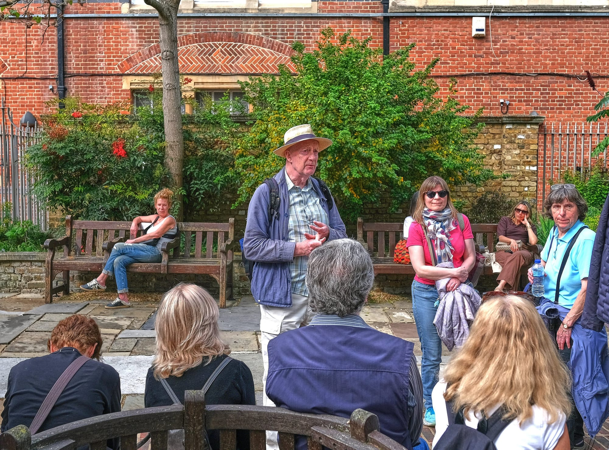
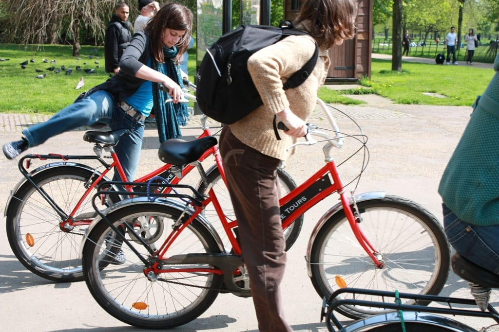
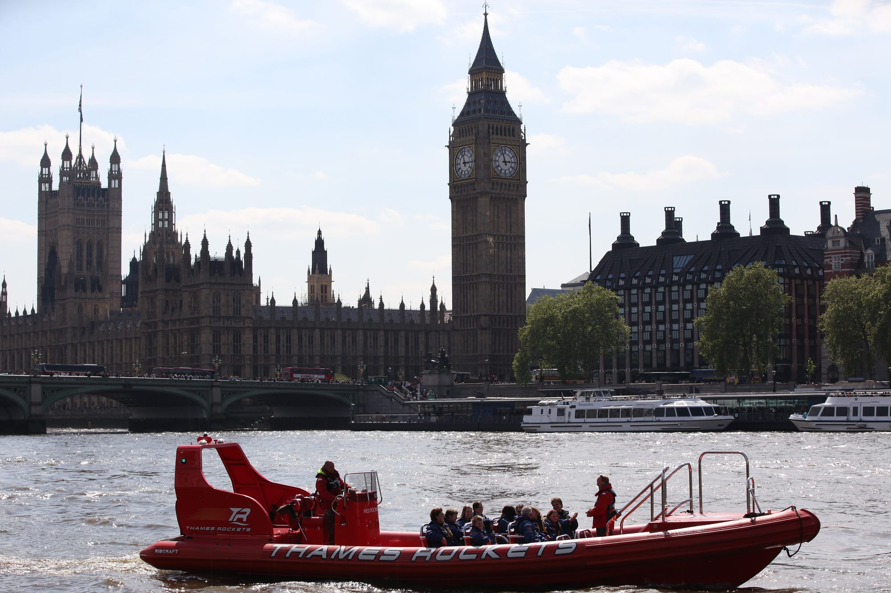
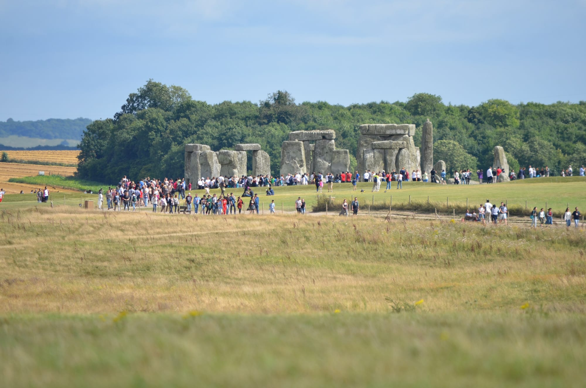

> 💡 **The Short Version:** **For meeting people**, take a walk that stops in pubs: [Liquid History's Historic Pubs walk](#historic-pubs-of-central-london--liquid-history-tours) (**£35**, 3½ hours, four pubs) or the [Soho music pubs walk](#soho-music-and-historic-pubs--experience-local) (**£32**). **For no money down**, [Strawberry Tours and Free Tours by Foot](#free-and-tip-based-walks) run tip-based walks daily; you book free and pay what you think it was worth. **For £20**, [London Walks](#london-walks) goes out rain or shine, and its Jack the Ripper walk leaves Tower Hill at 7.30pm every night. **For a day out of London**, the [Cotswolds small-group tour](#cotswolds-small-group-tour) takes no more than 16. Everything here is priced per person, so there is no single supplement.

*Prices are the lowest adult price on GetYourGuide or the operator's own site, and review scores are GetYourGuide's, as at 19 November 2026. Prices move with the date.*

> 📘 **How we choose these (editorial note).** We earn a commission if you book through our GetYourGuide links; the price is the same either way. No operator paid to be included. Each tour is here because it is sold per person and the group spends time together, not only listening to a guide.

## Pick by what you want

| You want | Tour | From | Length |
| --- | --- | --- | --- |
| To talk to people over a drink | [Historic Pubs of Central London](#historic-pubs-of-central-london--liquid-history-tours) | £35 | 3½ hours |
| To spend nothing up front | [Strawberry Tours](#free-and-tip-based-walks), tip-based | Free | 2–3 hours |
| A walk tonight | [London Walks, Jack the Ripper](#london-walks) | £20 | 2 hours |
| Lunch with company | [East London food tour, No Diet Club](#east-london-food--no-diet-club) | £58 | 3½ hours |
| A big night out | [Original Shoreditch Pub Crawl](#the-original-shoreditch-pub-crawl) | £25 | 4½ hours |
| To see a lot quickly | [Secret London by bike](#secret-london-by-bike) | £45 | 3½ hours |
| The river, fast | [Thames speedboat](#thames-speedboat--thames-rockets) | £64.95 | 50 minutes |
| The countryside | [Cotswolds small-group tour](#cotswolds-small-group-tour) | £75 | 9½ hours |

Powered by <a target="_blank" rel="sponsored" href="https://www.getyourguide.com/london-l57/">GetYourGuide</a>

## What makes a tour work alone

**A stop where the group sits down.** On a straight walk you face the guide; in a pub or at a food stall you face each other. The pub and food tours below build in four or more of those stops.

**A capped group.** Eating London takes no more than 12 and the Cotswolds tour 16.

**Priced per person.** Every tour on this page is. Single supplements belong to multi-night packages, where the price assumes two to a room. A "private tour" is the exception on the day: some are priced for the whole group, so read the price line before you book one for yourself.

## Walks that stop in pubs

### Historic Pubs of Central London — Liquid History Tours

*£35 · 3½ hours · starts at St Paul's · 4.9 from 1,278 reviews · <a href="https://www.getyourguide.com/activity/-t27204?partner_id=WWP7I0R&amp;cmp=solo-traveller-tours-london" target="_blank" rel="sponsored nofollow noopener" data-affiliate="gyg">Book on GetYourGuide</a>*

**Four historic pubs on a two-mile walk from St Paul's down Fleet Street**, ending in a Victorian gin palace. Tripadvisor's Travellers' Choice awards named it the No. 1 experience in the UK in 2025 and No. 7 in the world in 2026. You sit down at each pub, and the walking between them is gentle. Meet at Exit 2 of St Paul's station, on Panyer Alley. You buy your own drinks, so bring a card and ID.

### Soho Music and Historic Pubs — Experience Local

*£32 · 2½ hours · starts at Piccadilly Circus · 4.9 from 1,014 reviews · <a href="https://www.getyourguide.com/activity/-t80541?partner_id=WWP7I0R&amp;cmp=solo-traveller-tours-london" target="_blank" rel="sponsored nofollow noopener" data-affiliate="gyg">Book on GetYourGuide</a>*

**Four Soho pubs where the Beatles, the Rolling Stones, Jimi Hendrix and David Bowie drank**, with the stories of each. It is shorter than the Liquid History walk and finishes in Soho, which is where you want to be at the end of an evening. The same company runs the [Great British Rock and Roll walk](https://www.getyourguide.com/activity/-t453983?partner_id=WWP7I0R&amp;cmp=solo-traveller-tours-london) (£32, two hours from Tottenham Court Road), rated 5.0 from 2,398 reviews, which has no pub stops.

*A guide and his group in Marylebone. Photo: [Anthony O'Neil](https://commons.wikimedia.org/wiki/File:Tour_guide_-_geograph.org.uk_-_8318296.jpg), [CC BY-SA 2.0](https://creativecommons.org/licenses/by-sa/2.0/), via Wikimedia Commons.*

## Free and tip-based walks

**You book a place for nothing and pay the guide at the end, whatever you think the tour was worth.** Book even though it is free: the meeting point arrives in the confirmation.

**[Strawberry Tours](https://strawberrytours.com/london)** lists more than 15 London walks, from morning departures to a two-and-a-half-hour Night Tour. Its Essential Westminster walk takes two to three hours and is rated 4.85 from 1,812 reviews on its own site; its Jack the Ripper walk 4.93 from 2,836 and its Street Art walk 4.95 from 2,100. There are also Soho, Camden, Notting Hill and LGBTQ+ history walks. Each guide sets a limit on group size per departure.

**[Free Tours by Foot](https://freetoursbyfoot.com/london-tours/)** calls its model "name your own price". Its regular walks cover Westminster, the City, Harry Potter, street art, rock and roll, Jack the Ripper and ghosts, and it runs an East London food tour and a City of London historic pubs tour as ticketed extras.

## London Walks

*£20 adults · £15 students and over-65s · 2 hours · [walks.com](https://www.walks.com/our-walks/walks-by-date/)*

**Walks every day, listed by date on its site, each two hours and run rain or shine.** Its classic [Jack the Ripper walk](https://www.walks.com/our-walks/jack-the-ripper-walking-tour/) leaves from the coffee stand at Tower Hill station at **7.30pm every night** except 24 and 25 December 2026, with a 3pm matinee on Saturdays, and is rated 4.97 from 390 reviews on the company's own page. Reserve online: London Walks recommends booking because walks fill. For more Ripper and ghost walks, see our [Jack the Ripper and ghost tours guide](/articles/jack-the-ripper-ghost-tours-london/).

## Food tours

A food tour is a long lunch eaten with the group, stop by stop. The food is included in each price below.

### East London Food — No Diet Club

*£57.59 · 3½ hours · from midday · 4.9 from 143 reviews · <a href="https://www.getyourguide.com/activity/-t508003?partner_id=WWP7I0R&amp;cmp=solo-traveller-tours-london" target="_blank" rel="sponsored nofollow noopener" data-affiliate="gyg">Book on GetYourGuide</a>*

**Local cheese, ice cream, chai, pies and a bakery between midday and about 4pm**, the cheapest of the three.

### East End Food Tour — Eating London

*£89 · 3½ hours · groups of up to 12 · 4.9 from 88 reviews · <a href="https://www.getyourguide.com/activity/-t136652?partner_id=WWP7I0R&amp;cmp=solo-traveller-tours-london" target="_blank" rel="sponsored nofollow noopener" data-affiliate="gyg">Book on GetYourGuide</a>*

**Spitalfields Market, Brick Lane and Shoreditch, with the street art between the stops.** The cap of 12 is what the extra £31 over No Diet Club buys.

### Borough Market — Secret Food Tours

*£91.99 · 3 hours · 4.8 from 627 reviews · <a href="https://www.getyourguide.com/activity/-t67794?partner_id=WWP7I0R&amp;cmp=solo-traveller-tours-london" target="_blank" rel="sponsored nofollow noopener" data-affiliate="gyg">Book on GetYourGuide</a>*

**Six British classics in and around Borough Market, plus a drink, a dessert and a dish the guide doesn't name in advance.** The most reviewed food tour in London on GetYourGuide. Our [London food tours guide](/articles/london-food-tours/) and [Borough Market tours guide](/articles/borough-market-tours/) compare the rest.

## A night out with a group

### The Original Shoreditch Pub Crawl

*£25 · 4½ hours · 4.5 from 57 reviews · <a href="https://www.getyourguide.com/activity/-t37235?partner_id=WWP7I0R&amp;cmp=solo-traveller-tours-london" target="_blank" rel="sponsored nofollow noopener" data-affiliate="gyg">Book on GetYourGuide</a>*

**Five Shoreditch pubs, bars and clubs with free entry, free shots, drink discounts and hosts.** It is a party rather than a history lesson. If you would rather the evening had a guide and a story, take one of the pub walks above instead.

## Bike and river tours

### Secret London by Bike

*£45 · 3½ hours · 4.9 from 614 reviews · <a href="https://www.getyourguide.com/activity/-t17285?partner_id=WWP7I0R&amp;cmp=solo-traveller-tours-london" target="_blank" rel="sponsored nofollow noopener" data-affiliate="gyg">Book on GetYourGuide</a>*

**The City and the East End by bike, from medieval London to its stranger characters**, covering more ground in an afternoon than a walk can. For the royal side instead, the [Royal Parks and Palaces afternoon ride](https://www.getyourguide.com/activity/-t151133?partner_id=WWP7I0R&amp;cmp=solo-traveller-tours-london) is £39 for 3½ hours, 4.9 from 105 reviews. Our [cycling guide](/articles/cycling-bike-hire-scooters-london/) covers hiring a bike to ride on your own.

*Riders setting off on a bike tour in a London park. Photo: [Jaanus Silla](https://commons.wikimedia.org/wiki/File:Fat_Tire_Bike_Tours_-_London.jpg), [CC BY 2.0](https://creativecommons.org/licenses/by/2.0/), via Wikimedia Commons.*

### Thames speedboat — Thames Rockets

*£64.95 · 50 minutes · 4.9 from 1,057 reviews · <a href="https://www.getyourguide.com/activity/-t16670?partner_id=WWP7I0R&amp;cmp=solo-traveller-tours-london" target="_blank" rel="sponsored nofollow noopener" data-affiliate="gyg">Book on GetYourGuide</a>*

**A speedboat from the London Eye past the Tower of London, with a comedian as the guide.** You sit in rows next to whoever booked the same departure. Thames Rockets does not take pregnant passengers. A slower river trip, such as the [Westminster to Greenwich cruise](https://www.getyourguide.com/activity/-t71379?partner_id=WWP7I0R&amp;cmp=solo-traveller-tours-london) from £17.20, has an audio commentary rather than a guide and is no more social than a bus; see our [Thames cruises guide](/articles/thames-river-cruises-london/).

*A Thames Rockets boat passing the Palace of Westminster. Photo: [Gswaby](https://commons.wikimedia.org/wiki/File:Big_Ben_Thames_Rockets.jpg), [CC BY-SA 4.0](https://creativecommons.org/licenses/by-sa/4.0/), via Wikimedia Commons.*

## Day trips where you won't sit alone

**A capped small group is the sociable way to do a day trip**; on a full-size coach, take a seat near the front and talk to the guide.

### Cotswolds Small-Group Tour

*From £75 · 9½ hours · maximum 16 · 4.8 from 5,370 reviews · <a href="https://www.getyourguide.com/activity/-t215430?partner_id=WWP7I0R&amp;cmp=solo-traveller-tours-london" target="_blank" rel="sponsored nofollow noopener" data-affiliate="gyg">Book on GetYourGuide</a>*

**Burford, Bibury, Bourton-on-the-Water and Stow-on-the-Wold, with free time in each**, from a coffee shop by South Kensington station at 08:25. The villages charge nothing to walk round, so the ticket is the whole cost of the day. No children under seven. Our [Cotswolds day trip guide](/articles/cotswolds-day-trip/) has the train-and-bus alternative.

### Stonehenge and Bath — Day Tours London

*£85 · full day · Stonehenge entry included · 4.8 from 3,327 reviews · <a href="https://www.getyourguide.com/activity/-t61147?partner_id=WWP7I0R&amp;cmp=solo-traveller-tours-london" target="_blank" rel="sponsored nofollow noopener" data-affiliate="gyg">Book on GetYourGuide</a>*

**Stonehenge as it opens at 9.30am, then Bath from about 12.15pm to 3pm.** It leaves Gloucester Road at 07:00. Stonehenge entry is in the price; the Roman Baths are not. If only the stones matter, the [morning half-day trip](https://www.getyourguide.com/activity/-t219849?partner_id=WWP7I0R&amp;cmp=solo-traveller-tours-london) is £66 with entry, 6½ hours, 4.8 from 4,107 reviews. See the [Stonehenge](/articles/stonehenge-day-trip/) and [Bath](/articles/bath-day-trip/) guides.

*Visitors round the stones at Stonehenge. Photo: [Steven Lek](https://commons.wikimedia.org/wiki/File:Stonehenge_tourists.jpg), [CC BY-SA 4.0](https://creativecommons.org/licenses/by-sa/4.0/), via Wikimedia Commons.*

### Seven Sisters and Brighton

*£89 · 9 hours · train tickets included · 4.9 from 366 reviews · <a href="https://www.getyourguide.com/activity/-t820119?partner_id=WWP7I0R&amp;cmp=solo-traveller-tours-london" target="_blank" rel="sponsored nofollow noopener" data-affiliate="gyg">Book on GetYourGuide</a>*

**The chalk cliffs at Birling Gap and Seaford Head, then a walking tour of Brighton and free time there.** The group travels by train rather than coach. Our [Brighton and Seven Sisters guide](/articles/brighton-seven-sisters-day-trip/) covers doing it yourself.

### Windsor, Stonehenge and Bath in one day

*£79 · 11–12 hours · 4.5 from 6,093 reviews · <a href="https://www.getyourguide.com/activity/-t945?partner_id=WWP7I0R&amp;cmp=solo-traveller-tours-london" target="_blank" rel="sponsored nofollow noopener" data-affiliate="gyg">Book on GetYourGuide</a>*

**Three stops on one coach.** The listing sells admission to Windsor Castle, Stonehenge and the Roman Baths as an extra, so budget for the tickets on top unless you add them at booking. It is a long day with short stops, and the right choice only if you want all three ticked off. For Oxford, the [Cotswolds and Oxford guided day trip](https://www.getyourguide.com/activity/-t60796?partner_id=WWP7I0R&amp;cmp=solo-traveller-tours-london) is £79, 4.6 from 4,667 reviews. Our [day trips from London guide](/articles/day-trips-from-london/) compares every destination by train and by tour.

Powered by <a target="_blank" rel="sponsored" href="https://www.getyourguide.com/london-l57/">GetYourGuide</a>

## More for travelling alone

- 🧭 **[Solo travel in London](/articles/solo-travel-london/)** — where to stay, getting home at night, and the rest of the solo guides
- 👋 **[How to meet people in London](/articles/meet-people-london/)** — the hostel bars, clubs and classes where people talk to strangers
- 🎟️ **[Things to do alone in London](/articles/things-to-do-alone-london/)** — what works best on your own, from galleries to saunas
- 🍝 **[Eating alone in London](/articles/eating-alone-london/)** — counters and restaurants that take a booking for one
- 🚶 **[The best walking tours in London](/articles/best-walking-tours-london/)** — 33 themed walks, from Harry Potter to street art
- 🛏️ **[The best hostels in London](/articles/best-hostels-london/)** — the hostel bar is the other easy place to find company
