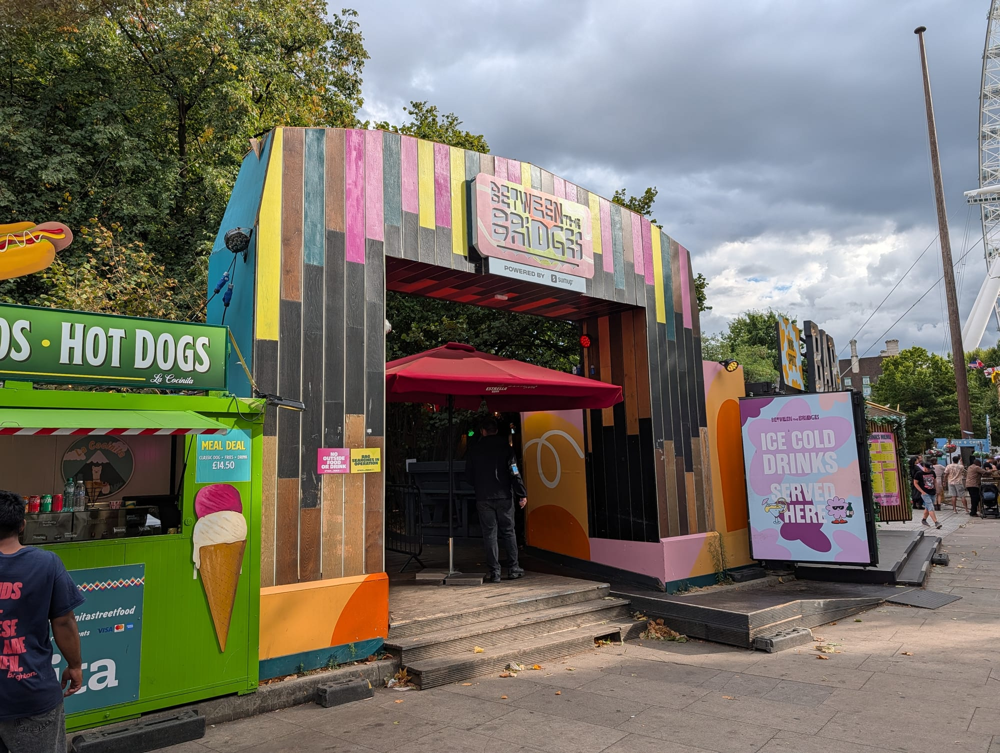
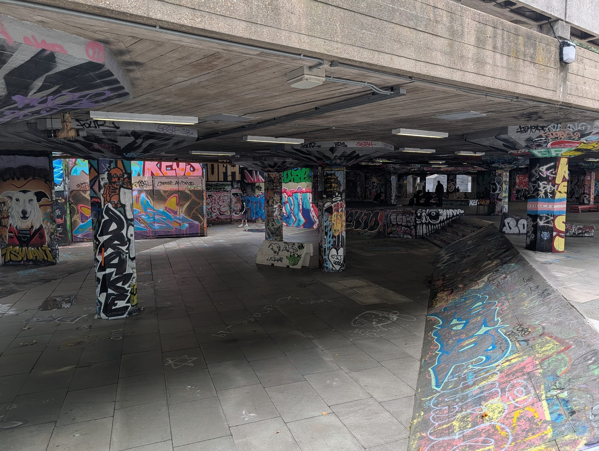
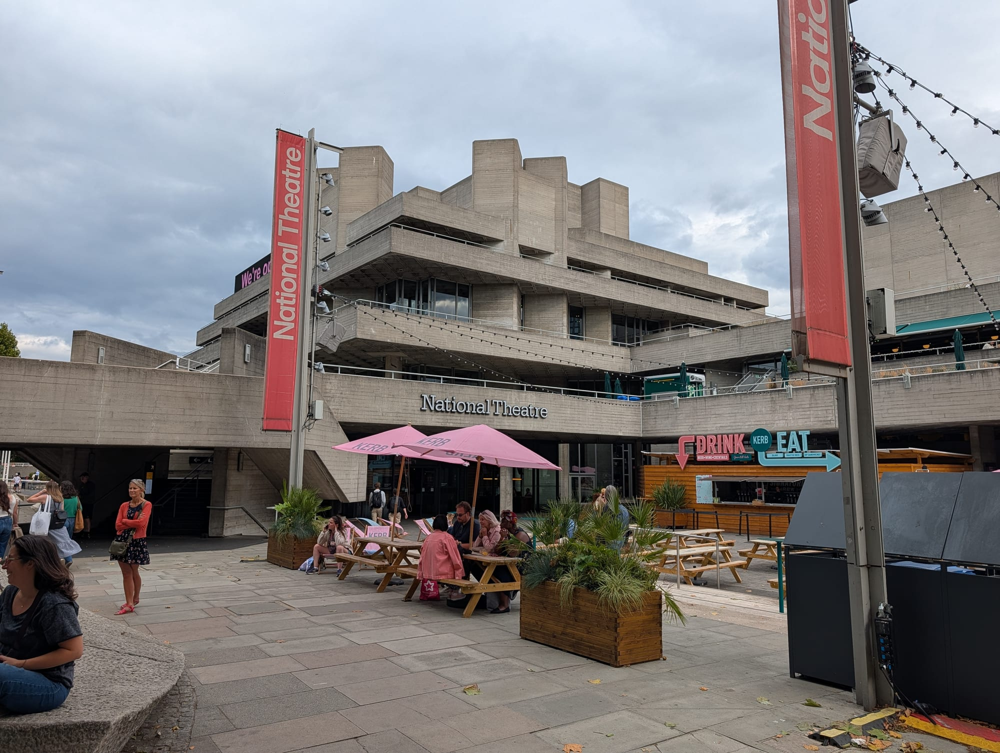
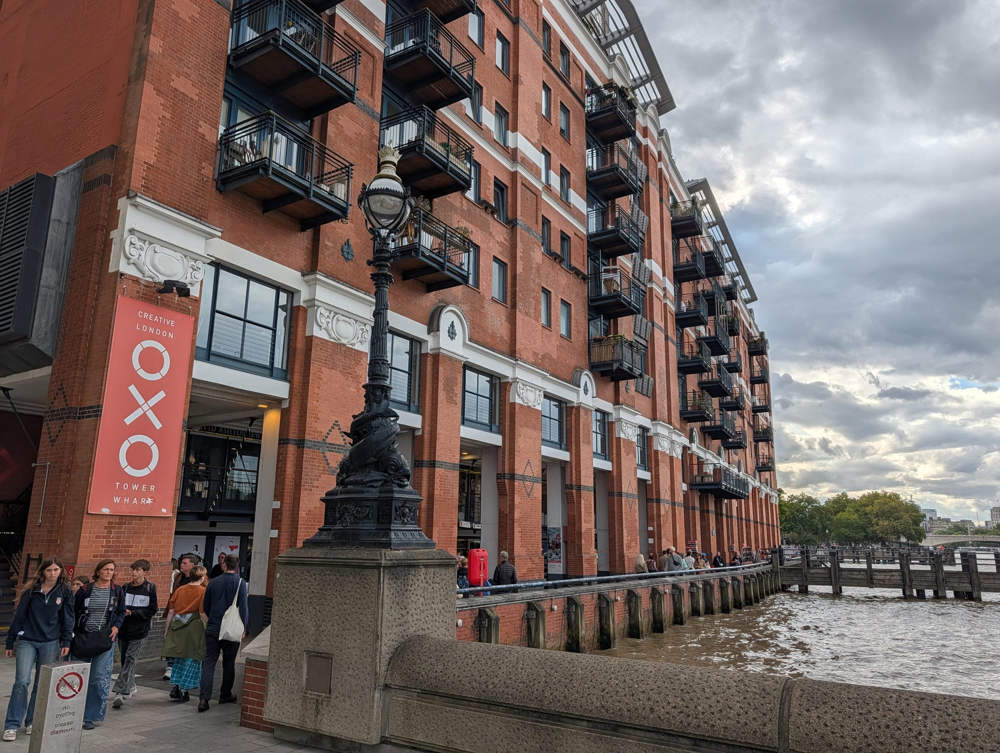
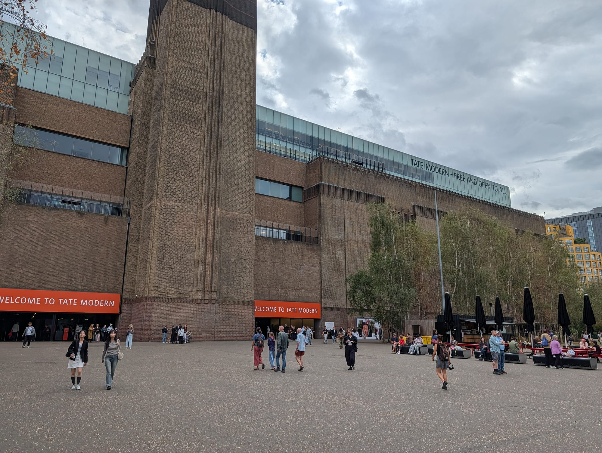
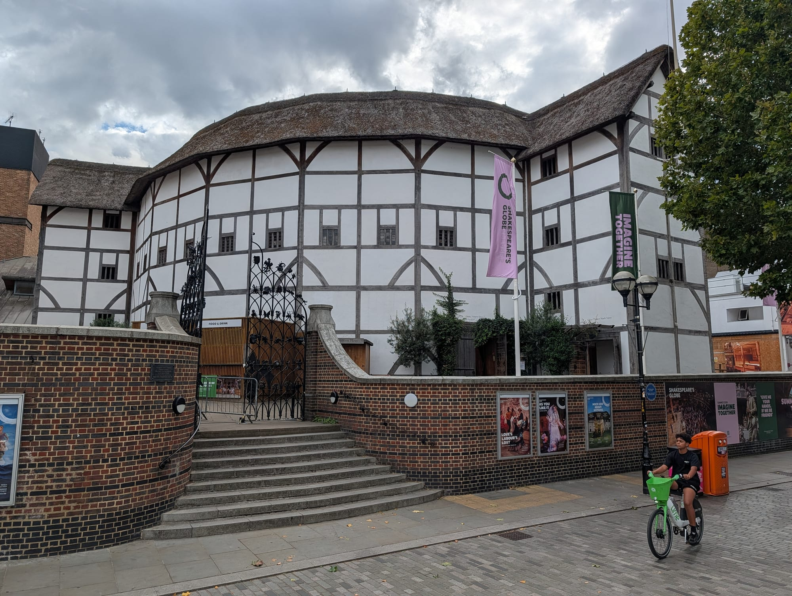
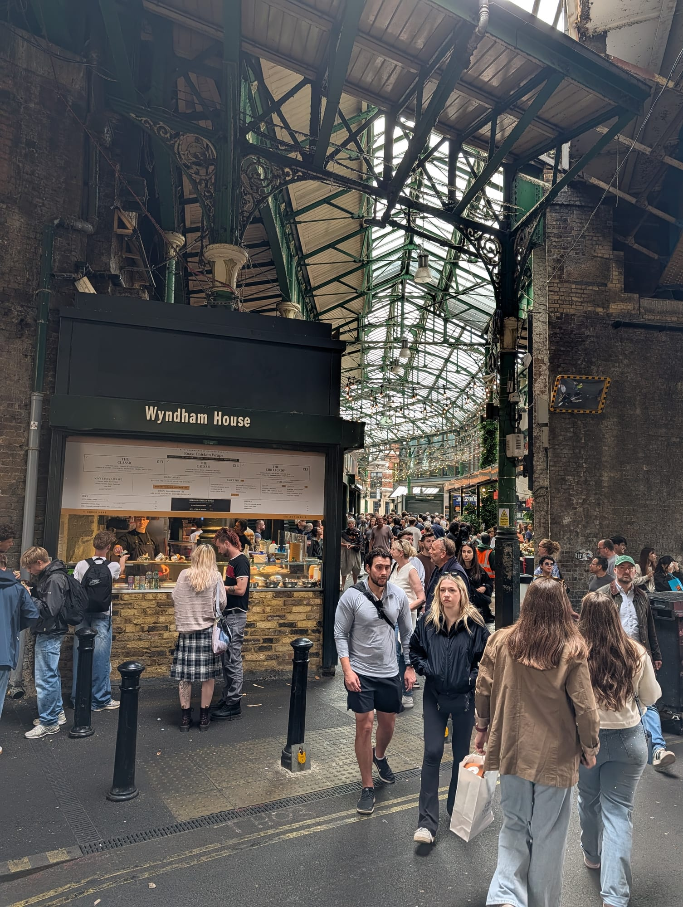
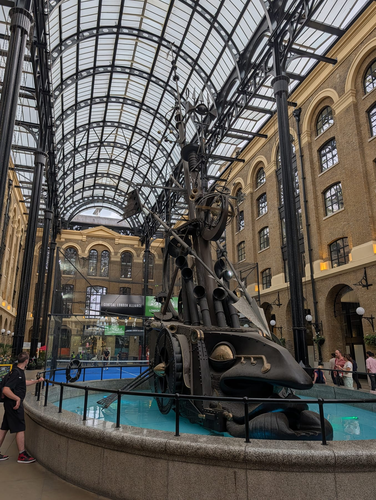
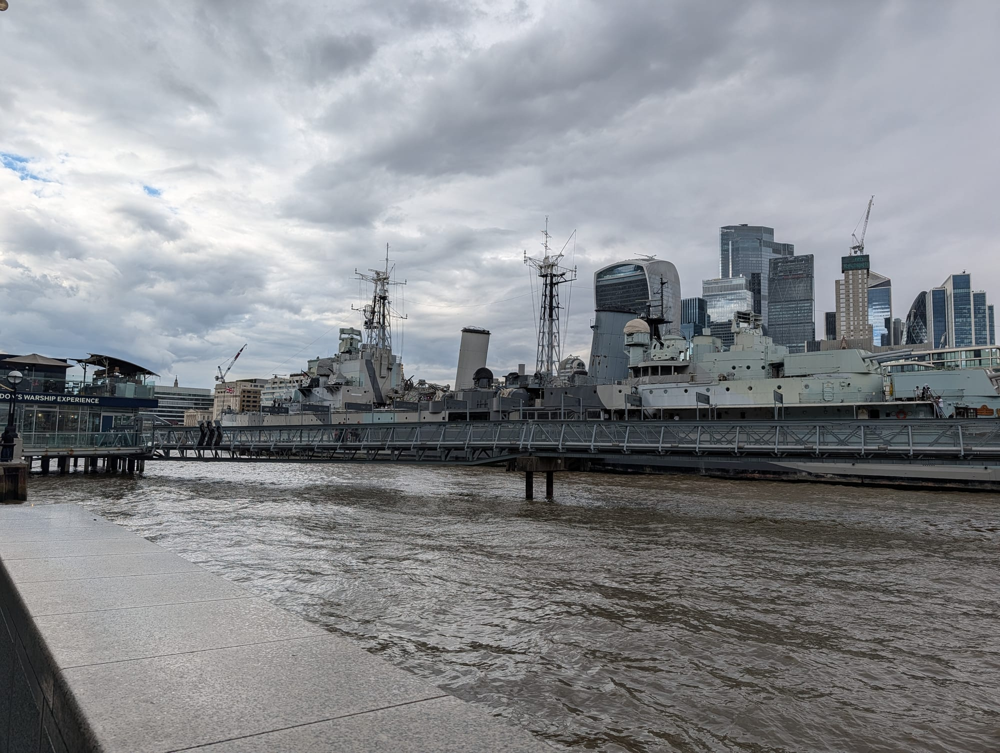
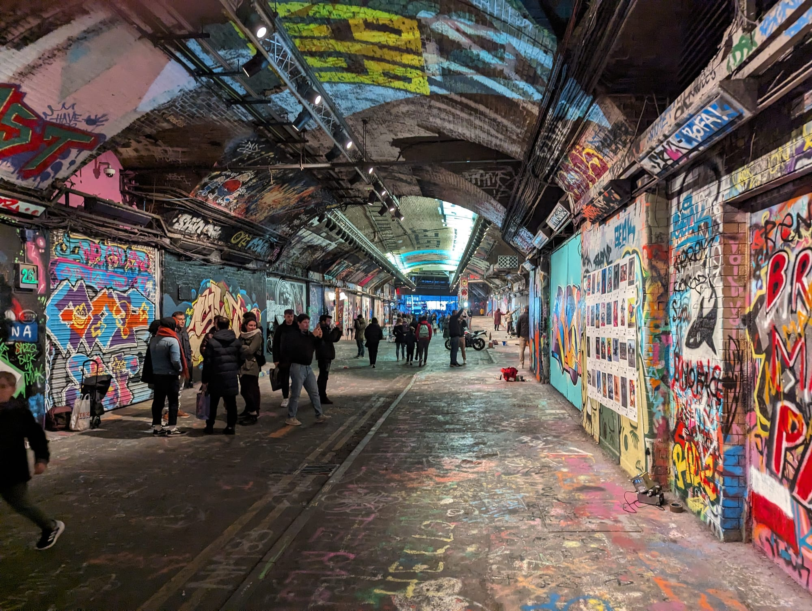

Most people walk about a third of the South Bank: out at Waterloo, as far as the Tate, then back. That misses the half where the river gets interesting.

**This is the whole stretch, west to east**, from Westminster Bridge to Tower Bridge: eleven numbered stops, about **3km and two to three hours**, entirely riverside and flat. Almost all of it is free.

It has one trap: **Borough Market is closed on Mondays**, and it is stop nine of eleven, so a Monday walk arrives at the lunch stop to find it shuttered.

For the theatres, where to stay and the bits inland, see the [South Bank area guide](/articles/south-bank-area-guide/).

> 💡 **The Short Version:** Walk **west to east**, starting by crossing **Westminster Bridge** and finishing at **Tower Bridge**. **Not on a Monday** — Borough Market is shut. **Tate Modern is free** and open late on Fridays and Saturdays. Five minutes off the route is **Leake Street**, a legal graffiti tunnel. You cannot walk into the **Globe** without a ticket.

## The route

  

    Map of the walk, numbered in walking order
  

  

    
Loading the map…

  

  

    <i class="route-map-marker" aria-hidden="true">1</i> On the route, in walking order
    <i class="route-map-marker route-map-marker--alt" aria-hidden="true">+</i> Optional detour
  

  <noscript>
    
The map needs JavaScript. Every stop below is numbered in walking order with its nearest station.

  </noscript>

**[Open the whole route in Google Maps →](https://www.google.com/maps/dir/?api=1&origin=51.503342,-0.119677&destination=51.505517,-0.075366&waypoints=51.502000,-0.118330%7C51.505779,-0.116787%7C51.506400,-0.114900%7C51.506988,-0.112818%7C51.507833,-0.110161%7C51.507429,-0.099342%7C51.508121,-0.097186%7C51.505526,-0.090438%7C51.506543,-0.081152&travelmode=walking)** — all eleven stops in walking order, set to walking directions, which is the version to put on your phone.

| # | Stop | Cost | Open |
| --- | --- | --- | --- |
| **1** | Westminster Bridge & the London Eye | Free to see | Always |
| **2** | County Hall | Ticket | Daily |
| **3** | Southbank Centre & the Undercroft | Free | Always |
| **4** | The book market | Free | Most days |
| **5** | National Theatre | Free | **Mon–Sat only** |
| **6** | Gabriel's Wharf & the Oxo Tower | Free | Daily |
| **7** | Tate Modern | **Free** | Daily, late Fri–Sat |
| **8** | Millennium Bridge & the Globe | Bridge free | Globe by ticket only |
| **9** | Southwark Cathedral & Borough Market | Free | **Market closed Mondays** |
| **10** | HMS Belfast & Hay's Galleria | Galleria free | Daily |
| **11** | Tower Bridge | Free to cross | Always |
| **+** | Leake Street graffiti tunnel | Free | Always |

---

## 1. Westminster Bridge and the London Eye

**Start on the north bank and cross.** Westminster Bridge is a better opening than coming out at Waterloo: you walk towards the Eye with the river opening up on both sides, and it costs nothing.

The **[London Eye](/articles/london-eye-guide/)** is 135 metres tall, a full rotation takes half an hour, and slots book ahead and queue anyway. The free options later on this walk are better value. If you plan to ride, our [London Eye guide](/articles/london-eye-guide/) has ticket hacks, Fast Track advice and sunset timing.

## 2. County Hall

The Edwardian building beside the Eye holds **three paid attractions**: the Sea Life aquarium, Shrek's Adventure and the London Dungeon, priced individually.

They are aimed at families and queue like it. Worth a stop with children; otherwise it is a four-minute walk past.

**Between the Bridges** is on the riverside here: an open-air beer garden with street food units, cocktail bars and a covered stage on Queen's Walk between Westminster and Hungerford bridges. Hot dogs, cold drinks, big screens for the football.

*Between the Bridges.*

> 💡 **The detour: Leake Street.** Five minutes inland from here, under Waterloo station, is a road tunnel where spraying the walls is **legal**. It is free, open at all hours and repainted constantly. It is a ten-minute round trip; see the section below.

Powered by <a target="_blank" rel="sponsored" href="https://www.getyourguide.com/london-l57/">GetYourGuide</a>

## 3. Southbank Centre and the Undercroft

The **Royal Festival Hall is free to walk into** and has free toilets; its upper levels have seats and a view over the river, a free indoor sit-down and somewhere to warm up in February.

Underneath it is the **Undercroft**, a skate spot in continuous use since the early 1970s. It was slated for redevelopment in 2013; the skaters organised and the space is now protected. **Free to watch**.

*The Undercroft.*

## 4. The book market under Waterloo Bridge

**Second-hand books on trestle tables, under the bridge, most days of the year.** It has been there for decades.

The bridge is the roof, so it trades in most weather. Prices are above jumble-sale level, but the stock is browsable rather than remaindered.

## 5. The National Theatre

**Brutalist, listed, and free to walk into.** The terraces are the reason to go in, whatever you think of Denys Lasdun's concrete.

The **exhibitions in the foyers are free**, the riverside terrace garden is free, and there is a bookshop. **Forza Wine's rooftop terrace** is the view stop, looking back west over the river.

*KERB's food stalls at the National Theatre.*

> ⚠️ **The building opens Monday to Saturday, 10am to 11pm — not Sundays.** The Olivier foyers and terraces are closed from 26 to 30 October, with limited access from 2 to 7 November.

## 6. Gabriel's Wharf and the Oxo Tower

A small courtyard of independent shops, studios and food units on a site that was derelict until the 1980s. The units are let cheaply to keep chains out.

Next door is the **Oxo Tower**, whose lettered windows exist because 1930s regulations banned skyline advertising and the owners built the word into the structure. The **public viewing gallery on the eighth floor is free**; the restaurant on the same floor is not.

*Oxo Tower Wharf.*

## 7. Tate Modern

**A power station turned into a modern art gallery, and it is free.**

The **Turbine Hall** is 3,300 square metres with a commissioned installation most of the year. The collection is free; only the temporary exhibitions are ticketed.

**Open 10am to 6pm Sunday to Thursday, and 10am to 9pm on Friday and Saturday**, so it works as an evening plan.

## 8. The Millennium Bridge and Shakespeare's Globe

The **Millennium Bridge** is worth walking to the middle of and no further: the dome of St Paul's sits square at the end of the span.

Next along the bank is **Shakespeare's Globe**, a 1997 reconstruction of the 1599 theatre.

> ⚠️ **You cannot walk into the Globe.** The theatre opens for **guided tours and performances only**. The shop and the Swan bar are open to anyone, and the exterior is free. The playing season runs roughly April to October; tours run year-round.

*Shakespeare's Globe, from the street.*

## 9. Southwark Cathedral and Borough Market

**Southwark Cathedral** is free to enter and almost always empty compared with the market forty metres away. Shakespeare's brother is buried here. The streets behind it, from the George Inn's galleries to Cross Bones and the site of the Rose, have their own route: the [Bankside and Borough walk](/articles/bankside-borough-walk/).

Then **Borough Market**.

> ⚠️ **Borough Market is closed on Mondays.** Tuesday to Friday **10am–5pm**, Saturday **9am–5pm**, Sunday **10am–4pm**. A Monday walk gets all the way to stop nine before finding out. The market's own guidance is that visitor numbers are high on Saturday afternoon.

*Borough Market.*

Powered by <a target="_blank" rel="sponsored" href="https://www.getyourguide.com/london-l57/">GetYourGuide</a>

## 10. HMS Belfast and Hay's Galleria

**HMS Belfast** is a Second World War cruiser moored permanently in the Pool of London. It is ticketed, but free to look at.

Beside it, **Hay's Galleria** is a covered Victorian dock with a glass roof, now shops and cafés around a kinetic sculpture of a ship. **Free, covered and warm**, it is the shelter stop if the weather turns in the last mile.

*Hay's Galleria.*

*HMS Belfast.*

## 11. Tower Bridge

**Crossing it is free**; the road and pavements are a public highway. The ticketed parts are the high-level walkways with the glass floor and the Victorian engine rooms that powered the bascules.

This is the end of the walk and the start of another one: cross the bridge and you are at the finish of our [City of London route](/articles/city-of-london-walk/), which runs back inland to Bank.

---

## The detour: Leake Street

**Leake Street is a road tunnel under Waterloo station where graffiti is legal.** Banksy started it with an exhibition in 2008. About 300 metres of tunnel, walls and ceiling are repainted continuously, and none of it stays up for long.

**Free, open at all hours, and about five minutes inland** from stop 2. There are bars and food units in the arches off it now, but the tunnel itself is unchanged.

*Leake Street.*

Go if you want the one part of this route that is not curated. Skip it with small children in the evening: it is dark, loud and full of spray fumes.

## Where to eat

**Borough Market** at stop nine is the obvious answer, on the six days it opens. Go for the stalls, not the sit-down restaurants around it, and go before noon or after two.

If it is Monday, or you want something else:

- **Gabriel's Wharf** (£–££) at stop six — small independent units, not chains, and the least busy option on the route.
- **Hay's Galleria** (££) at stop ten — covered, so it works in the rain, and it is the last chance before Tower Bridge.
- **The Southbank Centre food market** (£) behind the Royal Festival Hall — **Friday to Sunday only**, so closed on a Monday.
- **Between the Bridges** (££) by the Eye at stop one — open-air beer garden and street food units; drinks rather than lunch. Seasonal, so check it is running.
- **Tower Bridge Collective** (£–££) at the finish — **thirteen independent kitchens over two floors, no chains, open 8am to 10.30pm every day**, so it works on a Monday. It opened in October 2025 in a converted office block a minute from the southern end of the bridge. Korean fried chicken, Palestinian musakhan, Eritrean and Ethiopian stews, Neapolitan pizza, and a children's play area.

For the full picture — the chains that fill the gaps, and the restaurants worth booking — the [area guide covers it](/articles/south-bank-area-guide/#where-to-eat-and-drink).

## The best day to go

**Any day but Monday**, and the reason is Borough Market.

| Day | What you get |
| --- | --- |
| **Tue–Fri** | Everything open. Borough at its most workable, and the quietest weekdays |
| **Saturday** | Borough at full tilt and very crowded. Tate open until 9pm |
| **Sunday** | Borough open until 4pm, **National Theatre closed**. Quietest riverside |
| **Monday** | **Borough Market shut.** Everything else runs. Plan lunch elsewhere |

**What never closes:** the river path itself, Westminster and Tower Bridges, the Undercroft, Leake Street, and the views. The walk works on a wet Monday in January; it just needs a different lunch.

> 💡 **A London Pass covers four stops on this walk.** Three of its inclusions sit on the route, the **London Eye** at stop one, the **County Hall attractions** at stop two and **HMS Belfast** at stop ten, plus Tower Bridge's high walkways at the finish. Two of those in a day is roughly the break-even point. Our [London Pass guide](/articles/london-pass-guide/) works through whether it is worth it for the way you travel.

**On time of day:** walking west to east, the morning sun is in your face and the afternoon sun is behind you. Tate Modern's late opening on Friday and Saturday also suits a later start.

Powered by <a target="_blank" rel="sponsored" href="https://www.getyourguide.com/london-l57/">GetYourGuide</a>

## Getting there and back

**Start:** Westminster (District, Circle, Jubilee) and cross the bridge, or Waterloo (Jubilee, Northern, Bakerloo, Waterloo & City, rail) and walk down. **Finish:** Tower Hill (District, Circle) over the bridge, or London Bridge (Jubilee, Northern, rail) from stop nine.

The route is **flat, paved and step-free throughout**, and never leaves the river for more than a couple of minutes, so it is easy to cut short; London Bridge at stop nine is the natural halfway exit.

Walked east to west it works equally well and ends at Westminster, which is a better finish if you are heading on to Parliament or St James's.

## Carry on walking

- **[Wapping to Canary Wharf](/articles/wapping-canary-wharf-walk/)** — starts at St Katharine Docks, beside Tower Bridge where this one ends.
- **[City of London: Bank to Tower Bridge](/articles/city-of-london-walk/)** — cross Tower Bridge and walk it backwards, or start it at Bank.
- **[Westminster](/articles/westminster-walk/)** — starts across Westminster Bridge from the London Eye.
- **[Bankside and Borough](/articles/bankside-borough-walk/)** — the inland walk behind stops 7 to 9: the coaching-inn yards, the George, Cross Bones, the Clink and the Rose, from London Bridge station to the Millennium Bridge.

## What to do with the rest of the day

- **[The South Bank area guide](/articles/south-bank-area-guide/)** — the theatres, Lower Marsh, where to stay and what to book.
- **[The City of London walk](/articles/city-of-london-walk/)** — starts where this one finishes, on the other side of Tower Bridge.
- **[Walks along the Thames](/articles/london-walks-along-the-thames/)** — more river stretches, including the quiet ones east of here.
- **[Free things to do in London](/free/)** — nine of these eleven stops cost nothing.
- **[The best areas to visit in London](/articles/best-areas-to-visit-london/)** — the neighbourhoods compared by what each is best for, how long it takes and the best day to go.
