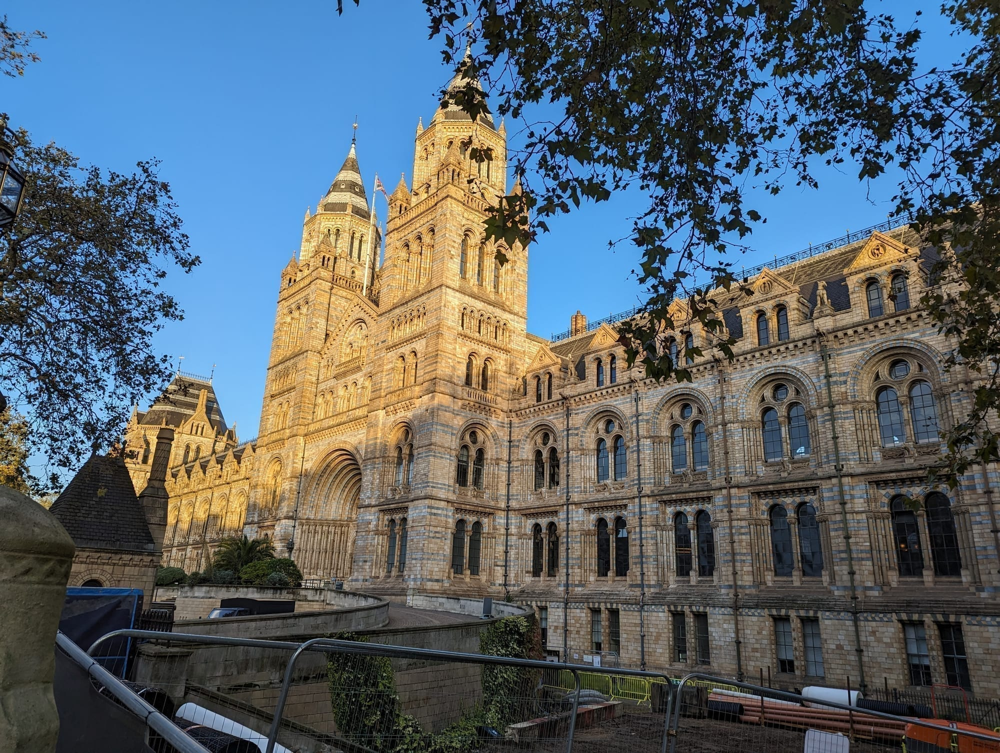
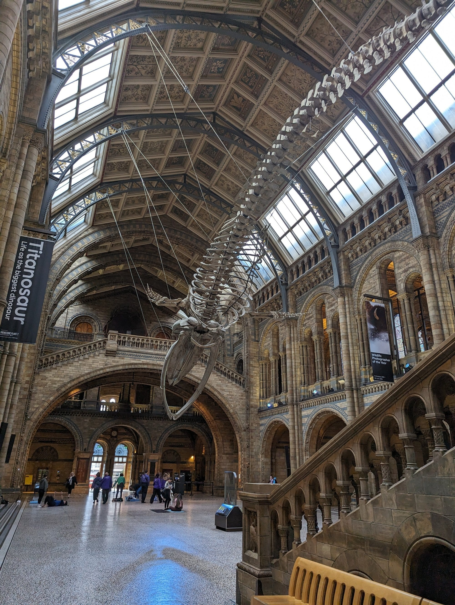
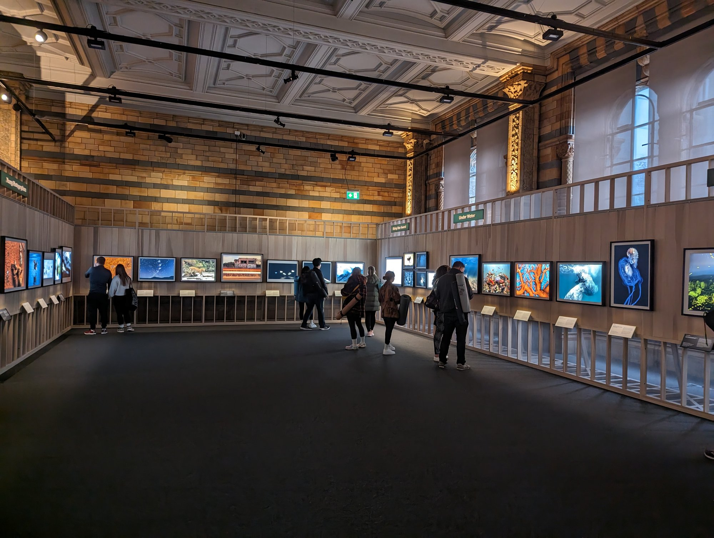
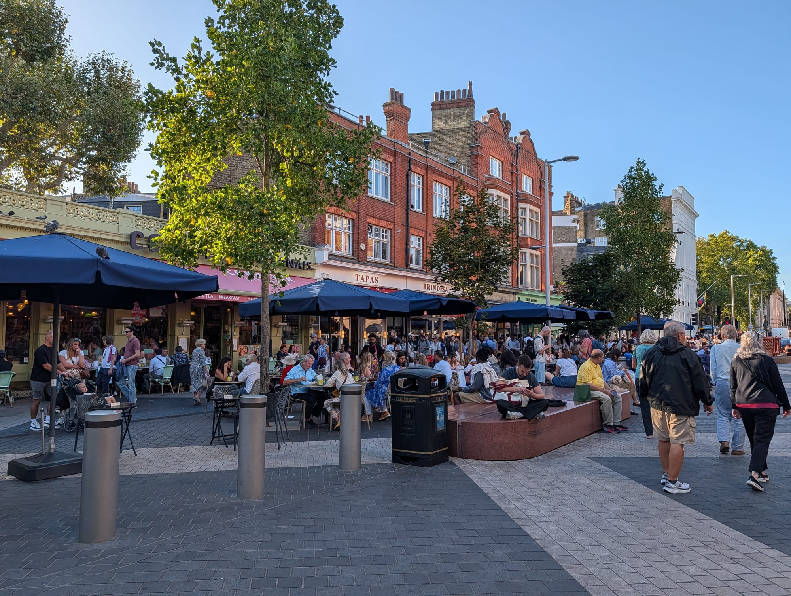
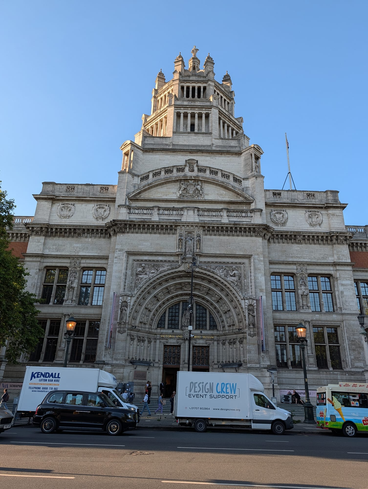
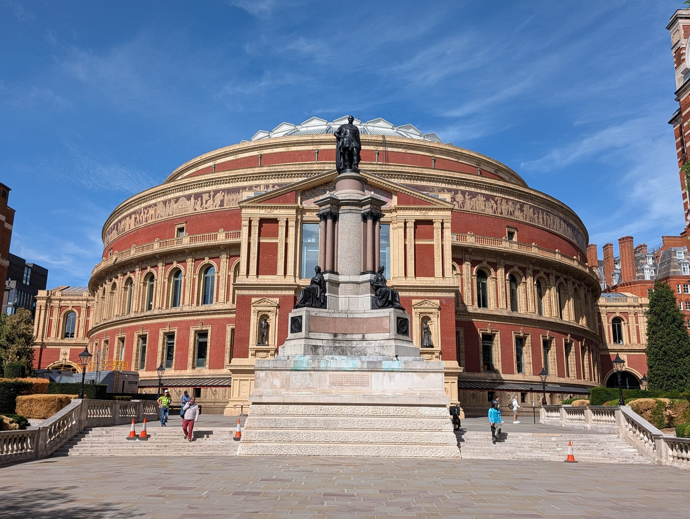
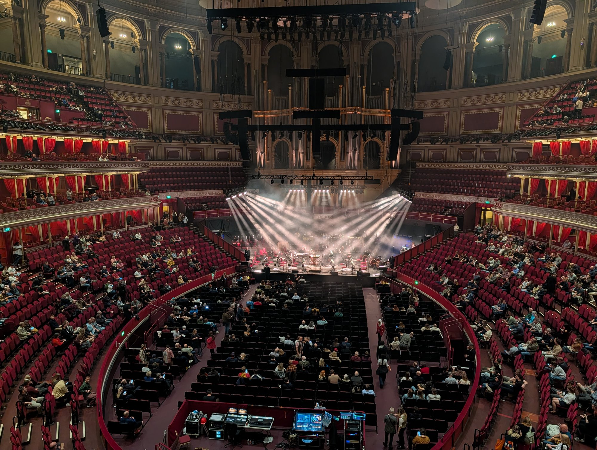
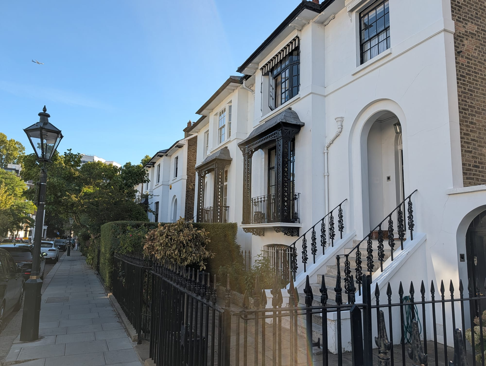
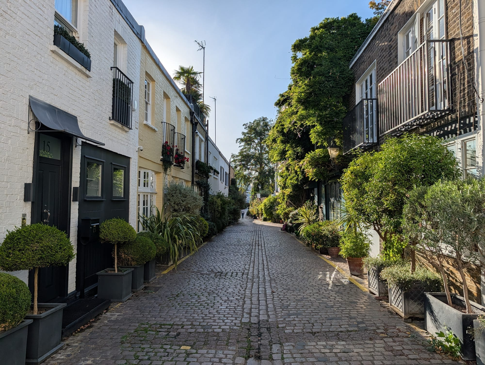
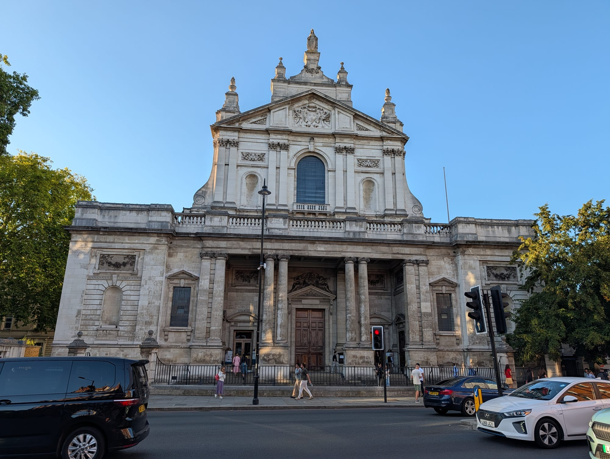

The profits of the 1851 Great Exhibition bought the land for a cluster of museums, colleges and concert halls, nicknamed Albertopolis after Prince Albert. Three free museums now sit within 400 metres of each other, with the Royal Albert Hall at the top of the road.

South Kensington has its own share of the commemorative plaques marking where notable people lived or worked - see them on our [interactive map](/plaques/?area=south-kensington).

## Why visit — and who should skip it

**Come here if** you have children, or a rainy day, or any interest in science, design or natural history. Three collections at no cost, and a Victorian subway from the station that takes most of the walk underground.

**Skip it if** you are short on time and not a museum person. There is little else here: the streets are residential and the area is quiet by evening. If you want one museum and then something else, the [British Museum](/articles/british-museum-guide/) in Bloomsbury sits closer to the rest of central London.

## Top sights and activities

1. **[Natural History Museum](/articles/natural-history-museum-guide/)** — Alfred Waterhouse's terracotta building, with "Hope" the blue whale skeleton suspended in Hintze Hall. Open daily 10:00–17:50. The ticketed Wildlife Photographer of the Year exhibition runs from 16 October 2026 to 11 July 2027, with adult off-peak tickets from £17.
2. **Victoria and Albert Museum (V&A)** — 145 galleries covering 5,000 years of art and design. The John Madejski Garden in the centre is a courtyard to sit in, and the Victorian refreshment rooms are billed by the V&A as the world's first museum cafe.
3. **Science Museum** — Rockets, jet engines and the Apollo 10 command module. **Wonderlab** upstairs is hands-on and ticketed.
4. **Royal Albert Hall** — The circular concert hall at the top of Exhibition Road. Home of the BBC Proms each summer, when standing tickets in the Arena or Gallery cost £8 on the day; the [Last Night of the Proms ticket routes](/articles/last-night-of-the-proms-tickets/) are set out separately.
5. **Kensington Gardens and the Albert Memorial** — Across the road, with Kensington Palace at the far end and the Serpentine galleries in between.
6. **Brompton Oratory** — A large Italianate Catholic church next to the V&A. Free.

## Key streets and micro-districts

*The Natural History Museum.*

*"Hope" the blue whale skeleton.*

*The Wildlife Photographer of the Year exhibition.*

### Exhibition Road
Resurfaced in 2012 as a shared surface with no kerbs, so pedestrians and traffic share the road.

**All three museums sit on it**: the Natural History Museum and the Science Museum on the western side, the V&A on the eastern, along with Imperial College and the Royal Geographical Society.

The road is about eight minutes end to end, uphill from the station towards the Albert Hall.

### The Museum Subway
The tiled Victorian tunnel running underground from the station towards the museums, opened in 1885 so that visitors could reach them without crossing Exhibition Road. Cream and yellow-brown glazed brick, Grade II listed. The Natural History Museum has a gate directly off it; for the other two you surface on the museums side and walk a short way outside.

**It is free, dry and open during station hours.**

*The Royal Albert Hall.*

*Inside the Royal Albert Hall.*

### Cromwell Road and Thurloe Square
Stucco terraces and private garden squares south of the museums, almost entirely residential.

**Thurloe Square** holds a wedge-shaped house about six feet wide at its narrowest, built in 1887 in a strip of land left over when the District line was cut through.

**Nothing to buy or book:** a quiet five minutes between the museums and the Fulham Road.

**Launceston Place**, a few minutes west, has a cobbled mews running off it.

### Bute Street and Old Brompton Road
The everyday streets, home to the French community around the Lycée Français Charles de Gaulle.

There are French bakeries, cafés and a bookshop; Bute Street is a short pedestrian run of them.

**Best in the morning**, when the bakeries are full. Two minutes from the station.

### Knightsbridge and Brompton Road

North-east along the Brompton Road towards **Harrods and Harvey Nichols** — about ten minutes on foot from the museums. The **Brompton Oratory** stands on the way, next to the V&A: a vast Italianate Catholic church, free to enter.

Harrods is free to walk into; the food halls are the draw.

**Ten minutes on foot.** The 14 and 74 buses run the same route.

## Go deeper

- **[The best museums in London](/articles/best-museums-london/)** — the V&A, the Natural History Museum and the Science Museum compared, with which halls are worth your time and when to book.

## Where to eat and drink

| Spot | Style | Price | Why go |
| --- | --- | --- | --- |
| **V&A Cafe** | Museum cafe | ££ | Three Victorian rooms, billed by the V&A as the world's first museum cafe |
| **Ognisko** | Polish | ££ | Elegant townhouse dining room on Exhibition Road with a terrace |
| **The Anglesea Arms** | Historic pub | ££ | Pub five minutes south, away from the museum crowds |
| **Comptoir Libanais** | Lebanese | £ | Quick, and suits children |
| **Bute Street bakeries** | French cafes | £ | The local French quarter |
| **Duke of York Square** | Various | ££ | Fifteen minutes towards Chelsea, with a Saturday food market |

## Getting there

**By Tube.** **South Kensington** is on the Piccadilly, District and Circle lines. The Piccadilly line runs direct from Heathrow in about 40 minutes for under £6.

**Best exit.** Follow signs inside the station for the **Museum Subway**, the pedestrian tunnel that comes up inside the museum precinct. Do not leave by the main street exit unless you want the shops.

**On foot.** Ten minutes to Knightsbridge, fifteen to Sloane Square, twenty-five through the parks to Notting Hill.

## How long to spend, and when to go

| If you have | Do this |
| --- | --- |
| **Two hours** | One museum's highlights — Hintze Hall, or the V&A cast courts |
| **Half a day** | One museum, plus lunch and Exhibition Road |
| **A full day** | Two museums, with Kensington Gardens between them |

**Best time:** Right at opening, usually 10:00. The first hour is quieter, and the only time Hintze Hall is not crowded.

**Avoid:** Weekends and school holidays if you can, particularly at the Natural History Museum.

Comparing neighbourhoods? [Best areas to visit in London](/articles/best-areas-to-visit-london/) sets them side by side by what each is best for, how long it takes and the best day to go.

Powered by <a target="_blank" rel="sponsored" href="https://www.getyourguide.com/london-l57/">GetYourGuide</a>

## Suggested three-hour route

1. **Start:** South Kensington station, via the **Museum Subway**.
2. **[Natural History Museum](/articles/natural-history-museum-guide/):** Hintze Hall and the dinosaur gallery. Book the free entry ticket.
3. **Exhibition Road:** North past Imperial College to the **Royal Albert Hall**.
4. **Kensington Gardens:** Cross to the **Albert Memorial** and into the park.
5. **Finish:** Back down for the **V&A** courtyard, or east to Harrods.

Powered by <a target="_blank" rel="sponsored" href="https://www.getyourguide.com/london-l57/">GetYourGuide</a>

## Common mistakes to avoid

1. **Trying to do all three museums in a morning.** One per half day.
2. **Queuing outside in the rain.** The Museum Subway from inside the station is undercover.
3. **Not booking free timed entry.** It costs nothing and skips the weekend queue.
4. **Paying for a taxi from Heathrow.** The Piccadilly line comes here directly.
5. **Assuming Wonderlab is included.** The Science Museum is free; Wonderlab is ticketed.

## Where to stay

Quiet and well connected, though the area is sleepy after about 20:00.

- **South Kensington and Gloucester Road** — Townhouse hotels and serviced flats, walkable to the museums, direct to Heathrow.
- **[Earl's Court](/articles/where-to-stay-kensington/)** — Ten minutes west, noticeably cheaper, same District and Piccadilly access.
- **[Knightsbridge](/articles/where-to-stay-chelsea/)** — North-east and considerably more expensive, closer to Hyde Park.

Our [South Kensington hotel guide](/articles/where-to-stay-south-kensington/) compares the hotels by the museums.
