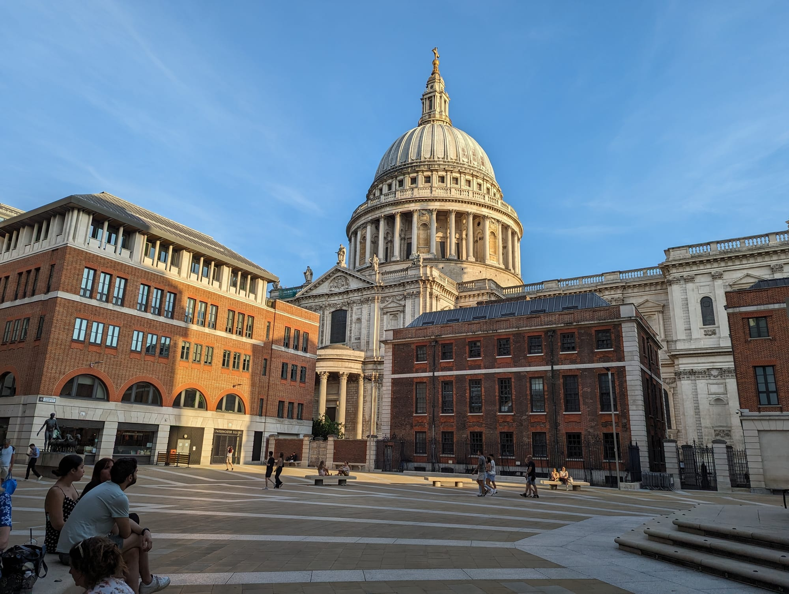

> 💡 **The Short Version:**
> - **Sightseeing is Monday to Saturday.** Doors open at 08:30 on most days, the Dome Galleries at 09:30, and last entry is usually 16:00 (galleries 16:15). Sunday is for worship only.
> - **An adult ticket is £27** (£24 for over-65s and students, £10.50 for ages 6 to 17, under-6s free). It covers the floor, the crypt, the three dome galleries and a multimedia guide. [Book on the cathedral's site](https://www.stpauls.co.uk/book-tickets) up to six months ahead, or just turn up.
> - **A tour is optional.** The 90-minute floor and crypt tour is free with a ticket: ask at the Guiding Desk on the day. A <a href="https://www.getyourguide.com/activity/-t19600?partner_id=WWP7I0R&amp;cmp=st-pauls-cathedral-guide" target="_blank" rel="sponsored nofollow noopener" data-affiliate="gyg">St Paul's ticket on GetYourGuide</a> is the same £27 and can be cancelled free up to 24 hours before; the cathedral's own tickets are non-refundable.
> - **Evensong is free** and needs no ticket: usually 17:00 Monday to Saturday and 15:00 on Sunday. Check the fortnightly service schedule, because some weekday evenings have a different service.
> - **The dome is 528 steps and stairs only:** 257 to the Whispering Gallery, 376 to the Stone Gallery. No photos on the Whispering Gallery.
> - **Bags: 45 x 30 x 25 cm at most, and there is no cloakroom.**
> - **Passes:** the London Pass needs no booking; National Rail 2FOR1 has to be booked online.
> - **Saturday 14 November 2026 is Lord Mayor's Show Day:** the floor and crypt are free, and the dome is £13.50.

> ⚠️ **The Cathedral is closed to sightseers on Sundays.** Services run all day, but there is no sightseeing, crypt or dome access. In 2026 the Dome Galleries opened on Sundays from 15 March to 25 October.

---

## Tickets and booking

*St Paul's from Paternoster Square.*

A sightseeing ticket covers the Cathedral Floor, the Crypt, the Dome Galleries, a multimedia guide and any temporary exhibitions. The Cathedral is a charity with no regular state funding, and every ticket carries an optional 10% donation.

| Ticket | Price | With 10% donation |
| --- | ---: | ---: |
| Adult (18 and over) | £27.00 | £29.70 |
| Senior (65 and over) or student with photo ID | £24.00 | £26.40 |
| Child (6 to 17) | £10.50 | £11.55 |
| Under 6 | Free | Free |
| Family: 2 adults and 2 or 3 children (6 to 17) | £64.50 | £70.95 |
| Family: 1 adult and 2 or 3 children (6 to 17) | £37.50 | £41.25 |

A disabled visitor and one carer or companion get free tickets, booked ahead or requested on arrival. Groups of 15 or more pay £24.30 per adult and £9.50 per child and book a date and time in advance. A child under 18 must be supervised by an adult in the Dome Galleries.

### How to book

[Tickets are sold on the cathedral's site](https://www.stpauls.co.uk/book-tickets) for a chosen date and time, from six months ahead until the day itself. Walk-up visitors are welcome, and cash is accepted at the door. Booking online is the fastest way in.

- **Changes:** a booking can be moved to another date or time up to 24 hours before. Tickets are non-refundable.
- **Late arrival:** you are usually let in later that day, up to the last entry time. Missed visits are not refunded.
- **GetYourGuide:** the [St Paul's Cathedral entry ticket](https://www.getyourguide.com/activity/-t19600?partner_id=WWP7I0R&cmp=st-pauls-cathedral-guide) is the same £27 for an adult and can be cancelled free up to 24 hours before. Check dates below.

Powered by <a target="_blank" rel="sponsored" href="https://www.getyourguide.com/london-l57/">GetYourGuide</a>

### Discounts

- **London Pass:** covers Monday to Saturday sightseeing. Bring the pass; there is nothing to book. Our [London Pass guide](/articles/london-pass-guide/) works out whether it pays.
- **National Rail 2FOR1:** two Monday to Saturday tickets for the price of one adult ticket, bookable online only. Pick "National Rail Days Out - Two Visitors", quantity one, and show your train tickets to London for both visitors. It cannot be combined with another offer, and it excludes group tickets, tours and special events. The [National Rail 2FOR1 guide](/articles/national-rail-2for1-london-attractions/) lists the other attractions.
- **£1 tickets:** for UK visitors on Universal Credit, Pension Credit or Employment and Support Allowance, for one adult and up to four children aged 6 to 17. Book online up to three months ahead, or buy at the door with proof of benefit.
- **National Art Pass:** 50% off walk-up adult, concession and child tickets.
- **Blue Peter badge:** up to two holders aged 6 to 15 get a free child ticket with a full-paying adult.
- **Friends of St Paul's:** free sightseeing for a year, for £36.

### Lord Mayor's Show Day

On **Saturday 14 November 2026** the Cathedral Floor and Crypt are free and unticketed, with last admission at 16:00. The Dome Galleries are £13.50 for an adult, £12 for a senior or student and £5.25 for a youth or child, free for Friends, from 09:30 with last admission at 16:00. There is an organ showcase from 13:15 to 14:00 and Evensong at 15:00. The Cathedral calls it one of its busiest days of the year, may close earlier or limit entry at capacity, and the City is closed to traffic all day.

---

## Tours

Most of the cathedral's own tours are free with a ticket, and the Treasures tour is the paid one. The widget below lists tours sold on GetYourGuide.

- **Highlights tour:** 20 to 30 minutes, free with a ticket. Monday to Saturday at various times, usually between 11:00 and 15:00. Book on the day at the Guiding Desk.
- **Cathedral Floor and Crypt tour:** about 90 minutes, free with a ticket, same times and same Guiding Desk. It includes the Geometric Staircase and the Quire.
- **Treasures tour:** £16 on top of admission, 60 minutes, booked online with your ticket. It goes up into the Triforium, the gallery that wraps around the top of the building, to the 18th-century library, the Great Model of Wren's original design in the Trophy Room, the Geometric Staircase and the view down the nave from above the Great West Doors. There are 141 steps to the Triforium and up to ten more short flights, no lift and no seating, and it suits ages 12 and over.
- **Private tours:** £195 for up to 15 people plus admission for the floor and crypt tour, Monday to Friday, booked at least a month ahead with the Sales and Ticketing team.
- **Multimedia guides:** included, with a touch screen, fly-through footage of the dome galleries, and commentary in English, French, German, Italian, Spanish, Portuguese, Mandarin, Japanese and Korean. There is a family version with quizzes and games, an audio-described version and a British Sign Language one.

Powered by <a target="_blank" rel="sponsored" href="https://www.getyourguide.com/london-l57/">GetYourGuide</a>

---

## Opening hours

- **Monday to Saturday:** doors open at 08:30 on most days. Last sightseeing entry is usually at 16:00, and sightseeing ends 30 minutes after that.
- **Dome Galleries:** open at 09:30, with last entry at 16:15. Access to the Golden Gallery can be limited by capacity late in the day.
- **Sundays:** worship only.
- **Crypt Cafe by Benugo:** Monday to Saturday 10:00 to 17:00 and Sunday 11:00 to 16:30. Use the north-west Crypt door; no ticket is needed.
- **Changes:** opening and closing times move for services and events, so check the [what's on calendar](https://www.stpauls.co.uk/whats-on) for your day.

---

## Climbing the dome

The dome is 111 metres (365 feet) high. The three galleries are reached by stairs only, and the Cathedral advises anyone with a medical condition, mobility difficulties or a fear of heights or confined spaces to skip the climb. A video fly-through of all three levels is on the multimedia guide.

| Gallery | Steps from the floor | What it is |
| --- | ---: | --- |
| Whispering Gallery | 257 | An indoor gallery around the inside of the dome, where a whisper against the wall carries to the opposite side. Photography is not allowed. |
| Stone Gallery | 376 (119 more) | An outdoor gallery around the dome, 52 metres above the ground. |
| Golden Gallery | 528 (152 more) | The smallest gallery, at the highest point of the outer dome, 85 metres up. |

Child ticket holders must be accompanied by an adult in the galleries, and the Cathedral recommends comfortable shoes. Photos are allowed on the Stone and Golden Galleries, without flash.

---

## On the Cathedral Floor

Security is at the entrance, and the nave opens out beyond it.

- **The Quire:** the first part of the building to be built and consecrated, with carved stalls by Grinling Gibbons. Its mosaics by William Blake Richmond were made between 1891 and 1904 and show the Creation and other Bible stories.
- **The Grand Organ:** built in 1695, in a case by Gibbons, with 7,189 pipes, five keyboards and 138 stops. It is the third largest organ in the UK.
- **The High Altar:** installed in 1958 to replace a Victorian altar damaged by a bomb. Its canopy follows a sketch by Wren that was not built in his time.
- **American Memorial Chapel:** also called the Jesus Chapel, behind the high altar. It commemorates the 28,000 Americans in the UK who died in the Second World War.
- **Wellington's monument:** an equestrian monument in an arch between the nave and the north aisle, completed in 1912.
- **Art:** William Holman Hunt's *The Light of the World* (the third version, painted around fifty years after the first), Henry Moore's *Mother and Child: Hood*, and Bill Viola's video works *Martyrs* and *Mary*.
- **The Geometric Staircase:** in the south-west tower, with steps that seem to float. It is seen on a tour, not by wandering in, and was the route to the divination class in the Harry Potter films.
- **A Dangerous Calling:** an exhibition on William Tyndale's New Testament, on the Cathedral Floor until February 2027. To see the original 1526 Tyndale New Testament, add a Treasures tour to your admission.

The 1981 wedding of Prince Charles and Lady Diana Spencer, and Winston Churchill's state funeral in 1965, were held here.

---

## The Crypt

The Crypt is the largest in Europe and follows the footprint of the building above. It is reached by lift as well as stairs.

- **Sir Christopher Wren:** a simple stone marks his tomb, with the Latin epitaph *Lector, si monumentum requiris, circumspice* ("Reader, if you seek his monument, look around you"). He died in 1723.
- **Lord Nelson:** killed at Trafalgar in 1805, in a coffin made from the timber of a French ship he defeated, inside a black marble sarcophagus originally made for Cardinal Wolsey.
- **The Duke of Wellington:** in a casket of Cornish granite, hung around with the banners made for his funeral procession.
- **Between the two:** the Falklands memorial to the 255 British people killed in 1982, and the Churchill memorial gates. Churchill is not buried here.
- **Artists, scientists and musicians:** memorials to J.M.W. Turner and other artists, to Alexander Fleming and Sir Henry Wellcome, to Parry and Sullivan, and to William Blake, unveiled in 1927. Florence Nightingale is commemorated with a marble memorial but is not buried here.
- **The OBE Chapel,** the Cathedral's shop and the accessible toilets are also down here.

---

## Free: services and Evensong

Services are free to attend, with no ticket and, for most, no booking. About thirty take place each week, and you do not have to be a Christian to come.

- **Choral Evensong:** usually 17:00 Monday to Saturday and 15:00 on Sunday. Some weekday evenings have Evening Prayer or a Eucharist instead, and the [service schedule](https://www.stpauls.co.uk/resources/our-service-schedule) is published a fortnight at a time with the music for each service.
- **Other services:** Morning Prayer at 07:30, a Eucharist at 08:00 and 12:30, and on Sundays Holy Communion at 08:00, Choral Mattins at 10:00 and Sung Eucharist at 11:15.
- **Where to sit:** most people sit under the dome, as it is closer to the service; the nave makes it easier to leave without disturbing anyone. Seating is unreserved. At some services you may be invited into the Quire.
- **Rules:** stay in your seat, and take no photographs or video during a service. You pass through the same security check as sightseers.
- **St Dunstan's Chapel:** open for private prayer and candles whenever the Cathedral is open, free, with no ticket. Photography is not allowed.

Advent services, carol services and concerts run through December. The Advent Carol Services on 28 and 29 November 2026 are free. Family Carols on 19 December and the 16:00 carol services on 23 and 24 December need tickets, and Handel's *Messiah* on 2 December and *A Celebration of Christmas* on 10 December are paid concerts. Our [Christmas in London guide](/articles/christmas-in-london/) covers the rest.

---

## Bags, security and photography

Everyone is searched at the entrance, and the rules are strict.

> ⚠️ **No bag larger than 45 x 30 x 25 cm, and no cloakroom.** The limit includes handles, wheels and pockets. Our [London luggage storage guide](/articles/luggage-storage-london/) covers where to leave a suitcase.

- **Allowed:** personal belongings, unopened soft drinks cans, food and water.
- **Not allowed:** glass bottles or containers, alcohol, opened drinks cans, knives or sharp objects, drones and anything used for protest.
- **Photography:** non-flash stills for personal use on the Cathedral Floor, in the Crypt and on the Stone and Golden Galleries. Not on the Whispering Gallery, in St Dunstan's Chapel or during services. No video, tripods, monopods, gimbals or selfie sticks.
- **Dress:** there is no dress code, though as a place of worship visitors are asked to dress suitably.

### Step-free access

Our [step-free London guide](/articles/step-free-london/) compares the big attractions.

- **Entrance:** the main entrance is up a flight of steps. The ramped North Transept entrance leads straight onto the Cathedral Floor and is the one wheelchair users should use.
- **Crypt and Quire:** the Crypt has a lift with 1,400 mm by 1,300 mm of usable space, which some larger scooters do not fit. The Quire has a stair lift with a platform of 1.0 m by 0.76 m. Other parts of the Cathedral are reached by steps.
- **The galleries and the Triforium:** stairs only.
- **Toilets:** wheelchair-accessible toilets and a Changing Places toilet in the Crypt near the cafe. Ask Visitor Experience staff in the Crypt for the RADAR key.
- **Help:** wheelchairs are available on request, a hearing loop covers the Cathedral Floor, and the multimedia guides include a British Sign Language tour with subtitles and an audio-described tour for visually impaired visitors. Assistance dogs are welcome.

---

## Getting there

St Paul's Cathedral, St Paul's Churchyard, London EC4M 8AD.

- **St Paul's** Underground station: 270 metres, three minutes.
- **City Thameslink:** 300 metres, four minutes.
- **Blackfriars** station: 500 metres, seven minutes.
- **By river:** Uber Boat from Blackfriars Pier is nine minutes' walk (650 metres), and Bankside Pier is twelve (900 metres). Our [river boat guide](/articles/how-to-use-london-river-boats/) explains the services.
- **By bike:** Santander Cycles docking stations are within a three-minute walk, and there are free bike racks on the surrounding streets.
- **By car:** on-street parking is very limited. The nearest public car park is Baynard House on Queen Victoria Street, six minutes away.

---

## What is nearby

- **[One New Change roof terrace](/articles/best-views-london/)** looks straight at the dome and is free.
- **The Millennium Bridge** runs from below the Cathedral to Tate Modern and the South Bank, which our [South Bank walk](/articles/south-bank-walk/) and [South Bank area guide](/articles/south-bank-area-guide/) cover.
- **The [City of London walk](/articles/city-of-london-walk/)** goes from Bank to the Tower of London and Tower Bridge, and the [City of London area guide](/articles/city-of-london-area-guide/) covers St Paul's, Smithfield and the Roman remains.
- **The [Tower of London](/articles/tower-of-london-guide/)** and **[Tower Bridge](/articles/tower-bridge-guide/)** are the two big sights downriver.
- **[Westminster Abbey](/articles/westminster-abbey-guide/)** is the other cathedral-scale church with free Evensong, upriver.
- **[Thames river cruises](/articles/thames-river-cruises-london/)** pass the dome between Westminster and Greenwich.
- **For a London itinerary,** see [three days in London](/articles/three-days-in-london-itinerary/) and [five days in London](/articles/five-days-in-london-itinerary/).
