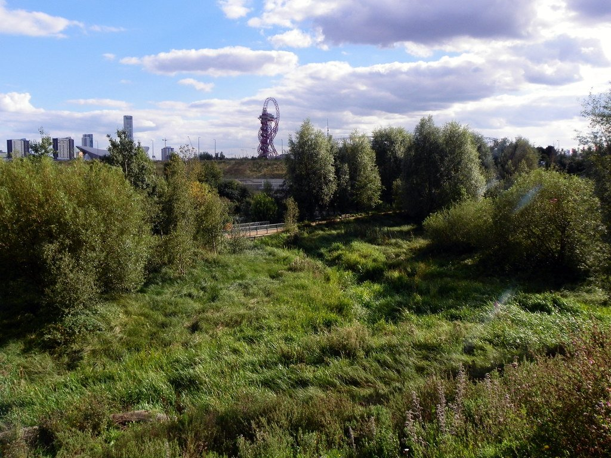
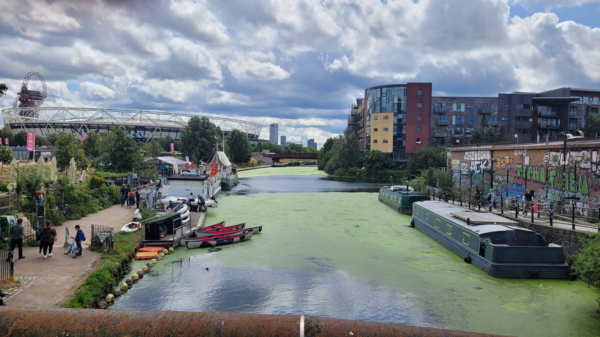
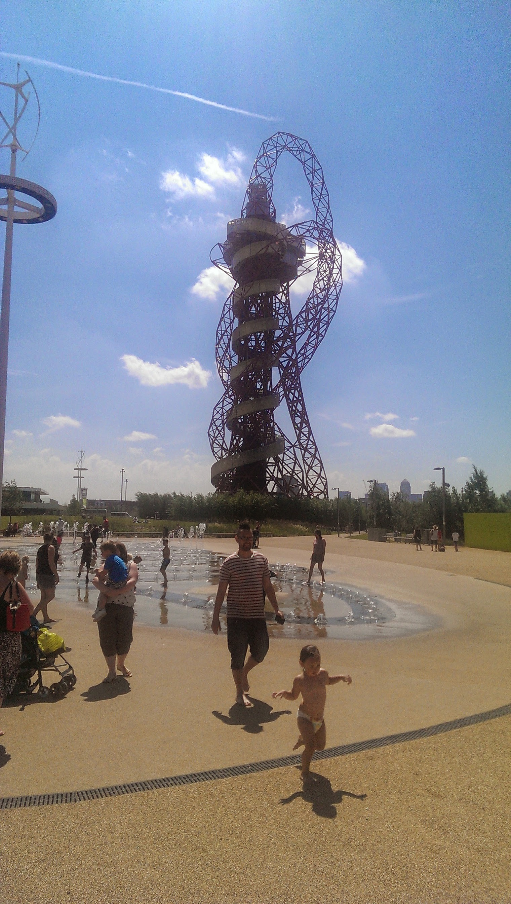

Stratford was a rail junction and a shopping centre until 2012, when the Olympics rebuilt 560 acres of contaminated industrial land into the Queen Elizabeth Olympic Park. The pool is a public pool, the stadium is a football ground and the velodrome takes bookings.

Six lines meet at Stratford, and the Elizabeth line reaches Liverpool Street in nine minutes.

Stratford has its own share of the commemorative plaques marking where notable people lived or worked - see them on our [interactive map](/plaques/?area=stratford).

## Why visit — and who should skip it

**Come here if** you have children, or you want to swim in an Olympic pool, or you like modern landscape design. The park is free, large and full of waterways.

**Skip it if** you want historic London. Almost nothing here predates 2012, so there is no old street pattern to explore.

## Top sights and activities

1. **Queen Elizabeth Olympic Park** — 560 acres, free and open daily. Waterways, wildflower meadows, play areas and the River Lea running through it.
2. **ArcelorMittal Orbit and Helix** — Anish Kapoor's 114.5-metre sculpture, the UK's tallest, run by Zip World, which sells the viewing platforms (Orbit 360) and the slide (Helix) as separate tickets. Helix is Carsten Höller's 178-metre tunnel slide around the sculpture, billed as the world's longest and tallest. Height limits apply.
3. **London Aquatics Centre** — Zaha Hadid's wave-roofed building. You can swim in the Olympic pool for the price of an ordinary session.
4. **London Stadium** — Now West Ham's ground, with tours on non-event days including the pitch and the dressing rooms. Match-day transport and parking are in our [London Stadium guide](/articles/london-stadium-travel-guide/).
5. **East Bank** — The cultural quarter: V&A East Museum and V&A East Storehouse (both free, open daily 10am to 6pm and until 10pm on Thursdays and Saturdays), Sadler's Wells East, and the London College of Fashion and UCL East campuses. BBC Music Studios are due in 2027.
6. **Lee Valley VeloPark** — The Olympic velodrome, open for taster sessions on the boards, plus BMX and mountain bike tracks.
7. **Hackney Wick and the canal** — West across the water. Warehouse studios and canal-side breweries, twenty minutes on foot.

*The planted river valley, Olympic Park. Photo: [Peter O'Connor aka anemoneprojectors](https://www.flickr.com/photos/58414938@N00/25121703793), [CC BY-SA 2.0](https://creativecommons.org/licenses/by-sa/2.0/).*

## Key streets and micro-districts

### The Olympic Park (south)
The busy half, built around the main waterways. **The ArcelorMittal Orbit** is here with the Helix slide, along with the **London Stadium**, the **Aquatics Centre** and **East Bank**, where the V&A, Sadler's Wells and UCL now sit on the park.

*The Stadium and the Orbit, from Hackney Wick.*

**The Aquatics Centre is open to the public to swim in**, in the Olympic pool, for the price of an ordinary leisure-centre session.

**The park itself is free and always open.** The Orbit and the slide are ticketed, so book before making the trip for them.

### The Olympic Park (north)
Quieter parkland. The **VeloPark** is here, the Olympic velodrome, open for public track sessions and taster rides, along with the **Copper Box Arena**.

The landscaping is wilder up here: reedbeds, meadow planting and the River Lea, not the formal lawns to the south.

**Free, open at all times, and quiet on a weekday.** It is about twenty minutes' walk from Stratford station to the northern end. The park's fountains run through the summer and are free to run through.

*The ArcelorMittal Orbit, above the fountains.*

### Westfield Stratford City
Between the station and the park, with around 250 shops, a cinema, a casino and a bowling alley. **You have to walk through it to reach the park.**

**Typically 10am to 9pm**, with shorter hours on Sundays. Allow ten minutes to cross it, more at a weekend.

### Stratford town centre
East of the station, **the Stratford that existed before 2012**: a covered market and an ordinary high street.

**Theatre Royal Stratford East** is the anchor: a Victorian producing house on Gerry Raffles Square with a long history of new and community work, and cheaper tickets than the West End.

**It is five minutes east of the station.**

### Hackney Wick
West across the canal, reached from the park by footbridge in a couple of minutes. **Warehouse studios, breweries and taprooms**, with painted walls that change constantly.

It is for drinking and wandering, not sightseeing. It is best on a summer afternoon. Hackney Wick has its own Overground station if you would rather not walk back through the park.

*The velodrome, from the 2012 Games. Photo: [kevin.gale](https://www.flickr.com/photos/52647449@N04/23204273471), [CC BY 2.0](https://creativecommons.org/licenses/by/2.0/).*

## Go deeper

- **[The best parks and gardens in London](/articles/best-parks-gardens-london/)** — the Queen Elizabeth Olympic Park alongside the royal parks and the other big green spaces.
- **[Shopping in London](/articles/shopping-in-london/)** — where Westfield Stratford City sits against the West End streets and the department stores.

Powered by <a target="_blank" rel="sponsored" href="https://www.getyourguide.com/london-l57/">GetYourGuide</a>

## Where to eat and drink

| Spot | Style | Price | Why go |
| --- | --- | --- | --- |
| **Westfield food court** | Mixed | ££ | Around 70 options; the practical choice with children |
| **Crate Brewery** | Brewery and pizza | ££ | Canal-side at Hackney Wick, twenty minutes west |
| **The Cow** | Pub | ££ | In Westfield, with outdoor seating |
| **Stratford covered market** | Market stalls | £ | East of the station |
| **Barge East** | Restaurant on a barge | ££ | A restored Dutch barge moored on the River Lea; floating restaurant open Thursday to Sunday |
| **Hackney Wick canal bars** | Various | ££ | Best on a summer afternoon |

Bamboo Mat in East Village cooks Nikkei, the Japanese-Peruvian cuisine, and opens every day. It is in our [fusion restaurants guide](/articles/best-fusion-restaurants-london/).

## Getting there

**By Elizabeth line.** Nine minutes from Liverpool Street, about eighteen from Bond Street. Fully step-free.

**By Tube.** The **Central** and **Jubilee** lines both serve Stratford, plus the **DLR** and **Overground**. Six lines in total.

**By high speed.** **Stratford International** connects to St Pancras in seven minutes on Southeastern high speed, but the station is a ten-minute walk from Stratford proper.

**Walking in.** From Stratford station the signed route goes **through Westfield**; follow signs for the Olympic Park.

## How long to spend, and when to go

| If you have | Do this |
| --- | --- |
| **Two hours** | The southern park, the Orbit and the waterways |
| **Half a day** | Add a swim at the Aquatics Centre or a stadium tour |
| **A full day** | Walk the canal west to Hackney Wick and on to Victoria Park |

**Best time:** Weekday mornings, when the park is quiet. Summer evenings suit the waterways and the Hackney Wick bars.

**Check first:** The London Stadium closes to tours on event days.

Comparing neighbourhoods? [Best areas to visit in London](/articles/best-areas-to-visit-london/) sets them side by side by what each is best for, how long it takes and the best day to go.

## Suggested half-day route

1. **Start:** Stratford station. Follow signs through **Westfield** to the park.
2. **The Orbit:** South into the park for the sculpture, and the slide if you are up for it.
3. **Aquatics Centre:** Next door — swim in the Olympic pool, or just look at the roof.
4. **The waterways:** North-west along the River Lea through the planting.
5. **Hackney Wick:** Cross the canal to the warehouse studios and breweries.
6. **Finish:** Hackney Wick Overground, or walk on to Victoria Park.

Powered by <a target="_blank" rel="sponsored" href="https://www.getyourguide.com/london-l57/">GetYourGuide</a>

## Common mistakes to avoid

1. **Confusing Stratford and Stratford International.** They are a ten-minute walk apart and serve different lines. International is domestic high speed, not Eurostar.
2. **Booking the wrong Orbit ticket.** The viewing platforms (Orbit 360) and the slide (Helix) are separate tickets.
3. **Turning up to swim without checking the timetable.** The Aquatics Centre runs club and school sessions that close lanes.
4. **Trying to avoid Westfield.** The signed route from the station goes through it.
5. **Coming for old London.** There is essentially none here.

## Where to stay

Well connected and cheaper than Zone 1, in a modern, retail-led setting.

- **Stratford and Westfield** — Large modern hotels beside the station and the mall.
- **Hackney Wick** — Warehouse conversions on the canal, quieter.
- **Shoreditch** — Twenty minutes west, with more to do in the evening.
