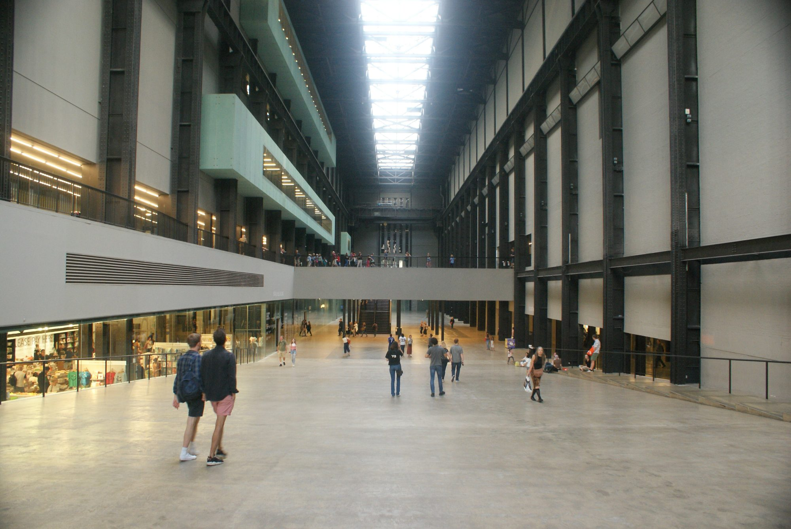
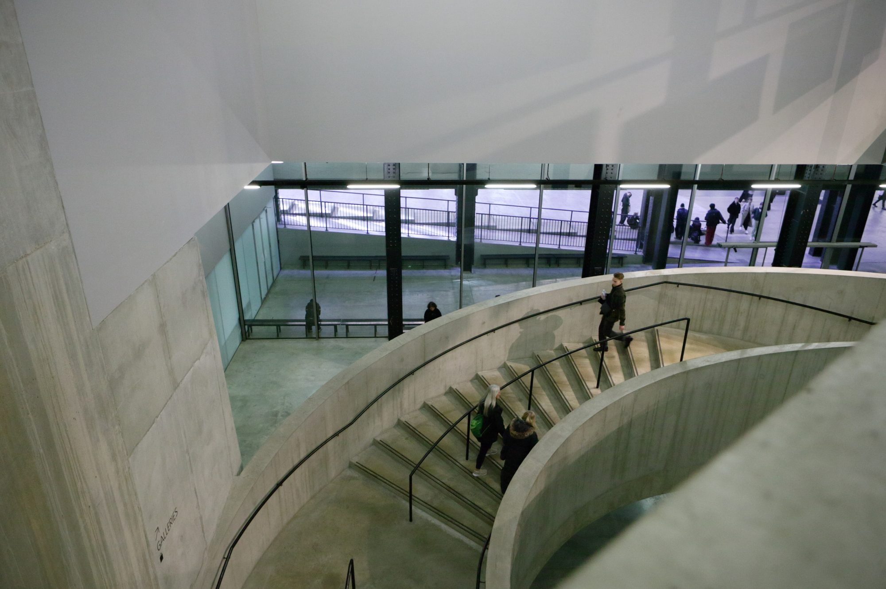
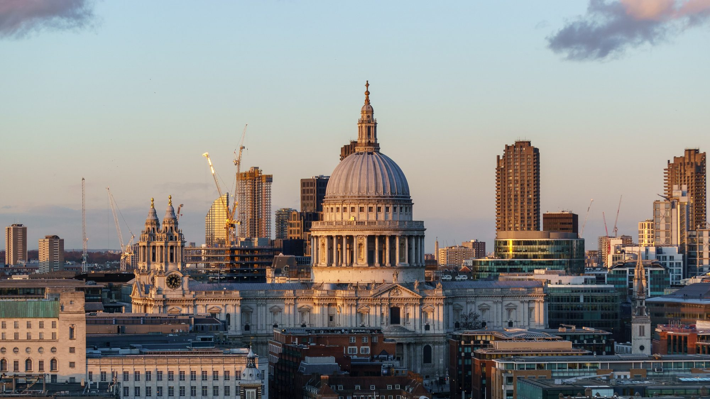
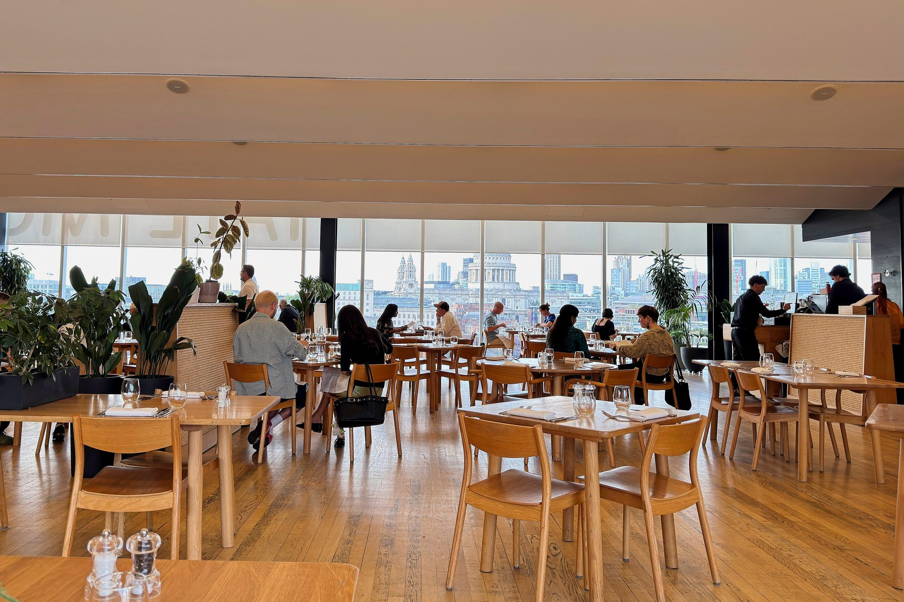
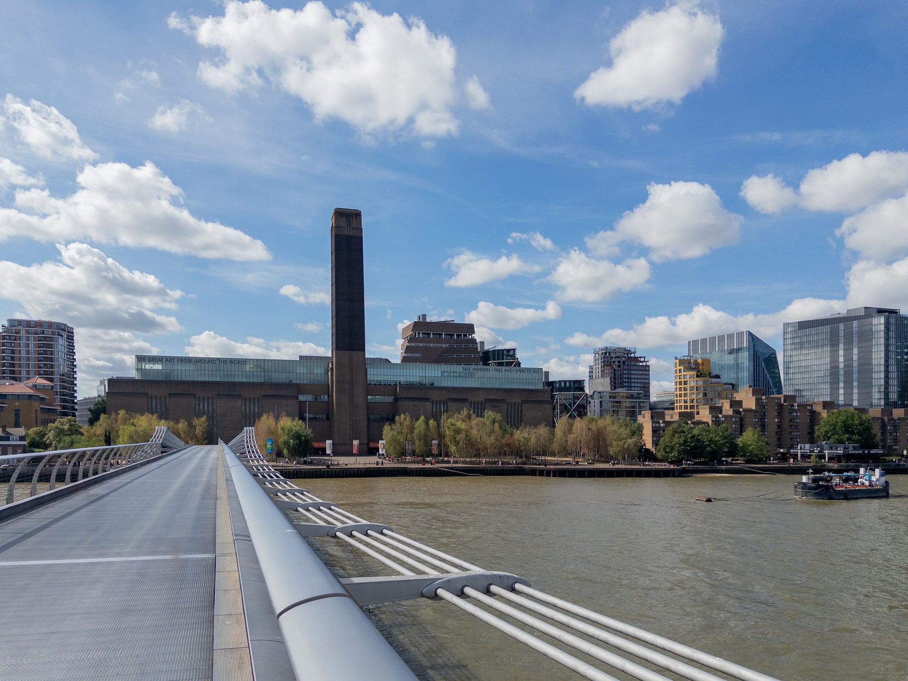

> 💡 **The Short Version:**
> - **Entry is free, with no booking for the collection.** Open Sunday to Thursday 10:00 to 18:00 and **Friday and Saturday 10:00 to 21:00**; last entry is 30 minutes before closing. Closed 24 to 26 December.
> - **Paid exhibitions:** **Frida: The Making of an Icon** to 3 January 2027 (£25), **Ana Mendieta** to 17 January (£18), **Light and Magic** to 21 February (£20) and **Julio Le Parc** to 3 May 2027 (£15). **Monet: Painting Time** follows from 25 February (£26). Members go free; 16 to 25s pay £5 with Tate Collective; up to four children aged 11 and under go free per adult.
> - **The Turbine Hall** holds the free Hyundai Commission, **Tarek Atoui: Hold**, to 11 April 2027.
> - **Level 10** at the top of the Blavatnik Building looks across the Thames to St Paul's. Take the lift from Levels 0 to 4; it is open until 17:00 Sunday to Thursday and 21:00 Friday and Saturday.
> - **Allow two to three hours** for the free displays and the Turbine Hall, and add an hour for each exhibition.
> - **Leave the suitcase behind.** Bags over 55 x 40 x 20 cm are refused and there is no cloakroom.

Tate Modern fills the former Bankside Power Station on the south bank, opposite St Paul's. It is two buildings: the Natalie Bell Building, the old power station with the Turbine Hall in the middle, and the stepped Blavatnik Building behind it. Both are free to enter. The collection is arranged by theme rather than by date.

*Opening times, prices and exhibition dates as of 15 November 2026.*

---

## Free entry and booking

Walk in at any time during opening hours. There is no free ticket or timed slot for the collection or the Turbine Hall. Only the temporary exhibitions need a ticket, which you can book online up to the day of your visit if there is availability, or buy at the ticket desks. The desks close 45 minutes before the gallery does.

There are two main entrances:

- **The Turbine Hall ramp on Holland Street** leads into the Natalie Bell Building.
- **The Blavatnik Building entrance on Sumner Street** leads into the stepped building behind.

You can also walk in through the Corner café on the north riverside side from 10:00. Bags are checked on arrival, so allow a few minutes.

*The Turbine Hall. Photo: [Robert Lamb](https://commons.wikimedia.org/wiki/File:View_along_the_Turbine_Hall_in_the_Tate_Modern_-_geograph.org.uk_-_6252685.jpg), [CC BY-SA 2.0](https://creativecommons.org/licenses/by-sa/2.0/).*

---

## The Turbine Hall commission

The Hyundai Commission is **Tarek Atoui: Hold**, free and open to **11 April 2027**. Atoui, a sound artist and composer, has filled the hall with instruments played by wind and machine: bamboo pipes channelling air through Chinese and Southeast Asian shengs, Korean drums struck by mechanised mallets, Uzbek karnai horns, and textiles up to 30 metres long that move with the air currents. Microphones sample the sound and software replays it, so it changes through the day. You can sit or lie on stones along the floor and feel them vibrate.

Musicians play the installation in a series of live sessions, free with a ticket. The next are on 27 November, 11 December and 15 January; the [live programme page](https://www.tate.org.uk/whats-on/tate-modern/tarek-atoui) lists the line-ups and booking links.

---

## Paid exhibitions, 2026 to 2027

A ticket gives you the exhibition only; the collection stays free. Prices are those Tate lists on its booking pages.

| Exhibition | Dates | Adult | Concession | What it covers |
| --- | --- | ---: | ---: | --- |
| **[Frida: The Making of an Icon](https://www.tate.org.uk/whats-on/tate-modern/frida-kahlo-the-making-of-an-icon)** | to 3 Jan 2027 | £25 | Available | Over 30 works by Frida Kahlo, with more than 200 works by artists she influenced, and a closing section on "Fridamania" with over 200 commercial objects. Level 3, Natalie Bell Building. |
| **[Ana Mendieta](https://www.tate.org.uk/whats-on/tate-modern/ana-mendieta)** | to 17 Jan 2027 | £18 | £17 | The first in-depth UK show of her work in over ten years, built around the Silueta Series, in which she recorded the body's presence and absence in fire, water and flowers. Level 2, Blavatnik Building. |
| **[Light and Magic: The Birth of Art Photography](https://www.tate.org.uk/whats-on/tate-modern/light-and-magic)** | to 21 Feb 2027 | £20 | £19 | Over 200 prints by more than 80 artists, from Seoul to Sydney, on pictorialism as a global movement. |
| **[Julio Le Parc: Light. Colour. Action.](https://www.tate.org.uk/whats-on/tate-modern/julio-le-parc)** | to 3 May 2027 | £15 | £13 | Seven decades of work by the Argentinian-born artist, including interactive installations and shimmering light sculptures. |
| **[Monet: Painting Time](https://www.tate.org.uk/whats-on/tate-modern/monet)** | 25 Feb – 27 Jun 2027 | £26 | £25 | Opens after Light and Magic closes. |

Tate's discounts for these tickets:

- **Members** and Patrons go free with no booking. Membership starts at £8 a month or £84 a year.
- **Tate Collective** is free to join for ages 16 to 25 and gives £5 exhibition tickets. Bring ID.
- **Children aged 11 and under** go free, up to four per adult. Children aged 12 to 18 pay £5.
- **Students** with ID and **disabled visitors** pay the concession price, and a companion goes free.
- **Universal Credit and Pension Credit** recipients pay £5 for each exhibition.
- **Art Pass** holders get 50% off.

**Relaxed Hours**, a quieter session, run from 10:00 to 11:00 on the third Tuesday of each month, starting 17 November, for Frida, Light and Magic, Le Parc and (to 15 December) Mendieta.

If you want lunch with the exhibition, Frida has a **£64 ticket** that includes two courses in the Level 6 Restaurant (exhibition entry at 10:45, 11:15, 12:45 or 13:15), and a **£39 ticket with a cocktail** on Friday and Saturday evenings (entry at 18:00 or 18:30).

---

## The free displays, by building and level

Tate groups the collection into displays, each with its own rooms. The ones listed below are free and ongoing; rooms inside a display are sometimes shut for maintenance, so treat the room numbers as a guide.

**Natalie Bell Building**

- **Level 2: In the Studio** holds Mark Rothko's *Red on Maroon* (1959) in Room 10, Henri Matisse's cut-out *The Snail* (1953) in Room 12 and Andy Warhol's *Marilyn Diptych* (1962) in Room 14. **Artist and Society** is on the same level.
- **Level 4: Materials and Objects** has Marcel Duchamp's *Fountain* (1917, replica 1964) in Room 7. **Media Networks** has Cildo Meireles's *Babel* (2001), a tower of second-hand radios, in Room 6.

**Blavatnik Building**

- **Level 3: Performer and Participant** covers participation art from the 1960s to the 1990s, including Pipilotti Rist's *Lungenflügel* (2009) in Room 9 and Britto Arts Trust's *Rasad* (2024), a Bangladeshi market in miniature, in Room 7.
- **The Tanks**, underground, show live art, performance, film and video.

**Gathering Ground**, a free exhibition drawn from the collection on art and ecological crisis, runs to 7 March 2027 on Level 3 of the Natalie Bell Building.

Free guided tours run most days, and Tate's [top 10 collection highlights](https://www.tate.org.uk/visit/tate-modern/highlights) page gives the current room for each work. Tate's displays change, so check there before you plan a route around one picture.

*The curved concrete stairs in the Blavatnik Building. Photo: [Adrian Boliston](https://commons.wikimedia.org/wiki/File:Curved_concrete_stairs_Blavatnik_building_at_the_Tate_Modern_2025-03-18.jpg), [CC BY 2.0](https://creativecommons.org/licenses/by/2.0/).*

---

## The Level 10 view

Level 10 is the top floor of the Blavatnik Building. It is a café, with Tate coffee, Jing tea and snacks, and Tate lists its view of the Thames, St Paul's Cathedral and the Millennium Bridge among the free things to do. Reach it by lift only, from Levels 0 to 4 of the Blavatnik Building.

It is open **10:00 to 17:00 Sunday to Thursday and 10:00 to 21:00 Friday and Saturday**, with last orders at 16:30 and 20:15. On Friday and Saturday that puts a sunset view in reach without a ticket.

*St Paul's Cathedral from Tate Modern. Photo: [Colin](https://commons.wikimedia.org/wiki/File:St_Paul%27s_Cathedral_from_Tate_Modern_2018-01-31.jpg), [CC BY-SA 4.0](https://creativecommons.org/licenses/by-sa/4.0/).*

For other views without a ticket, see our [best views in London](/articles/best-views-london/) guide.

---

## Late openings and events

Tate Modern stays open until 21:00 on Fridays and Saturdays, and the galleries are quieter in the evening. The **Corner** bar and café on Level 1 of the Natalie Bell Building stays open until 23:00 Tuesday to Saturday and runs music nights. Natural Jazz with Voices Radio is free on the first Friday of the month (next on 4 December), and Pour Decisions, a night of beer and records, is free on 26 November. Check the [Corner page](https://www.tate.org.uk/visit/tate-modern/corner) for new dates.

---

## Food and drink

- **Restaurant and Bar, Level 6, Natalie Bell Building:** seasonal British dishes with views towards St Paul's. Lunch mains start at £24. It opens Monday to Thursday 12:00 to 16:30, Friday 12:00 to 16:00 and 18:45 to 21:30, Saturday 10:00 to 16:00 and 18:45 to 21:30, and Sunday 10:00 to 16:30. [Reserve on Tate's site](https://www.tate.org.uk/visit/tate-modern/restaurant).
- **Corner, Level 1, Natalie Bell Building:** a café by day and a bar from the evening, open Sunday and Monday 10:00 to 18:00 and Tuesday to Saturday 10:00 to 23:00. Walk-ins are welcome, and evening tables can be reserved from 18:00.
- **Riverside Terrace:** wood-fired pizza, craft beer and cocktails, Wednesday and Sunday 12:00 to 17:30 and Thursday to Saturday 12:00 to 19:30, weather permitting.
- **Espresso Bar, Level 3, Natalie Bell Building,** and **Level 10:** coffee, cakes and snacks, open every day.
- **Bring your own:** you can eat a packed lunch on the concourses and in the Turbine Hall. Food and drink are not allowed in the gallery spaces.

The Members Bars are for Members only.

*The Level 6 Restaurant. Photo: [Bex Walton](https://commons.wikimedia.org/wiki/File:Tate_Modern_Restaurant_2026-07-18.jpg), [CC BY 4.0](https://creativecommons.org/licenses/by/4.0/).*

---

## With children

- **Exhibitions:** up to four children aged 11 and under go free per adult, and 12 to 18s pay £5.
- **Eating:** Corner has a kids menu, and the Espresso Bar and Corner both sell a Pick and Mix kids lunch of a sandwich, fruit and a snack.
- **Facilities:** buggies are welcome at every entrance. The Baby Care Room is on Level 0 of the Natalie Bell Building and there are nappy-changing tables in toilets on Levels 0 to 5.
- **Activities:** **Tate Draw**, digital sketch pads, is free, and in school holidays Tate runs free **UNIQLO Tate Play** sessions in the Turbine Hall.

For more days out, see our [London with children](/articles/london-with-children/) guide.

---

## Bags, lockers and what you cannot bring

> ⚠️ **Bags larger than 55 x 40 x 20 cm are not allowed in the building, and the Natalie Bell Building cloakroom has closed.** Wheeled luggage and cabin bags are also barred from ticketed exhibitions. Lockers on Level 0 of the Blavatnik Building cost £4, £6 or £8 and take cards only; there is left luggage at London Bridge station. Our [London luggage storage guide](/articles/luggage-storage-london/) lists other options.

Electric skateboards, scooters and folding bikes are not allowed at all. Non-electric ones must go in a locker, and space is limited.

---

## Step-free access and quiet spaces

- **Entrances:** every entrance is step-free. Use the Turbine Hall on Holland Street or the Blavatnik Building on Sumner Street.
- **Lifts:** there are four lifts in the Natalie Bell Building and eight in the Blavatnik Building.
- **Toilets:** accessible toilets are on every floor. A Changing Places toilet is on Level 0 of the Natalie Bell Building, and the RADAR key is available from the ticket desk on Level 0.
- **Wheelchairs and scooters:** wheelchairs and walkers can be borrowed free, booked in advance or on the day. Mobility scooters must be booked at least 24 hours ahead on +44 (0)20 7887 8888, option 1.
- **Quiet rooms:** on Level 2 (reached from Room 4 of Artist and Society) and on Level 4 of the Natalie Bell Building. Ear defenders can be borrowed from the ticket desks.
- **Seating:** folding stools are free from the racks on the concourses on Levels 2, 3 and 4.

Our [step-free London guide](/articles/step-free-london/) covers accessible stations nearby.

---

## Getting there

Tate Modern is on **Bankside, SE1 9TG**.

- **Millennium Bridge from St Paul's:** walk south across the bridge from the cathedral to Tate's north riverside front. See our [St Paul's Cathedral guide](/articles/st-pauls-cathedral-guide/).
- **Blackfriars** (District, Circle, Thameslink) is 300 metres from the station's south exit.
- **Southwark** (Jubilee line) is about 600 metres away. **London Bridge** is about 1,100 metres and **Waterloo** about 1,280 metres.
- **Boat:** Thames Clippers' RB2 "Tate to Tate" runs every 30 minutes between Millbank Pier, by Tate Britain, and Bankside Pier. See our [river boats guide](/articles/how-to-use-london-river-boats/).
- **Bus:** routes 40, 63 and 100 stop on Blackfriars Bridge Road, 381 on Southwark Street and 344 on Southwark Bridge Road.
- **Cycling:** bike racks are on Holland Street and New Globe Walk, with Santander Cycles docks on New Globe Walk and Sumner Street.
- **Taxi and coach:** drop-off is on Holland Street for taxis and Southwark Street for coaches. Tate has no car parking.

*The Millennium Bridge approach to Tate Modern. Photo: [Brett Jordan](https://commons.wikimedia.org/wiki/File:Tate_Modern_from_Millennium_Bridge_2026-08-10.jpg), [CC BY 4.0](https://creativecommons.org/licenses/by/4.0/).*

---

## A short route

1. **Turbine Hall** for the Atoui commission, then up to Level 2.
2. **Level 2, In the Studio**, for Rothko, Matisse and Warhol.
3. **Level 4**, for Duchamp's *Fountain* and the radio tower of *Babel*.
4. **Cross to the Blavatnik Building** for Performer and Participant on Level 3, then the lift to **Level 10** for the view.
5. **Walk on to Borough Market.** Our [Bankside and Borough walk](/articles/bankside-borough-walk/) can be done in reverse from Tate Modern.

---

## Continue planning your London trip

- 🖼️ **[London Exhibitions 2027](/articles/london-exhibitions-2027/)**: the year's big museum and gallery shows month by month, with prices and how each one books.
- 🚶 **[The South Bank: Westminster to Tower Bridge](/articles/south-bank-walk/)**: the riverside walk that passes Tate Modern at stop 7.
- 🚶 **[Bankside and Borough Walk](/articles/bankside-borough-walk/)**: from Tate Modern to Borough Market, Southwark Cathedral and the George Inn.
- 🗺️ **[South Bank Area Guide](/articles/south-bank-area-guide/)**: the river path, Borough Market and where to eat.
- 🛏️ **[Where to Stay on the South Bank](/articles/where-to-stay-south-bank/)**: hotels within walking distance of Bankside.
- ⛪ **[St Paul's Cathedral Guide](/articles/st-pauls-cathedral-guide/)**: the Millennium Bridge's north end.
- 🌆 **[The Best Views in London](/articles/best-views-london/)**: how Level 10 compares with the ticketed viewpoints.
- 🖼️ **[The Best Museums in London](/articles/best-museums-london/)** and **[The Best Galleries in London](/articles/best-galleries-london/)**: how Tate Modern compares with the others.
- 🌧️ **[London in the Rain](/articles/london-in-the-rain/)**: indoor days on the South Bank.
- 💷 **[London on a Budget](/articles/london-on-a-budget/)**: free attractions across the city.
