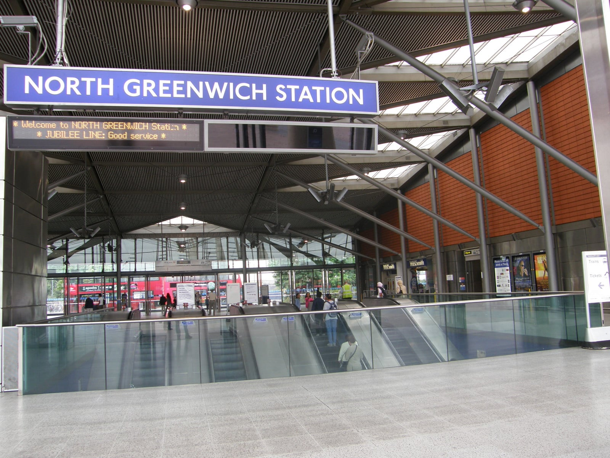
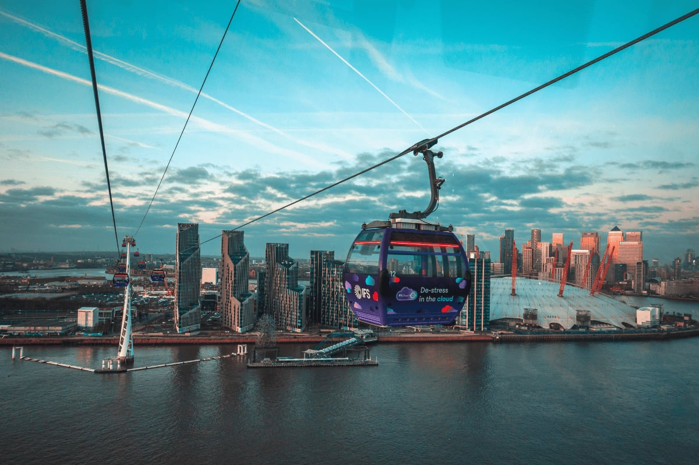

Getting most of The O2's crowd there and home again runs through one Tube line, one small peninsula, and a couple of scenic alternatives that turn out to be for arriving, not leaving.

> 💡 **The Short Version:** Come by tube: **North Greenwich** is the only station, on the **Jubilee line**, five minutes' walk from the doors. Driving means the **Blackwall Tunnel**, a real bottleneck, so book **Car Park 1** ahead: **£29–£35** pre-booked, **£40** on the day. Coming from the north or east, park near **ExCeL** and cross by cable car; it only works for arriving or an early finish. Getting home, the **ordinary last train** decides most nights (**23:45** and **00:16** on a Sunday); the **Jubilee Night Tube** runs all night, but only Friday and Saturday. Hotel prices at the peninsula can **triple or quadruple** on a big night, so staying anywhere else on the **Jubilee line** is usually simpler.

---

## Getting there by tube — one line serves it

| Station | Line | Zone | Walk to The O2 | Watch out for |
| --- | --- | --- | --- | --- |
| **North Greenwich** | **Jubilee only** | 2/3 | **About 5 minutes** | It's the only station — there is no second or third option |

North Greenwich's ticket hall sits right against The O2's forecourt: come up the escalators and the dome is in front of you. **The O2 depends on a single Underground line.** If the Jubilee is suspended or severely delayed on a show night, there is only the bus, the river, the cable car, or a much longer walk.

*The concourse at North Greenwich station.*

After O2 events, station staff **hold and meter the crowd** outside the station rather than let the ticket hall flood, with O2 security and the police. On a big night, expect to be held on the concourse or outside the gate line for a few minutes before you walk onto a train.

### Buses and the night bus

Routes **108, 129, 132, 161, 188, 422 and 486** all stop at North Greenwich Bus Station, immediately outside the tube entrance and The O2's doors. The **188 to Waterloo runs 24 hours a day**, the fallback if the Jubilee line is down or the Night Tube isn't running. The night route **N472** starts at North Greenwich Station and runs via Woolwich and Thamesmead to Abbey Wood.

---

## Driving: the Blackwall Tunnel is the real obstacle, not the parking rules

For anyone north of the river, the **Blackwall Tunnel**, the nearest road crossing, used to close **around 700 times a year**, according to TfL's monitoring, with over-height vehicles a recurring cause. The **Silvertown Tunnel** opened in April 2025 and has eased the approach roads, but both tunnels are tolled and both still funnel the whole peninsula through the same pinch point, so budget for delay before you think about parking.

The parking rules are the easy part: Greenwich runs no event-day zone shutting out visitor parking and no permit-only event hours. Its ordinary controlled parking zones and resident permits apply on a concert night as on any other.

> ⚠️ **Roadworks are affecting the drive in.** The O2 warns that major roadworks around the peninsula are causing long delays at peak times, particularly after events. Build in extra time both ways, especially for the journey home.

Capacity is the constraint: Car Park 1 is a single car park serving a very large room, so booking ahead is the only way to guarantee a space.

### Coming from north or east London? Park by the cable car instead

**Parking:** the cable car's far terminal is in **Royal Docks**, by ExCeL London and Custom House, a different river crossing with no tunnel and no toll. ExCeL has a large, pre-bookable multi-storey car park on site (postcode **E16 1FR**), with Blue Badge bays at the same tariff and space for vehicles up to 1.9m (over-height bays to 2.8m).

**Hotels:** the same Royal Victoria Dock development has three bookable hotels: **Aloft London Excel** on Eastern Gateway, by Prince Regent DLR, and **Novotel London Excel** and **Crowne Plaza London Docklands** on the Western Gateway side near Custom House. Our [ExCeL London guide](/articles/excel-london-guide/) covers stations, parking and the campus hotels, and our [hotels near ExCeL guide](/articles/where-to-stay-near-excel/) compares them.

**Timing:** this works only for getting there, or a show that finishes early. The cable car closes at 21:00 Sunday to Thursday, 22:00 Friday and 23:00 Saturday, so a normal evening finish means a DLR-and-bus routing home.

---

Powered by <a target="_blank" rel="sponsored" href="https://www.getyourguide.com/london-l57/">GetYourGuide</a>

## Where to actually park

### The O2's own car parks

All event parking is booked through **[JustPark](https://www.theo2.co.uk/visit-us/parking)**, and pre-booking closes 24 hours before the event.

| | Car | Minibus | Coach |
| --- | --- | --- | --- |
| **Pre-booked, early bird** | **from £29.39** | £59.35 | £59.35 |
| **Pre-booked, standard** | **£35.28** | £59.35 | £59.35 |
| **Pay on the day** (if space allows) | **£40** | £65 | £65 |
| **Valet** (arena events only) | £75 pre-booked / £85 on the day | — | — |

The early-bird car rate is available until three weeks before the event. Valet parking opens two hours before doors, with the car ready again as soon as the show finishes.

**Not coming to an event?** Car parks 2, 3 and 4 serve Outlet Shopping, Cineworld and Up at The O2 on hourly tariffs, from **£7** for up to two hours to **£52** for 18–24 hours. Car Park 2 is open 24/7. Spend £35 or more at Outlet Shopping and you get four hours free in car parks 2, 3 or 4; Cineworld customers get four hours free in car parks 2 and 3, validated at the parking office in Car Park 1.

Blue Badge spaces are available in all four of The O2's car parks (the badge holder must be in the car), and there are electric vehicle charging points on the BP Pulse network. The postcode for route planners is **SE10 0DX**.

### The other car park: North Greenwich station itself

Next to The O2's own car parks is the **North Greenwich Station Car Park**, on TfL land and run by Saba.

| | |
| --- | --- |
| **Spaces** | 519 (509 standard, 6 motorcycle, 4 EV charging bays reserved for taxis) |
| **Arrive before 18:00** | **£18** for the day |
| **Arrive after 18:00** | **£27.50** for the day |
| **Height limit** | 1.9m |
| **Booking** | None — first come, first served, cashless (PayByPhone or machine only) |

It can't be booked, so a space isn't guaranteed. It beats paying on the day at Car Park 1 only if you arrive before 6pm; the after-6pm rate applies to almost every evening show.

### Free Blue Badge parking at Monro Way

A short walk from the station car park, on **Monro Way (SE10 0EJ)**, a 19-space car park is reserved for Blue Badge holders: **free, with no time limit**, seven days a week, no booking and no payment machine.

---

## The cable car and the river: fine for arriving, rarely useful for leaving

### The cable car

The gondola to the Royal Docks is still sold and signed in places as the **IFS Cloud Cable Car**; TfL's site now calls it the **London Cable Car**. It is a single crossing of the Thames from Greenwich Peninsula Terminal (a couple of minutes from North Greenwich station) to the Royal Docks Terminal, taking up to **10 minutes**, with cars every 30 seconds.

*A cable car cabin crossing the Thames beside The O2.*

| Day | Hours |
| --- | --- |
| Monday–Thursday | 08:00–21:00 |
| Friday | 09:00–22:00 |
| Saturday | 09:00–23:00 |
| Sunday and bank holidays | 09:00–21:00 |

At Christmas it runs 09:00–21:00 on 21–23 and 26–30 December, 10:00–18:00 on 24 December, 09:00–22:30 on 31 December, and is closed on 25 December.

Booked online, a one-way adult ticket starts at **£7** and a round trip at **£13.50** (children roughly half price); contactless and Oyster pay-as-you-go are also accepted. **O2 ticket holders get 50% off a walk-up fare** on the day of their event.

> ⚠️ **It closes before most shows end.** Sunday to Thursday it shuts at 21:00, and even on Saturday it is closed by 23:00. A typical evening concert, comedy show or fight card finishes inside that window on most nights, so the cable car is a way to arrive for a show, not to get home. It is step-free at both terminals, with lifts and boarding staff, though only single battery-powered wheelchairs up to 80cm wide can travel.

### The river

**Uber Boat by Thames Clippers** calls at North Greenwich Pier, on the East zone of the river network (you need a Central & East ticket to reach central piers like Embankment or Westminster). A single fare bought online is **£13.50**, or **from £9.80** as the <a href="https://www.getyourguide.com/activity/-t413091?partner_id=WWP7I0R&amp;cmp=the-o2-travel-guide" target="_blank" rel="sponsored nofollow noopener" data-affiliate="gyg">Uber Boat single river ticket on GetYourGuide</a>, valid from any pier between Battersea Power Station and Barking Riverside. Pay as you go by contactless or Oyster is **£13.70 at peak times**, which on this stretch means practically every evening: off-peak is weekdays before 09:27 only, and every weekend and bank holiday is peak all day. The crossing to Blackfriars takes about **44 minutes**.

Sailings run roughly every 20 minutes in the evening, but the last sailing towards central London leaves North Greenwich Pier at **21:45 on a weekday** and **22:22 at weekends**. A matinee or an early-finishing show can catch it; a 19:30 or 20:00 doors show usually can't. The pier is step-free and wheelchair accessible, with accessible toilets on the larger boats.

---

## Getting home

### Crowd management at the station

TfL **holds and meters the crowd outside the station**. North Greenwich has one main approach, not several, so expect staff-managed queuing on the concourse for a big finish and allow for it when you work out how long it takes to reach the platform.

### Last trains, most nights of the week

TfL does not extend the timetable for an O2 event, so on most nights the last train decides how the evening ends. Last trains from North Greenwich:

| Direction | Sunday | Monday–Thursday |
| --- | --- | --- |
| **Towards Stanmore** (westbound) | **23:45** | **00:19** |
| **Towards Stratford** (eastbound) | **00:16** | **01:01** |

If your show finishes later than that, plan on a bus, a taxi, or waiting it out.

### Friday and Saturday: the Night Tube runs all night

On those two nights only, the Jubilee is one of six Night Tube lines, alongside the Central, Northern, Piccadilly, Victoria and Windrush. Trains run all night, roughly every ten minutes, so a late Friday or Saturday finish is not a problem: wait out the worst of the crowd and walk onto a near-empty platform.

### Buses, taxis and the night bus

The **188 runs 24 hours** to and from Waterloo, and the **N472** starts at North Greenwich station and runs through Woolwich to Abbey Wood. There's a taxi rank at North Greenwich Bus Station. Only Car Park 2 is confirmed as open 24/7, so check the closing arrangements for your event if you are returning to a car.

---

Powered by <a target="_blank" rel="sponsored" href="https://www.getyourguide.com/london-l57/">GetYourGuide</a>

## Where to stay, and why the peninsula is the trap on a big night

The two hotels closest to The O2 are cheap most nights and expensive on a big one.

| | Event night (Sunday) | Ordinary Sunday, one week later |
| --- | --- | --- |
| **InterContinental London – The O2** (Classic Room) | **£465** | **£261** |
| **Holiday Inn Express London Greenwich** (Double Standard, breakfast included) | **£276** | **£68** |

*Same room type, one night, two adults, prices including taxes and fees, for a standard single-headliner arena show.*

For a major event the swing is bigger: the InterContinental's Classic Room came to **£610–£615** a night for a three-day international sporting event at the arena.

- **For a big night, book early or expect to pay a multiple of the ordinary rate.**
- **Or shift your stay to the night after** and travel home the next day.
- The event-night premium was roughly **1.8×** the ordinary rate at the InterContinental and roughly **4×** at the Holiday Inn Express.

### The hotels at the peninsula

**[InterContinental London – The O2](hotel:intercontinental-the-o2)** — 493 rooms and suites on Waterview Drive, with a spa (17-metre pool, jacuzzi, sauna), three restaurants and two bars. A private walkway connects the hotel directly to The O2. On-site parking is £52 a day. Check-in from 3:00pm, check-out by noon.

**[Holiday Inn Express London Greenwich](hotel:holiday-inn-express-greenwich-peninsula)** — the budget option on Bugsby's Way, about 15 minutes' walk from The O2 and the station, with breakfast included (the InterContinental charges extra). On-site parking is £35 a day.

The simpler recommendation is to stay on the **Jubilee line** and ride in. Our [O2 hotel guide](/articles/where-to-stay-near-the-o2/) compares Canary Wharf, Canning Town, the Royal Docks, Stratford and London Bridge by door-to-door time and last train home.

---

## The hours before doors

Going for the **National Television Awards**? Seat prices, the red-carpet packages and the check-in times are in our [National Television Awards tickets guide](/articles/national-television-awards-tickets/).

**Up at The O2** is a guided, 90-minute climb over the top of the dome's fabric roof, reaching 52 metres above ground with a 360-degree view of London. Pricing runs from **£37 for a weekday daytime climb** up to **£44 for a weekend sunset climb**, with twilight and sunset slots in between. Book well ahead of a big event, since a climb slot and a doors time rarely both fit into the same evening.

The **Design District**, 16 low-rise studio buildings by eight architects, sits opposite the arena, about a minute from the station, and has its own canteen for a quieter meal before a show.

**Disney On Ice presents Discover the Magic** runs **24 December 2026 to 3 January 2027** in The O2 arena: an ice show built around the search for Tinker Bell, with scenes from *Coco*, *Moana*, *Beauty and the Beast* and *Frozen*. Doors open at 12pm and 3.30pm on Christmas Eve and at 9.30am and 1.30pm on 2 and 3 January. The O2's [event page](https://www.theo2.co.uk/events/detail/disney-on-ice-presents-discover-the-magic) lists every performance and sells tickets through AXS.

**Outlet Shopping at The O2** wraps around the dome with over 60 discount and outlet stores, on its own hours separate from the arena's.

---

## Eating and drinking in the Entertainment District

The Entertainment District doesn't close to the public on an event day; it runs on its ordinary public hours whatever is on in the arena.

The complex's general hours are **10:00–22:00 daily**, though individual restaurants, bars and leisure venues set their own, often later, times. More than 40 places include **Gordon Ramsay Street Burger, Nando's, Five Guys, KFC, German Doner Kebab, Gaucho, Haidilao Hot Pot, TGI Fridays, PizzaExpress, Zizzi, Las Iguanas** and **Frankie & Benny's**, plus bars including **All Bar One** and **Slug & Lettuce**.

**Wetherspoon's pub here, The Stargazer**, is open **10am to 12:15am daily**, with food served **10am to 11pm**, the late kitchen and late pint after a show.

Inside the arena, bars include the **American Express Lounge, Aperol Spritz Bar, London Essence Cocktail Bar, O2 Bluebar, O2 Blueroom, Smirnoff Bar** and **The Budweiser Bar**. Both The O2 arena and indigo at The O2 are **cashless**.

---

## The bag problem

If your hotel checkout is at noon and doors are hours later, you can't carry a bag around all day.

| | The O2 arena | indigo at The O2 |
| --- | --- | --- |
| **Bag limit** | One bag per person, **no bigger than A4** or a standard handbag | Same policy applies |
| **Cloakroom** | **None** | **Yes** — a cloakroom is available |
| **Paid storage** | **£10 per bag**, just outside the main entrance | — |

Backpacks, travel cases, laptop bags, camera bags and large tote bags aren't permitted inside the arena, and folding one down smaller doesn't count. **American Express cardholders get free bag drop** through a dedicated Amex lane. Tote bags bought at The O2's own merchandise stands are allowed in, subject to search.

> ⚠️ **Collect your bag promptly.** Bag storage closes between 30 minutes and an hour after the show ends.

The prohibited items list is broader than the bag rule: no weapons or bladed items, no fireworks, flagpoles or large inflatables, no large umbrellas, no glass or hard drinks bottles (an empty collapsible bottle is fine), no flammable liquids, no laser pens, no professional camera with a detachable lens, no illegal drugs or alcohol brought in, and no animals other than service and assistance dogs.

Our [luggage storage guide](/articles/luggage-storage-london/) covers the citywide storage apps if the on-site bag store is full.

---

## Step-free access, Blue Badge parking and accessible booking

**Getting there:** North Greenwich station has low-level ticket machines, wheelchair-accessible gates (with a dedicated gate to the right of the barriers), an induction loop, step-free access to every platform via lifts, and step-free bus stops. The cable car terminals are step-free with lifts and boarding staff, though only single battery-powered wheelchairs up to 80cm wide can travel on it. North Greenwich Pier is step-free and wheelchair accessible, with accessible toilets on the larger boats.

**Parking:** Blue Badge bays are available in all of The O2's own car parks (from about £21 pre-booked), or **free with no time limit** at the dedicated 19-space Blue Badge car park on Monro Way. An accessible drop-off point for cars and coaches sits about 150m from the main entrance, clearly signposted.

**Inside the venue:** the main concourse is level and step-free, with accessible lifts across all levels. Accessible seating is available on every level — aisle seats, minimal steps nearby, no obstruction, and close to accessible toilets — and viewing platforms are offered for guests who find standing difficult at events where the crowd tends to stand. Accessible toilets are unisex, on every level, and use a RADAR key; there's also a Changing Places unit on Level 1. If you bring your own wheelchair, it can be stored at the Customer Service Desk near block 101. Assistance dogs can stay with you in wheelchair bays; email **access@theo2.co.uk** ahead of your visit. Assistive Listening Devices are available at the Level 1 Customer Service desk (a form of ID is held as a deposit).

**Getting a wheelchair to you:** call **0208 463 2211** once doors open on the night, and a wheelchair will be brought to the main entrance; you'll need your own companion to push it. That line is only staffed on event nights.

**Booking accessible tickets:** The O2 uses the **Nimbus Disability Access Card** system. A Personal Assistant ticket requires a valid Access Card carrying the "+1" symbol, booked at the same time as your own ticket; for more than one PA, call the dedicated access line on **020 8463 3359**. BSL interpreting is available through SignVideo, **10am–2pm, Monday to Friday** (Typetext 18001 020 8463 3359).

---

Powered by <a target="_blank" rel="sponsored" href="https://www.getyourguide.com/london-l57/">GetYourGuide</a>

## Small print that catches people out

- **Postcodes:** The O2 itself and its car parks, **SE10 0DX**; North Greenwich station and its car park, **SE10 0PH**; the Blue Badge car park on Monro Way, **SE10 0EJ**.
- **Pre-booked parking closes 24 hours before the event.** After that you pay the on-the-day rate if space allows.
- **Event doors, show times and curfews are published per event**, not as a house rule, so check the listing for your date.

---

## Continue planning your London trip

- 🏉 **[Twickenham Stadium Travel Guide](/articles/twickenham-stadium-travel-guide/)** — the west London equivalent, where the crowd all leaves at once
- 🚇 **[How to Use the London Underground](/articles/how-to-use-the-london-underground/)**
- 💷 **[London Transport Costs and Fares](/articles/london-public-transport-costs-and-fares/)**
- 🛏️ **[Best Areas to Stay in London](/articles/best-areas-to-stay-in-london/)**
- 🎤 **[Best Live Music Venues in London](/articles/best-live-music-venues-london/)**
- 📺 **[National Television Awards Tickets](/articles/national-television-awards-tickets/)** — seat prices and the red carpet for the awards night held at The O2
- 🚌 **[How to Use London Buses and Trams](/articles/how-to-use-london-buses-and-trams/)**
- 🏟️ **[Wembley Stadium and OVO Arena Travel Guide](/articles/wembley-stadium-arena-guide/)** — the equivalent guide for London's other major arena, for comparison
- 💰 **[Money in London: Cash, Cards and ATMs](/articles/money-in-london/)** — including which London venues take no cash at all
- 🎟️ **[Exhibitions and Conventions in London](/articles/exhibitions-conventions-london/)** — what's on next door at ExCeL, across the cable car
