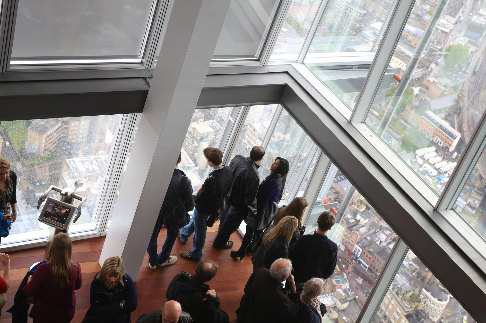
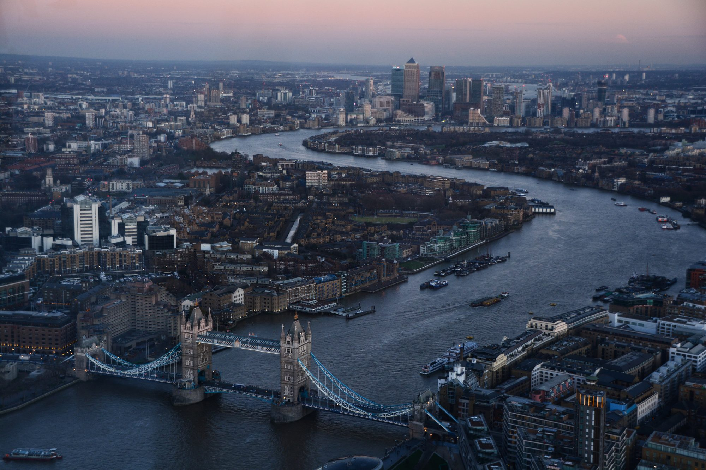
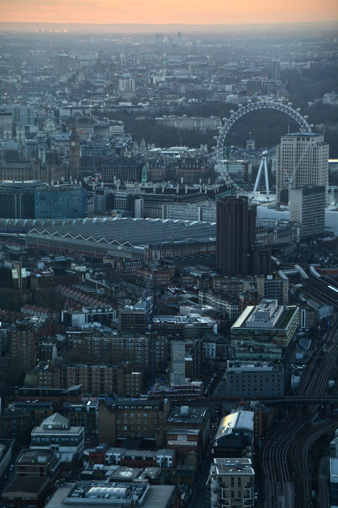
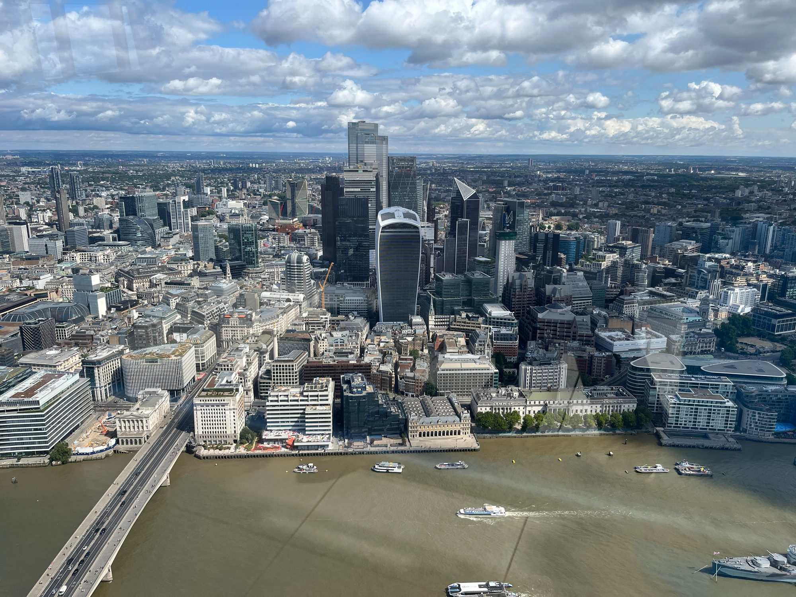

> 💡 **The Short Version:**
> - **Prices:** Standard (13 and over) is **from £28**, child (4 to 12) **from £10** with a scoop of ice cream, and under-4s go free. **All Inclusive from £38** adds a glass of Moët & Chandon champagne or a non-alcoholic cocktail and £5 to spend in the shop. Prices vary by day and time. [Check your date](https://www.theviewfromtheshard.com/ticket-types/).
> - **What you get:** indoor platforms on levels 68 and 69 and the open-air deck on level 72, plus a two-photo digital package. No time limit: stay until closing.
> - **View Guarantee:** if cloud hides more than two of five named landmarks, you get a free revisit voucher valid for at least three months. Claim it on the day, before you leave.
> - **Closed Mondays and Tuesdays** from November 2026 to March 2027, except a handful of dates listed below. Otherwise open 11:00 to 19:00 (10:00 to 18:00 in January, 12:00 to 20:00 in March) and 10:00 to 22:00 on Saturdays. Last entry is an hour before closing.
> - **Discounts:** <a href="https://www.getyourguide.com/activity/-t24625?partner_id=WWP7I0R&amp;cmp=the-shard-guide" target="_blank" rel="sponsored nofollow noopener" data-affiliate="gyg">The View from The Shard on GetYourGuide</a> for an instant-confirmation booking, National Rail 2FOR1 until 31 December 2026, or the Go City London Pass.
> - **Sunset:** in winter it falls between about 15:55 and 16:45, so a slot around 15:00 gets you daylight, dusk and the lit city.
> - **Bags:** nothing larger than 55 x 38 x 20 cm, and no cloakroom.

> ⚠️ **The Shard is shut on Mondays and Tuesdays from November 2026 to March 2027.** The operator's calendar runs to March 2027 and shows the gallery closed those two days, except 23 November, 22 December, 28 and 29 December, and 15 and 16 February. It is also closed on 25 November and 24, 25 and 26 December. Tickets are non-refundable, so check the date before you pay.

---

The View from The Shard sits on levels 68, 69 and 72 of the tower beside London Bridge station. Two floors are indoors behind glass, with a bar on level 69, and level 72 is an open-air deck, which the operator bills as London's highest. The entrance is on Joiner Street.

*Prices, hours and events as listed by the operator on 15 November 2026.*

---

## Ticket prices

The View from The Shard publishes "from" prices only, and they move with the day and time you pick. Book on the [ticket types page](https://www.theviewfromtheshard.com/ticket-types/) with your date entered.

| Ticket | From | What it includes |
| :--- | :--- | :--- |
| **Standard (13 and over)** | **£28** | Levels 68, 69 and the open-air level 72, the View Guarantee and two digital photos |
| **Child (4 to 12)** | **£10** | The same, plus one scoop of ice cream. Under-4s are free and need no ticket |
| **All Inclusive** | **£38** | Standard entry plus a glass of Moët & Chandon champagne or a non-alcoholic cocktail and £5 to spend in the shop |
| **Groups** | **£25 per person** | A free ticket for every 10 paid, booked online only. Entry plus champagne is £31 per person |
| **Mastercard Priceless VIP** | **£45** | Mastercard cardholders only, through priceless.com, booked at least 7 days ahead. Fast-track security, champagne, a 30-minute guided tour with a London Expert, and a fixed 3pm slot |
| **Go City London Pass** | Pass price | Entry is part of the pass, which the operator lists from £65 |

Rules that catch people out:

- **Walk-ups are possible but not guaranteed.** Same-day tickets are sold on the website and at the desk, subject to availability, and the operator says advance online prices may be discounted against the desk price.
- **Arrive within 15 minutes of your ticket time.** Later than that you may have to pay a £15 rebooking fee and wait for space.
- **No refunds, £15 to change.** All sales are final. A change of date or time, before your slot has passed, costs £15 per booking.
- **Under-18s need an adult.** Anyone under 18 must be accompanied by an adult aged 18 or over with ID, and a ticket purchaser must be 18 or over.

Current dates and prices:

Powered by <a target="_blank" rel="sponsored" href="https://www.getyourguide.com/london-l57/">GetYourGuide</a>

The View Guarantee comes with every paid ticket bought direct. It is not included with complimentary, school, promotional, special-event or private-hire tickets, annual passes or "selected third-party tickets", so read the listing's terms before you book through a reseller.

---

## The View Guarantee: what counts as bad weather

The test is simple. If low visibility from the weather means you cannot see at least three of these five landmarks, you qualify:

- London Eye
- The Walkie Talkie
- Tower Bridge
- One Canada Square
- St Paul's Cathedral

The duty manager decides on the day and hands out revisit vouchers as you leave. **You must claim before leaving the building; vouchers cannot be claimed later.** The voucher gives a free standard ticket and is valid for at least three months, but the expiry date is the last day you can book, not the last day you can visit. It cannot be redeemed on the main site: you contact customer service to use it. Once booked, the date and time cannot be changed, and the voucher cannot be combined with other offers.

Read the [full terms](https://www.theviewfromtheshard.com/view-guarantee/) before you rely on it.

---

## Discounts that apply

- **National Rail 2FOR1.** Two entries for the price of one full-price general ticket for visitors travelling by train. It is booked on the Shard's own site 24 hours ahead and is listed until 31 December 2026. The [Days Out Guide](https://www.daysoutguide.co.uk/) issues the offer, and our [National Rail 2FOR1 guide](/articles/national-rail-2for1-london-attractions/) explains how vouchers work.
- **The London Pass (Go City).** Entry is included, and holders reserve a slot through Go City. Whether it pays depends on what else you visit: our [London Pass guide](/articles/london-pass-guide/) does the sums.
- **Mastercard Priceless.** The VIP ticket in the table above is for cardholders only.
- **GetYourGuide.** The <a href="https://www.getyourguide.com/activity/-t24625?partner_id=WWP7I0R&amp;cmp=the-shard-guide" target="_blank" rel="sponsored nofollow noopener" data-affiliate="gyg">View from The Shard listing on GetYourGuide</a> lets you compare dates and prices against the official booking page; check its cancellation terms before you buy.
- **Free entry.** A carer for a registered disabled visitor goes in free, standard entry only, and Blue Badge Guides go in free with their badge and no booking.

---

## Opening hours

The operator's [opening times calendar](https://www.theviewfromtheshard.com/opening-times/) sets hours by month. Last entry is **one hour before closing**, and the bars stop serving about 30 minutes before closing. Once you are in, you can stay until closing.

| Period | Wed to Fri and Sun | Saturday | Mon and Tue |
| :--- | :--- | :--- | :--- |
| **November and December 2026** | 11:00 to 19:00 | 10:00 to 22:00 | Closed |
| **January 2027** | 10:00 to 18:00 | 10:00 to 22:00 | Closed |
| **February 2027** | 11:00 to 19:00 | 10:00 to 22:00 | Closed |
| **March 2027** | 12:00 to 20:00 | 10:00 to 22:00 | Closed |

Exceptions to the table, as listed by the operator:

- **Open on a Monday or Tuesday:** 23 November (11:00 to 19:00), 22 December (11:00 to 19:00), 28 and 29 December (11:00 to 19:00), 15 and 16 February (11:00 to 19:00), and 29 to 31 March, the Easter holiday (13:00 to 21:00).
- **Different hours:** 21 November closes at 20:00, 3 December at 17:00, 5 December at 20:00, 26 November opens at 09:30 and closes at 17:00, 31 December runs 10:00 to 17:00, and 1 January is 11:00 to 19:00. Valentine's weekend, 12 and 14 February, runs 10:00 to 22:00.
- **Closed:** 25 November, and 24, 25 and 26 December.

---

## What you get

*Visitors at the windows of the viewing gallery. Photo: [Ronnie Macdonald](https://commons.wikimedia.org/wiki/File:Inside_the_Shard.jpg), [CC BY 2.0](https://creativecommons.org/licenses/by/2.0/).*

- **Levels 68 and 69** are indoors. Level 69 has a bar with drinks and snacks.
- **Level 72** is the open-air deck, with a second bar. Wear a coat: it is open to the weather.
- **Photos.** Hand-held cameras and video for personal use are welcome; tripods and monopods are not. The team takes two digital photos, which you download from MyMagicphotos.com with your View Code. They are deleted after a month.
- **Staff.** Staff called London Experts point out landmarks. Seats are not fixed, but folding chairs are available on request.
- **Food and drink.** Only food and drink bought inside can be consumed in the gallery. The venue does not serve lunch, dinner or afternoon tea and does not take table reservations: for those, see the restaurants below.

The lift runs at up to six metres per second, and the operator warns that the change in pressure can affect ears, particularly if you have a cold.

---

## The best time to go, and sunset

Because there is no time limit and the gallery stays open after dark, the way to see the lot is to arrive about an hour before sunset and stay. Sunset times for London, to the nearest five minutes:

| Date | Sunset |
| :--- | :--- |
| 15 November | 16:10 |
| 1 December | 15:55 |
| 21 December | 15:55 |
| 1 January | 16:00 |
| 1 February | 16:45 |
| 1 March | 17:40 |

The Shard's own site shows the day's sunset on every page. In December a slot at about 15:00 gives you daylight, the colour at 15:55 and the lit city by 16:30, with the gallery open until 19:00 on most days.

*Tower Bridge and the river towards Canary Wharf at dusk. Photo: [Lewis Clarke](https://commons.wikimedia.org/wiki/File:London_,_Southwark_-_London_Scenery_from_The_Shard_-_geograph.org.uk_-_4819860.jpg), [CC BY-SA 2.0](https://creativecommons.org/licenses/by-sa/2.0/).*

Look west for the London Eye and Westminster, north for the City and east for Tower Bridge and Canary Wharf. The winter sun sets to the south-west.

*Looking west to Westminster, Waterloo station and the London Eye. Photo: [Lewis Clarke](https://commons.wikimedia.org/wiki/File:London_,_Southwark_-_London_Scenery_from_The_Shard_-_geograph.org.uk_-_4819841.jpg), [CC BY-SA 2.0](https://creativecommons.org/licenses/by-sa/2.0/).*

*Looking north over London Bridge to the City. Photo: [ThatsTheBoss](https://commons.wikimedia.org/wiki/File:City_of_London_as_seen_from_The_Shard,_2026.jpg), [CC0 1.0](https://creativecommons.org/publicdomain/zero/1.0/).*

---

## Events, November 2026 to March 2027

- **Silent Disco.** A ticketed headphone party for 18 and over, from £37.50, on Saturday 21 November and 5 December 2026, and 23 January, 27 February and 20 March 2027. Doors open at 21:30 and it ends at 01:00, with a cashless pay bar. See the [Silent Disco page](https://www.theviewfromtheshard.com/silent-disco).
- **New Year's Eve.** The 2027 night at the gallery is sold to Mastercard cardholders through [Priceless](https://www.priceless.com/entertainment/product/234729/nye-view-from-the-shard-2026). The regular gallery closes at 17:00 on 31 December. Our [New Year's Eve in London](/articles/new-years-eve-london/) guide covers the rest of the night.
- **Christmas.** The gallery is shut on 24, 25 and 26 December. Hutong, on level 33, serves a five-course Northern Chinese menu on Christmas Day and runs a New Year's Eve night with live entertainment. Our [Christmas Day restaurants guide](/articles/christmas-day-restaurants-london/) covers where else is open.
- **The lights.** From dusk to 1am the top 20 storeys of the building mark each hour with a light display, free to watch from the street. For the other displays, see [Christmas in London](/articles/christmas-in-london/).
- **Afternoon tea.** Shangri-La's TĪNG serves a Mary Poppins-inspired festive afternoon tea to 31 January 2027, and Aqua Shard a Peter Pan one to 31 December 2026.

---

## Free alternatives

- **[Sky Garden](/articles/sky-garden-guide/):** free with a timed ticket, released every Monday three weeks ahead.
- **[Horizon 22 and The Garden at 120](/articles/best-views-london/):** also free; Horizon 22 needs a timed ticket and The Garden at 120 needs none.
- **[Aqua Shard](https://aquashard.co.uk/):** no entry fee, and walk-ins are accepted, so you are buying a drink on level 31.

Our [best views in London](/articles/best-views-london/) guide compares all of them. What the Shard ticket adds is the open-air deck on level 72.

---

## Restaurants and bars in the building

All of these sit lower than the gallery and are booked separately, through the links below.

- **[Aqua Shard](https://aquashard.co.uk/)**, level 31: contemporary British lunch on weekdays, dinner daily, afternoon tea and weekend brunch. Walk-ins are accepted.
- **[Oblix](https://www.oblixrestaurant.com/#oblix-booking)**, level 32: all-day dining from 12:00 to 22:00 across two spaces, Oblix West and Oblix East.
- **[Hutong](https://hutong.co.uk/reservation/booking)**, level 33: northern Chinese, 12:00 to 22:30 daily.
- **[TĪNG](https://www.sevenrooms.com/explore/tingrestaurant/reservations/create/search/)**, level 35, in the hotel: breakfast, lunch, afternoon tea and dinner.
- **[GŎNG](https://www.sevenrooms.com/explore/gong/reservations/create/search/)**, level 52, in the hotel: a cocktail bar open Monday to Wednesday from 15:00 to 23:30, Thursday to Saturday from 12:00 to 01:00 and Sunday from 12:00 to 23:30.

The hotel is Shangri-La The Shard ([Hotels.com](hotel:shangri-la-the-shard)). For TĪNG, GŎNG and the Sky Lounge, bags are scanned in the hotel's ground-floor lobby, so allow time before your reservation.

---

## With children

- Children aged 4 to 12 pay from £10 and get an ice cream. Under-4s are free and need no ticket.
- Under-18s must be with an adult aged 18 or over, who needs ID.
- The operator warns that the height may not suit every child.
- Folded pushchairs can be left free in the booking hall, but not bags or coats.

---

## Access, security and bags

- **Step-free.** The operator says the visit is step-free from level 1 to the open-air level 72. From Joiner Street there are 15 steps to the booking hall, with handrails and a small lift beside them. There are accessible toilets on level 1 and level 68.
- **Seating.** Chairs are available on request. Wheelchairs are available on site.
- **Carers.** A registered disabled visitor's carer gets a free standard ticket on arrival, which cannot be pre-booked. Buy your own ticket in advance and show proof of disability at the fast-track desk.
- **Security.** Everyone walks through a metal detector and bags go through an x-ray scanner.
- **Bags.** Nothing larger than 55 x 38 x 20 cm. There is no cloakroom, and the gallery cannot store bags. See our [luggage storage guide](/articles/luggage-storage-london/) for somewhere nearby.
- **Animals.** Only guide dogs and hearing dogs are allowed.

For more step-free options see [Step-Free London](/articles/step-free-london/).

---

## Getting there

The address is Joiner Street, London SE1 9QU, two minutes from London Bridge station.

- **Underground (Northern and Jubilee lines):** follow the signs for The Shard or Joiner Street.
- **National Rail:** from London Bridge station, turn left and go down the escalator to Joiner Street.
- **River:** Uber Boat by Thames Clippers stops at London Bridge City Pier, a five-minute walk. See [how to use London river boats](/articles/how-to-use-london-river-boats/).
- **Bus:** routes 43, 48, 141, 149 and 521 stop at London Bridge bus station.
- **Car:** there is no parking or drop-off. The nearest car parks are about five minutes away.

---

## Continue planning your London trip

- 🌆 **[The Best Views in London](/articles/best-views-london/)**: free and ticketed viewpoints compared.
- 🌿 **[Sky Garden](/articles/sky-garden-guide/)**: the free City viewpoint, and how its tickets work.
- 🚶 **[Bankside and Borough walk](/articles/bankside-borough-walk/)**: coaching-inn yards, Borough Market and the cathedral, starting at London Bridge.
- 🥘 **[Borough Market tours](/articles/borough-market-tours/)**: food tours and opening days for the market beside London Bridge.
- 🌉 **[Tower Bridge](/articles/tower-bridge-guide/)**: the glass floor and engine rooms, a walk east along the river.
- 🏙️ **[Bermondsey area guide](/articles/bermondsey-area-guide/)**: Bermondsey Street and the neighbourhood south of the tower.
- 🎟️ **[The London Pass Guide](/articles/london-pass-guide/)**: whether the pass pays.
- 🚆 **[National Rail 2FOR1](/articles/national-rail-2for1-london-attractions/)**: how to claim two entries for one.
- 🚤 **[London river boats](/articles/how-to-use-london-river-boats/)**: Thames services from London Bridge City Pier.
- 👨‍👩‍👧 **[London with children](/articles/london-with-children/)**: family planning across the city.
