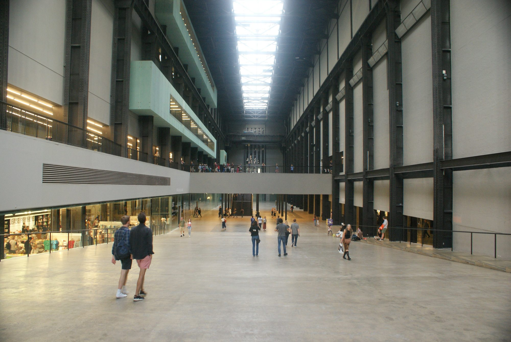
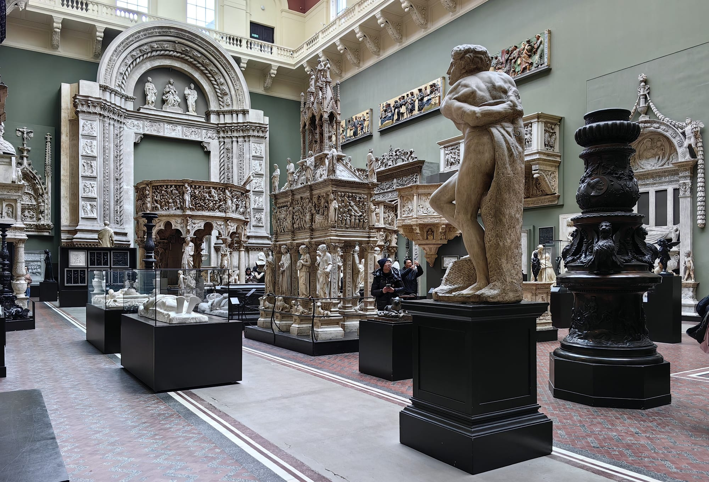
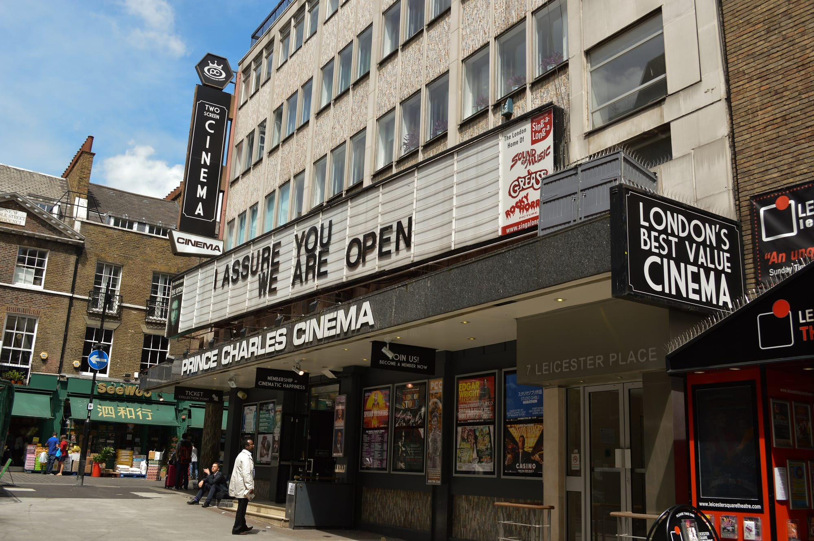
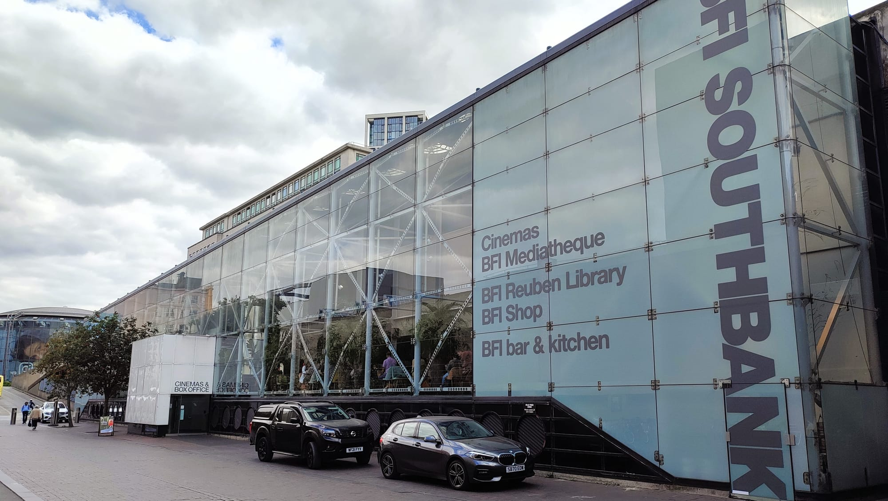
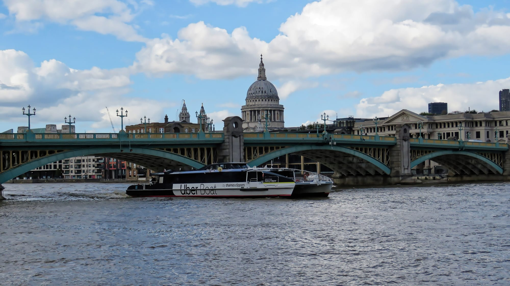
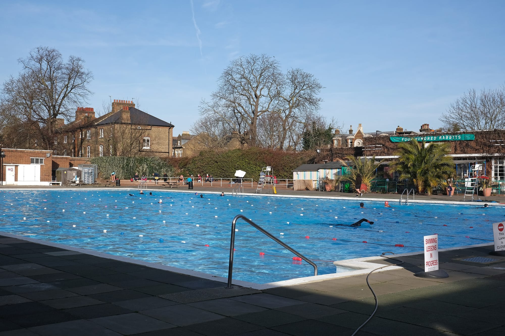

> 💡 **The Short Version:** London is good at things one person can do without anyone noticing they are alone. **Friday nights** are for the galleries: the [National Gallery](#national-gallery-every-friday-until-9pm) is open until 9pm every Friday, the [British Museum](#british-museum-fridays-until-830pm) until 8.30pm, and the free [V&A Friday Late](#va-friday-late-last-friday-of-the-month) and [Tate Modern Lates](#tate-modern-lates) both fall on 27 November 2026. **By day**, the [British Library](#the-british-library-kings-cross) and the [Barbican](#the-barbican-conservatory) are free places to sit, read and look. **In the evening**, take a [single seat](#seats-for-one-comedy-film-and-music) at the [Prince Charles Cinema](#prince-charles-cinema-leicester-square), [BFI Southbank](#bfi-southbank) or [free comedy at Angel Comedy](#angel-comedy-islington). **For air**, swim at a [year-round lido](#swim-outdoors-all-year) or take the [river boat](#the-river-on-your-own) east.

*Hours, dates and prices are each venue's own, as at 19 November 2026.*

## Pick by mood

| If you want… | Go to | When |
| --- | --- | --- |
| **Art after dark** | National Gallery, British Museum, V&A, Tate Modern | Fridays |
| **A seat and a quiet room** | British Library, Sir John Soane's Museum | Weekdays |
| **Plants under glass** | Barbican Conservatory (free, timed ticket) | 28 Nov 2026 to 3 Jan 2027, selected days |
| **A film** | Prince Charles Cinema, BFI Southbank | Any night; weekday matinees cheapest |
| **Laughs** | Angel Comedy (free), The Comedy Store | Every night at Angel Comedy |
| **Music** | Ronnie Scott's, Wigmore Hall, St Martin-in-the-Fields | Evenings; Friday lunchtimes at St Martin's |
| **Cold water** | Parliament Hill Lido, Brockwell Lido | All year |
| **A day out of town** | Brighton, Oxford, Cambridge, Windsor | Any day; book trains ahead |

---

## Museums and galleries after dark

Going round a gallery alone means no negotiating: you stop at the one room you came for and skip the rest. Friday is the night to do it, when the national collections stay open into the evening.

*The Turbine Hall at Tate Modern. Photo: [Robert Lamb](https://commons.wikimedia.org/wiki/File:View_along_the_Turbine_Hall_in_the_Tate_Modern_-_geograph.org.uk_-_6252685.jpg), [CC BY-SA 2.0](https://creativecommons.org/licenses/by-sa/2.0/).*

### National Gallery, every Friday until 9pm

*Trafalgar Square, WC2N 5DN · entrance via the Sainsbury Wing · free*

**Every Friday the gallery stays open until 9pm and runs Friday Lates**: short talks in the rooms and life-drawing sessions, with Bar Giorgio in the Sainsbury Wing serving drinks and aperitivo. On 20 November 2026 the programme included a free 45-minute talk in Room 41. Daytime hours are 10am to 6pm. **Entry is free**; booking a free [general admission ticket](https://www.nationalgallery.org.uk/visiting/plan-your-visit) gets you fast-track entry. Our [National Gallery guide](/articles/national-gallery-guide/) has the rooms worth heading for.

### British Museum, Fridays until 8.30pm

*Great Russell Street, WC1B 3DG · free*

**Open 10am to 5pm daily and until 8.30pm on Fridays**: the evening is the time to walk straight to the Parthenon sculptures or the Egyptian galleries with no plan but your own. Some rooms close for maintenance on set days. **Free, with a free timed ticket advised** for priority entry at busy times; [book on the museum's visit page](https://www.britishmuseum.org/visit). The museum is closed 24 to 26 December. See our [British Museum guide](/articles/british-museum-guide/) for a route round it.

### V&A Friday Late, last Friday of the month

*V&A South Kensington, Cromwell Road, SW7 2RL · free, drop in*

**Performance, film, installations, talks and DJs spread through the galleries**, built around a theme: the next is *(Im)Possible Bodies* on Friday 27 November 2026. It runs on the last Friday of every month except January, May and December, so after November the next is in February. The museum is open until 10pm every Friday whether or not a Late is on, which makes any Friday a good night for the Cast Courts alone. **Free and drop-in**; [the V&A's Friday Late page](https://www.vam.ac.uk/info/friday-late) has the programme. Our [V&A guide](/articles/v-and-a-guide/) covers the galleries.

*The Cast Courts at the V&A. Photo: [Thaler Tamas](https://commons.wikimedia.org/wiki/File:Cast_Courts.Victoria_and_Albert_Museum._FotoThalertamas.jpg), [CC BY-SA 4.0](https://creativecommons.org/licenses/by-sa/4.0/).*

### Tate Modern Lates

*Bankside, SE1 9TG · 27 November 2026, 6pm to 10pm · free*

**A night of music and art built around Tarek Atoui's Hyundai Commission in the Turbine Hall**, a sound installation that musicians play live: on 27 November the electronic musicians Nkisi and Mhamad Safa use it as a sound system. Most of it is drop-in; a few activities need a free ticket, given out on the day. **Free.** It falls on the same night as the V&A's Late, so pick one. Details are on [Tate's Lates page](https://www.tate.org.uk/whats-on/tate-modern/tate-modern-lates), and our [Tate Modern guide](/articles/tate-modern-guide/) covers the rest of the building.

For the Science Museum's adults-only Lates, see the [Science Museum guide](/articles/science-museum-guide/) and [science in London](/articles/science-events-london/).

---

## Places to sit, read and look

### The British Library, King's Cross

*96 Euston Road, NW1 2DB · free*

**The public floors are full of people on their own**: reading, working on laptops at the café tables, or sitting in the window seats facing the King's Library, George III's books in a glass tower in the middle of the building. The free **Treasures Gallery** has manuscripts, maps and printed books from the collection, and paid exhibitions run alongside (*Agatha Christie* is on now). A free Reader Pass gets you into the Reading Rooms if you have research to do.

**Open Monday to Thursday 9.30am to 8pm, Friday until 6pm, Saturday until 5pm and Sunday 11am to 5pm.** The Treasures Gallery closes at 5pm on 26 November and 3 December 2026, and **the whole St Pancras site is closed on 12 and 13 December 2026**. [The Library's visit page](https://www.bl.uk/visit) has the current hours. For other places to work, see our [laptop-friendly cafés](/articles/laptop-friendly-cafes-london/); the [King's Cross guide](/articles/kings-cross-area-guide/) covers the streets around it.

### Sir John Soane's Museum, Holborn

*13 Lincoln's Inn Fields, WC2A 3BP · Wednesday to Sunday, 10am to 5pm · free*

**The architect's own house, packed floor to ceiling with antiquities, casts and paintings exactly as he left it in 1837.** The rooms are small and the museum lets in only as many people as fit, which suits one person better than a group. At 2pm the Picture Room's hinged panels open to show Hogarth's *A Rake's Progress*. Free 30-minute tours of the private apartments run on Wednesdays, Fridays and Sundays at 2pm, first come first served, for eight people. **Free with no booking, but closed on Mondays and Tuesdays**, and you may wait outside at busy times. [The Soane's visit page](https://www.soane.org/your-visit) has the panel times.

### The Barbican Conservatory

*Barbican Centre, Silk Street, EC2Y 8DS · selected days, 28 November 2026 to 3 January 2027 · free, timed ticket*

**Palms and trailing plants spilling over tiers of concrete balconies under a glass roof**, which the Barbican calls the second-biggest conservatory in London. It opens to the public only on listed days, and the 2026–27 run is 28 November 2026 to 3 January 2027. **Free, but ticketed**: book a timed slot on [the Barbican's Conservatory page](https://www.barbican.org.uk/whats-on/2026/event/visit-the-conservatory), and if it shows sold out, a few day tickets are released online from 9.30am on each open day. Our [Barbican guide](/articles/barbican-centre-guide/) covers the rest of the centre.

More free places to go are in our [galleries guide](/articles/best-galleries-london/) and [museums guide](/articles/best-museums-london/).

---

## Seats for one: comedy, film and music

A seat in the dark facing a stage is the easiest place in London to be on your own. When a show is close to selling out, a single seat is often still there when pairs have gone. Theatre works the same way.

### Angel Comedy, Islington

*The Camden Head, 2 Camden Walk, N1 8DY · every night*

**Free stand-up seven nights a week in a pub back room**, from open-mic nights to established comics trying out new material, run by comedians. The club also puts on cheap ticketed shows at its second venue, The Bill Murray. **Free shows can't be booked**, so arrive early on Fridays and Saturdays. Listings are on [Angel Comedy's site](https://www.angelcomedy.co.uk/).

### The Comedy Store, Leicester Square

*1a Oxendon Street, SW1Y 4EE*

**The club that has run since 1979**, with stand-up line-ups most nights and the Comedy Store Players, the long-running improv troupe with Josie Lawrence among its regulars, on Sundays at 7.30pm. Through December most of the stand-up nights are *Christmas Best in Stand Up*. Doors, bar and diner open an hour before the show. **Book ahead** on [the Comedy Store's site](https://london.thecomedystore.co.uk/). Our [comedy clubs guide](/articles/best-comedy-clubs-london/) has the rest.

### Prince Charles Cinema, Leicester Square

*7 Leicester Place, WC2H 7BY*

**Repertory cinema off Leicester Square showing cult films, 35mm and 70mm prints, sing-alongs and movie marathons**. **A year's membership is £15**: at least £2.50 off one ticket a screening, £8 weekday matinees, £1 member screenings and 15% off at the bar. Details on [the PCC's membership page](https://princecharlescinema.com/membership/).

*The Prince Charles Cinema on Leicester Place. Photo: [Gareth Milner](https://commons.wikimedia.org/wiki/File:Prince_Charles_Cinema.jpg), [CC BY-SA 2.0](https://creativecommons.org/licenses/by-sa/2.0/).*

### BFI Southbank

*Belvedere Road, South Bank, SE1 8XT*

**Four screens open seven days a week, on the river by Waterloo Bridge**, with programme notes to read for each screening. Between films, the **BFI Mediatheque** lets you watch the BFI's archive of film and television for free, and the BFI Reuben Library is free to everyone. **Tickets are £4 for any film if you are 16 to 25**; BFI membership, from £44, gets priority booking for previews and festivals. [The BFI Southbank page](https://www.bfi.org.uk/bfi-southbank) links to the programme. Our [cinemas guide](/articles/best-cinemas-london/) and [cinema deals](/articles/cinema-deals-london/) cover the rest.

*BFI Southbank under Waterloo Bridge. Photo: [Ewan Munro](https://commons.wikimedia.org/wiki/File:BFI_Southbank_2025-08-21.jpg), [CC BY-SA 4.0](https://creativecommons.org/licenses/by-sa/4.0/).*

### Live music

- **Ronnie Scott's, 47 Frith Street, Soho.** Besides the main shows, the jazz club runs a **Late Late Show** in the main room and another in the smaller Upstairs bar, where *Viva Cuba* plays Cuban music from 20 November 2026 to 29 January 2027. Main-room shows by big names sell out, so [book ahead](https://www.ronniescotts.co.uk/).
- **Wigmore Hall, Marylebone.** The chamber music hall on Wigmore Street, where the audience comes to listen in silence. **Under-35s get £5 tickets** across the season by adding a date of birth to a free account; [the under-35 page](https://www.wigmore-hall.org.uk/whats-on/series/under-35) explains it.
- **St Martin-in-the-Fields, Trafalgar Square.** **Friday lunchtime concerts at 1pm**, often young soloists: **£10, or £20 with fish and chips** in the Café in the Crypt, booked in advance. Harpsichordist Nathaniel Mander plays Bach on 27 November 2026; [the lunchtime concerts page](https://www.stmartin-in-the-fields.org/lunchtime-concerts/) lists the rest.

The [live music venues guide](/articles/best-live-music-venues-london/) covers the gig rooms.

---

## The river on your own

**The Uber Boat by Thames Clippers is a commuter service, not a tour**, so you can sit at the back with the river going past and nobody narrating. Westminster to Greenwich takes in the Tower, Canary Wharf and the Cutty Sark. **Pay before boarding**: online and app fares are cheaper than at the pier, Oyster and contactless work, and the TfL daily cap doesn't apply. [Thames Clippers' ticket page](https://www.thamesclippers.com/plan-your-journey/ticket-information) has the fares. Our [river boat guide](/articles/how-to-use-london-river-boats/) explains the routes, and [Thames river cruises](/articles/thames-river-cruises-london/) covers the sightseeing boats.

*An Uber Boat at Southwark Bridge. Photo: [Acabashi](https://commons.wikimedia.org/wiki/File:Thames_Clippers_Uber_Boat_Galaxy_Clipper_Southwark_Bridge_River_Thames_London_England_01.jpg), [CC BY-SA 4.0](https://creativecommons.org/licenses/by-sa/4.0/).*

---

## Walk it

A walk is the one thing that is easier alone: your pace, your stops. Our numbered routes come with a map and what's open each day. The [South Bank walk](/articles/south-bank-walk/) runs past BFI Southbank and Tate Modern; the [King's Cross to Camden canal walk](/articles/kings-cross-camden-canal-walk/) starts at the British Library's door; and the [Hampstead Heath and Primrose Hill walk](/articles/hampstead-heath-primrose-hill-walk/) passes Parliament Hill Lido. [London walks along the Thames](/articles/london-walks-along-the-thames/) and [canal walks](/articles/best-canal-walks-london/) have more. To walk with a guide and a group, see [tours for solo travellers](/articles/solo-traveller-tours-london/).

---

## Markets

A market is built for grazing alone: one stall, one plate, move on. **Borough Market** by London Bridge is open Tuesday to Friday 10am to 5pm, Saturday 9am to 5pm and Sunday 10am to 4pm, and **closed on Mondays**; [its visit page](https://boroughmarket.org.uk/visit-us/) has the festive hours. Go on a weekday morning, before the lunch crowd. Our [London markets guide](/articles/best-london-markets/) covers the rest, and [eating alone in London](/articles/eating-alone-london/) has the counters and food halls where one person gets a seat.

---

## Swim outdoors all year

Lane swimming needs no partner, and both of these pools stay open through the winter.

### Parliament Hill Lido, Hampstead Heath

*Gordon House Road, Hampstead Heath · open 365 days a year*

**A 60-metre, unheated, open-air pool**; the water temperature is shown at the pool and online, and in winter it is a cold swim. The lido sauna reopened on 17 October 2026, with its own sessions. **Booking is needed in summer only, and the lido is cashless.** [The City of London's lido page](https://www.cityoflondon.gov.uk/things-to-do/green-spaces/hampstead-heath/where-to-go-at-hampstead-heath/parliament-hill-lido) has the hours and sauna sessions.

### Brockwell Lido, Herne Hill

*Brockwell Park, Dulwich Road, SE24 0PA · open all year*

**A 50-metre outdoor pool in Brockwell Park**, with a sauna, steam room and café. **An adult swim is £9.50**, booked as a session on [Active Lambeth's Brockwell Lido page](https://active.lambeth.gov.uk/locations/brockwell-lido/), which also shows the live pool temperature.

*Brockwell Lido in Herne Hill. Photo: [Kallerna](https://commons.wikimedia.org/wiki/File:Brockwell_Lido_2023.jpg), [CC BY-SA 4.0](https://creativecommons.org/licenses/by-sa/4.0/).*

For heat after the cold, [saunas and cold plunges](/articles/saunas-cold-plunge-london/) lists London's public saunas, and [hotel spa and pool day passes](/articles/hotel-spa-pool-day-passes-london/) covers the indoor option.

---

## A day out of London

A train ticket for one is the whole plan. **Brighton** is under an hour by direct train from Victoria or London Bridge, **Oxford** 55 minutes from Paddington, **Cambridge** 49 minutes from King's Cross on the fast train, and **Windsor** about half an hour from Paddington. Our guides to [Brighton](/articles/brighton-seven-sisters-day-trip/), [Oxford](/articles/oxford-day-trip/), [Cambridge](/articles/cambridge-day-trip/) and [Windsor](/articles/windsor-day-trip/) have the trains and the walking routes, and [day trips from London](/articles/day-trips-from-london/) has the rest.

---

## When to go

- **Weekday mornings at opening time** for the British Museum, the Soane and Borough Market, before groups arrive.
- **Friday evenings** for the galleries: the National Gallery until 9pm, the British Museum until 8.30pm, the V&A until 10pm.
- **Weekday matinees** at the Prince Charles, £8 with membership.
- **Sunday at 7.30pm** for the Comedy Store Players.
- **Friday lunchtime** for the 1pm concert at St Martin-in-the-Fields.

---

## Travelling on your own

The [solo travel in London](/articles/solo-travel-london/) hub covers where to stay and staying safe. For company, [meeting people in London](/articles/meet-people-london/) lists the social nights and clubs, and [competitive socialising](/articles/competitive-socialising-london/) has the bars built around a game. For a bed, see [London's hostels](/articles/best-hostels-london/), [pod hotels](/articles/pod-hotels-london/) and [budget hotels](/articles/best-budget-hotels-london/); on a wet day, [London in the rain](/articles/london-in-the-rain/).
