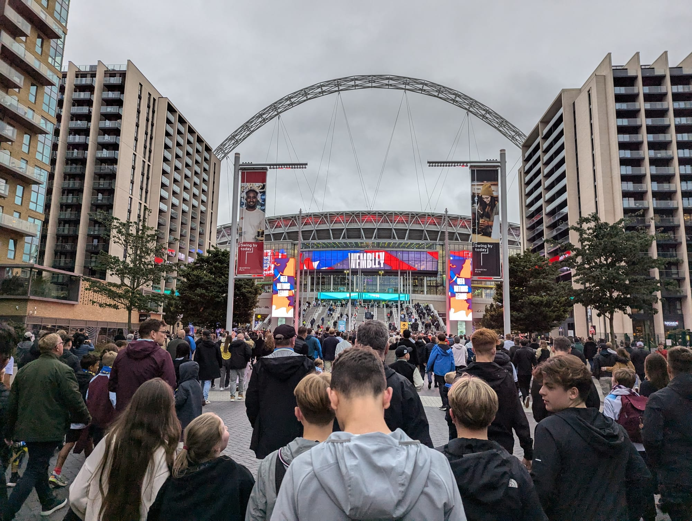

For the first three weeks of October the summer crowds have gone and the autumn exhibitions and festivals open one after another. In the final week the clocks go back, half term starts and the evenings are dark by five.

> 💡 **The Short Version:** **Half term runs 26 to 30 October 2026** and **Halloween falls on a Saturday**, so the last week is the busiest for families. **Asian Art in London** opens on 29 October, the free **Frieze Sculpture** in Regent's Park and the **London Literature Festival** run to 1 November, and **Black History Month** and the **Bloomsbury Festival** run all month. Frieze Week and the BFI London Film Festival fall in the middle of the month; in 2026 they ended on 18 October. The **clocks go back on the last Sunday**: 25 October in 2026, 31 October in 2027. **Bayeux Tapestry** tickets are sold out to 31 March 2027.

**Five ticketed art fairs ran in the same city on the same days in 2026**, inside the BFI London Film Festival's closing weekend, Thursday 15 to Sunday 18 October. What is left is the free half, Frieze Sculpture, which stays in Regent's Park until the start of November.

**Then the month has a hinge.** The clocks go back at 2am on the last Sunday of October and an hour of evening disappears overnight: sunset drops from about 5.50pm on the Saturday to about 4.48pm on the Sunday. In 2026 school half term started the next day, and Halloween falls on the Saturday that ends it. If you can choose your dates, the first ten days of October are the easier trip.

## The Bayeux Tapestry

*British Museum, Room 30 · exhibition runs to 11 July 2027*

[September's guide](/articles/things-to-do-in-london-in-september/) covers the Bayeux Tapestry's arrival in London. **If you are visiting in October 2026, you cannot buy a ticket for your own trip**: every ticket for 10 September 2026 to 31 March 2027 has sold out, and **April to July 2027** opens in early 2027. The hours are **Sunday to Wednesday 10am to 6pm, Thursday to Saturday 10am to 9pm.** The main entrance is on Great Russell Street, with a security and bag check. Prices and the rooms to see around it are in our [British Museum guide](/articles/british-museum-guide/).

## Frieze Week and the film festival

Five ticketed fairs shared the middle of October in 2026: **Frieze London** (Park Square West) and **Frieze Masters** (Gloucester Green) at opposite ends of Regent's Park, **PAD London** in Berkeley Square (13 to 18 October), **1-54 Contemporary African Art Fair** at Somerset House (15 to 18 October) and the **Affordable Art Fair** in Battersea Park (14 to 18 October). Frieze charged £130 to £150 for Thursday's first preview and £38 to £59 for a weekend day ticket.

The **BFI London Film Festival** ran 7 to 18 October 2026, its 70th edition. Our [BFI London Film Festival guide](/articles/london-film-festival/) has what its tickets cost and how to get into a sold-out screening.

### Frieze Sculpture: free, in Regent's Park until 1 November

*The Regent's Park, English Gardens · free, no ticket, 16 September to 1 November 2026*

**Frieze Sculpture is a free outdoor exhibition by the same organiser, in the same park, but it is not part of the ticketed fairs**: you can walk straight in. The 2026 edition is its fourteenth, curated for a fourth year by Fatoş Üstek, with 11 international artists showing in the English Gardens.

Powered by <a target="_blank" rel="sponsored" href="https://www.getyourguide.com/london-l57/">GetYourGuide</a>

## The rest of October's annual fixtures

### Black History Month: the whole of October

A UK-wide observance, unlike the United States, which marks it in February. London's programme runs across museums, galleries, libraries and boroughs all month; 2026's national theme is "Honouring Our Communities."

### Bloomsbury Festival: 1 to 31 October, 40-plus venues

The festival's 20th edition has more than 150 events of music, performance, exhibitions, talks, walks and workshops across more than forty venues in [Bloomsbury](/articles/bloomsbury-area-guide/), from its squares and churches to museums, laboratories and university buildings. Many events are free and walk-in; the rest are ticketed on the [festival's site](https://www.bloomsburyfestival.org.uk/).

### Dance Umbrella: 7 to 27 October

London's international dance festival runs across Sadler's Wells East, the Barbican, Somerset House, Rich Mix and The Place. A digital strand of dance films runs on to **30 November**.

### London Literature Festival: 20 October to 1 November

The Southbank Centre's literature festival is curated in 2026 by **Dua Lipa**, with writers picked through her Service95 Book Club. Events include **Malorie Blackman marking 25 years of *Noughts & Crosses*** in the Queen Elizabeth Hall on **28 October**.

### London Restaurant Festival: across the month

The autumn edition of the American Express-backed restaurant festival has festival menus at participating restaurants throughout October rather than in one fixed week, plus separately ticketed one-off dining events. Some series, such as its ten-chef global cuisine dinners, are for Amex Cardmembers only.

### Asian Art in London: 29 October to 10 November

The 29th edition of the dealers' and auction houses' programme of selling exhibitions, auctions and lectures. Its first late-night gallery openings fall on Halloween: **South Kensington and Belgravia on Saturday 31 October**, then St James's on 1 November and Mayfair on 2 November.

### Science and consumer shows

October is the month the science calendar wakes up: [science events in London](/articles/science-events-london/) has the Royal Institution's autumn Discourses, the free Royal Society prize lectures and the pumping stations that steam on published dates. It is also the busiest month for consumer shows at ExCeL and Olympia; our [exhibitions and conventions guide](/articles/exhibitions-conventions-london/) has the full calendar. MCM Comic Con London ended on 25 October; its next show is 28 to 30 May 2027 (see the [MCM Comic Con London guide](/articles/mcm-comic-con-london/)).

## Sport

**The NFL played three games in London in October 2026, on consecutive Sundays**: the Colts v Commanders (4 October) and Eagles v Jaguars (11 October) at Tottenham Hotspur Stadium, and the Texans v Jaguars (18 October) at Wembley. Tickets, the clear bag rule and what a 2.30pm kick-off does to your Sunday are in our [NFL London Games guide](/articles/nfl-london-games/), and match-day transport is in our [Tottenham Hotspur Stadium guide](/articles/tottenham-hotspur-stadium-travel-guide/).

**England played Czechia at Wembley on Tuesday 6 October 2026**, and the **Royal Parks Half Marathon ran on Sunday 11 October**: 13.1 miles on closed roads from Hyde Park past Buckingham Palace, along The Mall and Whitehall, to a finish in Kensington Gardens.

*Olympic Way, on a Nations League match night.*

Match-day transport, the bag rules and the hotels that treble in price on event nights are in our [Wembley guide](/articles/wembley-stadium-arena-guide/).

## The last week: dark, full of children, and Halloween on a Saturday

### The clocks go back: 2am, last Sunday of October

British Summer Time ends at 2am on the last Sunday of October: 25 October in 2026, 31 October in 2027. Clocks go back an hour, and the effect is not gradual: in 2026 sunset was about **5.50pm** on the Saturday before and about **4.48pm** on the Sunday after. By the 31st it is nearer **4.37pm**. Anything you want to see outdoors in the last week of October has to happen before mid-afternoon. That includes the river: from Monday 26 October City Cruises' last sightseeing boat from Westminster to Greenwich leaves at 14:40 rather than 16:00 ([Thames river cruises](/articles/thames-river-cruises-london/)).

### Diwali on the Square

The Mayor of London's Diwali celebration in Trafalgar Square, due on 25 October 2026, was cancelled the day before by the Diwali in London committee. **It is not held on Diwali itself**, which moves with the lunar calendar and falls in November in 2026 (see our [November guide](/articles/things-to-do-in-london-in-november/)).

### School half term: Monday 26 to Friday 30 October 2026

Most London boroughs break up for the week beginning the last Monday of October; academies and free schools can set their own dates. It is an attraction spike rather than a hotel spike: timed-entry slots at the paid attractions go first, so **book before the week starts**. The free museums are the fallback for anyone who didn't, not the plan.

Family options in the week: **Absurd City** at Westfield London and **Larger Than Life: Starring Wallace & Gromit, Shaun and More** at Lightroom in King's Cross (both under "New in October" below), and **Wildlife Photographer of the Year** at the Natural History Museum. At Shakespeare's Globe, **MakeBeth**, an interactive retelling of Macbeth in recycled cardboard for ages 7 and up, runs **24 October to 1 November** and has sold out, and a **Ghosts & Ghouls** family tour of the theatre runs from **24 October to 30 January**. More ideas are in [London with children](/articles/london-with-children/).

### Halloween: Saturday 31 October 2026

*Full guide: [Halloween in London](/articles/halloween-london/)*

Scare attractions, club nights, ghost walks and one-off parties run on the night itself, not on the nearest weekend. Our Halloween guide has the scare attractions worth a train fare, the ones that don't need one, and where you can still hire a costume this late. In the West End, the horror play **Paranormal Activity** adds a **10.30pm performance** at the Ambassadors that night, from £36 ([book at the box office](https://www.atgtickets.com/shows/paranormal-activity/ambassadors-theatre/calendar/2026-10-31/)).

## Exhibitions that opened in October

All of these are still running and last into 2027.

Powered by <a target="_blank" rel="sponsored" href="https://www.getyourguide.com/london-l57/">GetYourGuide</a>

### Korea: British Museum, from 1 October

Ticketed, filed under the museum's special exhibitions, running to **31 January 2027**.

### Painting the French Riviera: Royal Academy, from 2 October

A major ticketed exhibition running to **31 January 2027**, with a related film season, *Screening the French Riviera*, from November. It sits alongside a free selling display, *In Provence and Southern France*, running at the RA since **29 September**.

### Renoir and Love: National Gallery, from 3 October

Forty paintings, including *Bal du moulin de la Galette* from the Musée d'Orsay, shown in the UK for the first time, and Renoir's *La Grenouillère*. Tickets are **£20 Sunday to Thursday and £25 on Fridays and Saturdays**; under-18s go free. Runs to **31 January 2027**.

### The 90s: Art and Fashion: Tate Britain, from 8 October

Ticketed, free for Tate Members, running to **14 February 2027**. Curated by Edward Enninful, drawing on photography by Juergen Teller, David Sims and Corinne Day, art by Steve McQueen, Damien Hirst, Sarah Lucas and Yinka Shonibare, and collections by Vivienne Westwood, Alexander McQueen and John Galliano. There is a Relaxed Hours slot on the third Wednesday of the month, 10 to 11am.

### Justin Caguiat: Change Ringing: Serpentine South Gallery, from 8 October

Free, running to **10 January 2027**: Caguiat's first UK institutional exhibition, with painting, sculpture, printmaking, sound and film in a site-responsive installation.

### Tim Walker's Fairyland: Love and Legends: National Portrait Gallery, from 9 October

Queer identity, community and love, in new portraits of activists, performers, artists and writers that Walker has spent five years making. Tickets are **£23 Monday to Thursday and £25 Friday to Sunday**, and it runs to **7 February 2027**. A free display of **Issy Wood's self-portraits** opened in Room 32 the same day.

### Light and Magic: The Birth of Art Photography: Tate Modern, from 14 October

The first major exhibition to explore pictorialism as a global movement: more than 200 rare prints by over 80 artists, from Seoul to Sydney, New York to Cape Town, alongside works from Tate's own collection. Ticketed, free for Tate Members, running to **21 February 2027**.

### Yinka Shonibare and Thomas Gainsborough: A Conversation: National Gallery, from 15 October

Shonibare's *Mr and Mrs Andrews without their Heads* (1998) hangs beside the Gainsborough portrait it answers, together for the first time, in Room 1, marking 300 years since Gainsborough's birth. Runs to **7 February 2027**.

### Wildlife Photographer of the Year: Natural History Museum, from 16 October

The year's winning pictures, running to **11 July 2027**. Adults from **£17** off-peak, children aged 4 to 17 **£10.50**, under-4s free.

**Declaring Independence: USA 250** at the British Museum is free and continues to 29 November.

## Theatre: what's open for the end of the month

**The Cherry Orchard** opened at the Harold Pinter Theatre on **3 October**, running to 9 January. **High School Musical** opened at Troubadour Wembley Park on **12 October**, running to **3 January**. **Jesus Christ Superstar** has been at Drury Lane since **16 October**, also running into January, as is **The Lives of Others** at the Adelphi, from **14 October**.

*The Cherry Orchard, at the Harold Pinter Theatre. Artwork: Sonia Friedman Productions.*

At the London Coliseum, English National Opera stages **Tosca** from **30 October**. **Cirque Berserk!** is at the Garrick for half term until **31 October** (book on [Ticketmaster](https://theatre.ticketmaster.co.uk/book/1J7JN-cirque-berserk/)), **Ceilidh** is at Shoreditch Town Hall, and the cheapest opening of the month is **The Bridge** at the Bush from **28 October**, from £13.

The **Duke of York's Theatre is now the Tom Stoppard Theatre**, and you will see both names in circulation.

## New in October

### Absurd City: Westfield London, from 15 October

*Shepherd's Bush, W12*

Billed by its operator, Wake The Tiger, as Europe's largest immersive art experience: 80,000 sq ft over two floors, five "districts," and upwards of three hours of exploring, with an immersive bar and kitchen inside. General admission is family-friendly; "After Hours" evenings are 18+.

### Larger Than Life: Starring Wallace & Gromit, Shaun and More: Lightroom, King's Cross, from 14 October

A new Aardman show on Lightroom's walls, booking to **4 January 2027**. It runs about 50 minutes on a loop, in half-hour entry slots; adults from **£25**, students and under-18s from **£15**. Book on [Ticketmaster](https://attractions.ticketmaster.co.uk/book/1JAP4-TICKETMASTER/). Both this and Absurd City are in our [immersive experiences guide](/articles/immersive-experiences-london/).

### Blue Note London

The New York jazz club's first UK venue, on St Martin's Lane, plays two sets a night (7pm and 9.30pm) in a 300-seat main room. October ends with Elements: A Celebration of Earth, Wind & Fire on 28 October and Laura Mvula on 29 and 30 October. Its entry is in our [guide to London's live music venues](/articles/best-live-music-venues-london/).

## Gigs worth planning around

Alexandra Palace carries the end of the month: **Overmono on 28 October**, and **[Skindred](https://www.ticketmaster.co.uk/skindred-you-got-this-tour-london-31-10-2026/event/1F006474E2A68594) on Halloween night, 31 October**.

## What's on in October 2026

One evening pick a day: music, comedy, theatre, classical and dance, each at a different venue.

## New restaurants and bars

**Cloth Cornhill** (38½ Cornhill, EC3V 9DR) opened on **1 October**, the second site from the Cloth restaurants group, in the building that was Simpson's Tavern, the City chophouse trading on the site since 1757. It trades **Monday to Friday only**, closed at weekends and on bank holidays. The first-floor restaurant, reached by stairs only, takes bookings up to 90 days ahead; the ground-floor pub is walk-in only.

**Dishoom Borough**, at 11–13 Park Street beside Borough Market, is open all day, every day.

Powered by <a target="_blank" rel="sponsored" href="https://www.getyourguide.com/london-l57/">GetYourGuide</a>

## Looking ahead to November and December

The full month is in our [Things to Do in London in November](/articles/things-to-do-in-london-in-november/).

**Bonfire Night** is Thursday **5 November**, but most of the big displays, Alexandra Palace and Battersea Park among them, are on **Saturday 7 November**, and both are on sale now. Every display, which of them need tickets, and the free viewpoints are in our [Bonfire Night guide](/articles/bonfire-night-london/).

**Hyde Park Winter Wonderland** runs **19 November 2026 to 3 January 2027**, and booking is open: advance entry is **£1** for off-peak slots and **£8.25** at peak, with everything inside, including rides, the ice rink and the circus, charged separately. Full prices and gates are in our [Winter Wonderland guide](/articles/hyde-park-winter-wonderland/). Somerset House's rink and the other outdoor rinks are booking too; dates and prices are in our [London ice skating guide](/articles/ice-skating-london/).

**The EFG London Jazz Festival** runs **13 to 22 November 2026** across 82 venues, from the Royal Festival Hall to basement clubs in Dalston and Chelsea. Nineteen of its concerts are free and tickets otherwise start at £5, but ten shows are sold out, so book before you arrive. See our [London Jazz Festival guide](/articles/london-jazz-festival/).

**Christmas in London** starts earlier than most people expect: Kingston's Christmas market opens on **12 November** and the Trafalgar Square tree is lit on **3 December**. Every market's dates and hours are in our [London Christmas markets guide](/articles/christmas-markets-london/), and the light switch-ons are in our [Christmas in London guide](/articles/christmas-in-london/).

**November is the big month for international sport.** England's men play three Nations Championship matches at Allianz Stadium, Twickenham: **Australia on Sunday 8 November** and **Japan on Saturday 14 November**, with tickets from £79 and £51, then **New Zealand on Saturday 21 November**, which has sold out. England's footballers play **Croatia at Wembley on Thursday 12 November**.

## Practical: October in London

**Weather.** Around 16°C by day at the start of the month, falling to 12–13°C by the end, with nights down to 8–10°C. It is wetter than September and the first month where a jacket alone is not enough. Assume rain and dark. It is also the month the parks turn; our guide to [where to see autumn leaves in London](/articles/best-places-autumn-leaves-london/) has the named trees and the peak weeks.

**Daylight.** Sunset moves from about 6.40pm on the 1st to about 5.50pm on the Saturday before the clocks change, then, overnight, to about 4.48pm the next day. By the 31st it is about 4.37pm. Plan outdoor time for the first half of the day once you're in the back half of the month.

**Crowds.** Two different months, split by half term. The first three weeks are among the easiest of the year in the big museums: summer has gone and the schools are in. Frieze weekend is the exception. Then half term refills every museum, aquarium and family attraction at once.

**Prices.** Two spikes, for two different reasons. Frieze Week is the hotel spike: five ticketed fairs and an international trade audience push rates up for five days. Half term hits attractions, not hotels: timed-entry slots go first, and turning up on spec is how a day gets wasted. The value in October is the first ten days and, if you don't mind the dark, the very end of the month.

**Working out which month suits you best?** [Best Time to Visit London](/articles/best-time-to-visit-london/) compares October's weather, crowds and hotel rates against the rest of the year.

