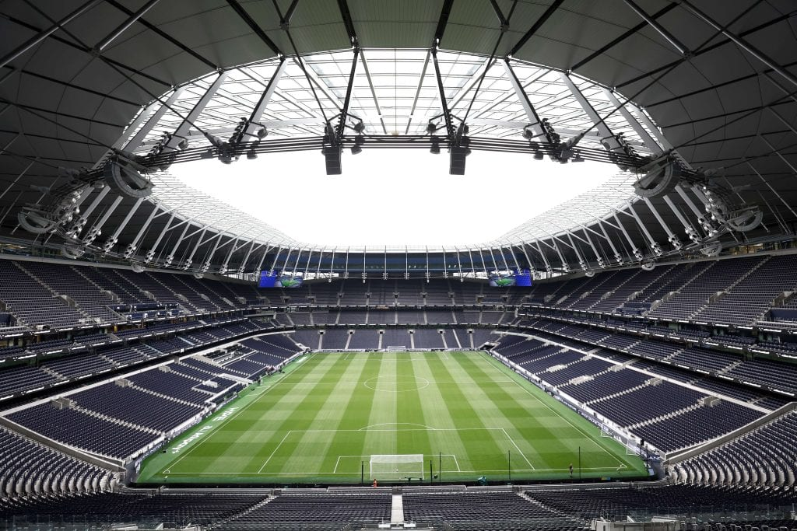

Tottenham Hotspur Stadium sits on the High Road in a residential stretch of N17 and holds up to 62,850 people. **There is no public car park at the ground.** Fans arrive by train, bus and coach, through four stations that aren't all on the same network, into a borough that closes its side streets to non-residents for events far smaller than a sell-out.

> 💡 **The Short Version:** Come by train. **White Hart Lane** is the closest station at **5 minutes' walk** and is step-free; use it whether you're going to the football, an NFL game or a concert. It runs on the **London Overground**, not the same network as **Northumberland Park** (10 minutes), which is **Greater Anglia only**. From central London, the Victoria line gets you to **Seven Sisters** (30 minutes) or **Tottenham Hale** (25 minutes, step-free, and the more reliable of the two on a matchday). **There is no stadium car park**; the only on-site parking is booked Blue Badge bays. Drive anyway and park on the street in one of Haringey's **seven event-day zones** and the penalty is **£160**, halved if you pay within 14 days. Going home, the **Victoria line runs all night on Friday and Saturday**, but the Overground through White Hart Lane does not. **NFL games close the roads for far longer**: 10 hours before kick-off, not two.

---

## Getting there by train

| Station | Line(s) | Walk to the stadium | Best for |
| --- | --- | --- | --- |
| **White Hart Lane** | **London Overground (Weaver)**, some Greater Anglia | **5 minutes** (~500 steps) | Everyone: the default, for home and away fans alike |
| **Northumberland Park** | **Greater Anglia only**, not the Overground | **10 minutes** (~1,000 steps) | The overflow, approaching from the east |
| **Tottenham Hale** | **Victoria line**, Greater Anglia | **25 minutes** (~2,500 steps) | Central London and airport arrivals; step-free, and steadier than Seven Sisters on a matchday |
| **Seven Sisters** | **Victoria line**, Greater Anglia, Overground (Weaver) | **30 minutes** (~3,000 steps) | Anyone who'd rather walk further than change again; not step-free |

Walk times are the club's own.

### White Hart Lane: the one the club tells everyone to use

White Hart Lane sits against the stadium's west side, off the High Road by Worcester Avenue, and is the station Tottenham Hotspur directs both home and away supporters to. It's on the **Weaver** line of the London Overground, with direct trains to and from **Liverpool Street** and onward services to **Enfield Town** or **Cheshunt**. The station has boarding ramps for step-free access but no ticket hall, no toilets and no car park.

> ⚠️ **Don't assume it's the same network as Northumberland Park.** White Hart Lane is Overground. Northumberland Park is Greater Anglia only, with a different operator, different apps for live running, and no place on the Overground map. The club's travel page says: "Use London Overground for direct trains to White Hart Lane, or Greater Anglia for direct trains to Northumberland Park."

### Northumberland Park: the eastern approach

A 10-minute walk in via Northumberland Park Road and Park Avenue Road to Park Lane on the stadium's east side. It has step-free access, according to the club. Treat it as the release valve for the crowd leaving White Hart Lane, not a first choice.

### Seven Sisters and Tottenham Hale: the Victoria line options

Both give you the Victoria line, both are roughly 25–30 minutes' walk, and **Tottenham Hale** is the better of the two. It's step-free to the Victoria line and to the northbound Greater Anglia platform; Seven Sisters has no lifts on any part of its site. And **some Victoria line trains skip Seven Sisters on a midweek matchday** to manage congestion further down the line, which can turn a 30-minute walk into a much longer diversion if your train sails past. The club's advice to visiting supporters is to travel early and expect the Victoria line to be busy, "particularly midweek."

Seven Sisters is also served by the Overground Weaver line, the same one that runs through White Hart Lane, but White Hart Lane is so much closer on that line that it's no help here.

---

## Buses, coaches and bikes

Local bus routes **149, 259, 279 and 349** normally run along the High Road. On event days they are diverted east of the stadium at Lansdowne Road and rejoin the High Road at the Northumberland Park junction, so build in extra time.

For coach travel, **Big Green Coach**, the club's official and exclusive coach partner, runs direct return services from more than 20 towns for **£17 return**, with a season option covering every home Premier League match for **£289**. Coaches are directed to designated zones on **West Road** and **Brantwood Road**, in the industrial estate northeast of the stadium, and drivers need a permit arranged in advance through the club.

The club also runs a **free, pre-booked shuttle bus** from **Alexandra Palace** (Great Northern) and **Wood Green** (Piccadilly line) stations, roughly every 15 minutes from three hours before an event until two hours after. Registration and an e-ticket are required, and the club advises not to board any service less than 50 minutes before kick-off.

Cyclists get **ample parking** at the ground, and **Cycle Superhighway 1** begins on Church Road directly opposite the stadium and runs to Liverpool Street.

---

Powered by <a target="_blank" rel="sponsored" href="https://www.getyourguide.com/london-l57/">GetYourGuide</a>

## Driving: Haringey's event-day zone

**There is no public parking in or around the stadium, parking restrictions are enforced and tow trucks operate on event days.** The streets around the stadium fall under an **event-day parking scheme** that applies to home men's and women's games, and to any other event, expected to draw **more than 10,000 people**. That covers essentially every Spurs fixture, both NFL games and any concert.

Seven controlled parking zones carry additional match-day hours, on top of each zone's normal hours:

| CPZ | Monday–Friday | Saturday, Sunday and bank holidays |
| --- | --- | --- |
| Northumberland Park West | 5pm–8.30pm | Noon–8pm |
| The Hale | 5pm–8.30pm | Noon–8pm |
| Tottenham Hale North | 5pm–8.30pm | Noon–8pm |
| Tottenham Event Day | 5pm–8.30pm | Noon–8pm |
| Tower Gardens | 5pm–8.30pm | Noon–8pm |
| White Hart Lane | 5pm–8.30pm | Noon–8pm |
| Willoughby Lane | 5pm–8.30pm | Noon–8pm |

A visitor **cannot buy their own permit** to park in these zones on an event day. Residents of Northumberland Park West, The Hale, Tower Gardens and White Hart Lane have an event-day permit included in their resident permit. Residents and businesses in Tottenham Event Day and Tottenham Hale North can apply for a free permit. A visitor to a resident's house can park only by arriving before the road closures start and using a visitor permit the resident applies for on their behalf. **Blue Badge holders can park as usual** in these zones.

> ⚠️ **The penalty is steep.** Parking in a suspended bay, or in a permit bay without a valid permit, is a **higher-band Penalty Charge Notice of £160**, cut to **£80** if paid within 14 days. It rises to £240 if it is still unpaid after the Notice to Owner. Cars left in suspended spaces can be relocated to the council pound; London Councils' TRACE service will tell you if yours has been towed and where to collect it.

On event days all parking bays on Worcester Avenue, Park Lane, Love Lane and Whitehall Street are suspended. The road closures also mean that if you do drive, you cannot leave any car park inside the closure area for one hour after the event finishes.

### The road closures, phase by phase

- **From 8am**, Worcester Avenue closes for security checks on the stadium's basement car park; Park Lane closes **three hours before kick-off**.
- **Two hours to one hour before**, the northern High Road (from White Hart Lane to Bromley Road) closes to general traffic, with buses diverted around it. Residents can still reach their homes via a vehicle permit checkpoint.
- **One hour before to 15 minutes after kick-off**, nothing but emergency vehicles moves on the roads immediately around the ground, and the southern High Road (down to Lordship Lane/Lansdowne Road) closes too.
- **During the event**, the southern High Road reopens for residents; the northern section stays shut as an emergency evacuation route.
- **From 15 minutes before the final whistle to an hour after**, the High Road closes again in full. Love Lane and Whitehall Street, by White Hart Lane station, stay closed for **up to 90 minutes** to manage the station queue, and Leeside Road (eastbound) and Willoughby Lane (northbound) run one-way for an hour or two to help the crowd disperse.

---

## Where to actually park

### The only on-site parking is for Blue Badge holders

**74 enlarged accessible bays** sit in the stadium's basement, reached from **Worcester Avenue**, in three zones (Yellow for the North/West Stand, White for the East Stand and Grey for the South Stand) with a **2.1m height limit**. You need to be registered with the club's Disability Access Scheme, and booking opens online at 7pm once tickets for a fixture go on sale, allocated first come, first served. Arrive at least **two hours before kick-off**.

Two overflow options exist for Blue Badge holders without a basement space: **Sainsbury's, Northumberland Park** (no dedicated bays, open from an hour before kick-off) and **St Francis de Sales**, for oversized vehicles, booked by email two hours ahead.

### Non-event days: free parking at Sainsbury's

On any day **without** an event, **Sainsbury's Tottenham** offers free parking, including Blue Badge bays, for up to three hours, a five-minute walk from the club's Tottenham Experience building. It's not available on a matchday.

### For everyone else: don't drive

There's no public parking at the stadium, and the surrounding streets are inside a Controlled Parking Zone with additional event-day rules on top. There is no list of nearby station car parks to leave a car in, so travel by train, bus or coach.

If you need to be dropped off, the club recommends a taxi or private-hire drop-off and pickup point at least **half a mile away**, about a 10-minute walk, because the road closures prevent drop-offs close to the ground. An **event-day black taxi rank** operates at **Scotland Green**, off the High Road.

---

## Getting home

### Managed queues at the stations

Post-match queuing systems run at all four stations, with stewards directing the flow. At **White Hart Lane** and **Northumberland Park**, northbound and southbound platforms are queued separately, and at White Hart Lane there's **no entry onto Moselle Street from the High Road** while the crowd clears.

### The Night Tube reaches two of the four stations, not the closest one

The **Victoria line runs all night on Friday and Saturday**, end to end between Walthamstow Central and Brixton, calling at both **Seven Sisters** and **Tottenham Hale**.

> ⚠️ **White Hart Lane has no equivalent.** The Weaver line of the London Overground runs a normal timetable only, with no Friday/Saturday night extension. However late a match, NFL game or concert finishes, the last train from White Hart Lane keeps to its ordinary last-train time. Check the timetable for your date.

### Coaches

Coach parking sits in the same streets used for buses on an event day, **West Road** and **Brantwood Road**, with Big Green Coach services offering a guaranteed seat home.

---

Getting a ticket is the harder half of the trip. Spurs say home league games are unlikely to reach general sale, and [how a visitor actually gets a Premier League ticket](/articles/premier-league-tickets-london/) covers what One Hotspur membership costs and what it does not buy you.

## The NFL London Games

The club describes Tottenham Hotspur Stadium as the only stadium outside the US purpose-built for NFL games, with a dedicated NFL playing surface under the retractable grass pitch, NFL-specific locker rooms, and broadcast and medical facilities. The club and the NFL have extended their partnership through the 2029–30 season, with a minimum of two regular-season games a year and official status as the "Home of the NFL in the UK." The 2026 games were played on Sunday 4 October (Indianapolis Colts v Washington Commanders) and Sunday 11 October (Philadelphia Eagles v Jacksonville Jaguars).

On an NFL Sunday the same four stations, the same lack of a public car park and the same Victoria line apply. Two things are different.

**The road closures start much earlier.** Haringey has a separate traffic order for NFL event days, running from **10 hours before kick-off to 90 minutes after the final whistle**, against roughly two hours either side for a football match. For a 2.30pm kick-off, that means restrictions from the early hours of the morning.

**Many visitors don't know London's ticketing.** Get an Oyster card or use a contactless bank card before you travel, since there's no paper ticket booth to fall back on at a modern London station, download the TfL Go app for live disruption, and use White Hart Lane first. The bag policy, the tour timetable and the accessibility provisions in this guide are the stadium's standard rules for every event, NFL games included.

---

Powered by <a target="_blank" rel="sponsored" href="https://www.getyourguide.com/london-l57/">GetYourGuide</a>

Tickets, prices, the clear bag rule and what a game day looks like hour by hour are in our [NFL London Games guide](/articles/nfl-london-games/).

## Where to stay, and why this isn't Wembley

**There's no cluster of stadium hotels here.** This part of Tottenham is residential streets and a high road, and the advice for most visitors is to **stay central and travel out** on the Victoria line.

The nearest chain hotel is **Premier Inn London Tottenham Hale**, on Station Road, **1.5 miles, about 25 minutes' walk, from the stadium**. It has no parking of its own; the nearest option is Hale Village Car Park, an 8-minute walk away, at £10 a day. Premier Inn also has hotels further out at **Edmonton** (N18 3AF) and **Enfield** (EN3 7XY), both on retail parks, so they only make sense if you have a car.

Our [guide to the best areas to stay in London](/articles/best-areas-to-stay-in-london/) covers the Victoria line neighbourhoods that put you one change from Seven Sisters or Tottenham Hale.

---

## The hours before doors

*The stadium bowl, roof open.*

### The stadium tour, and the separate one for matchdays

The regular **Stadium Tour** is **from £25** for an adult, with kids going free alongside a paying adult and 15% off for booking ahead. It **does not run on any day the stadium has a fixture**, football or NFL.

In its place, a separate **Matchday Tour** (from £50, 10% off booked ahead) runs in the hours before kick-off on event days, going into the home changing room, the tunnel and the media mixed zone, with a seat in the manager's dugout chair and a pitch-side photo with the match ball. On an NFL day it includes the **NFL away dressing room and press auditorium**.

The site also runs **The Dare Skywalk** (a harnessed walk 46.8 metres above the pitch), **F1 Drive London** (an outdoor go-kart circuit, seasonal), Legends Tours and VIP Tours.

---

## Eating and drinking

**Beavertown Brewery** operates inside the stadium, in the South Stand at Level 1, brewing on-site. Its beer, alongside Pravha, Madri and Coors, is served at the **Goal Line Bar**, which the club markets as **Europe's longest bar at 65 metres**.

Across more than **58 outlets** on the general admission concourses, named vendors include **The Linesman** (fish and chips), **N17 Grill** (burgers, with gluten-free and plant-based options), **Seoul Birdie** (Korean food), **Smashed Olive** (stone-baked pizza), **Chicken House** (halal fried chicken) and **Tap Inn**, which has 29 separate locations selling pies and sausage rolls made on-site. The stadium is **fully cashless**: contactless, mobile payment or a gift card only.

---

## Drinking on event days

Haringey's **borough-wide Public Spaces Protection Order** bans drinking alcohol in an anti-social manner anywhere in the borough, Tottenham included, and runs until **1 May 2028**. The fixed penalty is **£100**, rising to a maximum of **£1,000** if it isn't paid and goes to court.

Inside the stadium it's a criminal offence to serve alcohol to anyone under 18, including non-alcoholic beer, and the whole site is cashless, so bring a card.

---

## The bag problem

| | Tottenham Hotspur Stadium |
| --- | --- |
| **Personal bag limit** | A4 size or smaller — **21cm × 30cm** |
| **Clear bag alternative** | Up to **30cm × 30cm** |
| **Club drawstring bag** | Sold at the ground for £1, PVC, complies automatically |
| **Laptop sleeves** | Up to **37cm × 31cm** |
| **Bag drop on site** | **None** |
| **Medical exemption** | A form is available in advance for anyone who needs to bring a bag or equipment beyond these limits |

Bags over the limit are not permitted in, and there's nowhere on site to check them, so use your hotel's storage or leave bulkier bags behind. These limits apply to every event at the ground, NFL games included.

---

Powered by <a target="_blank" rel="sponsored" href="https://www.getyourguide.com/london-l57/">GetYourGuide</a>

## Step-free access and the Sensory Suite

**Five lifts** run the full height of the concourse from street level, there are **more than 250 wheelchair bays** and **over 500 additional accessible seats**, **66 accessible toilets** with RADAR key access, and **three Changing Places** facilities (two in the stadium, one in the club's Tottenham Experience building). Four home entrances (1, 5, 13 and 17) and one away entrance (11a) have lift access and are stocked with audio-commentary headsets, wheelchairs, induction loops and a water bowl for assistance dogs.

A **Sensory Suite** in the North Stand (block 416) offers a lower-stimulation space for up to three supporters plus one personal assistant each, with a tactile wall and bubble tube; booking requires completing a profile form in advance. The club issues a **Personal Assistant (PA) ticket** rather than a companion ticket, arranged through an Access Requirement Form with supporting evidence (such as DLA, PIP or a specialist letter) sent to access@tottenhamhotspur.com.

**By station:** White Hart Lane and Northumberland Park both have step-free access, and the club says all routes from any of the four stations to the ground are wheelchair-friendly. Tottenham Hale is step-free to the Victoria line and the northbound Greater Anglia platform only. **Seven Sisters has no lifts at all.**

Visiting (away) supporters use entrances 11 and 12, in blocks 114–118 in the stadium's north-east corner, approached via Worcester Avenue.

---

## Small print that catches people out

- **Sat-nav:** use **N17 0BX** for the stadium.
- **Everyone needs their own ticket**, including babies in arms; there's no lap-ticket option. Ear defenders are recommended for under-5s at their seat.
- **Each ticket works once** at the turnstile; it cannot be passed on to someone else after you've entered.
- **Gates open early:** three hours before kick-off for premium ticket holders, two hours before for general admission.
- **No pushchair storage** is provided inside the stadium.
- **Coach drivers** need a permit arranged in advance through the club before using the West Road or Brantwood Road coach zones.

---

## Continue planning your London trip

- 🏉 **[Twickenham Stadium Travel Guide](/articles/twickenham-stadium-travel-guide/)** — the same problem in reverse: no station on the doorstep, and a parking zone run by two boroughs
- 🚇 **[How to Use the London Underground](/articles/how-to-use-the-london-underground/)**
- 💷 **[London Transport Costs and Fares](/articles/london-public-transport-costs-and-fares/)**
- 🛏️ **[Best Areas to Stay in London](/articles/best-areas-to-stay-in-london/)**
- 🏟️ **[Wembley Stadium and OVO Arena Travel Guide](/articles/wembley-stadium-arena-guide/)**
- 🚌 **[How to Use London Buses and Trams](/articles/how-to-use-london-buses-and-trams/)**
- 🎾 **[How to Get Wimbledon Tickets](/articles/wimbledon-tickets-guide/)**
- 💰 **[Money in London: Cash, Cards and ATMs](/articles/money-in-london/)** — including which London venues take no cash at all

---

*Parking and traffic restrictions are set per event, so check [Haringey Council's event-day page](https://haringey.gov.uk/parking/where-you-can-park-haringey/tottenham-hotspur-stadium-event-day-parking-restrictions) for your date.*
