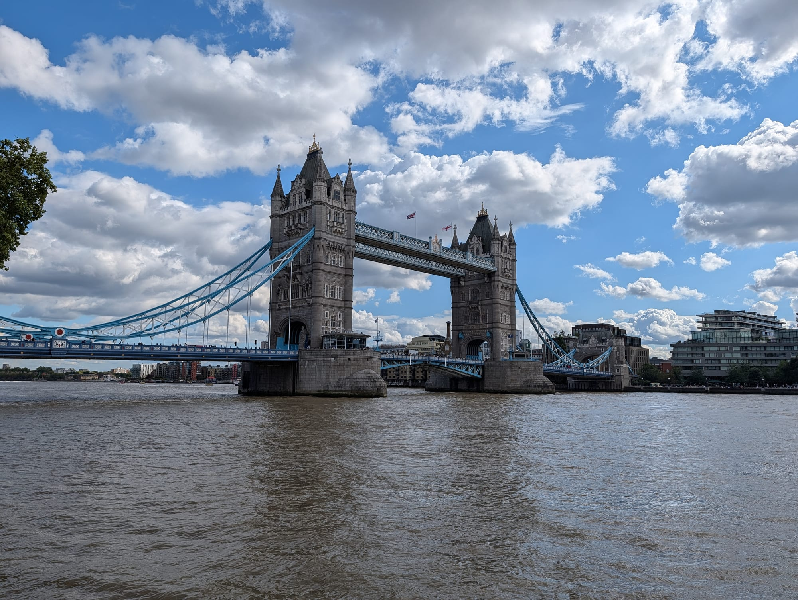

> 💡 **The Short Version:**
> - **Crossing is free; going inside is £18.** The ticket (adults £18.00, concessions £13.50, children 5 to 15 £9.00, under-5s free) covers the two towers, the high-level walkways with glass floors and the Victorian Engine Rooms. [Book entry](https://www.towerbridge.org.uk/book-tickets?product_id=7a2849ff-7252-44e0-84ac-dd22a7ecbe35) up to six weeks ahead.
> - **Open daily 09:30 to 18:00,** last entry 17:00. Closed 24, 25 and 26 December; opens at 10:00 on 1 January.
> - **A tour is optional.** Self-guided audio tours are free with a ticket. The 90-minute guided tour is £35 and takes up to 12 people; the £80 Behind-the-Scenes tour is sold out for January to March 2027. A <a href="https://www.getyourguide.com/activity/-t439425?partner_id=WWP7I0R&amp;cmp=tower-bridge-guide" target="_blank" rel="sponsored nofollow noopener" data-affiliate="gyg">Tower Bridge entry ticket on GetYourGuide</a> is the same £18 and can be cancelled free up to 24 hours before.
> - **A booked slot does not skip the queue.** Everyone waits outside on the bridge for the bag check.
> - **Bridge lifts** happen around 500 times a year, are free to watch, and are listed on the [lift times page](https://www.towerbridge.org.uk/bridge-lifts).
> - **Glass floors:** one in each walkway, 11.5 metres long and 33.5 metres above the road.
> - **Dogs are welcome** on a lead. Suitcases and bags over 45 x 35 x 20 cm are not.
> - **London Pass holders must book a slot** through Go City; **National Rail 2FOR1** is a ticket type at checkout.

> ⚠️ **Your booked time does not get you past the queue, and the queue is outside on the bridge.** The ticket check and bag search are at the North Tower entrance, so allow extra time and dress for the weather.

---

## Tickets and booking

*Tower Bridge from the north bank.*

The Ticket Office and entrance are on the west side of the North Tower, the one nearest the [Tower of London](/articles/tower-of-london-guide/).

| Ticket | Price |
| --- | ---: |
| Adult (18 and over) | £18.00 |
| Concession: seniors 60 and over and students 18 and over with ID, 16 and 17 year olds, disabled adults | £13.50 |
| Child (5 to 15) | £9.00 |
| Disabled child (5 to 15) | £6.80 |
| Under 5 | Free |
| One companion per disabled visitor | Free |
| Local ticket | £1.00 |

The £1 local ticket is for permanent residents of Southwark, Tower Hamlets and the City of London. Bring photo ID and a recent proof of address; visiting friends and relatives do not qualify. Groups of 15 or more get a discount and must book by phone or email.

### How to book

[Book entry](https://www.towerbridge.org.uk/book-tickets?product_id=7a2849ff-7252-44e0-84ac-dd22a7ecbe35) for a date and time up to six weeks ahead. Pre-booking secures the entry time you want, but not a place in the queue. The e-ticket is checked when you arrive, and your bags are searched again at the Engine Rooms. If a bridge lift is under way when your slot comes, staff will try to fit you in later.

The [Tower Bridge entry ticket on GetYourGuide](https://www.getyourguide.com/activity/-t439425?partner_id=WWP7I0R&cmp=tower-bridge-guide) is the same £18 for an adult and can be cancelled free up to 24 hours before. It does not give fast-track entry either. Check dates below.

Powered by <a target="_blank" rel="sponsored" href="https://www.getyourguide.com/london-l57/">GetYourGuide</a>

### Passes and offers

- **London Pass or London Explorer Pass:** book a slot through the Go City reservations portal, using your pass order number. Tell staff you have a pass on arrival; admission is subject to availability. Our [London Pass guide](/articles/london-pass-guide/) works out whether the pass pays.
- **National Rail 2FOR1:** two entries for the price of one full-price adult ticket. At checkout scroll to the bottom of the ticket types and add "National Rail Days Out - Two Visitors", quantity one for two people. Bring both e-tickets and a valid National Rail ticket for each visitor, or you pay the difference. Our [National Rail 2FOR1 guide](/articles/national-rail-2for1-london-attractions/) lists the other attractions.
- **Family Activities Pass:** take part in a family activity on the second Saturday of a month or in UK school holidays and you can come back to a family activity free within six months, with photo ID.
- **Guides:** Blue Badge and City of London guides are admitted free with proof of accreditation.

---

## Tours

Audio tours are free with a ticket: a highlights tour in English, Arabic, Mandarin, German, Italian, French and Spanish, a sensory tour and a British Sign Language tour. Scan the QR codes inside or use the free Smartify app, and bring your own headphones, as none are lent. A Tower Bridge Cat Trail is free too, and there are drop-in family craft activities and, in UK school holidays, Ask an Expert sessions in the Engine Rooms.

- **Guided tour:** £35 for adults (£30 concessions, £28 children 5 to 15). It lasts 90 minutes, takes up to 12 people, runs in English on selected dates and starts at the Ticket Office. It covers the towers, walkways, glass floors and Engine Rooms. Booking is essential, with tickets released eight weeks ahead. See [the guided tour page](https://www.towerbridge.org.uk/whats-on/guided-tours).
- **Behind-the-Scenes tour:** £80 for adults, about two hours, starting at the Engine Rooms. It goes into the control cabin, the machinery room and the Bascule Chambers, which house the 420-ton counterweights, and ends on the walkways. It runs at weekends from 2 January to 14 March 2027 and is sold out; the [waitlist](https://www.towerbridge.org.uk/whats-on/behind-the-scenes-tours) is open. Every visitor signs a waiver.
- **Private tour:** £210 for up to six people, plus standard admission for anyone more, in the mornings, by phone or email.

Powered by <a target="_blank" rel="sponsored" href="https://www.getyourguide.com/london-l57/">GetYourGuide</a>

---

## Opening hours

- **Daily:** 09:30 to 18:00, last entry 17:00.
- **Closed** on 24, 25 and 26 December every year. It opens at 10:00 on 1 January.
- **Relaxed Opening:** the second Saturday of each month, 09:30 to 11:30, last entry 11:10. Capacity is cut, the soundscape is reduced and it is designed for neurodivergent visitors. Booked on the Tower Bridge site.
- **Quieter Time:** sessions with limited numbers and no guided tours or group bookings, for anyone who wants a calmer visit. They are included in the entry ticket, and the dates are announced on the what's on page.

---

## Inside Tower Bridge

You climb the North Tower, cross the walkways, come down the South Tower and walk to the Engine Rooms. The Tower Bridge site recommends walking up the towers for the best experience; lifts run in both.

### The high-level walkways and the glass floors

The walkways connect the two towers 33.5 metres above the road and 43.5 metres above the Thames at high tide, 70 metres from tower to tower. They opened with the bridge in 1894, were closed in 1910 for lack of use, because people preferred to wait at street level during a lift, and reopened in 1982 as part of the visitor attraction.

The glass floors were installed in 2014: the West Walkway's opened on 1 November and the East Walkway's on 1 December.

- **Size:** each is 11.5 metres long and 1.8 metres wide, made of six panels of about 530 kg.
- **Strength:** each panel is five layers, 70 mm thick, and bears the weight of one elephant or two London black cabs. The top layer is replaced about every 18 months.
- **The view:** buses, cabs and river boats pass below. A mirrored ceiling lets you photograph the floor from above, and the walkways have small camera windows.
- **Rule:** glass bottles and other glass items are not allowed near the glass floors.

From the west walkway you can see the Tower of London, St Paul's and the Monument, HMS *Belfast*, the Shard, the Walkie Talkie, Tate Modern and the BT Tower. From the east walkway, Canary Wharf, Butler's Wharf and Shooter's Hill. The Walkie Talkie's free viewing garden is in our [Sky Garden guide](/articles/sky-garden-guide/), and [St Paul's Cathedral](/articles/st-pauls-cathedral-guide/) is the dome you will pick out upriver.

### The South Tower and the Blue Line

The South Tower covers what happened on the bridge after it opened in 1894, with original tools, uniforms and designs. Seven statues of workers are hidden in its roof. On the way out, a blue line painted on the pavement leads to the Engine Rooms, set with 80 bronze plaques that alternate between names and designs, laid in 2016. They include Hannah Griggs, a cook, whose plaque is followed by eels in a basket, and John Chalk, a rivet boy who began at 14. This part of the route is outdoors.

### The Engine Rooms

The Engine Rooms hold the original steam pumping engines, boilers and accumulators that raised the bridge for over 80 years, until a new electro-hydraulic system replaced steam in 1976. Coal fires made the steam; it drove pumps that stored pressurised water in six accumulators, which acted like batteries, and the water turned the cogs that open the road. The green of the engines' flywheels was chosen by the engineer William Armstrong and reflects his family crest. Staff check your ticket and bag again on entry.

---

## Watching a bridge lift

Tower Bridge opens its roadway, two bascules that pivot like seesaws, around 500 times a year. In 1894, its first year, it lifted 6,194 times.

- **Free:** watch from any outside area, or from the pavement. From the south-west side you also see the ship pass the Tower of London. If you are on the walkways during a lift, the ship passes below your feet.
- **Times:** the [lift times page](https://www.towerbridge.org.uk/bridge-lifts) lists confirmed lifts with the vessel and direction of travel, and extra lifts can be added at short notice for maintenance. Ships must book in writing at least 24 hours ahead.
- **Who can ask:** any vessel taller than 9 metres (30 feet), at any hour. The Tower Bridge Act of 1885 gives river traffic priority over the road, and the lift costs the ship nothing.
- **With children:** the family page suggests watching a lift before or after your visit, because inside can be busy.
- **Where:** Potters Fields Park is on the south bank beside the bridge, and Tower Wharf, in front of the Tower of London, is on the north bank.

---

## Dogs, food, bags and access

- **Dogs:** well-behaved dogs on a lead are welcome, supervised at all times, and the number admitted can be limited at busy times. Assistance dogs are always allowed.
- **Food and drink:** allowed inside, but no nuts or alcohol. There is no cafe, restaurant or water dispenser on site, so bring your own; Potters Fields Park is the picnic option.

> ⚠️ **Bags: shoulder bags and backpacks up to 45 x 35 x 20 cm only.** Suitcases, wheeled bags and oversize items are not allowed, and every bag, pram, pushchair and wheelchair is searched. Our [luggage storage guide](/articles/luggage-storage-london/) covers where to leave a case.

### Step-free access

Our [step-free London guide](/articles/step-free-london/) compares the big attractions.

- **Lifts:** one in each tower to the high-level walkways, and an external lift on the south-east side to the Engine Rooms entrance and the gift shop, from bridge level to the riverside path. A lift can be out of order at short notice.
- **Loans:** wheelchairs and walking frames at both the Ticket Office and the Engine Rooms entrance, stools throughout, and Braille books.
- **Toilets:** step-free accessible toilets in both towers and the Engine Rooms, with baby changing in the South Tower and Engine Rooms. There is no Changing Places toilet; the nearest are at the Tower of London (700 metres) and London Bridge station (750 metres).
- **Quiet spaces:** two, in the South Tower, with dimmable lights. They are not step-free.
- **Help:** a disabled visitor who cannot queue can ask at the Ticket Office for priority entry. Sensory access toolkits are available, and the Welcome All service gives a group an orientation before a self-guided visit.
- **Pushchairs:** lifts reach every level, but there is no buggy storage.

---

## Getting there

- **Tower Hill** (District and Circle lines): seven minutes' walk, 500 metres to the Ticket Office, step-free from platform to street.
- **London Bridge** (Northern and Jubilee lines): about 1 kilometre to the Engine Rooms entrance, step-free from train to street.
- **Fenchurch Street** station and **Tower Gateway** DLR are close. From Blackfriars, Cannon Street or City Thameslink you can walk along the Thames.
- **River:** boats stop at Tower Pier on the north side and London Bridge City Pier on the south. See our [river boat guide](/articles/how-to-use-london-river-boats/).
- **Bus:** routes 15, 42, 78, 100 and 343 serve the bridge. The Tower Bridge City Hall stop (42, 78 and 343) is step-free, 280 metres from the Ticket Office.
- **By bike:** Santander Cycles docking stations are on Tooley Street, Tanner Street, Curlew Street, St Katharine's Way and Tower Gardens.
- **By car:** Tower Bridge Road is a Red Route with no stopping at any time.

**Not London Bridge.** The 1894 bridge with the two towers is Tower Bridge; London Bridge, upriver, is a plain concrete and steel crossing opened to traffic in 1973.

---

## What is nearby

- **The [Tower of London](/articles/tower-of-london-guide/)** is next door, with the Crown Jewels and the Yeoman Warder tour.
- **Two walks end or start here:** the [South Bank walk](/articles/south-bank-walk/) finishes at the bridge and the [City of London walk](/articles/city-of-london-walk/) finishes at the Tower and the bridge. The [Wapping to Canary Wharf walk](/articles/wapping-canary-wharf-walk/) starts a few minutes east at St Katharine Docks.
- **[Bermondsey](/articles/bermondsey-area-guide/)** is just south of the bridge, and the [South Bank area guide](/articles/south-bank-area-guide/) covers Hay's Galleria and the riverside.
- **[St Paul's Cathedral](/articles/st-pauls-cathedral-guide/)** is the other big paid sight in the City.
- **On the river:** the [Thames river cruises guide](/articles/thames-river-cruises-london/) and [London walks along the Thames](/articles/london-walks-along-the-thames/).
- **With children:** [London with children](/articles/london-with-children/).
- **For a London itinerary,** see [three days in London](/articles/three-days-in-london-itinerary/) and [five days in London](/articles/five-days-in-london-itinerary/).
