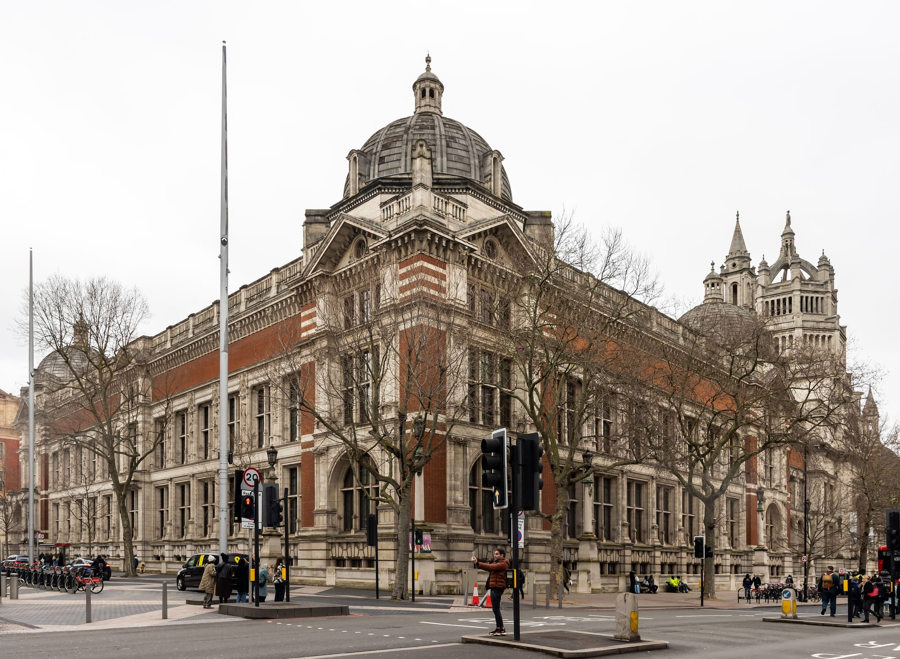
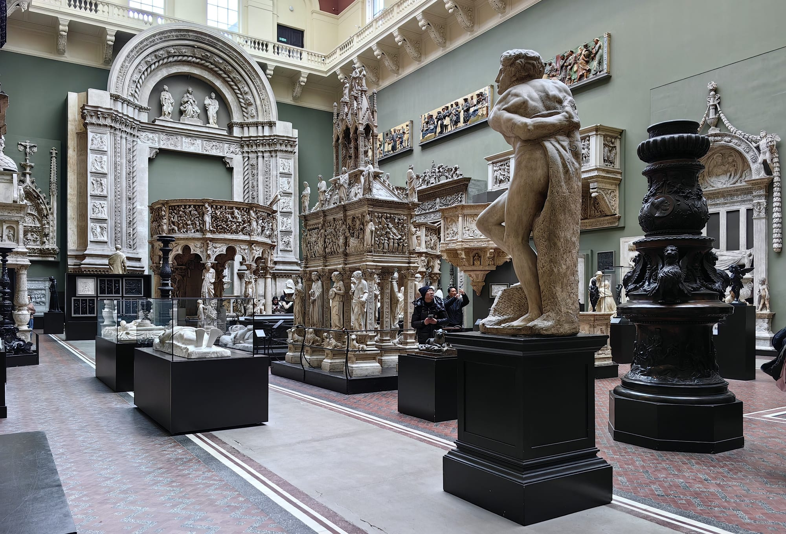
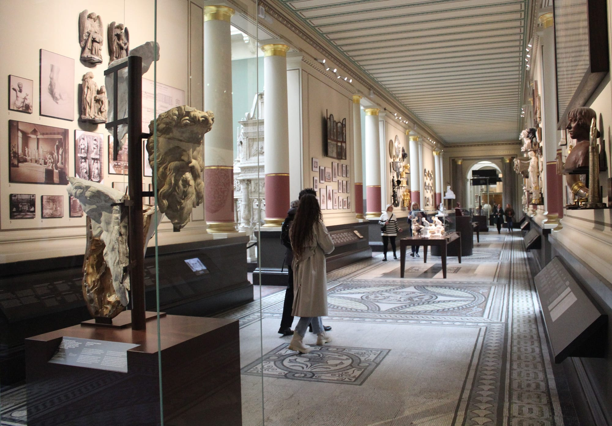
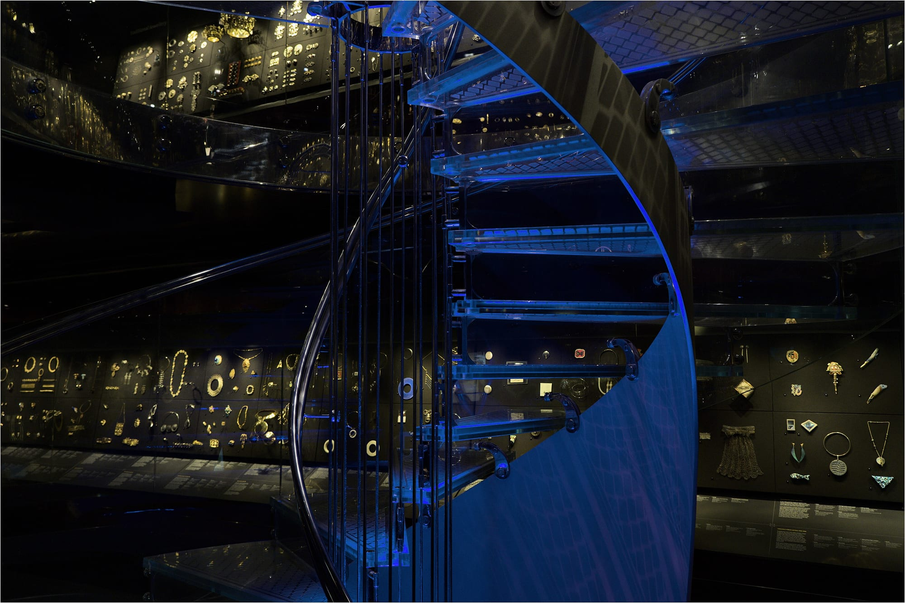
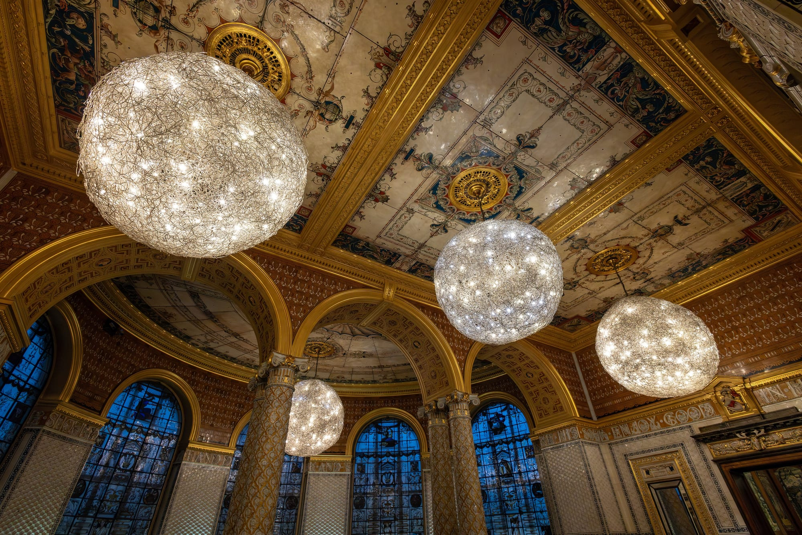
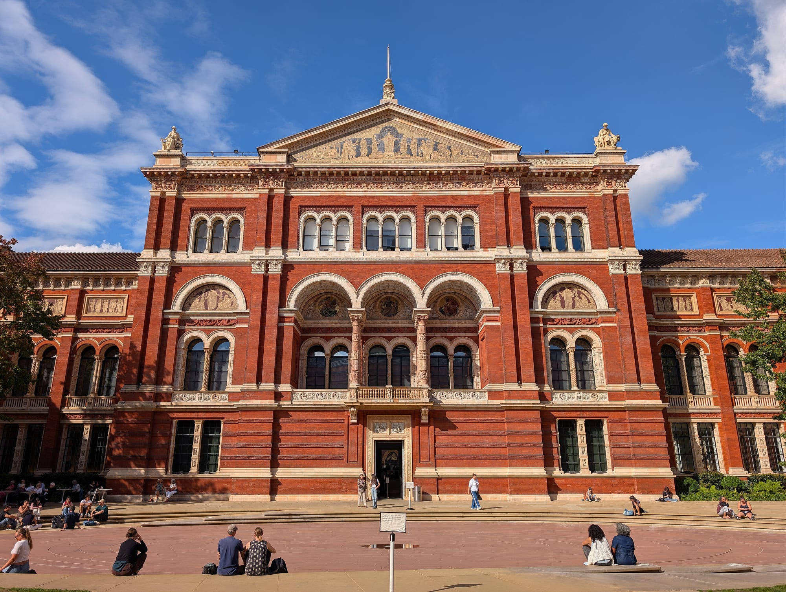

> 💡 **The Short Version:**
> - **Entry is free and needs no booking.** Open daily 10:00 to 17:45 and **Fridays until 22:00**, though some galleries close after 17:45. Closed 24–26 December.
> - **Two paid exhibitions.** **Constantinople to Istanbul: One City, Two Empires** runs to 9 May 2027 (£25 weekdays, £27 weekends). **Rising Voices** runs to 10 January 2027 (£17). The V&A recommends booking ahead.
> - **Free:** the **Freddie Mercury | Splendid Things** trail to 17 January 2027, with no ticket needed.
> - **The galleries to start with:** the Cast Courts, the Raphael Cartoons, the Jewellery galleries, and the refreshment rooms that opened in 1868.
> - **Friday Late** is on the last Friday of most months, free and drop-in. The next is **27 November 2026**.
> - **Closed until 2028:** the Fashion Gallery and the South Asia gallery.
> - **Short on time?** <a href="https://www.getyourguide.com/activity/-t879664?partner_id=WWP7I0R&amp;cmp=v-and-a-guide" target="_blank" rel="sponsored nofollow noopener" data-affiliate="gyg">GetYourGuide sells a guided tour of about 80 minutes</a> that includes entry.

> ⚠️ **The Fashion and South Asia galleries are closed.** The Fashion Gallery (Room 40) reopens in autumn 2028 and the South Asia gallery, home to Tippoo's Tiger, in spring 2028. If either is why you are coming, pick another gallery on the day.

*Prices, opening times and event dates as of 15 November 2026.*

---

## Tickets, hours and exhibitions

*The Aston Webb front. Photo: [Mike Peel](https://commons.wikimedia.org/wiki/File:At_London_2024_038.jpg), [CC BY-SA 4.0](https://creativecommons.org/licenses/by-sa/4.0/).*

**Opening hours:** daily 10:00 to 17:45, Fridays 10:00 to 22:00. Staff start clearing galleries 30 minutes before closing, and some galleries shut after 17:45 on Fridays. The museum is closed on 24, 25 and 26 December. General admission is free and you do not need to book, and Members visit every exhibition free.

The V&A is usually quieter when it opens at 10:00 and towards closing, and busiest at weekends and in school holidays. At peak times there can be a short wait to enter an exhibition.

| Exhibition | Dates | Price | What it covers |
| --- | --- | ---: | --- |
| **[Constantinople to Istanbul: One City, Two Empires](https://www.vam.ac.uk/exhibitions/constantinople-to-istanbul-one-city-two-empires)** | To 9 May 2027 | £25 weekday, £27 weekend | 1,600 years of art and design from one city, in Galleries 38 and 39. The V&A calls it a UK first. Concessions apply and advance booking is recommended. |
| **[Rising Voices: Contemporary Art from Asia, Australia and the Pacific](https://www.vam.ac.uk/exhibitions/rising-voices-contemporary-art-from-asia-australia-and-the-pacific)** | To 10 Jan 2027 | £17 | Works by over 40 creatives, made with QAGOMA in Brisbane, in the Porter Gallery. Concessions apply and advance booking is recommended. |

Disabled visitors get discounted exhibition tickets, and you can add a free companion or carer ticket to each one. Later in 2027 the V&A lists **Punk to Pop** (opens 13 March), **Sculpture in Clay** (29 May) and **Chintz** (18 September), with tickets on sale soon.

**Free displays** run alongside them. **[Freddie Mercury | Splendid Things](https://www.vam.ac.uk/exhibitions/freddie-mercury-splendid-things)** is a no-ticket trail of eight looks from his career across the museum, to 17 January 2027. **The Burberry Trench: Crafting an Icon** runs to 3 January 2027 and **Bharti Kher at the V&A** to 24 January 2027.

For a guided visit, <a href="https://www.getyourguide.com/activity/-t879664?partner_id=WWP7I0R&amp;cmp=v-and-a-guide" target="_blank" rel="sponsored nofollow noopener" data-affiliate="gyg">GetYourGuide sells entry with a guide</a> for about 80 minutes. Check live availability below:

Powered by <a target="_blank" rel="sponsored" href="https://www.getyourguide.com/london-l57/">GetYourGuide</a>

The V&A also runs its own [self-guided trails](https://www.vam.ac.uk/info/va-trails), among them a ten-object Collection highlights trail, an Architectural wonders trail and a Shakespeare's magic trail through the Britain Galleries that takes about 30 minutes.

---

## Friday Lates and Festive Fridays

**The V&A is open until 22:00 every Friday.** Shops stay open until 21:45 and cloakrooms until 21:30.

- **[Friday Late](https://www.vam.ac.uk/info/friday-late):** the last Friday of every month except January, May and December. Free and drop-in, with live performance, film, installations, debate and DJs. The next is **(Im)Possible Bodies on Friday 27 November 2026**. Expect crowds and music, and the Quiet Space may not be available.
- **[Festive Fridays](https://www.vam.ac.uk/event/ox3B2Zkmg7W/festive-friday-nov-dec-2026):** free, on **20 November and 4, 11 and 18 December**. Live music in the Dome includes the Rock Choir at 18:00, 19:00 and 20:00 and Freddie Mercury tribute performances at 18:30, 19:30 and 20:30. Seasonal drinks are sold at the Dome Bar.

---

## The galleries worth the walk

The V&A is a patchwork of Victorian and Edwardian buildings, so use the [digital map](https://www.vam.ac.uk/features/digitalmap/) rather than trying to wander in a line.

### Cast Courts (Rooms 46, 46a and 46b)

*The Cast Courts. Photo: [Thaler Tamas](https://commons.wikimedia.org/wiki/File:Cast_Courts.Victoria_and_Albert_Museum._FotoThalertamas.jpg), [CC BY-SA 4.0](https://creativecommons.org/licenses/by-sa/4.0/).*

Two enormous rooms of plaster copies of sculpture and architecture, built in 1873 and 25 metres high so that the cast of Trajan's Column, split in two, would fit. The collection includes the cast of Michelangelo's *David* and the Pórtico de la Gloria, a copy of a 12th-century portico from Santiago de Compostela. The courts were restored in 2018. In the Central Gallery (Room 46) the mosaic floor was made by prisoners at Woking Female Prison, and museum staff nicknamed it *Opus Criminale*, 'Criminal Work'.

*The Central Gallery, Room 46. Photo: [14GTR](https://commons.wikimedia.org/wiki/File:Room_46,_Victoria_and_Albert_Museum.jpg), [CC0](https://creativecommons.org/publicdomain/zero/1.0/).*

### The Raphael Cartoons

The Raphael Court holds seven full-size designs for tapestries, commissioned by Pope Leo X soon after his election in 1513 for the Sistine Chapel. They show scenes from the lives of Saints Peter and Paul. Of the ten original designs only seven survive, and all seven are here.

### Jewellery

*The William and Judith Bollinger Jewellery Gallery. Photo: [Rob Oo](https://commons.wikimedia.org/wiki/File:Bollinger_Jewellery_Gallery_2023-08-20.jpg), [CC BY 2.0](https://creativecommons.org/licenses/by/2.0/).*

The Jewellery galleries hold over 3,000 jewels covering Europe from ancient times to the present day. Queen Victoria's sapphire and diamond coronet is on permanent display here. Prince Albert designed it in 1840, the year of their wedding, and she wore it instead of her crown to open Parliament in 1866.

### Britain Galleries and the ten-object highlights

- **Britain Galleries (level 1):** the Great Bed of Ware, which Shakespeare mentions in *Twelfth Night*, stands here, and the Shakespeare's magic trail threads through them.
- **Ardabil Carpet:** woven in 1539–40 for a shrine in north-west Iran, dated by an inscription and described by the V&A as the oldest dated carpet in the world.
- **Rodin's *Cybele*, Giambologna's *Samson Slaying a Philistine* and the Mazarin Chest:** all in the ground-floor and Europe 1600–1815 galleries on the Collection highlights trail.
- **Korea Gallery (Room 47g):** closed for redevelopment until December 2026.

### The refreshment rooms and the courtyards

*The Gamble Room. Photo: [The wub](https://commons.wikimedia.org/wiki/File:Gamble_Room,_V%26A_-_2024-01-05.jpg), [CC BY-SA 4.0](https://creativecommons.org/licenses/by-sa/4.0/).*

- **Gamble, Morris and Poynter rooms:** three refreshment rooms opened in 1868, designed by James Gamble, William Morris and Edward Poynter. They were the world's first museum restaurant, and the Gamble Room is covered in majolica tiles with an enamelled iron ceiling, chosen to resist fire, steam and cooking smells. You can sit in them for coffee and cake.
- **Ceramic Staircase:** completed in 1869 with glazed reliefs and hexagonal ceiling tiles. The V&A lists it as open on level 0 only.
- **Exhibition Road Courtyard:** the UK's first porcelain-tiled public courtyard, with 10,000 bespoke ceramic tiles.

### John Madejski Garden

*The John Madejski Garden. Photo: [Andy Li](https://commons.wikimedia.org/wiki/File:John_Madejski_Garden,_Victoria_and_Albert_Museum_2026-09-22.jpg), [CC0](https://creativecommons.org/publicdomain/zero/1.0/).*

A courtyard in the middle of the building, open 10:00 to 17:00 daily, and closing from 16:40. Kim Wilkie designed the pool, lawns and planting. Memorial plaques to Jim, Henry Cole's dog, and Tycho, his son's dog, are to the left of the entrance to the Sculpture gallery, near where the dogs are buried. As of 15 November 2026 the pond is closed until further notice because of the Thames Water hosepipe ban.

---

## With children

- **Free family trails:** the Explore as a Family trail runs past an emperor's throne, dragons, plaster casts and wigs. The Curious Family trail follows Alice in Wonderland clues for about an hour.
- **Learning Centre:** the V&A says free family activities can be picked up there every day.
- **Practicalities:** highchairs are in the cafés, children's meal boxes are £7, baby changing is in most toilets and buggy parks are near both the Cromwell Road and Exhibition Road entrances.
- **Young V&A:** a separate, free children's museum in Bethnal Green, open daily 10:00 to 17:45. See our [best museums in London guide](/articles/best-museums-london/).

For a family day across the three museums, see our [London with Children guide](/articles/london-with-children/).

---

## Food, bags and shops

- **Main Café:** 10:00 to 17:00 and until 21:00 on Fridays, in the Gamble, Morris and Poynter rooms. Hot meals on Fridays stop at 15:00, except on Friday Late nights, when they are served 18:30 to 20:00.
- **Patisserie:** at the Exhibition Road entrance, 10:00 to 17:00 and until 19:00 on Fridays, with pastries, salads and coffee.
- **Garden Café:** closed for the winter season.
- **Prices:** grab-and-go sandwiches from £6.75, a deli selection with two salads £17, hot drinks from £3.40.
- **Picnics:** bottled water is welcome in the galleries. Packed lunches can be eaten in the John Madejski Garden, the Exhibition Road Courtyard and the Learning Centre Lunchrooms outside school visiting hours.
- **Cloakrooms:** at both the Cromwell Road and Exhibition Road entrances. £3 for coats, small bags, umbrellas and child scooters; £5 for a cabin bag (56 × 45 × 21 cm); £7 for larger bags, folding bikes and adult scooters. Wheeled luggage and bags bigger than a cabin bag are not allowed in the galleries. E-bikes and e-scooters are not allowed anywhere on the premises.
- **Shops:** the Main Shop, Fashion Shop and Exhibition Road Quarter Shop open 10:00 to 17:30, and until 21:45 on Fridays.

---

## Accessibility

- **Entrances:** the Cromwell Road and Exhibition Road entrances are step-free. The Tunnel entrance from South Kensington station is not wheelchair accessible.
- **Inside:** step-free access to all public areas, 13 accessible toilets, and a nearest Changing Places toilet at the [Science Museum](/articles/science-museum-guide/).
- **Borrowing aids:** to borrow a wheelchair or walking stick, fill in the V&A's accessibility aid form at least 24 hours before your visit.
- **Quiet Space:** on level 2, off Design 1900–Now (Room 74a), for infant feeding, prayer or a break from sensory stimulation.
- **Planning:** a visual story and a British Sign Language video are on the V&A's [access page](https://www.vam.ac.uk/info/disability-access).

See our [step-free London guide](/articles/step-free-london/) for the Tube.

---

## Getting there

- **South Kensington** (Circle, District and Piccadilly lines) is a five-minute walk and Gloucester Road is ten. The V&A warns that planned Piccadilly line upgrades through 2026 and 2027 may cause disruption.
- **Step-free:** Knightsbridge is a 14-minute walk and Earl's Court is 1.2 miles. London Victoria is step-free too, at 1.3 miles.
- **The station subway:** it runs from inside South Kensington station to the museums; see our [South Kensington guide](/articles/south-kensington-area-guide/).
- **Cycling:** bike hire is on Exhibition Road and Thurloe Place.
- **Blue Badge:** 12 spaces on Exhibition Road, up to four hours, 08:30 to 18:30. They cannot be booked.
- **Next door:** the [Natural History Museum](/articles/natural-history-museum-guide/) and the [Science Museum](/articles/science-museum-guide/) are both on Exhibition Road. Pick one for the other half of the day.
- **East London:** V&A East Museum in Queen Elizabeth Olympic Park, Stratford, is free and open daily 10:00 to 18:00, and until 22:00 on Thursdays and Saturdays, according to the V&A.

---

## Common mistakes

1. **Coming for fashion.** The Fashion Gallery is closed until autumn 2028.
2. **Arriving on a Friday evening expecting every gallery to be open.** The building stays open to 22:00, but some galleries close after 17:45.
3. **Not booking a paid exhibition at the weekend.** Constantinople to Istanbul costs £27 at weekends and the V&A recommends booking ahead.
4. **Taking wheeled luggage.** It is not allowed in the galleries, so use a cloakroom.
5. **Using the Tunnel entrance with a wheelchair.** It is not wheelchair accessible; use Cromwell Road or Exhibition Road.

---

## Continue planning your London trip

- 🏛️ **[South Kensington Area Guide](/articles/south-kensington-area-guide/)**: the station subway, the three museums and where to eat.
- 🔬 **[Science Museum Guide](/articles/science-museum-guide/)**: the free timed ticket, Wonderlab and the galleries worth the walk.
- 🦕 **[Natural History Museum Guide](/articles/natural-history-museum-guide/)**: the three entrances, Hope the blue whale and paid exhibitions.
- 🛏️ **[Where to Stay in South Kensington](/articles/where-to-stay-south-kensington/)**: hotels within walking distance of the museum quarter.
- 🖼️ **[The Best Museums in London](/articles/best-museums-london/)**: how the V&A compares with the others.
- 👨‍👩‍👧 **[London with Children](/articles/london-with-children/)**: pairing South Kensington's museums with parks, boat rides and hands-on galleries by age group.
- ♿ **[Step-Free London](/articles/step-free-london/)**: accessible Tube stations, bus ramps and Changing Places toilets.
- 🌧️ **[London in the Rain](/articles/london-in-the-rain/)**: indoor days across the city.
