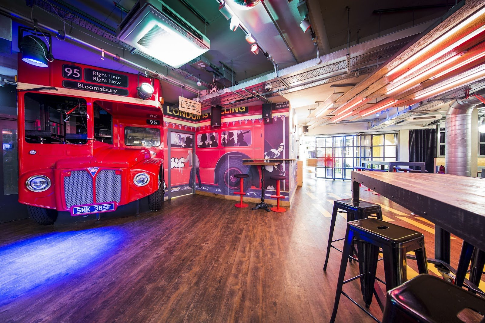
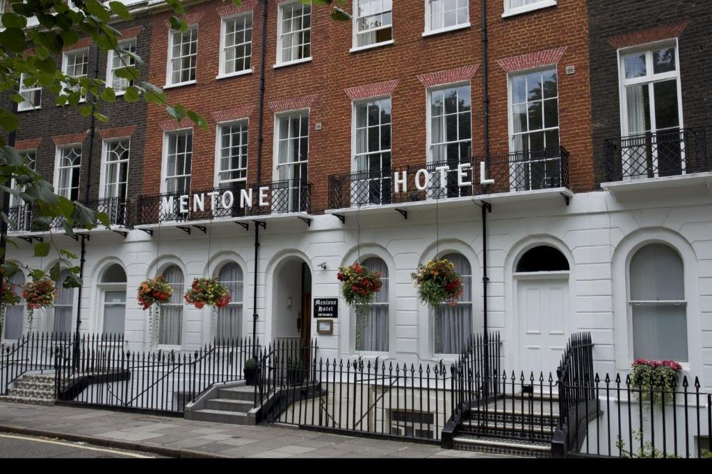
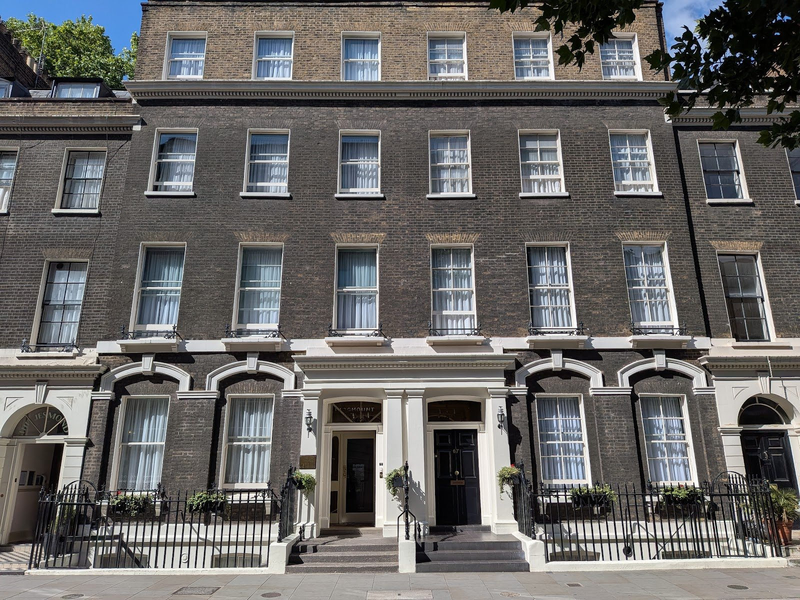
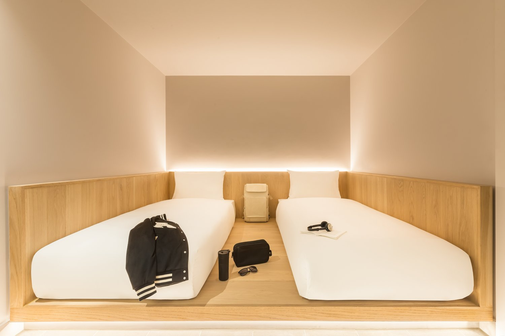
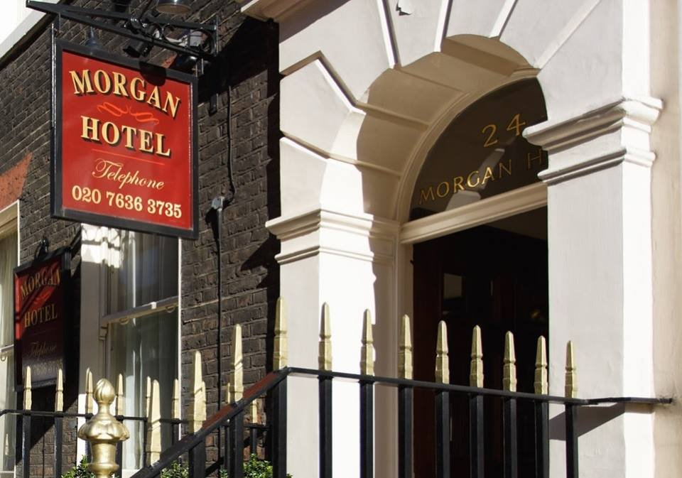
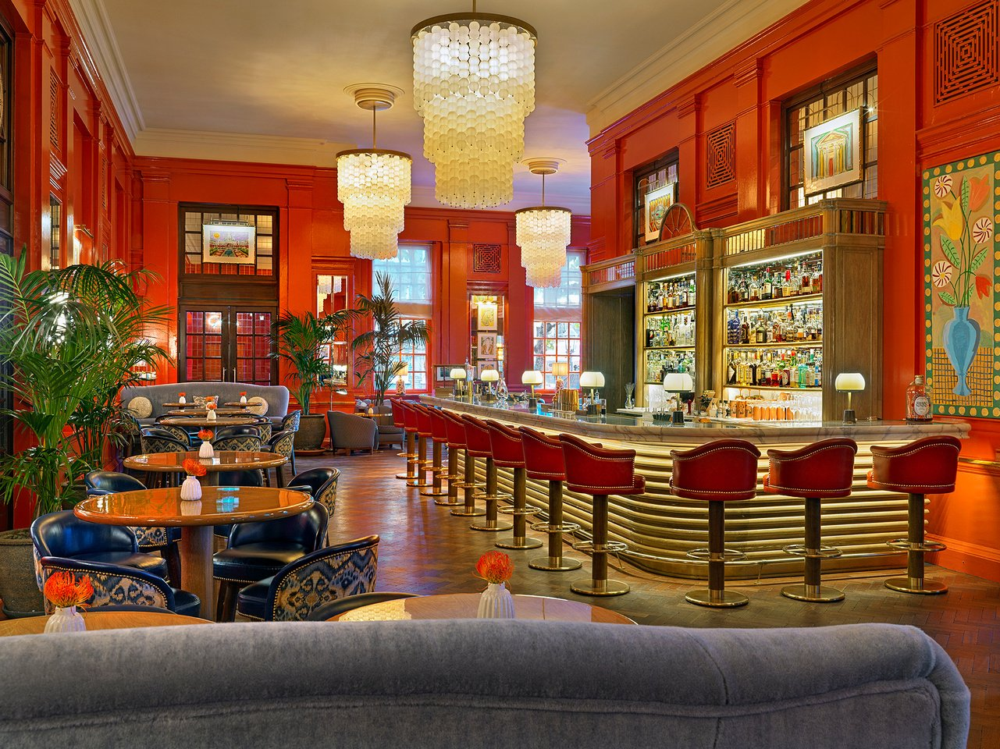
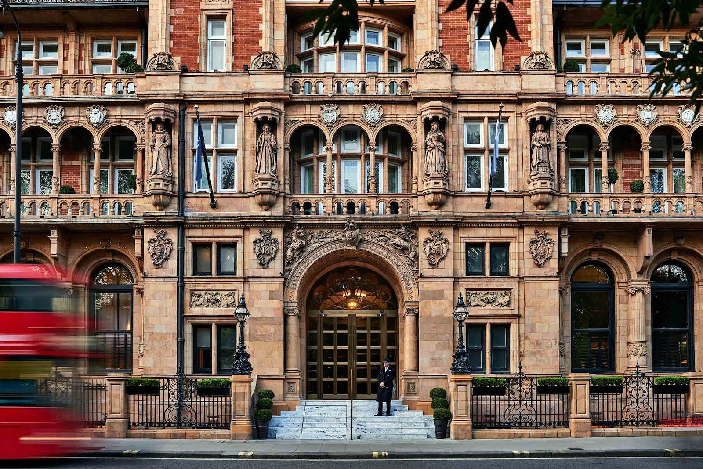
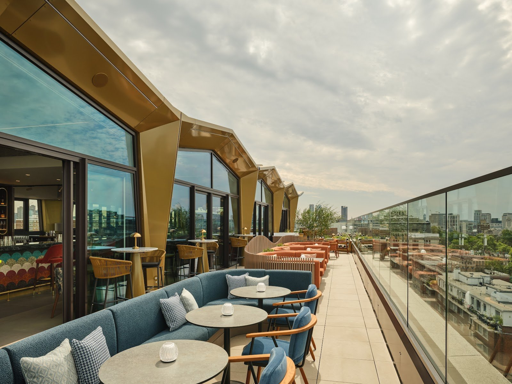

**Bloomsbury runs from a shared dorm bed to a fully relaunched grand hotel inside about ten minutes on foot.** Generator London and Kimpton Fitzroy London sit roughly eight minutes apart.

Zedwell Tottenham Court Road and The Bloomsbury Hotel are both under two minutes from the [British Museum](/articles/british-museum-guide/). Russell Square station is on the Piccadilly line, which runs to Heathrow without a change. The garden squares are quiet at night.

> 💡 **The Short Version:** **[Generator London](hotel:generator-london)** is a bed in a former police building, and it says outright that it is a party hostel — wrong choice before an early train. For a private room without the party, **[Mentone Hotel](https://www.mentonehotel.com/)** and **[Ridgemount Hotel](https://www.ridgemounthotel.co.uk/)** anchor the Cartwright Gardens and Gower Street B&B strip — check which rooms are en suite before you book either. **[Zedwell Tottenham Court Road](hotel:zedwell-tottenham-court-road)** sells a windowless private Cocoon two minutes from the Museum, and **[Morgan Hotel](hotel:morgan-hotel-bloomsbury)** does similar money in family apartments up to 51 sq m. At the top, **[The Bloomsbury Hotel](hotel:the-bloomsbury-hotel)**, **[Kimpton Fitzroy London](hotel:kimpton-fitzroy-london)** and the newly rebuilt **[The Imperial](https://www.imperialhotels.co.uk/hotels/the-imperial/)** all sit on or beside Russell Square.

## Which part of Bloomsbury

**Great Russell Street and the museum precinct**, in the south-west corner, is the British Museum end: Zedwell and The Bloomsbury Hotel are both here, a minute or two from the colonnade. Our [Bloomsbury area guide](/articles/bloomsbury-area-guide/) covers the street itself, including the quieter Montague Place entrance to the museum.

**Russell Square and Montague Street**, the middle of the area, is the grandest run: Kimpton Fitzroy London and The Imperial face each other across the square, and Montague on the Gardens and The Zetter Bloomsbury sit a street over. It is also the best-connected corner — Russell Square station is on the square itself.

**Cartwright Gardens and Gower Street**, running north-west toward Euston Road, is the budget strip: a run of family-run Georgian B&Bs behind a private garden square with its own tennis courts, plus a second cluster along Gower Street. Quality varies between addresses here, so stick to the names below.

**The edges are fuzzy.** Generator London's website files it under "London King's Cross" despite its Tavistock Place address, and Arosfa Hotel's site gives its Gower Street address as Fitzrovia. Treat the boundary as a walk, not a line on a map.

## Where to sleep

### Generator London — the hostel, and it says so itself

*Former police station · 37 Tavistock Place, WC1H 9SE · Russell Square 8 min, King's Cross St Pancras 10 min*

*The bus bar at Generator London.*

A former police station turned hostel: dorms of four to ten, female-only dorms, private rooms, a 24-hour reception and a bar built into the back half of a double-decker bus.

**It is an openly social party hostel**, the right booking if you want to meet people and the wrong one the night before an early train or for a light sleeper.

### Mentone Hotel — Cartwright Gardens, and the garden has tennis courts

*Family-run since 1972 · 54-56 Cartwright Gardens, WC1H 9EL · King's Cross St Pancras about 8 min*

*Mentone Hotel, Cartwright Gardens.*

Three connected Georgian townhouses on Cartwright Gardens, a private crescent with gated gardens and its own tennis courts, run by the same family since 1972. Every one of the forty-plus rooms is en suite, from a single with a three-foot bed up to a family room sleeping five, and the smallest doubles are on the top floor or lower ground, not the street-facing floors.

Breakfast — a cooked English plus a Continental buffet — **is free only when you book directly.** **The building has no lift and no air conditioning**, a condition of the Grade II listing. Free cancellation applies more than 48 hours out.

### Ridgemount Hotel — Gower Street, and not every room is en suite

*32 rooms · 65-67 Gower Street, WC1E 6HJ · Euston Square 5 min*

*Ridgemount Hotel, Gower Street.*

Two Georgian townhouses on Gower Street, thirty-two rooms across four floors. Every room has a smart TV and tea and coffee making facilities, and hot and cold drinks are available in the lounge around the clock.

**Only fifteen of the thirty-two rooms are en suite**, so ask which you are being offered. A full English breakfast is served each morning.

**The wider strip** carries several more of the same shape. **[Celtic Hotel](https://www.celtichotel.com/)**, on Guilford Street, is under a minute from Russell Square station. **[Arosfa Hotel](https://arosfalondon.com/)**, further along Gower Street, keeps a guest-only bar. **[St Athans Hotel](https://www.stathanshotel.com/)**, on Tavistock Place, takes pets. All three serve a complimentary breakfast and sit within five minutes of Russell Square or King's Cross on foot.

### Zedwell Tottenham Court Road — windowless by design, not as a cut-price grade

*206 Cocoons · 112 Great Russell Street, WC1B 3NQ · Tottenham Court Road 3 min*

*A windowless Cocoon room at Zedwell.*

Built inside a disused car park beneath Great Russell Street, two minutes from the British Museum, and billed by Zedwell as London's first entirely underground hotel. Every one of the 206 rooms is windowless, soundproofed and filtered-air: **Cocoon 1 is 10 sq m for one, Cocoon 2 is 12 sq m for two, Cocoon 3 is 14 sq m for three, and Cocoon 4 is 16 sq m for up to four**, each with a rainfall shower and no television built in on purpose.

Every room is windowless, so the choice is only size. Our [windowless hotel rooms guide](/articles/windowless-hotel-rooms-london/) compares this format against the rest of the city.

### Morgan Hotel — the one with the 51 sq m family apartment

*Two buildings, no lift · 24 Bloomsbury Street, WC1B 3QJ · Goodge Street and Tottenham Court Road both a short walk*

*The Morgan Hotel's entrance.*

A family-run hotel spread across two buildings on Bloomsbury Street, a couple of minutes from the British Museum, with a published room list that runs from an 11 sq m single up to a 51 sq m Deluxe Family Apartment with its own kitchen-equipped living space.

**The building has no lift**, so it does not suit anyone who cannot manage stairs with a case. Breakfast is included, with full English, vegan and vegetarian options, and the standard rooms — though not the apartments — are air conditioned.

### The Bloomsbury Hotel — the Doyle Collection's Bloomsbury house

*153 rooms · 16-22 Great Russell Street, WC1B 3NN · Tottenham Court Road and Holborn both about 9 min*

*The Coral Room, The Bloomsbury Hotel.*

A Lutyens-designed neo-Georgian building a minute along Great Russell Street from the museum, run by the Irish family-owned Doyle Collection and named among London's finest hotels in Condé Nast Traveller's Readers' Choice Awards 2025. Three venues: **the Coral Room**, a Martin Brudnizki-designed "Grand Salon Bar"; **the Bloomsbury Club Bar**, built around the 1930s Bloomsbury Set; and **Dalloway Terrace**, the flower-covered terrace restaurant already known to anyone who has read our [Bloomsbury area guide](/articles/bloomsbury-area-guide/).

**It is set up for families as well as couples**: babysitting can be arranged, cookies and milk appear before bed, and play tents are part of the family-room offer, on top of a pet-friendly policy and complimentary gym access on every room type.

### Kimpton Fitzroy London — the one where dogs stay free

*334 rooms · 1-8 Russell Square, WC1B 5BE · Russell Square station under 2 min*

*Kimpton Fitzroy London, Russell Square.*

A full block down the eastern side of Russell Square, interiors by Tara Bernerd & Partners in the 19th-century building, with Fitz's Brasserie, Fitz's Bar, Fitz's Palm Court and an outdoor Terrace.

**Dogs stay free:** no charge and no deposit, though the hotel's own FAQ caps dogs at 35kg, so ring ahead with a big dog. Every dog gets a loaner bed, bowls and a door hanger. A dog-specific room-service menu runs through a partnership with Marleybones, and dog walking and day care can be booked through Paws Galore with 24 hours' notice. Afternoon tea in the Palm Court runs from £49 a head for anyone not staying.

### The Imperial — the one that rebuilt itself in 2026

*357 rooms · 61-66 Russell Square, WC1B 5BB · Russell Square station under 2 min*

*Arcus, on The Imperial's tenth floor.*

**The Imperial has been relaunched** as 357 mid-century-modern rooms across nine new grades, from an entry Access room up to a 57 sq m Beacon suite and the Bloomsbury Beacon suite, which connects two rooms and has two king beds and panoramic views over London.

Arcus, a 324-seat rooftop bar and restaurant on the tenth floor themed around London's weather, opened with the relaunch, alongside Edit Bar & Lounge downstairs. Imperial London Hotels also runs the Bedford, Morton, President, City Sleeper and Tavistock hotels around the same square; the Tavistock is the group's budget end.

**Further options near Russell Square and Montague Street:** **[The Montague on the Gardens](hotel:montague-on-the-gardens)**, a Red Carnation house with a raised garden terrace and live jazz in the Leopard Bar; **[The Zetter Bloomsbury](hotel:the-zetter-bloomsbury)**, a 68-room townhouse hotel across six Georgian buildings that only opened in April 2026; **[The Hoxton, Holborn](hotel:the-hoxton-holborn)**, two minutes over the Holborn line with rooms from a Shoebox grade; and **[Bertrand's Townhouse](hotel:bertrands-townhouse)** on Bedford Place, themed on Bertrand Russell with a cigar garden and jazz nights.

Powered by <a target="_blank" rel="sponsored" href="https://www.getyourguide.com/london-l57/">GetYourGuide</a>

## Where to stay just outside

Three directions if Bloomsbury doesn't fit. If you have not settled on an area at all, our guide to the [best areas to stay in London](/articles/best-areas-to-stay-in-london/) sorts the whole city by what the trip is for.

### Fitzrovia — west across Tottenham Court Road, and quieter again

Immediately west of Zedwell and Gower Street, Fitzrovia swaps the museum crowd for Charlotte Street's restaurants. Our [Fitzrovia area guide](/articles/fitzrovia-area-guide/) covers the neighbourhood itself, and the [Soho and West End guide](/articles/where-to-stay-soho-west-end/) covers the hotels on its far side.

### Holborn — south over the boundary, for a kitchen or a courtyard

**[Rosewood London](hotel:rosewood-london)**, entered through a carriageway into a Belle Époque courtyard on High Holborn, is walkable to both Bloomsbury and Covent Garden. For a kitchen rather than a bar, **[SACO Holborn](hotel:saco-holborn)** on Lamb's Conduit Street puts serviced apartments on a shopping street at Bloomsbury's edge — our [Bloomsbury area guide](/articles/bloomsbury-area-guide/) covers the street itself. Our [Covent Garden guide](/articles/where-to-stay-covent-garden/) has the rest of the Holborn comparison, including the identical room sold for less than its Covent Garden counterpart.

### King's Cross — north, for an early train

King's Cross, ten minutes north, adds the Eurostar and the East Coast Main Line, with a premium for the hotels closest to the concourse. For an early train, our [King's Cross and St Pancras guide](/articles/where-to-stay-kings-cross/) covers which hotels are worth the extra, and the case for sleeping in Bloomsbury instead.

## What you are staying for

Our [Bloomsbury area guide](/articles/bloomsbury-area-guide/) covers what is worth the walk: the British Museum via the quieter Montague Place entrance, the garden squares, Lamb's Conduit Street and the small museums. It is a half-day on foot, nearly all of it free, and none of it more than ten minutes from anywhere on this page.

*Check room grades, policies and your own dates with the hotel before booking.*
