> 💡 **The Short Version:** **[Strand Palace](hotel:strand-palace)** is the safe pick at about £140 — 785 rooms, so it still has stock when everything else has sold out. **[The Z Hotel Covent Garden](hotel:z-hotel-covent-garden)** starts at £70, but that grade has **no window at all**, and the first room here with one is £100. **hub by Premier Inn** on St Martin's Lane is about £95 for 11 square metres, and it has windowless rooms too. **[The Savoy](hotel:the-savoy)** and **[The Londoner](hotel:the-londoner)** stand a few hundred metres from both, at £700 and £450. And **Holborn is ten minutes east and £30 a night cheaper for the identical room.**

Z Hotels runs twelve London hotels and publishes a from-rate for each on one website. **A Z Double — 9 square metres, one window — is £100 at its Covent Garden hotel and £70 at Z Holborn**, which Z's own site gives as five minutes away. For a family: the four-person Z Family is **£155 in Covent Garden and £95 in Holborn**.

So the premium is roughly 40%, and what it buys is the walk home. If you are going to the theatre it usually pays: more than twenty West End houses are within a ten-minute walk of the piazza.

Covent Garden's cheap rooms are 8 to 13 square metres, and some have no window at all. If you want an ordinary double with a window, price Holborn or Bloomsbury ten minutes out before you commit to the postcode.

## Which part of Covent Garden

The name covers about half a mile and shades into other areas.

**The Piazza and the market halls** are the middle: the Apple Market, three licensed busking pitches, and the densest crowds from about eleven to seven. It empties in the evening.

**Seven Dials and Monmouth Street**, north-west, is the quiet corner: independent shops, Neal's Yard, the Donmar Warehouse. None of the hotels below is here.

**The Strand and the river edge**, south, is where the large hotels are — Strand Palace, the Savoy, Wilde on Adam Street. It is a wide traffic road with buses through the night, two minutes from Waterloo Bridge.

**St Martin's Lane and the Charing Cross Road edge**, west, is the loud side, and the noise comes from Soho. hub and the Londoner are both here. Leicester Square is thirty seconds away: handy for the Tube, loud at midnight.

**Bow Street, Drury Lane and the Holborn edge**, east, has the Royal Opera House and Theatre Royal Drury Lane, and room rates drop fastest here.

**Do not plan around Covent Garden station.** Platform access is by four lifts or an emergency spiral staircase of 193 steps, with no escalators at all, and a last flight of stairs down from the lifts means it is not step-free either. Leicester Square is 260 metres away — the shortest gap between any two adjacent stations on the Underground — and quicker in both directions.

## The hotels

### The Z Hotel Covent Garden — the cheapest bed here, and the window costs £30

*£70 windowless, £100 with a window · 113 rooms · 31–33 Bedford Street, WC2E 9ED · Covent Garden 3 min · [check prices](hotel:z-hotel-covent-garden)*

113 compact rooms in a courtyard behind St Paul's Church, thirty seconds from the piazza. Z publishes the floor area of every grade; read that list before you pick one.

**Three of the seven grades have no window.** A Z Inside Single is 8 sq m at £70, an Inside Double 9 sq m at £80, an Inside Queen 11 sq m at £90. The first room with daylight is the **Z Double at £100** — the same 9 sq m as the Inside Double for £20 more. Check the grade name before you pay: the Inside grades are the windowless ones.

**Join Z Member before you book.** It is free, and it adds complimentary evening cheese and wine plus 10% off food and drink, though not breakfast. A Z Club room is a dearer grade that does include breakfast. Café Inigo downstairs does the buffet breakfast and small plates.

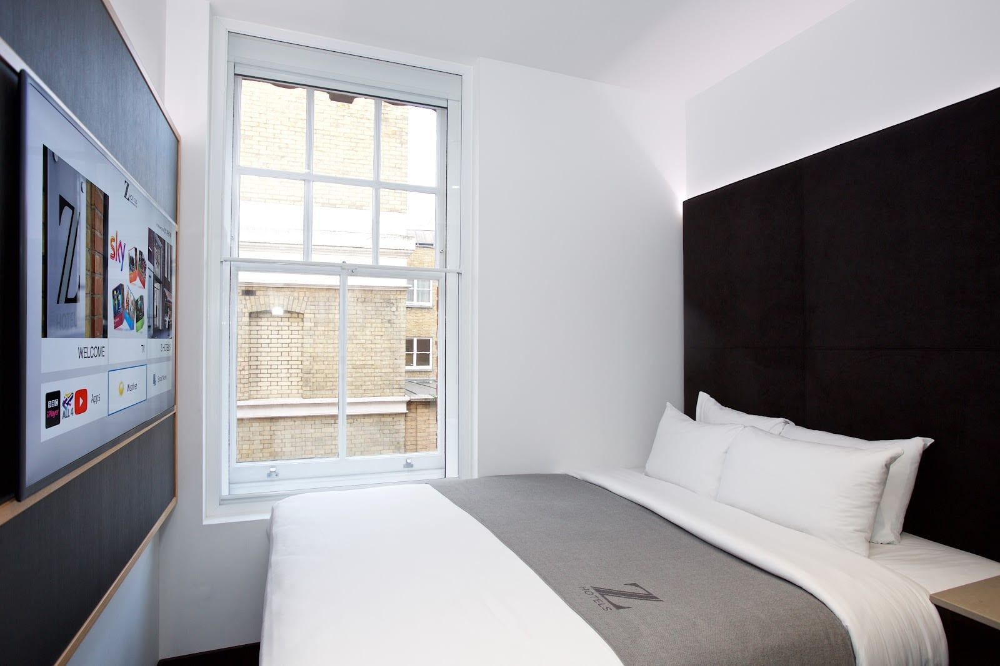

*A room at the Z Hotel Covent Garden.*

### hub by Premier Inn London Covent Garden — eleven square metres on St Martin's Lane

*About £95 · 11 sq m standard rooms · 110 St Martin's Lane, WC2N 4BA · Leicester Square 3 min · [Hotels.com](hotel:hub-covent-garden)*

**The standard room is 11 sq m**: a double bed, underbed storage, a slide-out desk, a 40-inch television and a touchscreen panel that runs the lighting and heating. The bed is the same as in a full-size Premier Inn, in roughly half the floor area.

**Some hub rooms have no window.** Premier Inn sells them as **"ambient rooms"**, with self-dimming backlit boxes and circadian light wells that mimic daylight. Ask which you are being given.

Breakfast is continental and charged separately, and there is no car park.

### Strand Palace — the one that still has rooms

*About £140 · 785 rooms · 372 Strand, WC2R 0JJ · Breakfast £18 · [check prices](hotel:strand-palace)*

Open since 1909, with 785 rooms between the piazza and the river. **When the small hotels are full, this one usually is not**, and it reprices less sharply.

Grades by size: **Classic Single 11 sq m, Classic Double 13 sq m**, then Superior Queen 16, Superior Twin and King 18, and the Deluxe Studio Queen and King at 20 and 21. Two adults with cases should skip the Classic Double and pay for a Superior.

**The Deluxe Studios are the family rooms** and the only grades taking three adults, or two adults and two children under eight. Children under 12 stay free sharing existing bedding, and a cot is free.

**Breakfast is £18 a head**, the gym is free, luggage storage is free before and after but never overnight, the hotel takes no cash at all, and Haxells downstairs runs a pre-theatre menu from midday. Joe Allen, the New York brasserie open since 1977, is in the same building, entered on Burleigh Street.

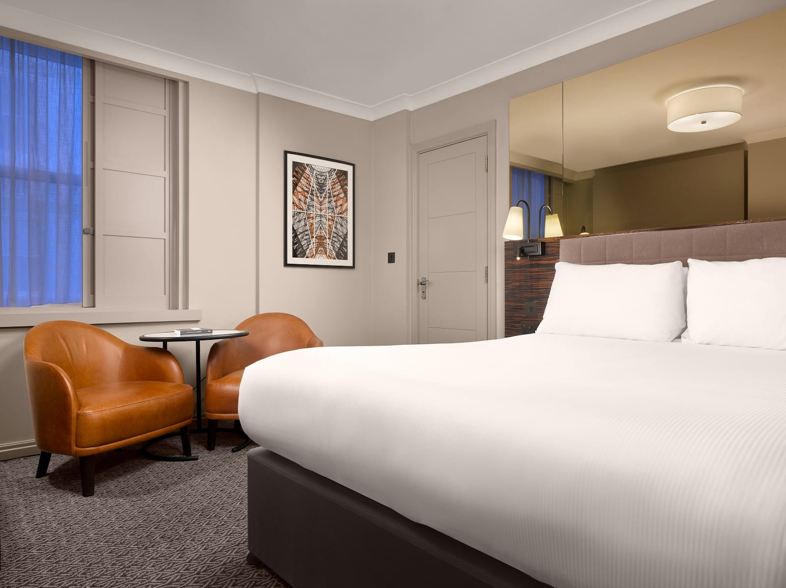

*A room at the Strand Palace.*

### Wilde Aparthotels Covent Garden — a kitchen, and a hard ceiling at three people

*About £185 · Studios with full kitchens · 11 Adam Street, WC2N 6AA · Charing Cross 5 min · [Hotels.com](hotel:wilde-aparthotels-covent-garden)*

Studio apartments with fully fitted kitchens on Adam Street, a turning off the Strand with theatres across the road. It is the only property in this guide with a kitchen, which saves eating out three times a day.

**The ceiling is three people, and it catches families out.** The unit list runs Wilde Bedroom, Studio, Twin Studio and Superior Studio, plus a Hideaway version of the first two, and the largest of them sleeps three. There is no two-bedroom apartment at this address. A family of four needs two units or a different hotel.

**Housekeeping is weekly rather than daily.** On a stay of a week or more the studio is cleaned on the fourth day and once a week after that; an extra clean is £20. Reception is staffed around the clock and check-in can be done online.

One booking trap: the building is sold twice on the booking sites, as Wilde Covent Garden and as Wilde by Staycity The Strand. Same address, two listings, two prices — compare both.

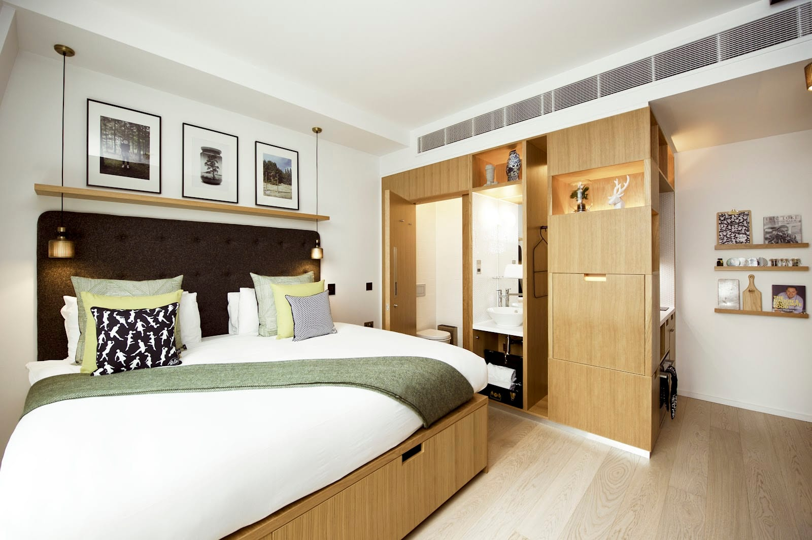

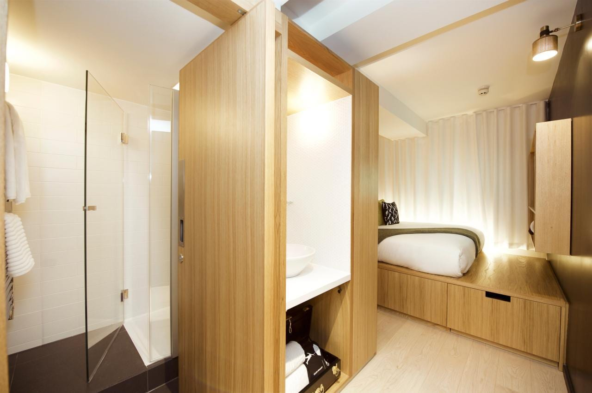

*A studio at Wilde Aparthotels Covent Garden.*

### The Londoner — sixteen storeys, six of them underground

*About £450 · 350 rooms and suites · 38 Leicester Square, WC2H 7DX · Pool, hydropool, sauna, steam*

It is on Leicester Square, five minutes west of the piazza: sixteen storeys, six of them below ground, 350 rooms, with a ballroom, a screening room and a wellness floor in the basements.

**The entry-level King Room is 24 sq m**, against 18 sq m for a Standard at Broadwick Soho at the same price. Deluxe Kings are 29, the Junior Suite 40, the Corner Suite 52.

**The Retreat** has a pool and a hydropool, sauna, steam room and bookable poolside cabanas, open 6am to 10pm, with **children restricted to set hours** — roughly 10.30am to noon and 3.30pm to 5pm on weekdays.

Your room key also opens The Residence: three guest-only rooms including a whisky parlour behind a hidden door with more than fifty bottles.

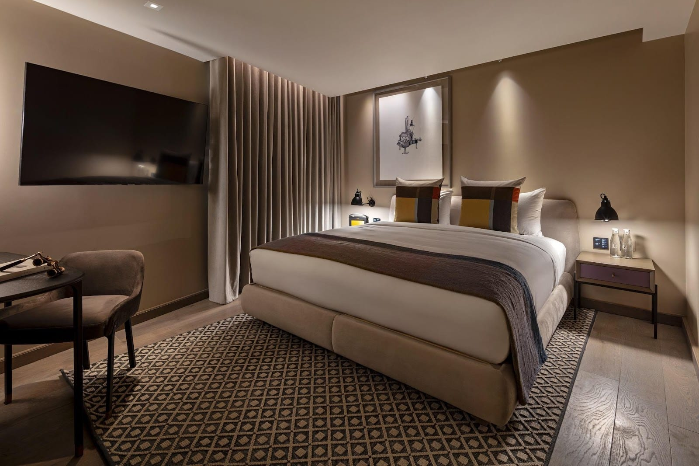

*A room at the Londoner.*

### The Savoy — where the river view starts at suite level

*About £700 · Strand, WC2R 0EZ · Pool, gym, three treatment rooms · Check-out noon*

**Before you spend £700, know that the river is not included.** Work through the room list and every grade below suite level faces the city, the courtyard or the Embankment gardens: Superior Queen 27 sq m, Deluxe King 31, Luxury King and Luxury King Garden View 34, Luxury Double Double 39. **The cheapest room with a river view is the Junior Suite River View.** If you are booking for the Thames, you are booking a suite.

There is a naturally lit pool, a gym, sauna, steam room and three treatment rooms; in-house guests swim free, and children from 9am to 5pm every day. Our guide to [London hotels with a pool](/articles/hotels-with-pool-london/) also covers One Aldwych's 18-metre pool around the corner. Housekeeping is daily with evening turndown, and check-out is noon, not eleven.

**The cheap way in is the archive tour.** The hotel's archivist runs a guided tour of the public rooms, finishing with a glass of champagne in the American Bar; you arrange it by emailing the hotel.

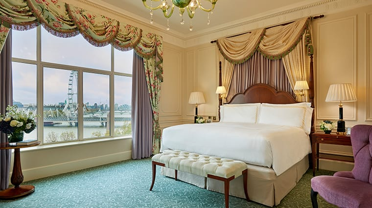

*A river-facing suite at the Savoy.*

Powered by <a target="_blank" rel="sponsored" href="https://www.getyourguide.com/london-l57/">GetYourGuide</a>

## Where to stay just outside

The premium above is a real £30 to £60 a night, and the areas that undercut it are all within about ten minutes on foot.

If you have not settled on a part of London yet, our guide to the [best areas to stay in London](/articles/best-areas-to-stay-in-london/) sorts the whole city by what the trip is for.

### Holborn — ten minutes east, and £30 less for the identical room

**Z Hotel Holborn is at 75 Kingsway**, which Z's own site places five minutes from Covent Garden. It sells the same rooms for less: the **Z Double at £70 against £100**, the Z Queen at £75 against £105, and the four-person **Z Family at £95 against £155**. Same brand, room names and floor areas.

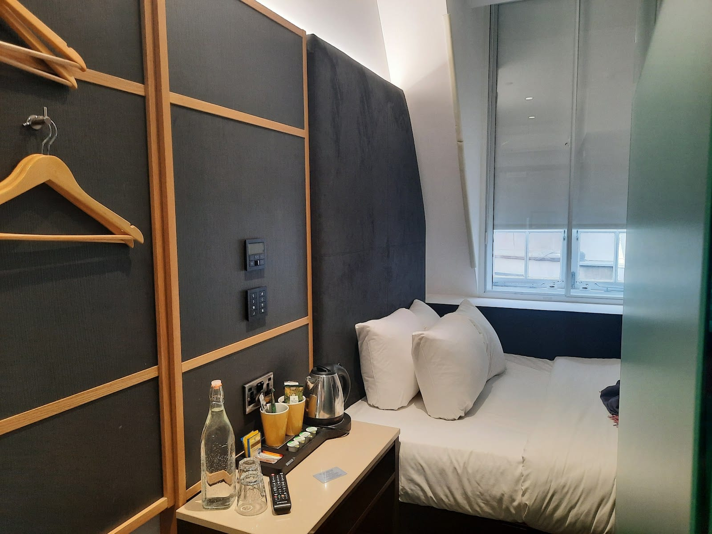

*A room at the Z Hotel Holborn.*

You give up the piazza on the doorstep; the walk to the theatres is nine minutes along Kingsway at any hour. You gain **Holborn station, which adds the Central line** to the Piccadilly, faster for the City, Stratford and the east. The [Hoxton Holborn](hotel:the-hoxton-holborn) is up the road at about £190 for the design-hotel version, and the [British Museum](/articles/british-museum-guide/) is ten minutes north.

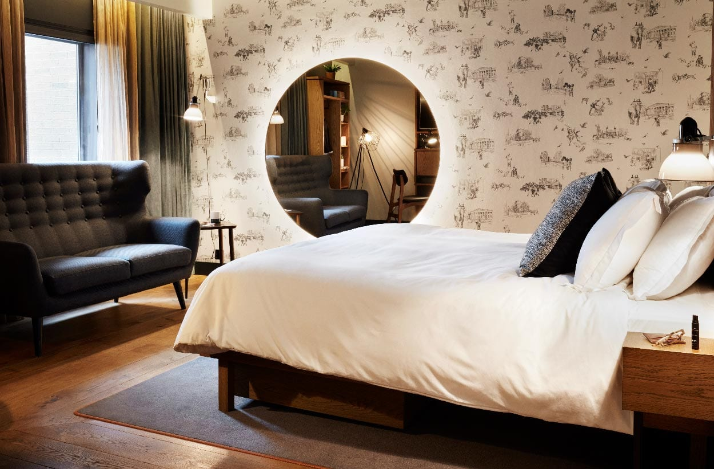

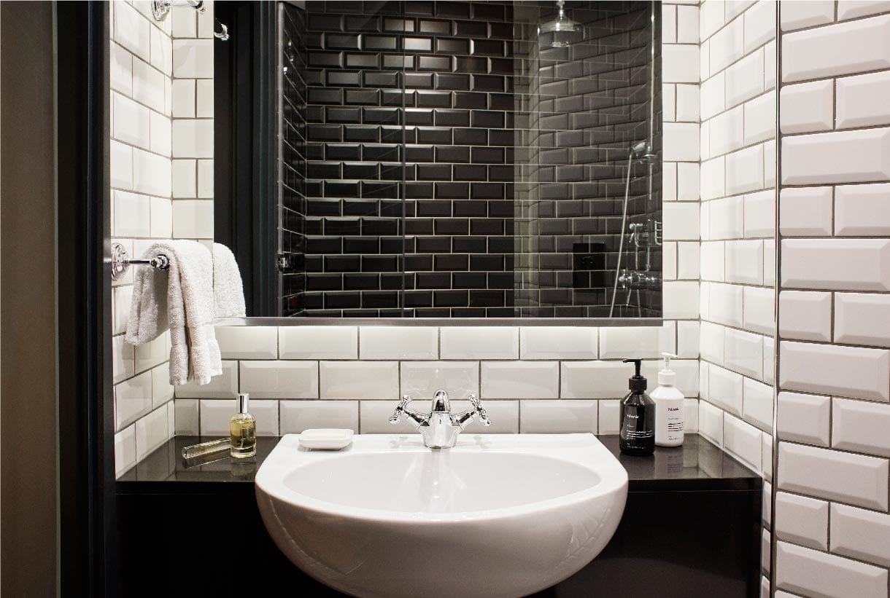

*A room at the Hoxton Holborn.*

### The South Bank and Bankside — over the bridge, with a walk back

**[citizenM London Bankside](hotel:citizenm-bankside)** is about £160 and sells one room type only: a wall-to-wall window, a tablet that runs the blinds and the lights, and a bed that fills the width of the room. **Premier Inn London County Hall** is about £110. And **[St Christopher's Village](hotel:st-christophers-village)** at London Bridge starts around £53 for a double capsule; our [capsule hotels guide](/articles/pod-hotels-london/) covers it.

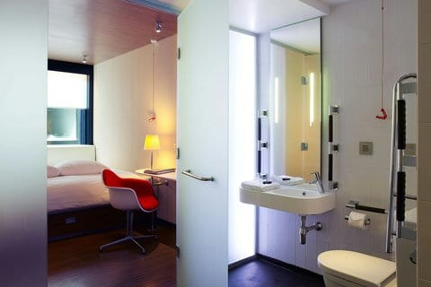

*A room at citizenM London Bankside.*

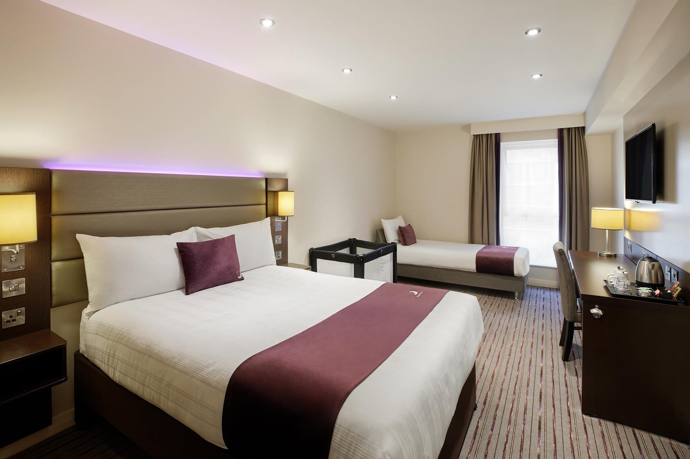

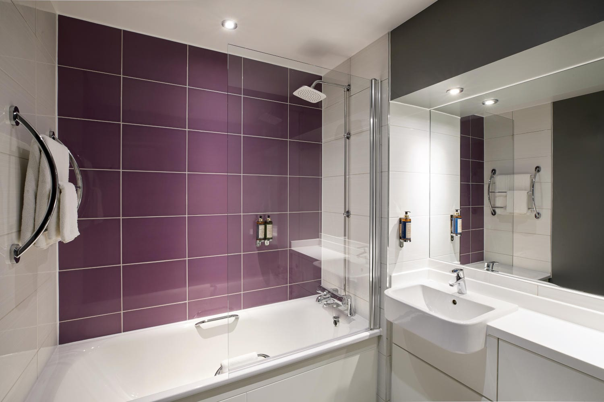

*A room at Premier Inn London County Hall.*

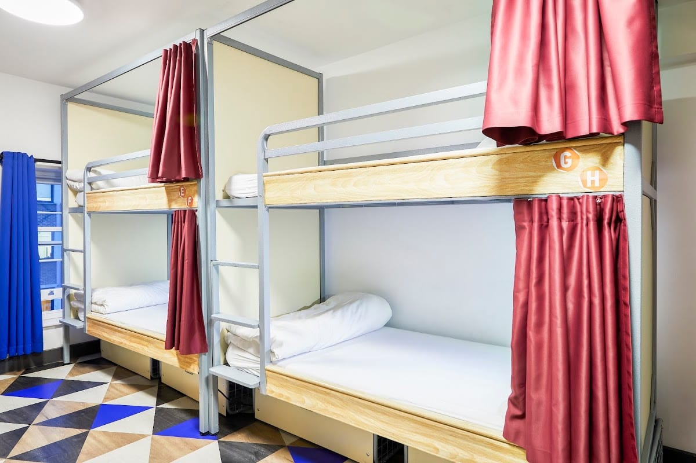

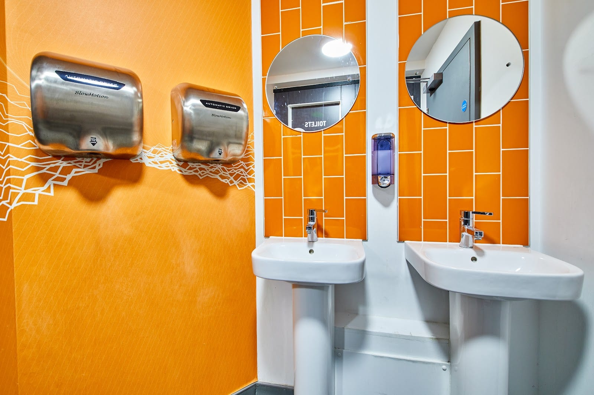

*A dorm at St Christopher's Village.*

Waterloo Bridge is ten minutes from the piazza on foot. Staying south swaps the nightly premium for a walk home along the river rather than through Leicester Square.

### The rest of the West End

Our [Soho and West End guide](/articles/where-to-stay-soho-west-end/) covers the area north of the piazza. Three hotels from it apply here.

**[Zedwell Tottenham Court Road](hotel:zedwell-tottenham-court-road)** is a windowless room from £81, two minutes from the British Museum; if you were going to book a Z Inside grade anyway, price this one first. **[Generator London](hotel:generator-london)** on Tavistock Place is about £26 a bed and a party hostel, a poor choice before an early flight. **[Treehouse Hotel London](hotel:treehouse-hotel-london)** is about £250 for a room on the top floors beside Broadcasting House, four minutes from Oxford Circus, with a panorama out of every window instead of a light well.

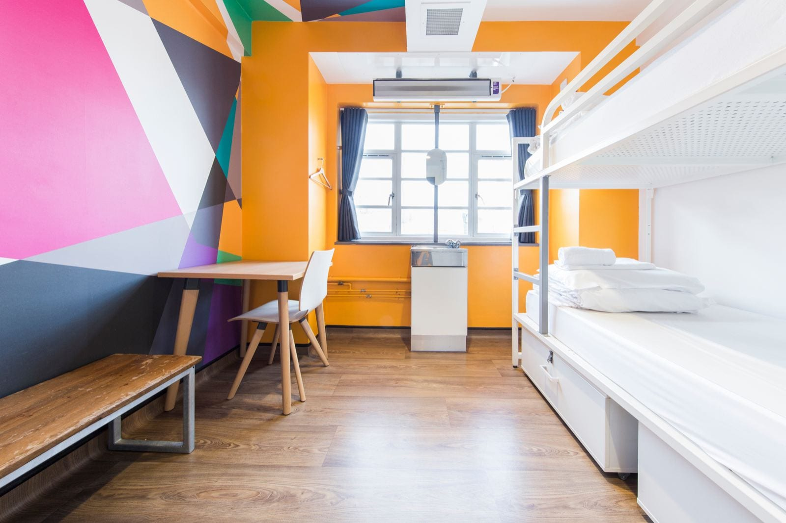

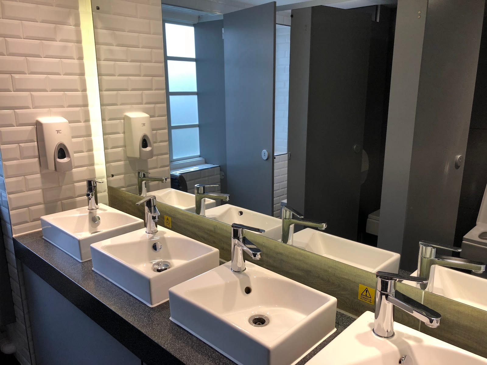

*A dorm at Generator London.*

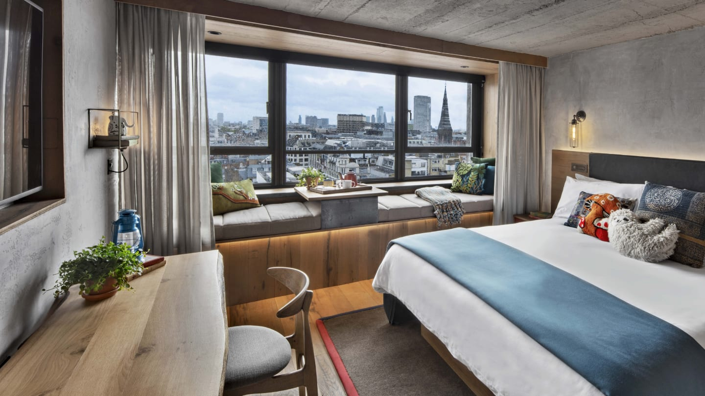

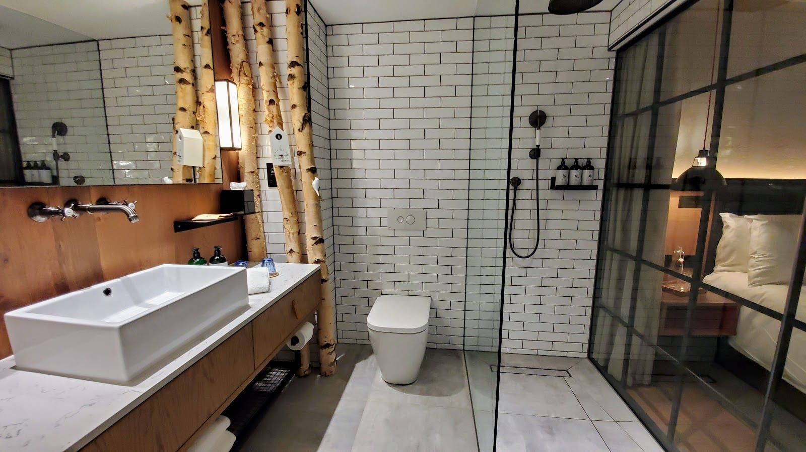

*A room at the Treehouse Hotel London.*

Powered by <a target="_blank" rel="sponsored" href="https://www.getyourguide.com/london-l57/">GetYourGuide</a>

## The noise question, and why Covent Garden is not Soho

Covent Garden and Soho are loud in different ways.

**Covent Garden's crowd has a finishing time.** The piazza fills with shoppers and buskers by mid-morning and empties after the theatres turn out. By half past eleven the cobbles are quiet in a way Wardour Street never is.

**The loud edge is the west, and it is Soho's noise.** St Martin's Lane, Charing Cross Road and the Leicester Square end run late seven nights a week. If you want quiet, book east of the piazza — Bow Street, Drury Lane, the Holborn side — not west of it.

**The Strand** has night buses, sirens and street cleaning. Ask for a room facing away from it when you book, not at check-in.

## What you are staying for

If you picked the area for the theatre, our [London theatre guide](/articles/london-theatre-guide/) covers day seats, returns and which houses are worth the balcony.

For the area itself, the [Covent Garden area guide](/articles/covent-garden-area-guide/) covers the piazza, Seven Dials, Neal's Yard and where to eat before curtain-up.

## Getting in and out

**Charing Cross** is the one to book near if you are arriving by train from the south — Northern and Bakerloo lines plus mainline services, and about five minutes from the piazza.

**Leicester Square** is Piccadilly and Northern, and it is the station to use instead of Covent Garden.

**Holborn** adds the Central line, which is the fast route east to the City and Stratford.

**Embankment** is District, Circle, Bakerloo and Northern, and it is the quiet way in and out of the south of the area.

**The Piccadilly line runs all night on Fridays and Saturdays**, so you can get back from Heathrow or home from a show without a taxi.

**For Heathrow**, walk the ten minutes to Tottenham Court Road and take the Elizabeth line. It beats the direct Piccadilly line from Covent Garden or Leicester Square even after the walk.

*Room grades, floor areas and the Z Hotels and hub rates are from each operator's own website; the approximate figures elsewhere are typical nightly prices, not quotes. A from-rate is the cheapest night of the year rather than the night you want, and prices move nightly, so check your own dates.*
