The hotels below run from about **£110 to £250 a night**, and most of the design hotels sit between £180 and £250.

Shoreditch is also loud. The streets around Great Eastern Street and Curtain Road are a nightlife district, and on a Friday people are still on them at three in the morning.

So this covers two questions: **which Shoreditch hotel**, and **where to stay near Shoreditch** if you would rather not pay the premium or be woken by it.

> 💡 **The Short Version:** **[The Hoxton](hotel:the-hoxton-shoreditch)** is the best all-rounder at about £200. **[The Z Hotel](hotel:z-hotel-shoreditch)** is the cheapest at £110, but its lowest rate is a windowless room. **[art'otel Hoxton](hotel:artotel-london-hoxton)** has two rescued Banksys on the outside of the building, free to see. For the area without the price, **Stratford** is fifteen minutes away from about £100, and **the City of London** is often cheapest at weekends.

## Which part of Shoreditch

The name covers about a mile, and the two ends are the difference between a good night's sleep and a bad one.

**Great Eastern Street, Curtain Road and Old Street** are the nightlife core: bars, clubs, queues, and street noise until the early hours at weekends. Several of the hotels are here. Book a room off the street.

**Spitalfields and the Liverpool Street edge**, to the south, is Georgian, quieter, and a ten-minute walk from the Elizabeth line. Stay here for Shoreditch in the evening and sleep at night.

**Hoxton and the north end**, up towards Hoxton Square and Kingsland Road, is more residential, slightly cheaper, and a longer walk to a Tube station.

**There is no Tube station called Shoreditch.** Shoreditch High Street is Overground, Old Street is the Northern line, Liverpool Street is everything including the Elizabeth line.

## The hotels

### The Hoxton, Shoreditch — the best all-rounder

*About £200 · Breakfast included · Shoebox to Roomy · [check prices](hotel:the-hoxton-shoreditch)*

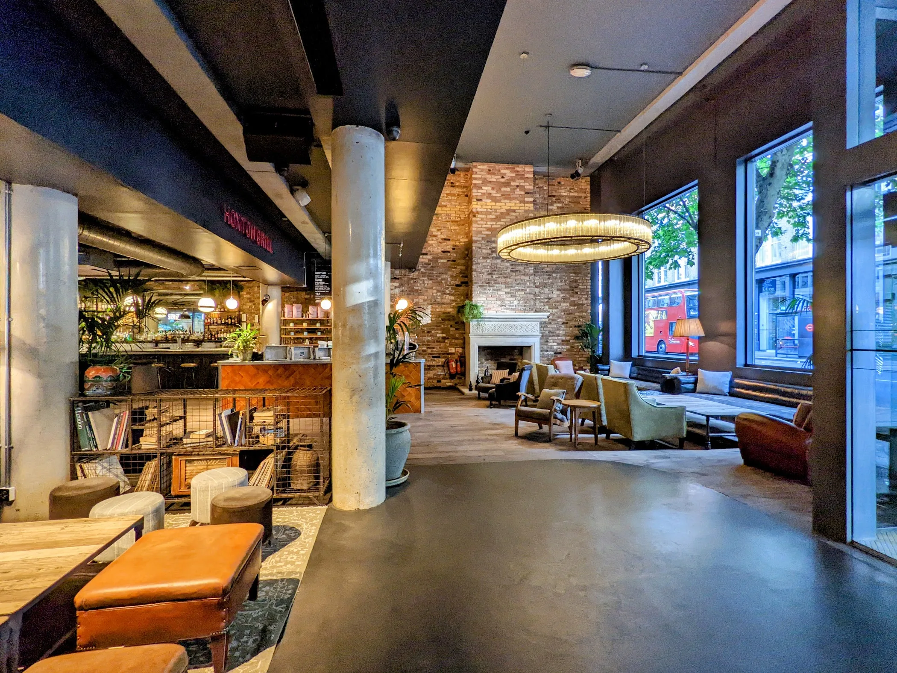

*The Hoxton, Shoreditch — the lobby and a twin room.*

An open lobby used as a workspace. The ground floor is full of locals working and meeting, not only guests.

**Breakfast is a bag hung on your door**, included in the rate.

Room grades are named by size and the naming is literal: **a Shoebox is exactly what it says**, then Snug, Cosy and Roomy. Pick the grade on the number, not the adjective.

### The Z Hotel Shoreditch — the cheapest, with a catch

*About £110 · Breakfast is charged separately · [check prices](hotel:z-hotel-shoreditch)*

A compact-room hotel on the Shoreditch edge of the City. Breakfast is bought in the Z Cafe: the free Z Member scheme adds evening cheese and wine and 10% off food and drink, but excludes breakfast, and only the pricier Z Club room grade has breakfast in the rate.

**The cheapest rate is an "Inside" room, which has no window at all**, the same format as the Covent Garden branch, and people book it by accident because the booking page does not lead with it. Pay up a grade unless you do not mind.

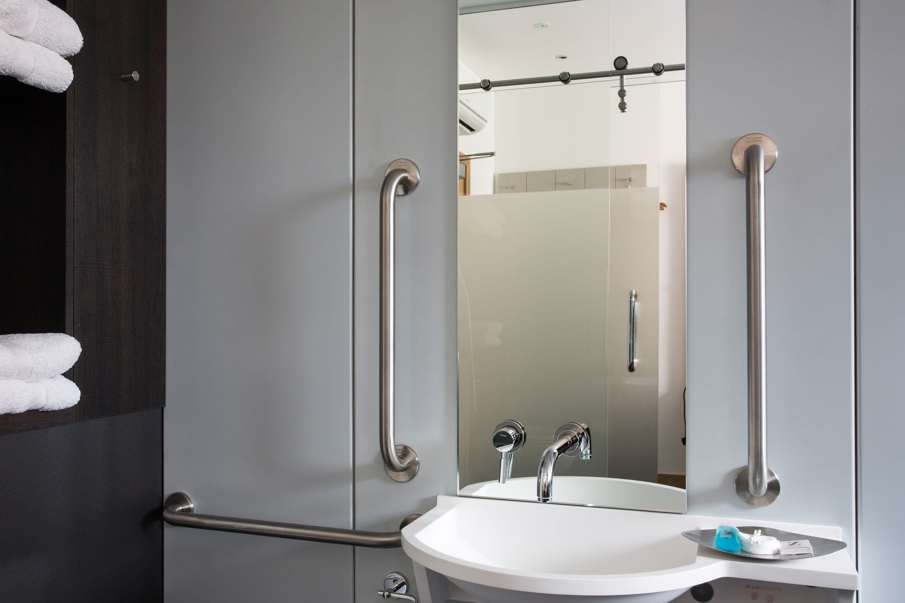

*A room at the Z Hotel Shoreditch, and its ensuite bathroom.*

### One Hundred Shoreditch — the calm one

*About £180 · Six bars and restaurants · [check prices](hotel:one-hundred-shoreditch)*

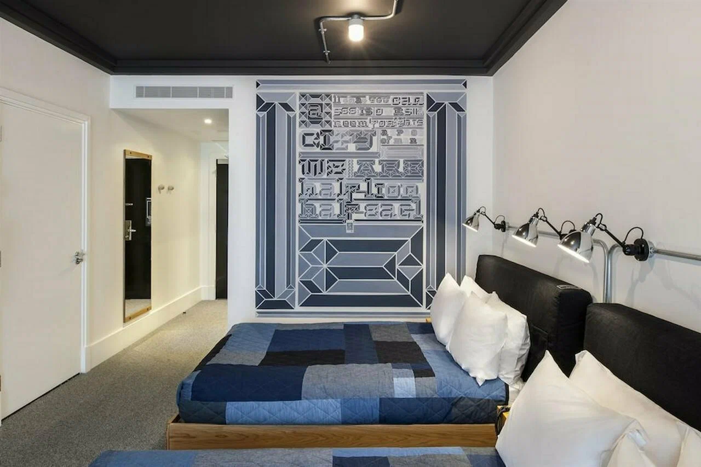

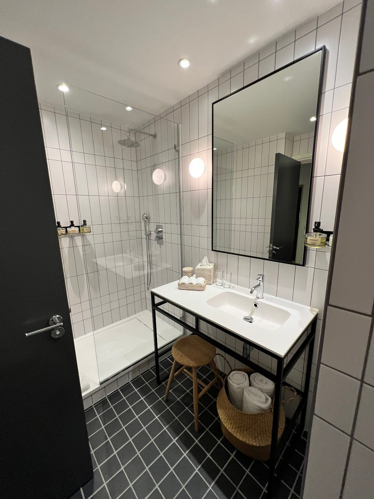

*One Hundred Shoreditch — a twin room and the bathroom.*

Rooms vary a lot: whitewashed walls, tapestry hangings and pine in some, a wall-filling graphic mural and patchwork quilts in others, with DS & Durga toiletries throughout.

**This is the former Ace Hotel building**, and booking sites still file it under the old name. Its six bars and restaurants, including a rooftop, are open to non-residents, which is good for the area and less good for quiet.

### Redchurch Townhouse — Soho House without the membership

*About £220 · Thirty-seven rooms · Cecconi's downstairs · [Soho House's site](hotel:redchurch-townhouse)*

Thirty-seven rooms in a 1970s interior with Cowshed products. **Shoreditch House is round the corner**, a members' club whose bedrooms also take non-members, with the rooftop pool and gym included for the stay (our [members' clubs guide](/articles/private-members-clubs-london/) has the details).

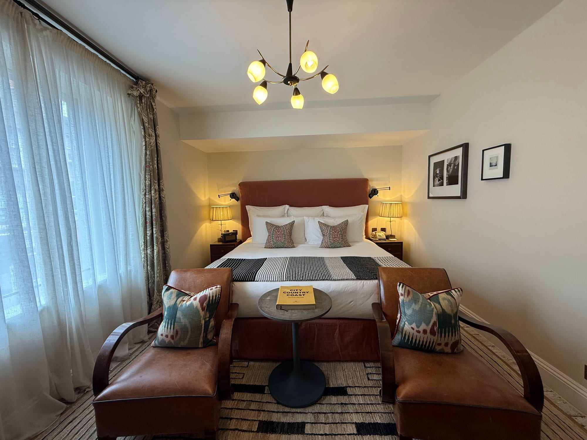

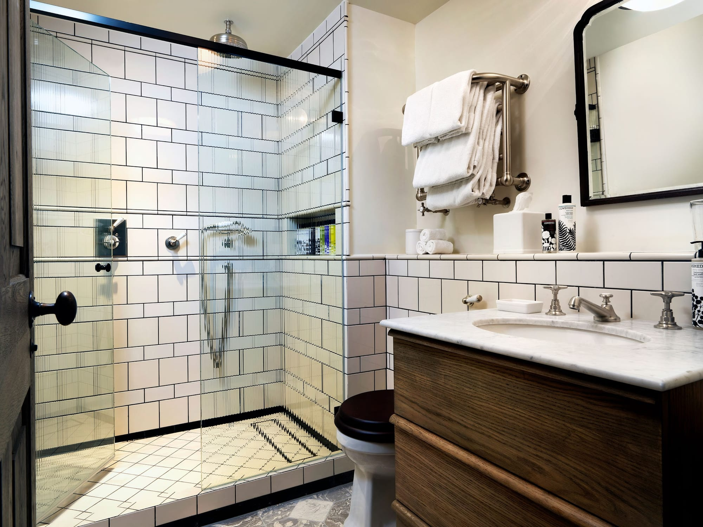

*Redchurch Townhouse — a room and the bathroom.*

It sits on Whitby Street, a side turning off Redchurch Street, which makes it quieter than its address suggests. **Cecconi's on the ground floor is open to non-residents** and busy on a Friday, so the lobby is not a quiet place to arrive into.

**With thirty-seven rooms it sells out before the big hotels do.** Book earlier than you would for One Hundred or the Hoxton, and note that **breakfast is charged on top** of the £220.

### Batty Langley's — the period one

*About £230 · No lift, no air conditioning · Seven minutes from Liverpool Street · [check prices](hotel:batty-langleys)*

Dark walls, floor-to-ceiling silk curtains, antiques and oil paintings on a cobbled Spitalfields street, next door to Dennis Severs' House.

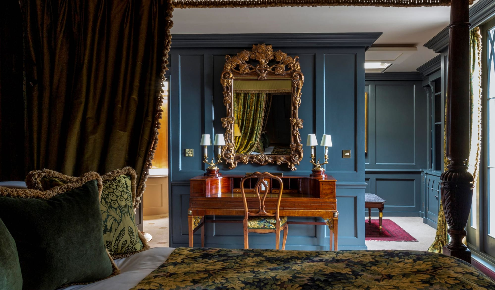

*One of Batty Langley's rooms.*

**No lift and no air conditioning.** The staircase is Georgian and narrow, so ask for a lower floor if a July heatwave or a heavy case worries you.

**Rooms are individually decorated**, so the room you see online is the room. Doubles and suites only.

It is on Folgate Street, **seven minutes from Liverpool Street**, on the quiet side of the area: Georgian terraces, not nightlife. **Breakfast is extra.**

### Aethos London Shoreditch — the wellness rebrand

*About £250 · Underground spa · Formerly Nobu Hotel · [check prices](hotel:aethos-london-shoreditch)*

A wellness-minded rebrand of the former Nobu Hotel Shoreditch, with floor-to-ceiling windows, a members'-club feel and an underground spa with steam and sauna, minutes from Brick Lane and Old Street.

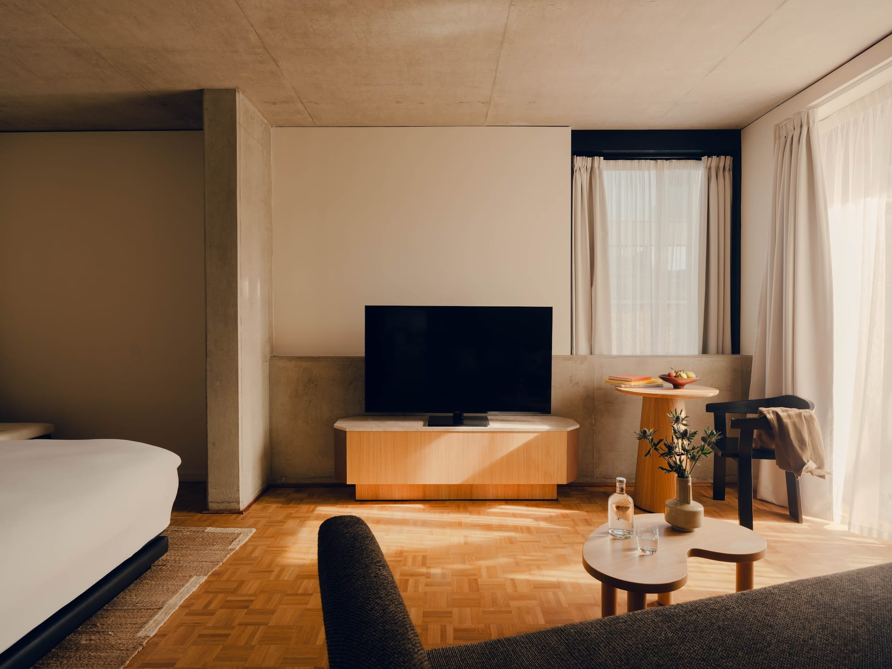

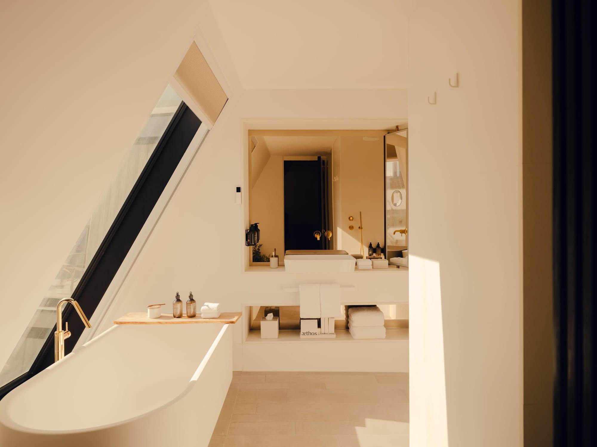

*Aethos London Shoreditch — a room and the bathroom.*

**Rooms lean small for the price.** There are four grades — double, executive, premium and Skyline suite — and **the top-floor Skyline rooms have private balconies**.

Check whether your rate includes spa access when you book; that is where the difference between this and One Hundred at £180 sits.

Willow Street is a side street off Great Eastern Street, **close enough to the nightlife core to hear it at weekends**, so ask for a room off the front. **Breakfast is extra.**

### Virgin Hotels London-Shoreditch — the rooftop pool

*About £250 · Heated rooftop pool, open all year · [check prices](hotel:mondrian-shoreditch)*

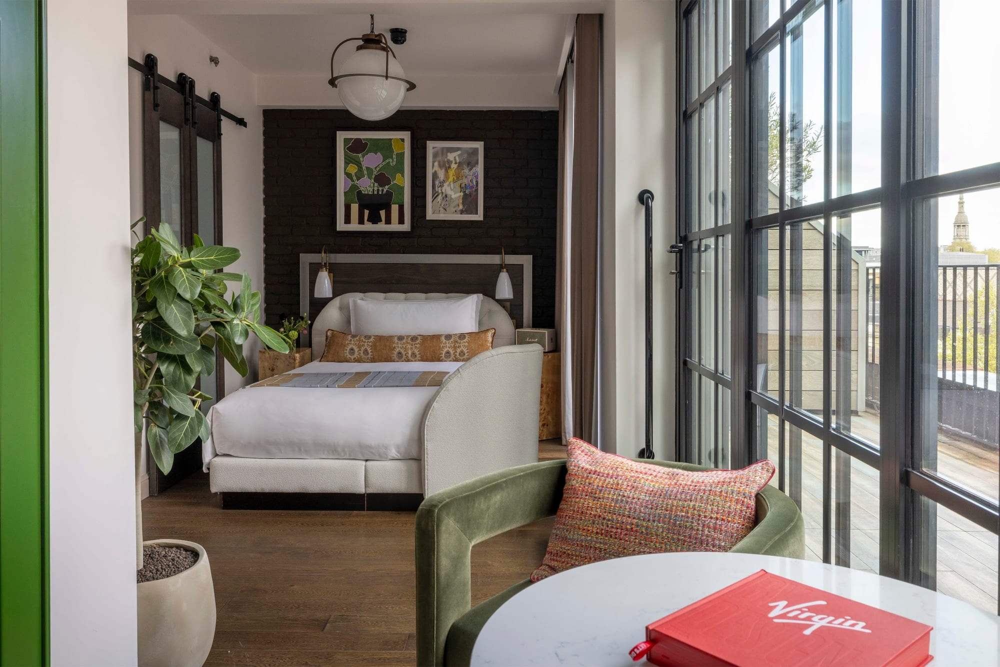

*Virgin Hotels London-Shoreditch — the rooftop pool and a room.*

A heated rooftop pool and terrace, open year-round.

**This building is on its third name.** It was The Curtain, then Mondrian Shoreditch, and has been Virgin Hotels London-Shoreditch since August 2024, Virgin's first London property. Some booking listings still use the previous names.

**The pool takes no reservations.** It is first come, first served, shared with members of the 45 London club: open to those aged 18 and under from 7am to 3pm and to adults aged 21 and over from 3pm to 9pm. Our guide to [London hotels with a pool](/articles/hotels-with-pool-london/) has the other rooftop pools.

### nhow London — the loud one, deliberately

*About £150 · Punk-meets-high-tech · 2 Macclesfield Road, EC1V 8DG · [check prices](hotel:nhow-london)*

A Project Orange interior with a Big Ben rocket sculpture in the lobby and graffiti throughout. **The theme is committed rather than tasteful**, so it is the wrong hotel if you want a calm room.

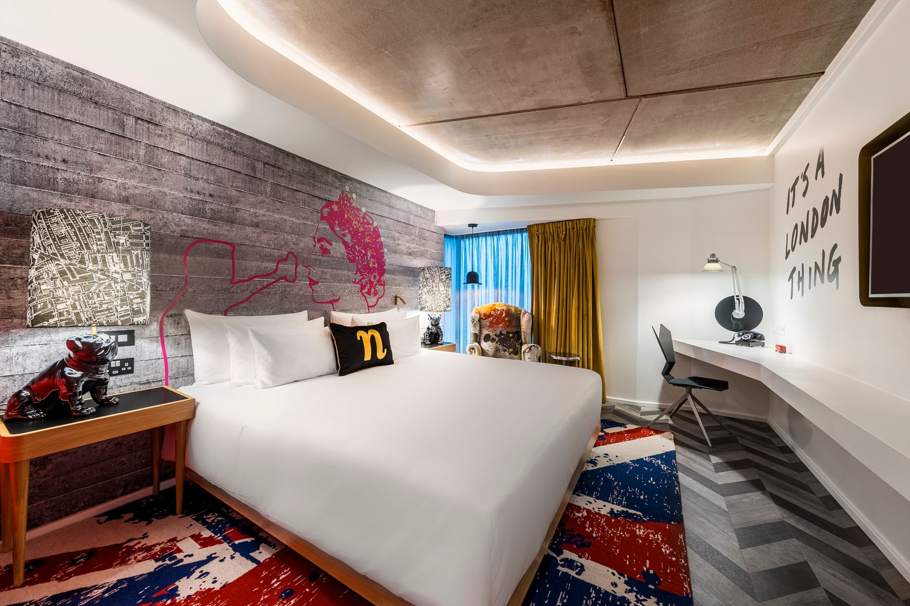

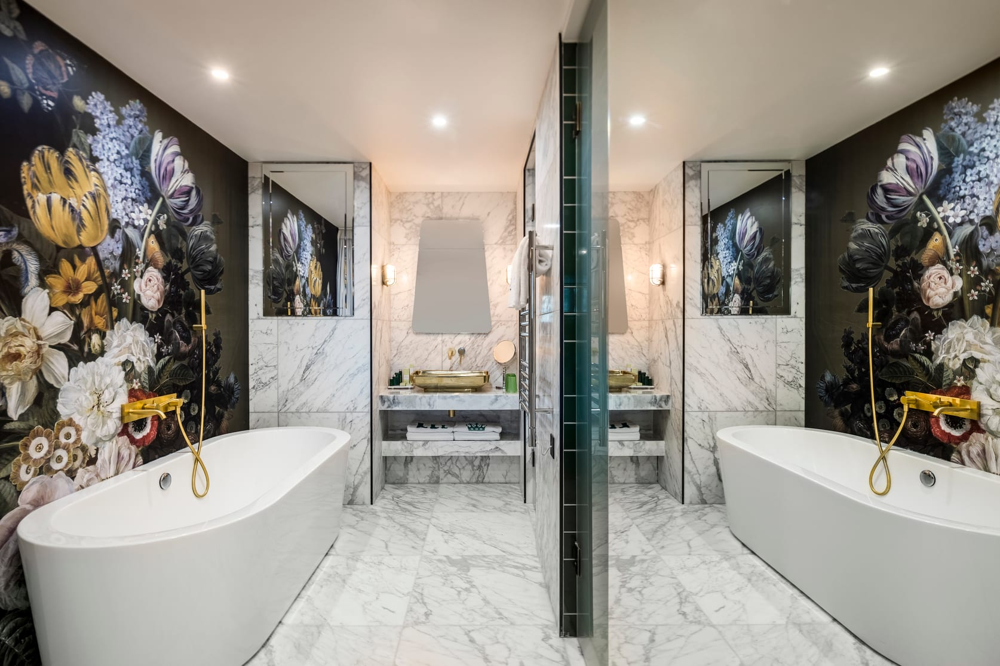

*nhow London — a room and the bathroom.*

**It is not quite in Shoreditch.** Macclesfield Road is up by Old Street and the City Road basin, a ten-minute walk from Curtain Road. You get a mid-range price and none of the 2am street noise, at the cost of walking home. Old Street is the nearest Tube, on the Northern line, which has no night service on this branch.

At about £150 it is the cheapest design hotel in this list after the Z Hotel, and **breakfast is extra.**

### art'otel London Hoxton — the tower

*About £230 · 26 storeys · Two Banksys outside · [check prices](hotel:artotel-london-hoxton)*

A tower wrapped in twisted black fins with the street artist D\*Face's work running through every room and public space. There is a public gallery, a 60-seat screening room, and an indoor pool non-residents can book.

**Two original Banksys are preserved on the outside of the building**, rescued from The Foundry which stood on this site, and free to look at from the street whether or not you stay.

**Breakfast is about £56 extra.** Solaya, the 25th-floor restaurant, is open Tuesday to Saturday evenings only, so check that if the view is why you booked.

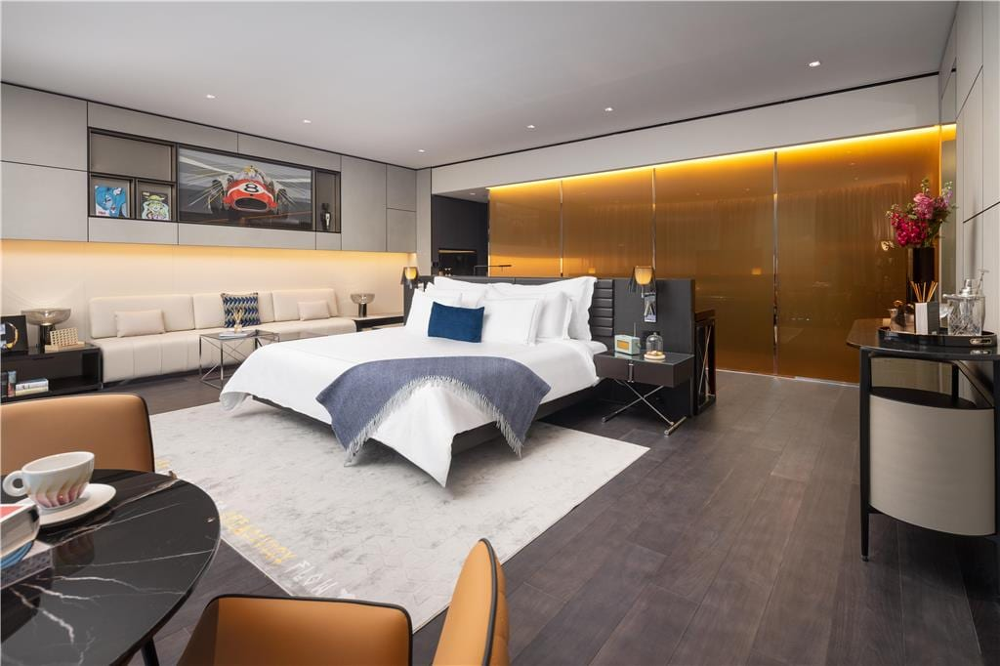

*A room at art'otel London Hoxton.*

Powered by <a target="_blank" rel="sponsored" href="https://www.getyourguide.com/london-l57/">GetYourGuide</a>

## Where to stay near Shoreditch instead

If you have not settled on the area yet, our guide to the [best areas to stay in London](/articles/best-areas-to-stay-in-london/) sorts the whole city by what the trip is for, and covers whether there is a train home at one in the morning.

### Liverpool Street and Aldgate — ten minutes south

Quieter at night, with better transport: **the Elizabeth line puts you at Bond Street in about twelve minutes and Heathrow without changing.** You are a ten-minute walk from Shoreditch's bars.

The streets are commercial rather than residential, so they empty after dark. Liverpool Street has the Elizabeth line, Central, Circle, Hammersmith & City and Metropolitan, plus National Rail out to Stansted. **[Batty Langley's](hotel:batty-langleys)** and **[Leman Locke](hotel:leman-locke)** both sit in this pocket, the first a Georgian townhouse and the second an aparthotel with kitchens.

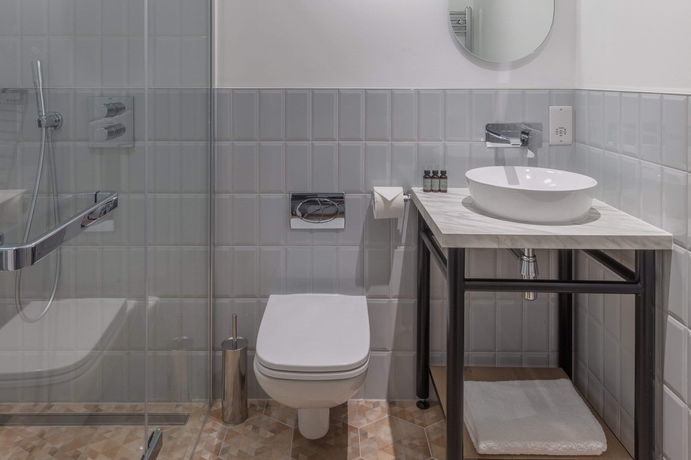

*Leman Locke — the studio and bathroom.*

It is dull on a Sunday. Aldgate has very little open at the weekend, so plan to walk north for food.

### The City of London — cheapest at weekends

**The City empties out at weekends**, so hotels that charge business rates from Monday to Thursday discount on Friday and Saturday, the opposite of the pattern elsewhere in London.

**[Locke at Broken Wharf](hotel:locke-at-broken-wharf)** is about £190 midweek and worth checking against a Shoreditch room for the same Saturday. It is ten minutes away by bus or twenty on foot, on the river between Blackfriars and the Millennium Bridge, and the rooms are studios with kitchens.

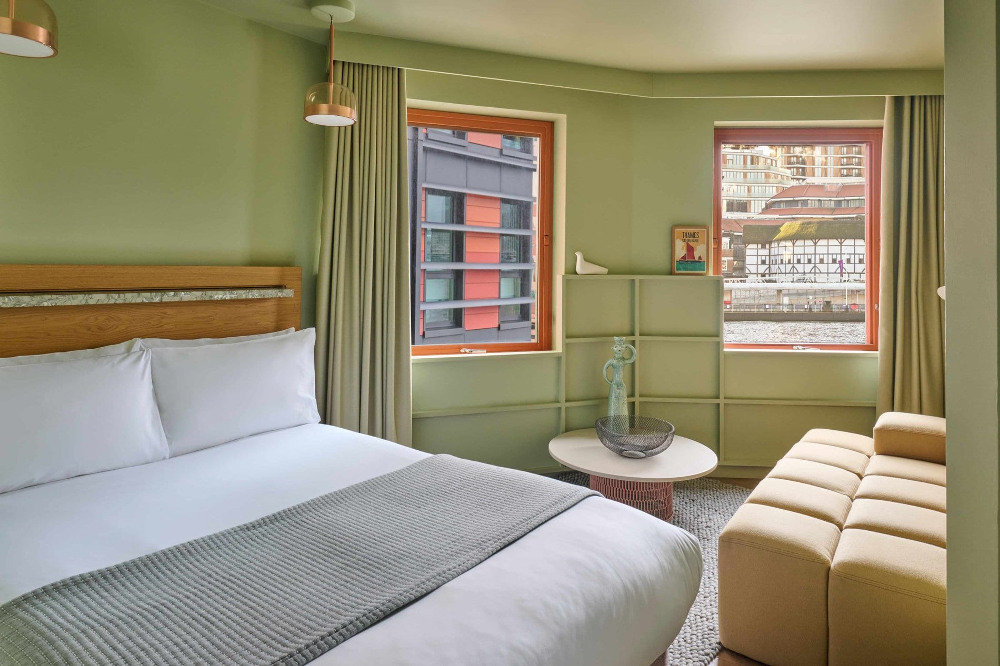

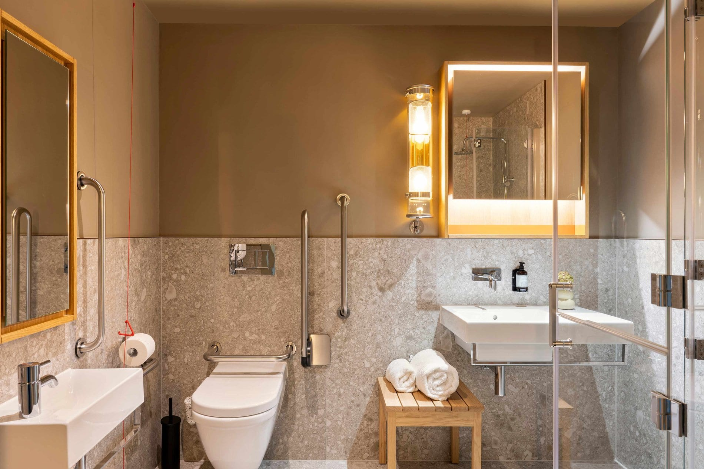

*Locke at Broken Wharf — the studio and bathroom.*

**Price the same Saturday twice**, once in Shoreditch and once in the City, and take whichever is cheaper.

**The City is dead on a Sunday** and many places do not open at all, so it suits a Friday and Saturday and a week badly.

### Whitechapel — east and cheaper

East of Shoreditch, cheaper, and on both the Elizabeth line and the District line: **Bond Street in about fifteen minutes, Heathrow without changing.**

It is a working East End high street rather than a going-out district. **Whitechapel Market runs six days a week** along the main road, and the Royal London Hospital dominates the middle of it. It is busy by day and quiet by night. The walk back from Shoreditch's bars is twenty-five minutes, so the night bus is the realistic way home.

### Hackney and Dalston — north, better value

**Staycity Aparthotels Dalston** is about £130 for an apartment with a kitchen, which suits a stay of more than two nights or a family.

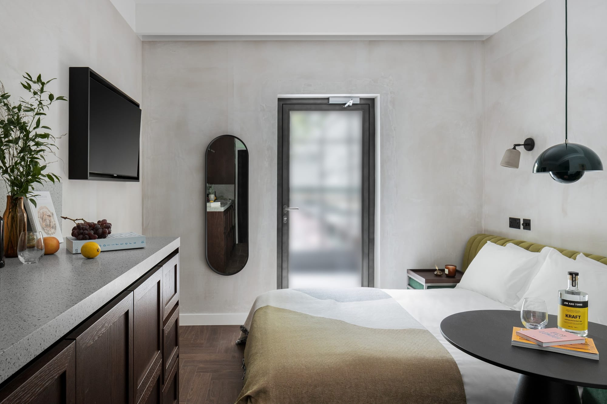

*One of Staycity Aparthotels Dalston's apartments.*

**[The GreenHouse Capsules](hotel:greenhouse-capsules)** on Roman Road is £42 to £53 if you can sleep in a capsule; our [pod hotels guide](/articles/pod-hotels-london/) goes into it. **[Town Hall Hotel](hotel:town-hall-hotel)** in Bethnal Green is about £220, in a 1930s town hall with an Art Deco council chamber you can walk into.

*One of the rooms at Town Hall Hotel.*

### Stratford — fifteen minutes, from £100

**Premier Inn London Stratford** is about £100 and fifteen minutes from Liverpool Street on the Central line. **[Hyatt Regency London Stratford](hotel:hyatt-regency-stratford)** is about £170.

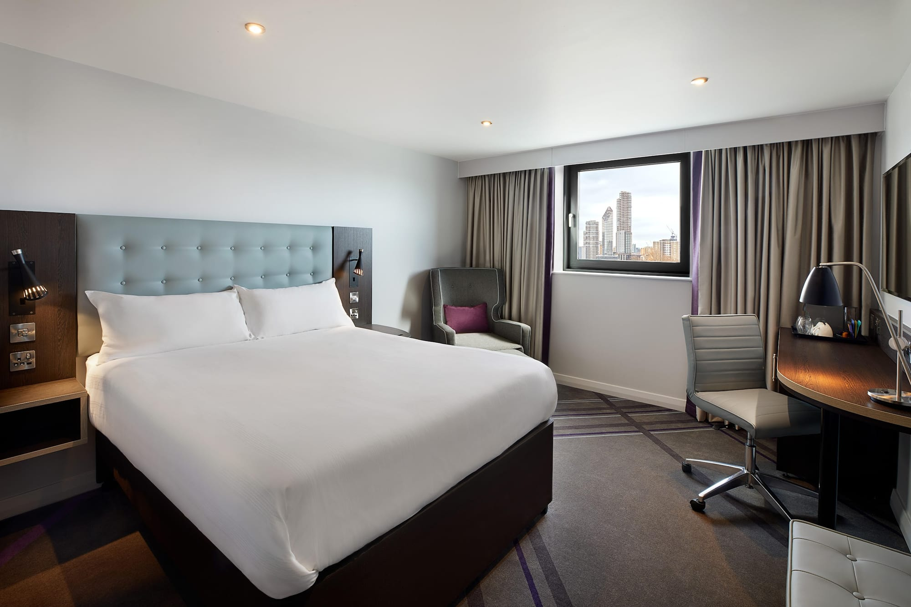

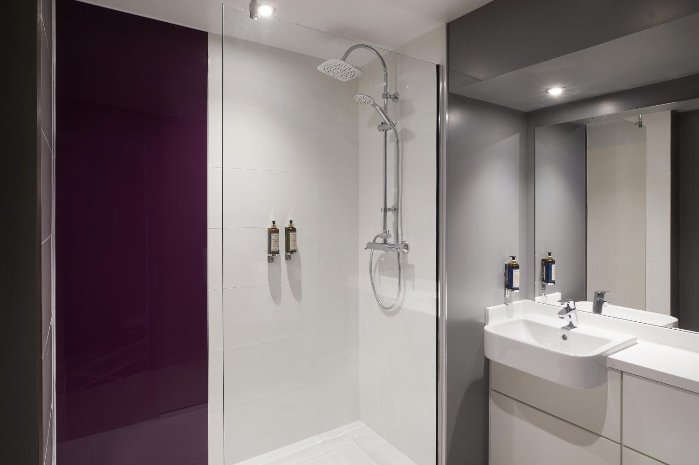

*A room at Premier Inn London Stratford, and its bathroom.*

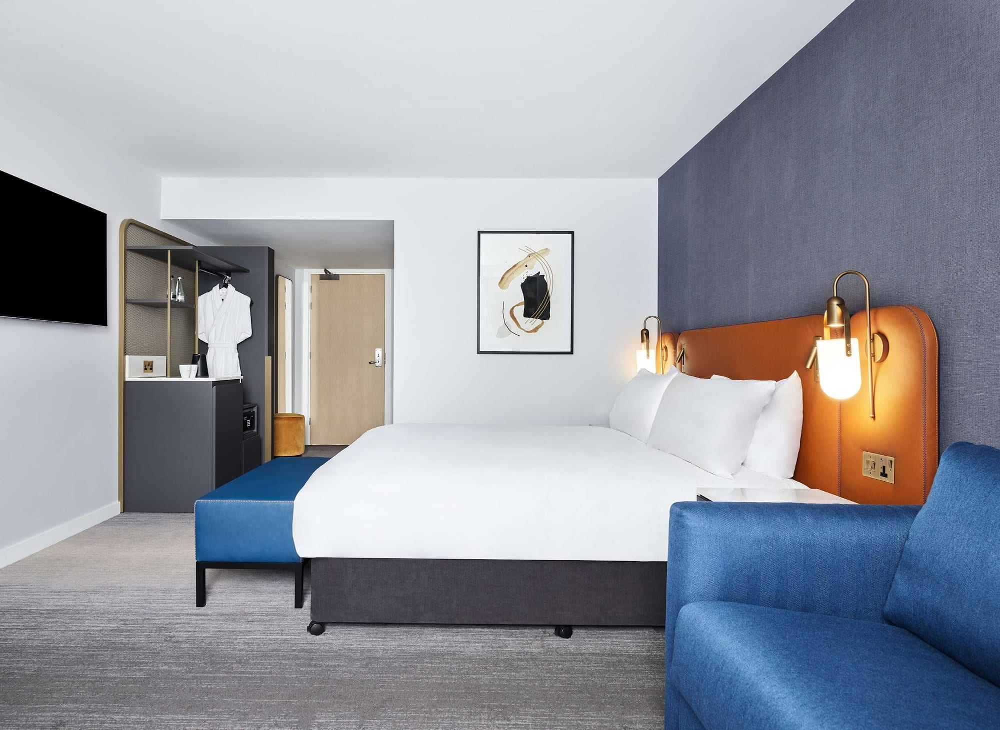

*A room at Hyatt Regency London Stratford.*

Westfield, the Olympic Park and the Elizabeth line are all on top of it. The Central line, the Jubilee, the Elizabeth line, the Overground and the DLR all meet at one station, plus National Rail. **The Central line runs all night on Fridays and Saturdays**, so you can get home from Shoreditch at 3am without a taxi.

The area around the station is a shopping centre and a stadium, so evenings mean chains rather than independents. Treat it as a base, not a destination.

Powered by <a target="_blank" rel="sponsored" href="https://www.getyourguide.com/london-l57/">GetYourGuide</a>

## What you are staying for

Our [Shoreditch area guide](/articles/shoreditch-area-guide/) covers the markets, the bars and what is worth walking to. The [street art](/articles/london-street-art/) is free and the walls change often, so read the guide before you go looking.

## The noise question

Shoreditch is a nightlife district and a residential one at the same time, and the hotels sit in the middle of that. Three things help:

**Ask for a room away from the street**, by name, at booking, not check-in. The design hotels here have deep floorplates and the internal rooms are quieter.

**Ask for a high floor.** Street noise falls off fast above the fourth.

**Treat Friday and Saturday as different products.** A hotel on Great Eastern Street that is calm on a Tuesday is not calm on a Saturday.

If none of that appeals, stay at Liverpool Street or Spitalfields, close enough to walk back and far enough to sleep.

## Getting in and out

**Liverpool Street** is the main station: Elizabeth line, Central, Circle, Hammersmith & City, Metropolitan, and mainline trains to Stansted. Ten minutes on foot from most of Shoreditch.

**Old Street** is the Northern line, and closer to the north end.

**Shoreditch High Street** is Overground only, useful for Hackney, Dalston, Whitechapel and New Cross, and no use for the West End.

**For Heathrow**, walk to Liverpool Street and take the Elizabeth line, with no changes.
