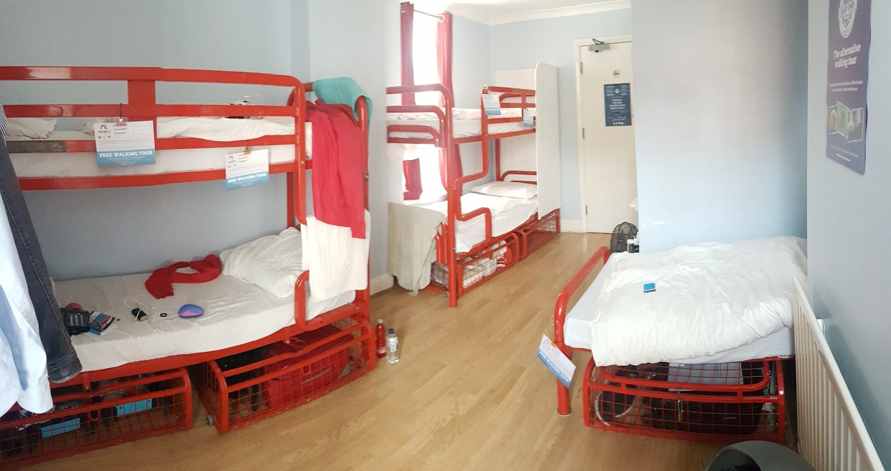

South Kensington is built around three museums. If that is what your trip is for, it is a good base; if not, you will spend a lot of time travelling.

What makes it work is **a 433-metre tiled tunnel, built in 1885, running from inside the Tube station towards the museums**, which gets you to the Natural History Museum, the Science Museum and the V&A without crossing Exhibition Road.

The drawback is the evening. The museums close between **17.45 and 18.00**, and the area empties when they do. Prices are spread out too: **a dorm bed at £18 and a boutique double at £280 on streets four minutes apart**.

> 💡 **The Short Version:** **[The Ampersand](hotel:the-ampersand-hotel)** at about £280 is the one that leans into the museums, and its **Science Family Suite has a rocket-shaped bunk bed**. **[Cheval Gloucester Park](hotel:cheval-gloucester-park)** is the family answer — 98 apartments with kitchens, bookable for a single night. **[Nell Gwynn House](hotel:nell-gwynn-house-pods)** is the cheap way to cook for yourself, in a 1930s Art Deco block ten minutes east. **[Astor Hyde Park](hotel:astor-hyde-park)** is £18 a bed, but its shared dorms are for guests aged 18 to 39 and the age limit is enforced. And if anyone in your party needs a lift at the station, sleep in **Knightsbridge** instead — South Kensington has none.

## Which part of South Kensington

The name covers about half a mile, and where you sit in it decides how far you walk each morning.

**Harrington Road and Queensberry Place**, immediately north of the station, is the tunnel end. The Ampersand and [The Exhibitionist](hotel:the-exhibitionist-hotel) are both here, minutes from the point where the subway starts.

**Exhibition Road and Queen's Gate** is the museum spine itself, and quiet by seven. Queen's Gate runs up the western edge past the Natural History Museum's West Entrance towards the Royal Albert Hall, and Astor Hyde Park is at the top of it.

**Gloucester Road and Ashburn Place**, one stop west, is where the serviced apartments are. You lose five to ten minutes on every museum walk and you gain a kitchen.

**Cromwell Road** is the main road through all of it, and it is loud. Hotels that advertise "South Kensington" can mean a room facing four lanes of traffic, so ask which way you face.

**Thurloe Square east towards Chelsea** is stucco terraces and private garden squares — the quietest streets here, and the direction to walk for dinner.

## The tunnel, and why it decides this

**Historic England lists the South Kensington Subway at 433 metres, Grade II.** It opened on 4 May 1885, is lined in cream and yellow-brown glazed brick, charged a penny toll to begin with, and has been free to walk since 1908.

It runs east from the station, turns north beneath Exhibition Road and comes out beside the Science Museum. Along the way there are exits to the V&A and to the Natural History Museum gardens.

**That gets you to all three museums without crossing Exhibition Road.** Only the Natural History Museum lets you walk in directly from underground: its own site tells visitors to use the tunnel for step-free access to the Central Entrance via the Subway Gate. For the Science Museum and the V&A you come up a stair and walk a few metres in the open, which still beats queueing on Cromwell Road in the wet.

**One caution.** The tunnel is step-free at the museum end and the station above it is not. South Kensington has no lifts to its platforms, so arriving with a heavy case or a pram means stairs. Stay within walking distance and you never need the station for the museums.

Powered by <a target="_blank" rel="sponsored" href="https://www.getyourguide.com/london-l57/">GetYourGuide</a>

## Where to stay

### The Ampersand Hotel — the one that leans into the museums

*About £280 · Breakfast extra · 10 Harrington Road, SW7 3ER · Two minutes from the tunnel*

The themed floors are the room grades, and the order tells you the size: astronomy in the Singles and Small Doubles, music in the Superiors, ornithology in the Deluxes, botany in the Deluxe Studios and geometry in the top-floor suites. Choose on the grade, not on the theme.

**The room worth crossing London for is the Science Family Suite**, which is two connecting bedrooms — a children's room built around a rocket-shaped bunk bed, and an adult room in the hotel's velvet-headboard house style, with a bath-and-shower bathroom. It takes its cue from the Science Museum a few minutes up the road.

Apero is the restaurant and there are two afternoon teas, a Science one and a Jurassic one, both bookable without a room — the cheap way to see the building. Rooms include soft drinks and gym access. **Breakfast is charged on top of £280.**

### The Exhibitionist Hotel — the art one, with no room for children

*About £280 · 37 rooms · 8–10 Queensberry Place, SW7 2EA · Check-in 2pm, out at noon*

Thirty-seven rooms one street west of Exhibition Road, where the corridors are the gallery and the suites are commissions. **Trash City** is by the street artist Dotmasters; there are penthouses curated by the furniture makers Jimmie Martin and by Squint; and the Splash Suites have a jacuzzi in the bedroom.

**The fact to have straight before booking is that it does not sell family rooms at all.** The hotel's own site sends families across the road to its sister property, The Gainsborough.

Rooms are small for the rate, and the ground floor is a bar and lounge, not a restaurant you would plan an evening around. There is a 24-hour front desk. **Breakfast is extra.**

### Cheval Gloucester Park — the family answer, and it will sell you one night

*£££ · 98 apartments · Ashburn Place, SW7 4LL · Gloucester Road 220m · Breakfast extra*

Ninety-eight serviced apartments in one-, two- and three-bedroom sizes with three five-bedroom penthouses on top, and **Cheval takes bookings of any length**, where most apartment operators at this address want a week minimum.

Every apartment has a full kitchen, a washing machine and a dryer, and most have a balcony. There is a 24-hour reception, a free 24-hour gym, secure underground parking, and a **12-person private cinema on the ground floor that guests book by the slot**. Grades run by floor: Superior on 1 to 3, Luxury on 4 to 6, Deluxe on 7 to 10.

Cheval's own distances put the Natural History Museum at 850m, the V&A at 1km and the Science Museum at 1.1km: ten to fifteen minutes each way.

### Nell Gwynn House — a kitchen in a 1930s mansion block

*££ · Studios and apartments with kitchens · Sloane Avenue, SW3 · No breakfast · [check prices](hotel:nell-gwynn-house-pods)*

An Art Deco block from the 1930s with a 24-hour concierge and studios and apartments that have their own kitchens. It is the least expensive way to cook for yourself within walking distance of the museums.

**It is not a pod hotel**, whatever the listicles say. Hotels.com files it as an entire apartment with a private kitchen.

Two warnings: **there is no breakfast of any kind**, and guest reviews since it opened mention street noise. It is a ten-minute walk east of the station.

### Astor Hyde Park — £18 a bed, if you are under forty

*From £18 a dorm bed, £99 a private room · 191 Queen's Gate, SW7 5EU · Breakfast included · [check prices](hotel:astor-hyde-park)*

A Victorian townhouse at the top of Queen's Gate. Large mixed dorms of nine to fifteen beds start at £18; four- to six-bed en-suite dorms and the female-only rooms start at £22; an en-suite private double or twin is £99. Breakfast is in the rate, and there is a full kitchen, laundry, and free luggage storage on arrival.

**The rule: Astor takes guests aged 18 to 39 in its shared dormitories.** If you are forty or over, this is not your hostel.

By Astor's own reckoning the Natural History Museum is ten minutes' walk and the V&A eleven. You approach from Queen's Gate, so the museum's **West Entrance** is the one to head for. **No lift, and townhouse stairs with a case.**

*A dorm at Astor Hyde Park.*

## The evening problem, and the two nights it does not apply

**The Natural History Museum closes at 17.50 with last entry at 17.30. The Science Museum closes at 18.00, last entry 17.15, and starts closing galleries half an hour before that. The V&A closes at 17.45.**

There are two exceptions, both free:

**The V&A is open until 22.00 every Friday.** Some galleries shut after 17.45, but the building stays open, the main café serves until 21.00 and the shops until 21.45. If you are staying one night in South Kensington, make it a Friday.

**The Science Museum runs Lates from 18.30 to 22.00 on selected dates**, free, over-18s only, with themed events through the evening. Bags are discouraged and luggage is not allowed in at all, so it is not a plan for your last day.

Otherwise, walk. Sloane Square and the King's Road are one stop east on the District and Circle lines, and the Old Brompton Road heading south-west has the everyday restaurants and pubs that the museum end does not. **Budget twenty minutes each way to eat out.**

Powered by <a target="_blank" rel="sponsored" href="https://www.getyourguide.com/london-l57/">GetYourGuide</a>

## Breakfast, and the ten o'clock start

All three museums open at 10.00, so **an early hotel breakfast buys you nothing** — there is nowhere to be until mid-morning. Astor Hyde Park puts breakfast in the rate. The Ampersand, The Exhibitionist and Cheval all charge extra. Nell Gwynn House does not serve any, and has a kitchen.

The streets around Bute Street are the centre of French London, and the bakeries there open long before the museums. Our [South Kensington area guide](/articles/south-kensington-area-guide/) covers where to eat and what to see once you are through the doors.

## Where to stay just outside — for the money, or for an evening

Two of these are cheaper than South Kensington. Two are dearer and have an evening.

### Gloucester Road and Earl's Court — one and two stops west, and cheaper

Gloucester Road is one stop west on all three lines — the Natural History Museum puts it at a twelve-minute walk to the Central Entrance and seven to the West. Earl's Court is two stops on the District and Piccadilly, with South Kensington four minutes away when you cannot face walking.

What is here is aparthotels, not hotels. **[Ember Locke Kensington](hotel:ember-locke)** is on Cromwell Road between the two stations, done in a seventies palette; Cromwell Road is a main artery, so ask for a studio at the back or you will hear it all night. **[Templeton Place by Supercity](hotel:supercity-templeton-place)** sits on an Earl's Court garden square two minutes from the station.

Both are cheaper because Cromwell Road is loud and Earl's Court is quiet in the evening. **Earl's Court is step-free**, which South Kensington is not.

### Knightsbridge — windowless, and the nearest step-free station to the museums

**[Zedwell Knightsbridge](hotel:zedwell-knightsbridge)** ranges from **£89 to £257** depending on the date, for an SW1 address two minutes from Knightsbridge station and about fifteen minutes' walk from the V&A. The rooms are windowless, soundproofed and en-suite with a rainfall shower.

Two limits. **It sells one room type only, a Cocoon 2 sleeping two**, so there is no single rate and no family option. And the price moves 2.9 times between the cheapest and dearest dates, so the bargain is a February-midweek proposition.

**The V&A names Knightsbridge as its nearest step-free Tube station**, a fourteen-minute walk, because South Kensington has no lifts. If anyone in your party uses a wheelchair, that settles it.

### Chelsea and Sloane Square — dearer, and the one that has an evening

For anyone who puts dinner ahead of the tunnel. Sloane Square is one stop east on the District and Circle, and the King's Road runs west from it with restaurants still serving when South Kensington has gone dark.

**[San Domenico House](hotel:san-domenico-house)** is about £240 for nineteen Italian-furnished rooms off Sloane Square; being that small, it books out well ahead. **[The Chelsea Townhouse](hotel:the-chelsea-townhouse)** is about £260 for 36 individually decorated rooms on a garden square — it was **The Draycott until 2022**, so older reviews are of the same hotel under a different name. **[The Cadogan](hotel:the-cadogan-belmond)** on Sloane Street is about £450.

Add ten to fifteen minutes to every museum walk. Our [Chelsea area guide](/articles/chelsea-area-guide/) covers what the extra buys.

### Notting Hill — north through the parks, and worth it for two hotels

Notting Hill is twenty-five minutes on foot through Kensington Gardens, or the Circle line round to Notting Hill Gate.

**[The Laslett](hotel:the-laslett)** is about £240, on Pembridge Gardens a minute from Notting Hill Gate station, with work by local artists in the rooms and the Central and Circle lines at the door. **[The Portobello Hotel](hotel:the-portobello-hotel)** is about £260 for 21 rooms on a quiet garden square with breakfast included; some rooms are theatrical, with round beds and claw-foot baths standing in the bedroom, so **ask which one you are being given**. There is no lift, so upper floors mean stairs with cases.

Take this if the museums are one day of a longer trip. If they are the trip, you will walk that route twice a day.

Powered by <a target="_blank" rel="sponsored" href="https://www.getyourguide.com/london-l57/">GetYourGuide</a>

## What you are staying for

The three museums are all free. The Natural History Museum's free entry ticket is worth booking because there can be a queue at weekends and in school holidays; our [Natural History Museum guide](/articles/natural-history-museum-guide/) covers the entrances, a route and the exhibition prices. Our [best museums in London](/articles/best-museums-london/) guide covers which halls in each are worth your time, and the [Kensington area guide](/articles/kensington-area-guide/) picks up the ground north of here — Kensington Palace, Holland Park and Kensington High Street — if you are staying more than two days.

Our [aparthotels guide](/articles/aparthotels-london/) compares the kitchens-and-washing-machine option, and the [windowless rooms guide](/articles/windowless-hotel-rooms-london/) explains what you are buying at Zedwell.

## Getting in and out

**South Kensington** is Piccadilly, District and Circle. The Piccadilly line runs to Heathrow without a change, about 55 minutes from Gloucester Road by Cheval's measure.

**The Piccadilly line is closed from 1am on 31 October to the end of 1 November.** TfL is also replacing the entire 1975 fleet, with new trains entering service in a window running from **December 2026 to June 2027**, and the work involves weekend part-closures; the V&A now warns its own visitors that upgrades through 2026 and 2027 may disrupt journeys. Have a second route to the airport.

**There is no step-free access at South Kensington**, and no lifts to the platforms. Knightsbridge is the nearest step-free station to the museums at 0.6 miles, Earl's Court the next at 1.2. Gloucester Road has a lift to the Piccadilly line platforms only.

TfL, Native Land and Places for London are redeveloping the station with a new accessible entrance on Thurloe Street giving step-free access to the ticket hall, the platforms and the subway, plus a new eastbound District and Circle platform. Enabling works start later in 2026.

**There is no Elizabeth line here.** For the City, Canary Wharf or Stratford you are changing at least once, and Paddington — five stops round on the Circle — is where the fast trains actually are.

If you have not settled on an area yet, our guide to the [best areas to stay in London](/articles/best-areas-to-stay-in-london/) sorts the whole city by what the trip is for.

*Prices change nightly, so always check your own dates.*
