**Six operators in London sell rooms with no window at all.** Zedwell runs five hotels where every room is windowless by design. **Every one of Z Hotels' twelve London branches sells a windowless room**, and at nine of them it is the cheapest rate in the building. hub by Premier Inn, Point A, easyHotel and The Corner sell them too.

Below: what the rooms are like, how each brand discloses them, and what daylight costs, which runs from £5 to £35 for the identical room.

> 💡 **The Short Version:** A windowless room is a **small, private, en-suite hotel room with no daylight**, and it is not a capsule. **Zedwell** is the purpose-built version: for two people the second guest adds about £5 a night. **Z Hotels** sells a windowless "Inside" grade at all twelve London branches — cheapest at **Shoreditch and Victoria, £50** — but the premium for daylight varies wildly, from £5 at Tottenham Court Road to £35 at Shoreditch. **Read the grade name before you pay.**
>
> **Three picks:** [The Z Hotel Shoreditch](hotel:z-hotel-shoreditch) (£50 windowless, two minutes from Old Street) · [Zedwell Greenwich](hotel:zedwell-greenwich) (£66–£145, Cutty Sark DLR) · [Zedwell Piccadilly Circus](hotel:zedwell-piccadilly-circus) (£97–£287, one minute from the Tube).

## Two different things get called a windowless room

**Windowless by design** is Zedwell: there is no room with a window to upgrade to, and two of the five hotels are entirely below ground.

**Windowless as a grade** is everyone else. Z Hotels, hub by Premier Inn, Point A, easyHotel and The Corner sell their interior rooms, usually cheaper. **Disclosure ranges from a word in the room's name to a footnote behind an asterisk**.

Neither is a capsule: every room in this guide has its own door and shower. Our [London capsule hotels guide](/articles/pod-hotels-london/) covers capsules.

## What a purpose-built windowless room is like

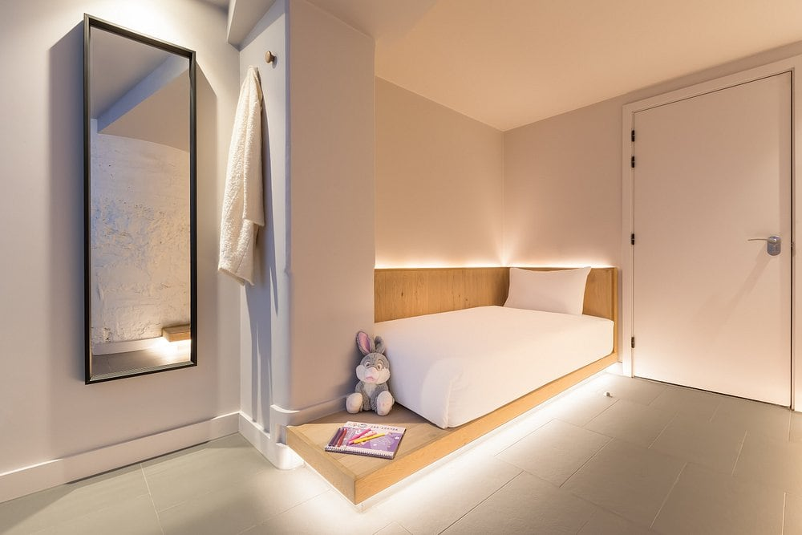

*A cocoon room.*

**Your own room, your own door, your own bathroom.** The smallest Zedwell is 7 sq m. The bed sits on a lit oak plinth, there is a full-length mirror, hooks, not a wardrobe, and an **en-suite with a walk-in rainfall shower**.

**Soundproofing** on walls, floors and doors, and purified, temperature-controlled air instead of an opening window. The bathroom mirror runs circadian-rhythm lighting that mimics a daylight cycle.

**Hypnos mattress, Egyptian cotton sheets, Wi-Fi over 50 Mbps.** Reception is staffed 24 hours.

hub lights its window-free rooms with a self-dimming back-lit box and what it calls circadian light wells; The Corner builds the bed and the bathroom into one moulded cube with blank walls. None gives a daylight cue in the morning.

## What you give up, beyond the window

**Zedwell cleans the room every fourth night, not daily**, with fresh towels. You can pay for extra cleans or collect towels and bedding from reception at any time. easyHotel Victoria cleans free every sixth night and charges **£15** for an extra clean.

**Zedwell has no kettle, mini bar or television.** No hairdryer or iron either — those are **£10 to have delivered to the room**. Piccadilly Circus and Tottenham Court Road have free beauty and ironing rooms; Greenwich, Knightsbridge and Park Lane do not. Z Hotels and The Corner both put a TV in the room; hub has no kettle but free tea and coffee all day.

**There is no breakfast at Zedwell.** Point A includes breakfast if you book direct; Z Hotels charges for it outside its Club grade.

**Zedwell check-in is 3pm and check-out 10am.** Both ends move for a fee:

| | Early check-in from 9am | From noon | Late check-out to noon | To 2pm |
| --- | --- | --- | --- | --- |
| **Piccadilly Circus, Knightsbridge, Park Lane, Tottenham Court Road** | £60 | £40 | £50 | **£80** |
| **Greenwich** | £25 | £15 | £25 | £50 |

**After 2pm you are charged a full night** at every one. On a quiet Sunday, when a Cocoon 1 at Piccadilly Circus is £97, an £80 late check-out is most of a second night's price. Greenwich is less than half the price at both ends.

**Foreign nationals must upload a passport copy before arrival** at Zedwell, through a secure link emailed after booking. UK residents can check in with any government photo ID.

## The Zedwell pricing, which works backwards

A windowless room for one person is not a bargain. Across five sample dates — a quiet Sunday, a February midweek, an October Saturday, the second Saturday of December and a Saturday in April — a single room at Zedwell Piccadilly Circus ran from **£97 to £287**, ordinary money for central London.

**The value is in filling the room.** The Cocoon number is how many people it sleeps, and the price barely moves with it:

| Date sampled | Room for one | Room for two | Difference |
| --- | --- | --- | --- |
| Quiet Sunday | £97 | £102 | **+£5** |
| February midweek | £113 | £117 | **+£4** |
| October Saturday | £253 | £258 | **+£5** |
| December Saturday | £287 | £291 | **+£4** |
| April Saturday | £168 | £172 | **+£4** |

A second guest adds £4 or £5 on a room whose price swings by nearly £200 across the year. Tottenham Court Road adds £8 or £9.

**A Cocoon 8 sleeps eight for about two and a half times the price of a single**, and that ratio held to within about three per cent on every sample date.

**The limit is the beds.** From Cocoon 4 upwards the rooms are *double* beds in bunks: a Cocoon 4 is two doubles, a Cocoon 8 is four. The per-person price assumes people share a bed, so two couples suit a Cocoon 4 and four friends who each want their own bed do not.

Floor space works the same way: a Cocoon 8 is 20 sq m for eight people, against 7 sq m for one.

## The five Zedwell hotels, in the order we would book them

### Zedwell Tottenham Court Road — the default pick

*£81–£206 a Cocoon 1 · 206 rooms · Beneath Great Russell Street, WC1 · Tottenham Court Road 2 min · [check prices](hotel:zedwell-tottenham-court-road)*

Entirely below ground, under Great Russell Street. It **undercut the Piccadilly flagship on every sample date**, by £16 to £81, for the same product two Tube stops away.

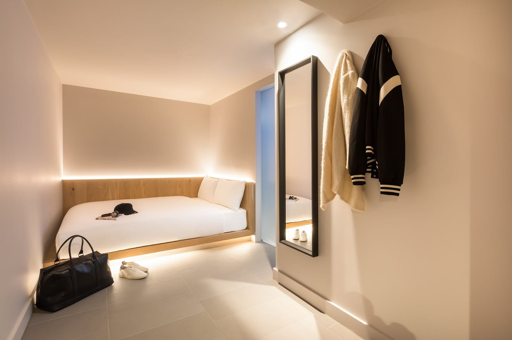

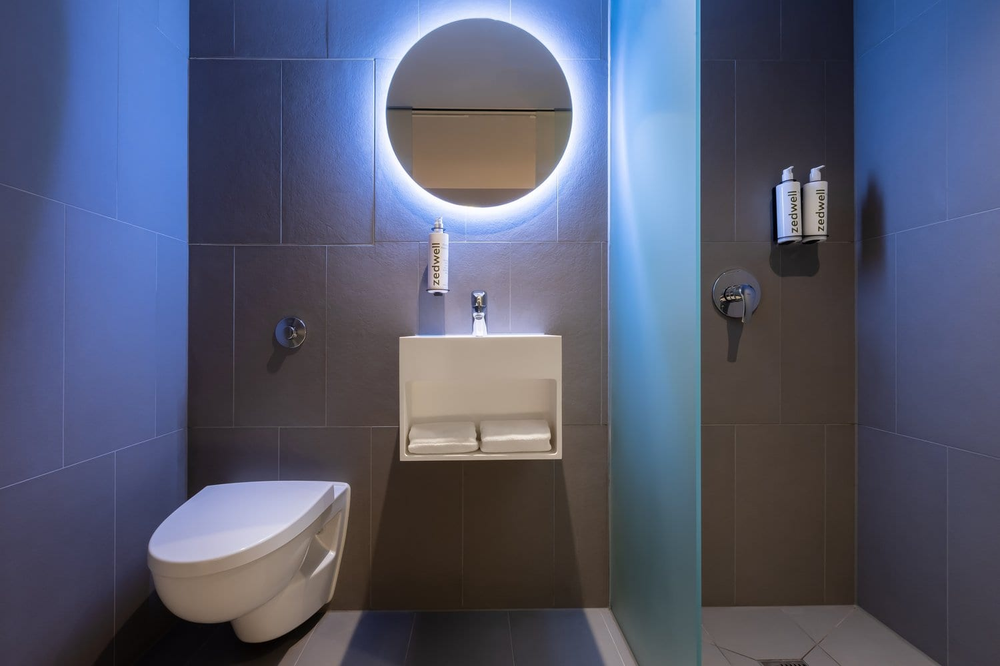

*A Cocoon room at Zedwell Tottenham Court Road, and its ensuite bathroom.*

Two minutes from the [British Museum](/articles/british-museum-guide/), and on the Elizabeth, Northern and Central lines, so it is the easiest arrival from Heathrow of the five. No street noise reaches it.

**Rooms stop at Cocoon 4**, so a group of six or more has to go back to Piccadilly Circus. Early check-in is West End money here — £60 from 9am, £40 from noon.

### Zedwell Greenwich — the value one

*£66–£145 a Cocoon 2 · Greenwich SE10 · Cutty Sark DLR · [check prices](hotel:zedwell-greenwich)*

The steadiest price in the group. A room for four starts at **£117**, the cheapest way to put four people in a private room anywhere in this guide.

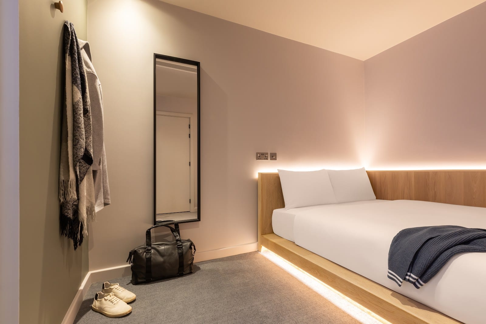

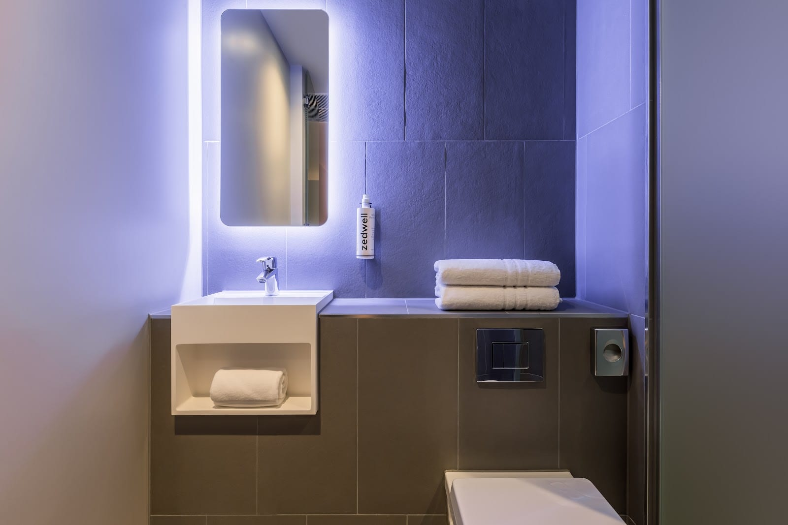

*A Cocoon room at Zedwell Greenwich, and its ensuite bathroom.*

**Fees are lower too.** Early check-in is **£25 rather than £60**, from noon it is £15 against £40, and a late check-out to 2pm is £50 against £80.

It is by the river for the Cutty Sark, Greenwich Park and the O2 (the Royal Observatory is closed from 2 November 2026), outside Zone 1 for about a third off. There is no free beauty or ironing room; a hairdryer or iron is £10 delivered.

### Zedwell Piccadilly Circus — the address, or the group

*£97–£287 a Cocoon 1 · London Pavilion, W1J 0DA · Piccadilly Circus 1 min · [check prices](hotel:zedwell-piccadilly-circus)*

The biggest of the five, in the London Pavilion, and the most volatile: the price roughly **triples** between a quiet Sunday and a Saturday in December, a wider swing than any other property here.

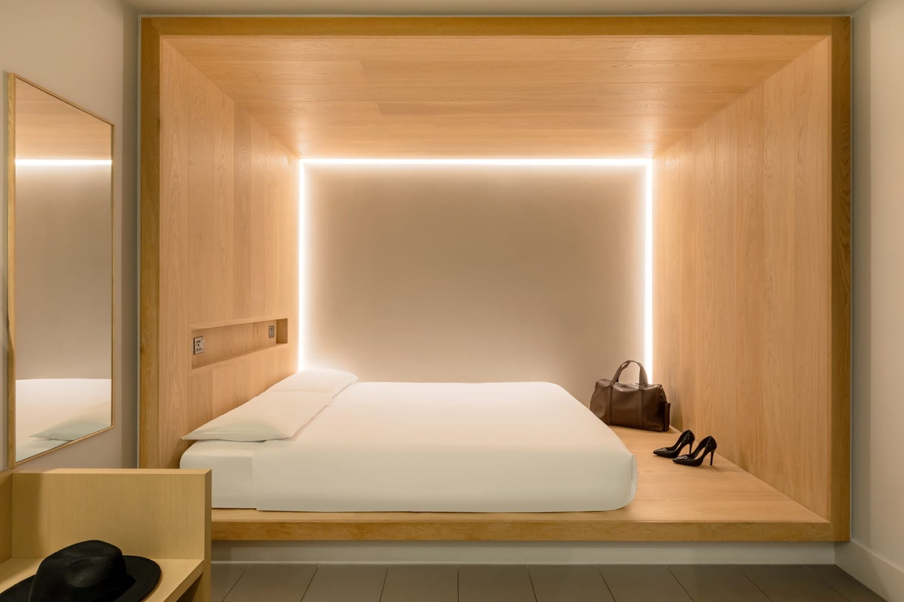

*A Cocoon room at Zedwell Piccadilly Circus.*

**Book it for the address**, at £16 to £81 more than Tottenham Court Road, **or for a group of more than four**: it is the only Zedwell selling Cocoon 6, 8 and 12 rooms.

It has a free beauty and ironing room, which Greenwich, Knightsbridge and Park Lane do not. Luggage storage is **£15 a piece and non-refundable**.

### Zedwell Knightsbridge — couples only

*£89–£257 a Cocoon 2 · Knightsbridge SW1 · Knightsbridge 2 min · [check prices](hotel:zedwell-knightsbridge)*

**One room type**, a Cocoon 2 sleeping two: no single rate and no family option.

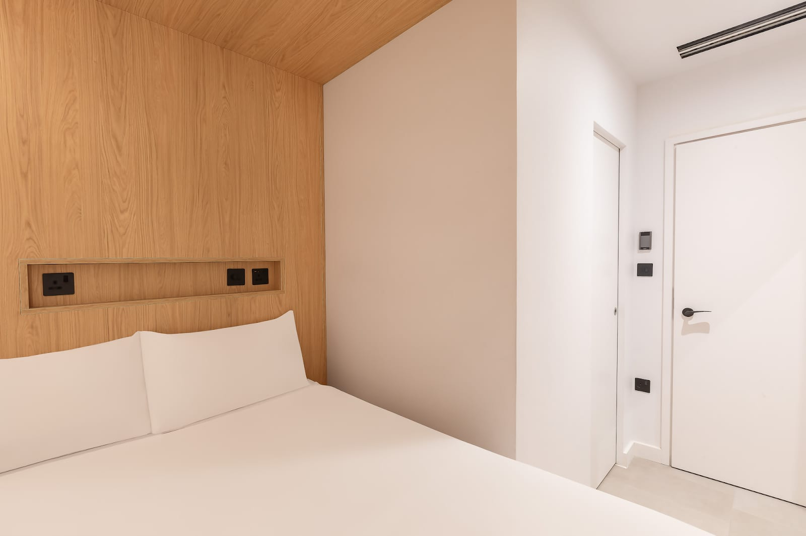

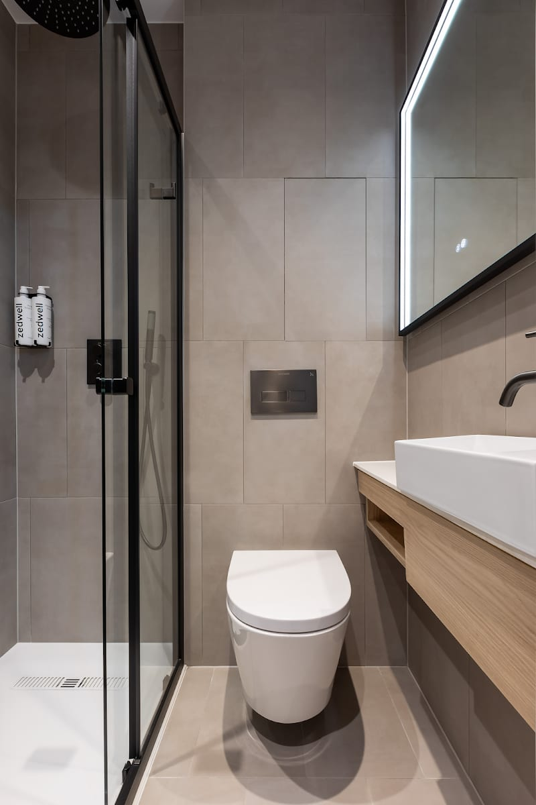

*A Cocoon room at Zedwell Knightsbridge, and its ensuite bathroom.*

On a quiet night it starts at £89, about fifteen minutes' walk from the V&A and the Natural History Museum. It reprices as hard as the flagship, so it is a **midweek-and-February option**: at £257 on a bad date it is poor value.

Early check-in is the full £60 from 9am, and there is no free ironing room.

### Zedwell Park Lane — a Mayfair address at Knightsbridge money

*£90–£207 a Cocoon 2 · 77 Park Lane, W1K 7TP · Marble Arch 7 min · [check prices](hotel:zedwell-park-lane)*

The newest of the five and, like Tottenham Court Road, entirely underground. Its Cocoon 2, sleeping two, ran £90 to £207 across the sample dates — within a pound of Knightsbridge on a quiet night and about **£50 cheaper on an October Saturday**. A **Cocoon 4 of 14 sq m sleeps four**.

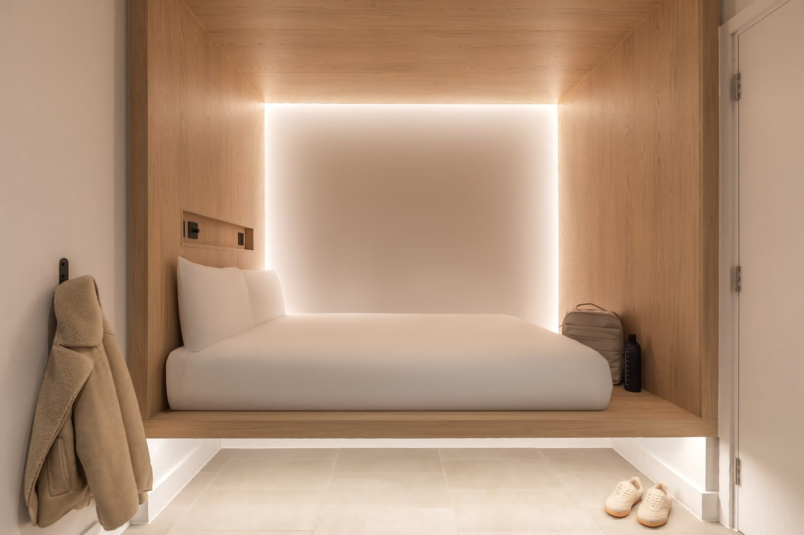

*A Cocoon room at Zedwell Park Lane.*

Seven minutes from Marble Arch, ten from Hyde Park Corner, with Hyde Park across the road.

**It is last because it has few reviews so far**, so there is little to go on beyond the rate and the specification. For a safer booking take Tottenham Court Road.

Powered by <a target="_blank" rel="sponsored" href="https://www.getyourguide.com/london-l57/">GetYourGuide</a>

## Z Hotels: all twelve London branches sell one

Z Hotels has **twelve London branches**, and every one publishes at least one room grade with no window.

Z's own word for them is **"Inside"**, and the room page says an Inside room has all the features of the standard bedroom, "just with no curtains to draw". Most cards also carry a small **"no window"** tag beside the occupancy.

**At nine of the twelve branches the cheapest published rate in the hotel is a room with no window.** At Piccadilly it ties with the single; only at City and Soho does the lead rate come with daylight.

What the window costs at each, comparing the Inside grade with the same bed size and floor area with a window, from Z's published from-rates:

| Branch | Cheapest Inside | Same room, with a window | The window costs |
| --- | --- | --- | --- |
| **Tottenham Court Road** — 52 Poland Street | £70 (9 sq m) | £75 | **£5** |
| **Gloucester Place** — 51 Gloucester Place | £65 (14 sq m) | £75 | **£10** |
| **Strand** — Heathcock Court, 415 Strand | £65 (9 sq m) | £75 | **£10** |
| **City** — 24 Fleet Street | £65 (11 sq m) | £80 | **£15** |
| **Holborn** — 75 Kingsway | £55 (9 sq m) | £70 | **£15** |
| **Piccadilly** — 2 Orange Street | £60 (9 sq m) | £75 | **£15** |
| **Leicester Square** — 3–5 Charing Cross Road | £70 (9.6 sq m) | £85 | **£15** |
| **Soho** — 17 Moor Street | £70 (10 sq m) | £90 | **£20** |
| **Trafalgar** — 53–59 Chandos Place | £60 (9 sq m) | £80 | **£20** |
| **Covent Garden** — 31–33 Bedford Street | £80 (9 sq m) | £100 | **£20** |
| **Victoria** — 5 Lower Belgrave Street | £50 (9 sq m) | £80 | **£30** |
| **Shoreditch** — 136–144 City Road | £50 (10 sq m) | £85 | **£35** |

**The same missing window costs seven times more at Shoreditch than at Tottenham Court Road.** Whether an Inside room is a bargain depends on the branch.

Two cautions. **"Inside" is not a reliable warning on its own**: Z Holborn's **Z King at £90** carries the no-window tag with no "Inside" in the name, and the **£150 Club Family Room at Z Leicester Square** describes itself as having no curtains to draw. And **the name is sometimes the only warning**: several Inside grades carry no tag and say nothing about windows in the description.

### The Z Hotel Shoreditch — the cheapest bed, and the widest gap

*£50 windowless, £85 with a window · 136–144 City Road, EC1V 2RL · Old Street 2 min · [check prices](hotel:z-hotel-shoreditch)*

**£50 is the lowest published rate at any Z Hotel in London**, shared with Victoria, and buys an 8 sq m Inside Single or a 10 sq m Inside Double. Take the double.

The window costs most here: the **Z Double at £85** is the same 10 sq m as the Inside Double, so daylight is **£35**. An Inside Queen at £70 (11 sq m) sits between them.

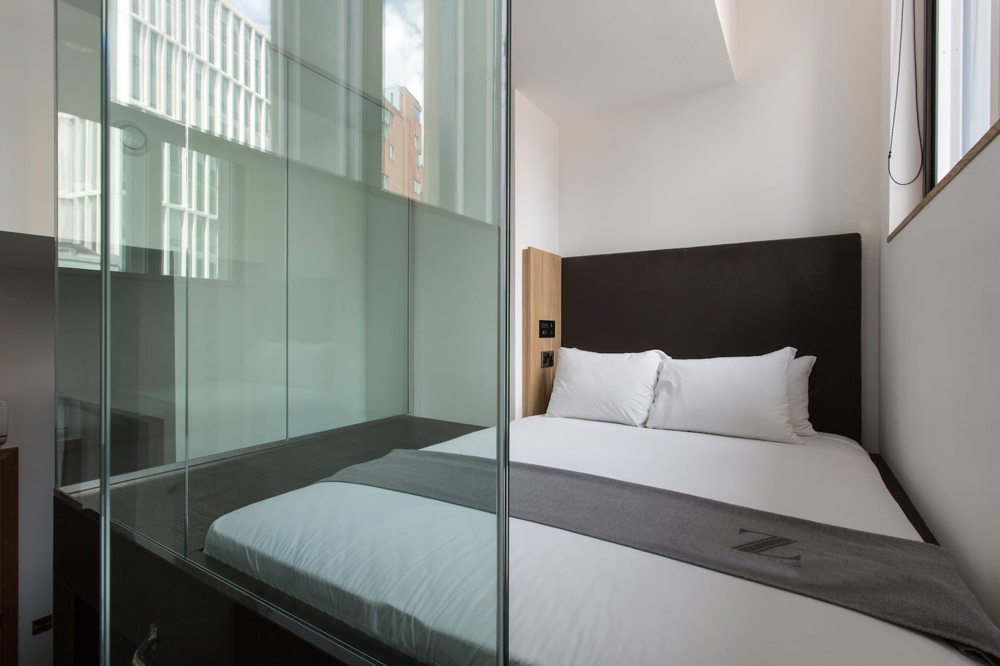

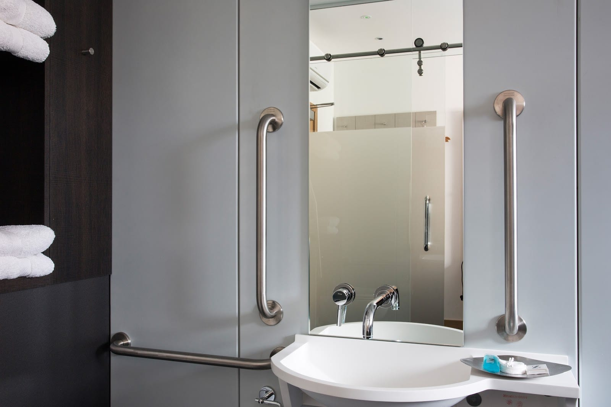

*A room at the Z Hotel Shoreditch, and its ensuite bathroom.*

Breakfast is bought in the Z Cafe rather than included. Joining Z Member before you book is free and adds evening cheese and wine plus 10% off food and drink, but not off breakfast; only the dearer Z Club room grade has breakfast in the rate. The address is the Shoreditch edge of the City, not the nightlife core. Our [Shoreditch hotel guide](/articles/where-to-stay-shoreditch/) compares it with the other hotels in the area.

### The Z Hotel Victoria — £50, and £30 for daylight

*£50 windowless, £80 with a window · 5 Lower Belgrave Street, SW1W 0NR · Victoria 2 min*

The other £50 room, two minutes from Victoria station, the arrival point for Gatwick trains and the coach station.

An Inside Double is 9 sq m at £50, an Inside Queen 10 sq m at £60, and the Z Double — the same 9 sq m with a window — is **£80**. Daylight is a £30 step, the second widest of the twelve, which makes the Inside Queen at £60 the pick: a bigger bed and room for £20 less than the smallest room with a window.

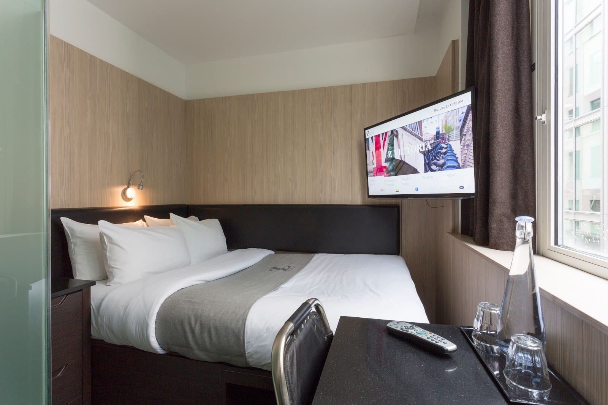

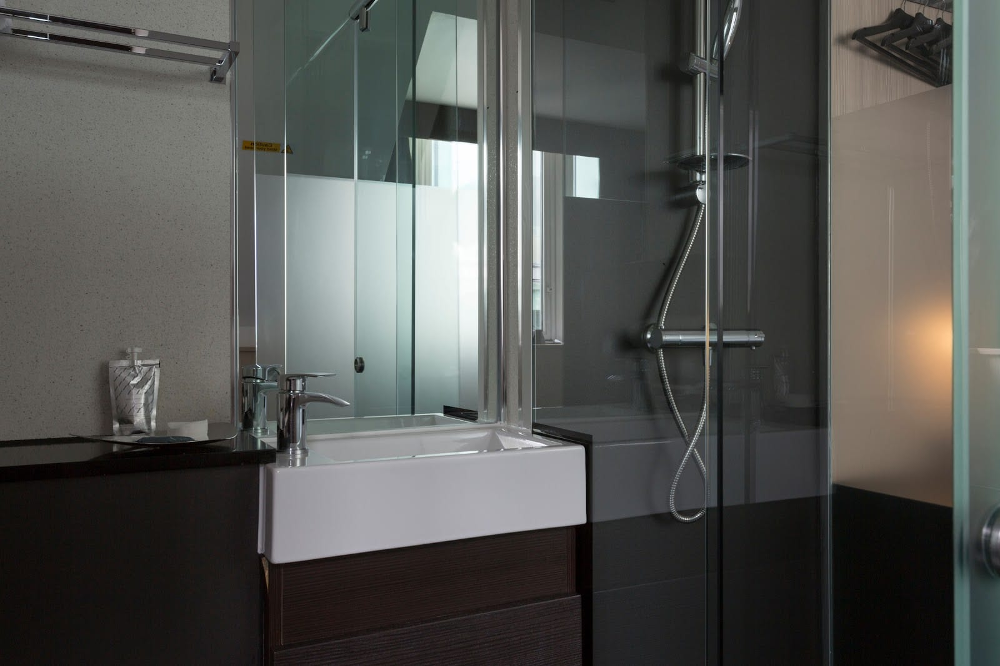

*A room at the Z Hotel Victoria, and its ensuite bathroom.*

There is no family grade; two adults is the ceiling on every room.

### The Z Hotel Tottenham Court Road — where the window costs £5

*£70 windowless, £75 with a window · 52 Poland Street, W1F 7NH · Oxford Circus 5 min*

An **Inside Double is 9 sq m at £70**; the **Z Double is the identical 9 sq m at £75**, with a window. Five pounds. Save the fiver only if you specifically want the dark.

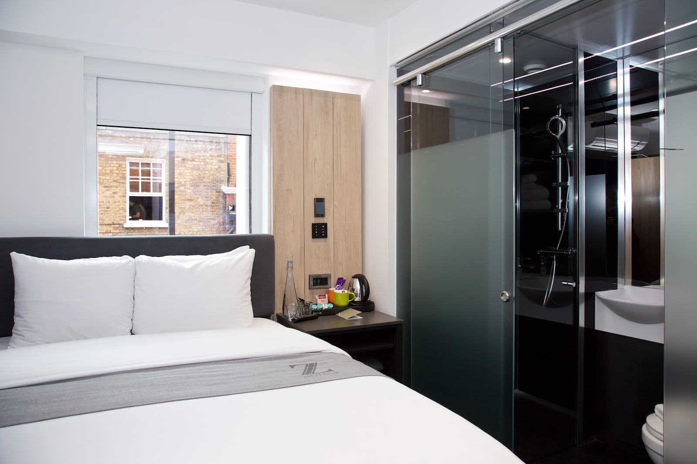

*A room at the Z Hotel Tottenham Court Road.*

The **Z Accessible at £75** is 14 sq m with a window, larger and cheaper than the 11 sq m Z Queen at £85. The branch is not on Tottenham Court Road: it is at 52 Poland Street in Soho, five minutes from Oxford Circus and six from Tottenham Court Road station.

### The Z Hotel Holborn — the branch with the traps

*£55 windowless, £70 with a window · 75 Kingsway, WC2B 6SR · Holborn 2 min*

Nine grades, the longest list of the twelve, with two traps.

**The family rooms are £95 either way.** A Z Inside Family and a Z Family are both 14 sq m, both sleep four in two queen bunk beds, and both cost **£95**; the only difference is the window, so the Inside version saves nothing.

**The £90 Z King has no window and does not say so in its name.** It carries the small no-window tag and nothing else, and it is the dearest windowless room here.

Otherwise: Inside Double £55, Z Double £70, two minutes from Holborn station and five from Covent Garden.

*A room at the Z Hotel Holborn.*

### The Z Hotel Covent Garden — three windowless grades before daylight

*£70 windowless, £100 with a window · 113 rooms · 31–33 Bedford Street, WC2E 9ED · Covent Garden 3 min · [check prices](hotel:z-hotel-covent-garden)*

113 compact rooms in a courtyard behind St Paul's Church, thirty seconds from the Covent Garden piazza, with **the deepest run of windowless grades of the twelve**: three before you reach a room with daylight.

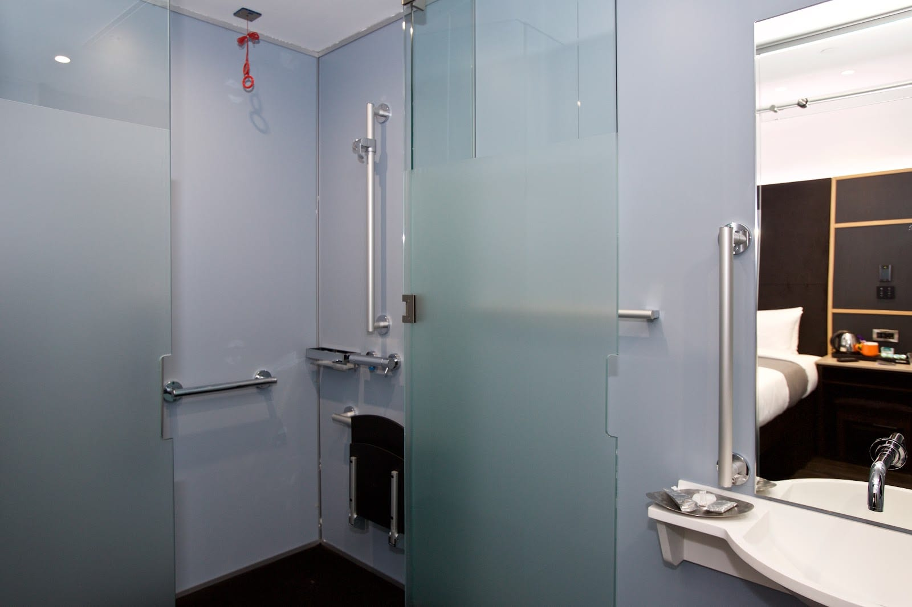

*The ensuite bathroom of a Z Hotel Covent Garden room.*

A **Z Inside Single is 8 sq m at £70**, an **Inside Double 9 sq m at £80**, an **Inside Queen 11 sq m at £90**. The first room here with a window is the **Z Double at £100** — the same 9 sq m as the Inside Double, for £20 more. A Z Family sleeping four is £155.

Z publishes every grade with its floor area, so compare areas. Café Inigo downstairs does the buffet breakfast, charged separately; the free Z Member scheme adds evening cheese and wine and 10% off food and drink, though not off breakfast. Our [Covent Garden hotel guide](/articles/where-to-stay-covent-garden/) sets it against the other hotels in the area.

Powered by <a target="_blank" rel="sponsored" href="https://www.getyourguide.com/london-l57/">GetYourGuide</a>

## The accessible room is often the windowless one

**Four Z branches sell a wheelchair-accessible room with no window**: Holborn at £60 (15 sq m), Strand at £65 (16 sq m), Trafalgar at £70 (14 sq m) and Leicester Square at £80 (16.4 sq m). At Holborn, Strand and Trafalgar there is also an accessible room with a window, at £75, £80 and £90 — so the step up is £15 to £20 and the choice is real.

**At Z Leicester Square the choice is much harder.** The only standard accessible room is the windowless one at £80; the next accessible grade is a Club Queen at £135. That is a £55 step to get daylight.

And on two of those four — Holborn's Z Inside Accessible and Leicester Square's Inside Queen (accessible) — **the word "Inside" in the name is the only signal on the page**. Neither carries the no-window tag, and neither description mentions a window at all.

## The other four operators

### hub by Premier Inn — the "ambient room", and where it actually is

*16 London sites · Interior grades published at Westminster Abbey and Paddington · 11–14 sq m*

hub's brand page carries a section headed "Our ambient rooms" stating plainly that they are **window-free**, lit instead by a self-dimming back-lit box, "circadian light wells" that mimic daylight, or frosted glass. Beneath it sits the double-asterisk footnote: the estate operates a mix of sites, and **this includes rooms that are window-free**. Neither line says which hotel.

hub's room FAQ says some rooms have a window and some are window-free, and that the ones **underground or on lower ground levels** have no natural daylight. The rule is a floor, not a hotel.

Of the sixteen London hub sites, **two publish the grade on the hotel page**. hub London Westminster Abbey, 21 Tothill Street SW1H, sells a Standard room – Interior at 11 sq m and a Bigger room – Interior at 14 sq m, both described as having no windows.

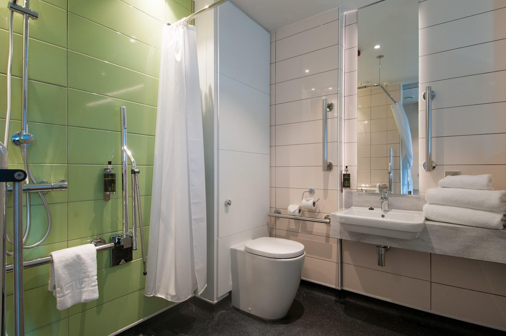

*The ensuite bathroom of a hub by Premier Inn Westminster Abbey room.*

hub London Paddington, 40 Eastbourne Terrace W2, sells a **Bigger room – Interior** at 14 sq m and no ordinary Bigger room at all, so the king-size bed there comes only without a window.

### Point A Hotels — the only chain that sells it as a feature

*Windowless rooms at Kensington, Liverpool Street and Paddington · Free breakfast booking direct*

Point A's property pages say **"windowless" in plain English in the main description**, as a benefit rather than a discount.

At **Point A Kensington**, just off Cromwell Road near Earl's Court, the choice is spelled out three ways: a bright room with a window, a room with a skylight for extra natural light, or a windowless option for total quiet. The skylight grade is the only middle option any operator in this guide offers.

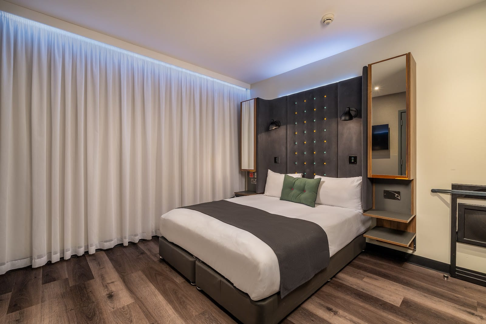

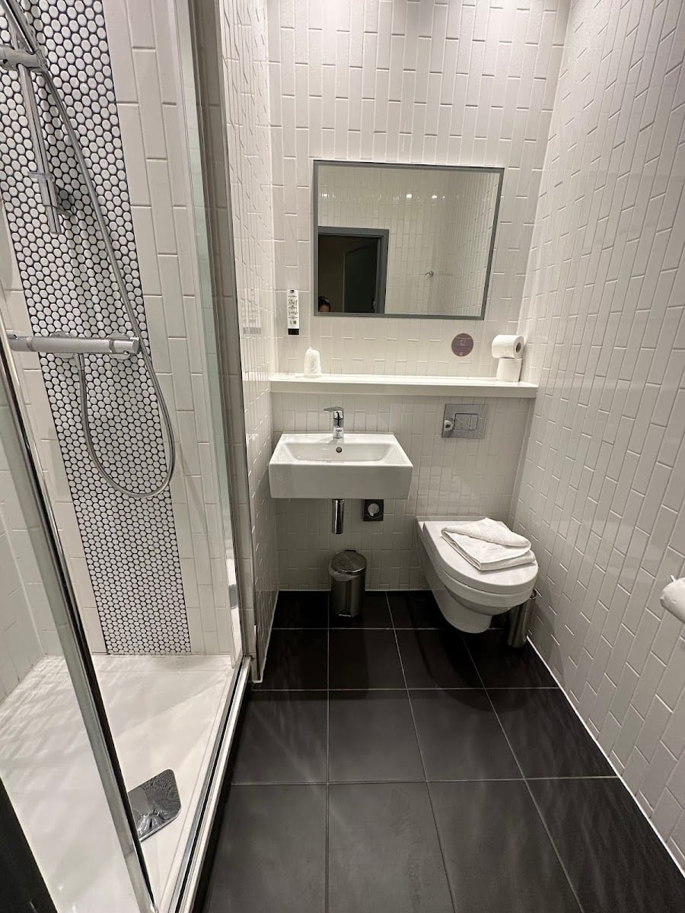

*A room at Point A Kensington, and its ensuite bathroom.*

**Point A Liverpool Street** offers quiet windowless rooms, city-view rooms or minimalist ones. **Point A Paddington** lists windowless rooms among its range, again framed as peace and quiet.

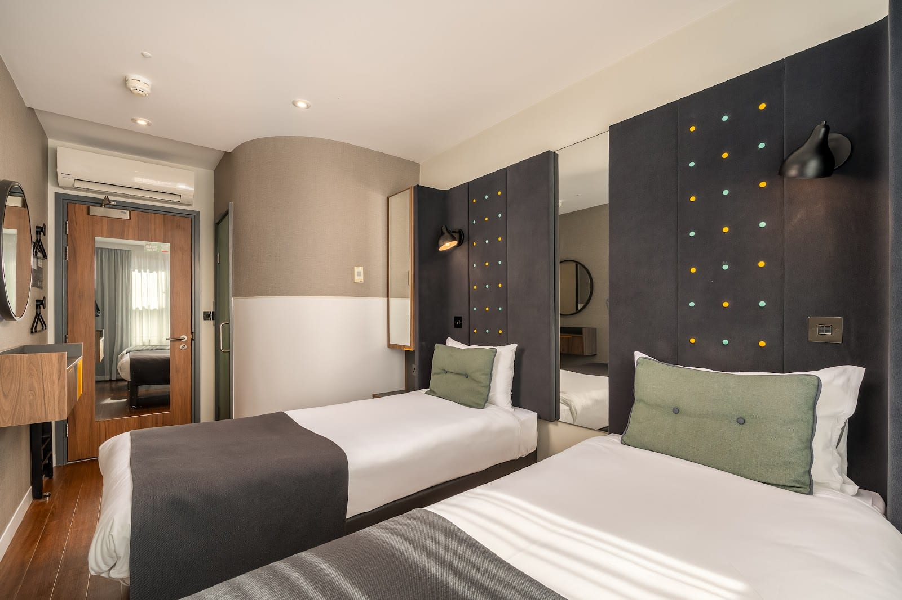

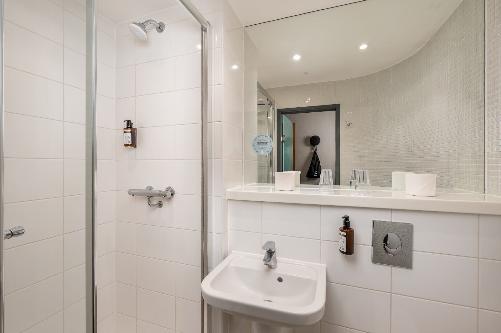

*A twin room at Point A Paddington, and its ensuite bathroom.*

Rooms are compact and airline-inspired, with mood lighting, air conditioning, a safe, an ironing room and unlimited Wi-Fi, and **breakfast is free if you book direct**. **Point A King's Cross** sells them too: on Hotels.com a Cosy Double Windowless was £9 to £10 under the same room with a window on each of five nights priced between October 2026 and April 2027.

### easyHotel — rooms from 6 sq m

*easyHotel South Kensington and Victoria · Rooms from 6 sq m · Cleaning every sixth night*

These are the smallest rooms in this guide. A small double at **easyHotel Victoria** or **South Kensington** is **6 to 7 sq m**, under the 7 sq m of the smallest Zedwell, and comes with and without a window at both.

At **South Kensington the standard grade is windowless outright**: the hotel sells only doubles, the small ones come both ways at 6–7 sq m, and the standard room at 8–9 sq m has no windows at all.

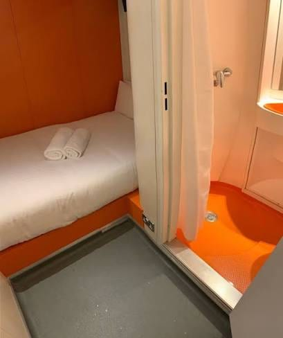

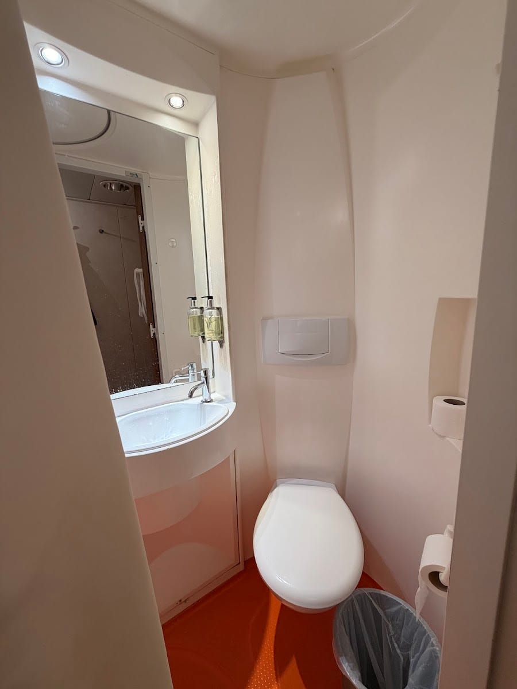

*A windowless room at easyHotel South Kensington, and its ensuite bathroom.*

At **Victoria** the standard room is 7.2–9 sq m and does come both ways, and every larger grade — the 14 sq m accessible room, the 12 sq m triple, the 18 sq m family room — has a window.

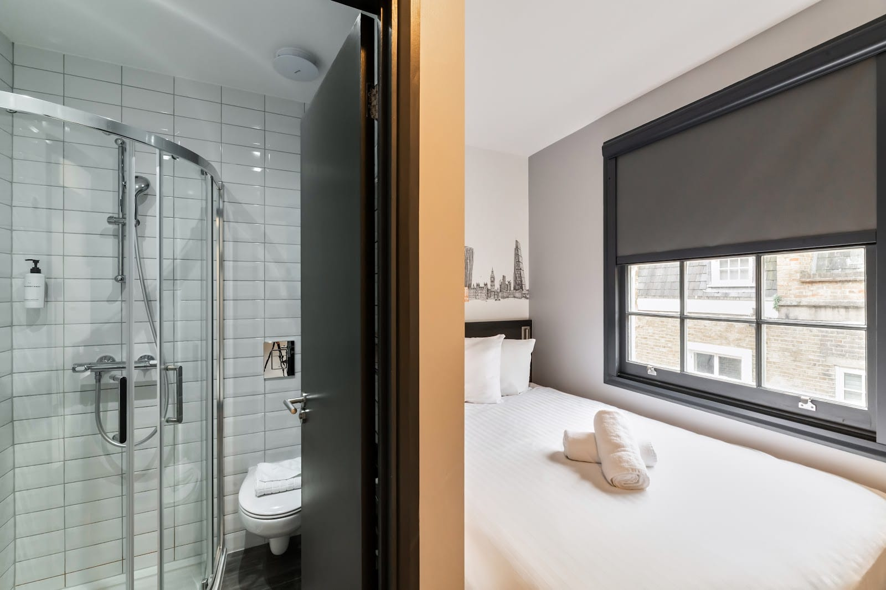

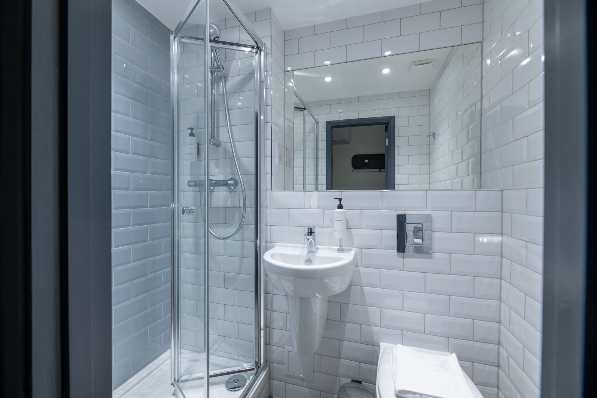

*A room at easyHotel Victoria, and its ensuite bathroom.*

The hotel page mentions windows only in a **FAQ answer** about room types. Extras: rooms are cleaned free only every sixth night, an extra clean is **£15**, luggage storage is £5 a piece, and early check-in or late check-out are £20 each.

### The Corner London City — clear about the room

*Snug Room (windowless) · 42 Adler Street, E1 1EE · Aldgate East 5 min · Cashless*

The former Qbic Hotel London City, and the only property in this guide that **puts the word in the room's name**: Snug Room (windowless), Comfy Room, Plush Room.

Every bedroom here is built around a moulded cube holding both the bed and the bathroom — a **super-king Naturalmat mattress**, a rain shower with a steam-free mirror, a 32-inch TV set into the wall, air conditioning, a laptop safe and sockets inside the cube itself. The Snug is that cube with blank walls around it.

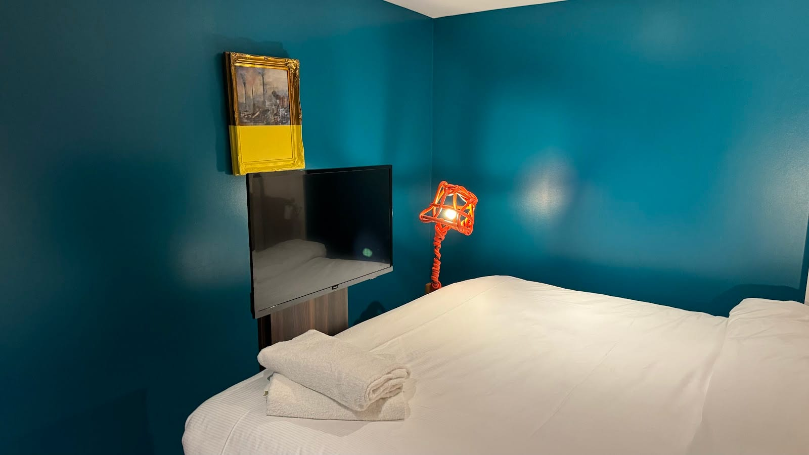

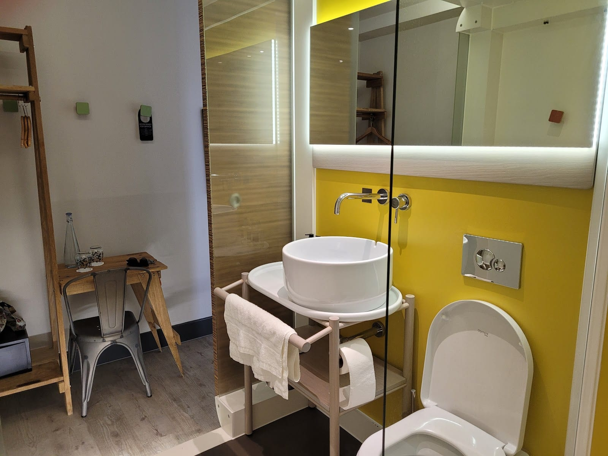

*A room at The Corner London City, and its ensuite bathroom.*

The Comfy Room is the window version and takes two adults plus an infant; the Plush adds a sofa bed for a third. It is **cashless**, check-in is 3pm and check-out 11am, and hanging the do-not-disturb tag to skip a clean earns a drink voucher.

Powered by <a target="_blank" rel="sponsored" href="https://www.getyourguide.com/london-l57/">GetYourGuide</a>

## How to tell before you pay

How each operator discloses it:

| Operator | What it calls the room | Where you find out |
| --- | --- | --- |
| **The Corner** | Snug Room **(windowless)** | In the room's name |
| **Point A** | "windowless rooms" | Property description, plain English |
| **Zedwell** | Cocoon | The whole hotel; unavoidable |
| **Z Hotels** | **"Inside"**, "no curtains to draw" | Grade name plus a small tag |
| **hub by Premier Inn** | "ambient" on the brand page, **"Interior"** on the hotel page | Two different words, two different pages |
| **easyHotel** | "no window" option | A FAQ answer near the foot of the page |

Three rules. **Read the grade name, not the price**: Inside, Interior, Snug and ambient all mean the same thing. **Check the floor area against the next grade up**; when two rooms are the same size and different prices, the difference is usually the window. And **at Z Hotels, check the gap**: £5 at Tottenham Court Road, £35 at Shoreditch.

## Who should not book one

**Do not book a windowless room if** you want to spend daytime in your room, you are claustrophobic, or you are unsure how you react to sleeping without daylight. Guest reviews report that **the rooms run warm** and that there is **no daylight cue**, so you wake to an alarm or you do not wake. Reviewers split: some call it the best sleep they have had in the city, others find it oppressive. Book one night before you book four.

To test it cheaply, take **the £70 Inside Double at Z Tottenham Court Road**; the same room with a window is £75.

## Not the same thing as a capsule

Zedwell also runs two **capsule** properties and calls the sleeping unit there a "Capsule Cocoon", so *cocoon* appears on both products. A capsule is a berth in a shared dormitory with shared bathrooms, at roughly a third of the price of a room. **Look for "Capsule" in the property name.**

Every room in this guide has its own lockable door and en-suite shower. Our [London capsule hotels guide](/articles/pod-hotels-london/) covers the five capsule properties.

For a longer stay at a lower price, compare an [aparthotel](/articles/aparthotels-london/): a kitchen changes the arithmetic more than a missing window. To keep the window, [the best budget hotels in London](/articles/best-budget-hotels-london/) lists hotels whose typical night came to £150 or less.

*Published from-rates are lead-in prices and move nightly, so check your own dates.*
